# 029：缓存计算 📦

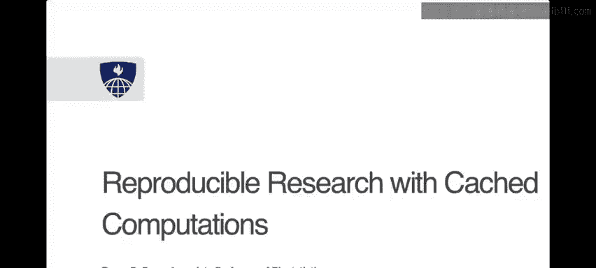

在本节课中，我们将学习“可重复研究”中的一个核心概念：缓存计算。我们将探讨如何通过“文学化统计编程”的理念，将分析代码、数据和文档整合在一起，并利用缓存技术来提高分析的可重复性和分享效率。

---

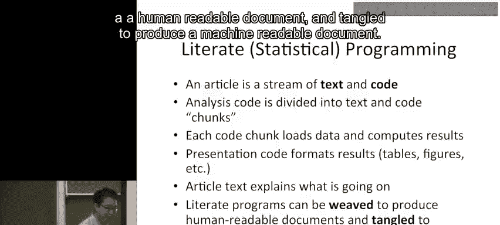

## 文学化统计编程 📝

上一节我们介绍了可重复研究的基础。本节中，我们来看看如何将研究与文档更紧密地结合。

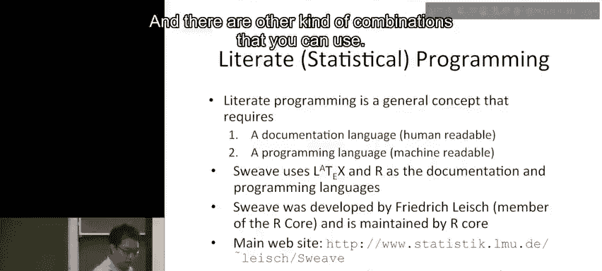

文学化统计编程的理念源于文学化编程。其核心思想是将一篇文章视为文本和代码的混合流。分析代码负责处理数据，这些代码以“代码块”的形式存在。此外，还有用于格式化结果的呈现代码。文本则穿插其中，用于解释正在进行的操作。

这些文学化统计程序可以被“编织”以生成人类可读的文档，或被“缠结”以生成机器可读的文档。这个概念最初由Donald Knuth提出。

文学化编程概念需要两个要素：一个文档语言和一个编程语言。

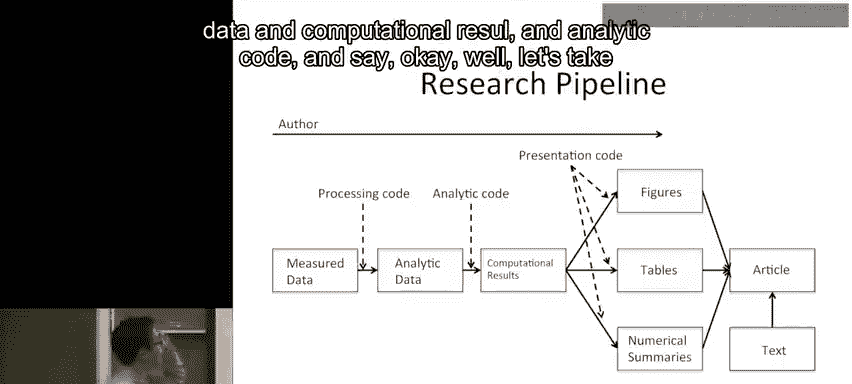

在R统计分析环境中，有一个名为**Sweave**的特定包。它使用LaTeX作为其文档语言，R作为其编程语言，由Friedrich Leisch开发。当然，也存在其他可用的组合。

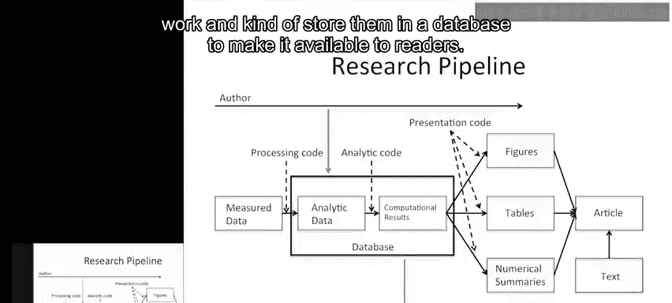

---

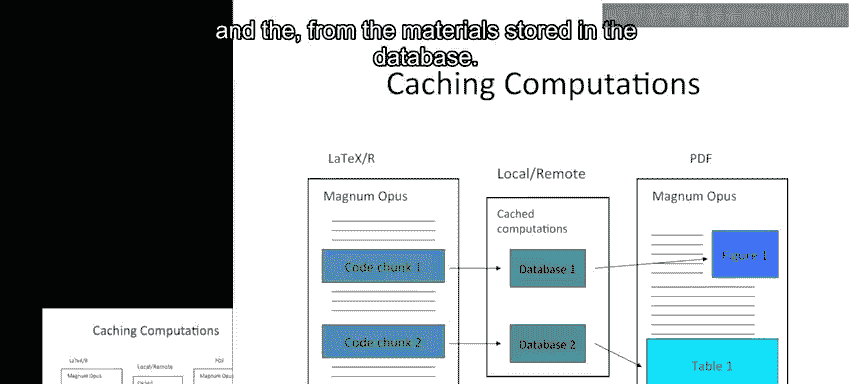

## 构建可分享的研究数据库 🗃️

上一节我们了解了文学化编程。本节中，我们来看看如何将研究的各个部分存储并分享。

我们的目标是将分析数据、计算代码和分析代码整合起来。具体过程是：文章本身（例如发表在期刊上）是可获取的，我们也让生成文章的分析过程变得可获取。

其理念是将这些内容存储在某种数据库中，使其对读者可用。读者希望从文章入手，深入探究；而作者则是从数据出发，最终生成文章。

以下是实现这一理念的步骤：

1.  在文学化统计程序框架中，你的论文包含文本和代码。
2.  代码块对数据进行操作。
3.  代码块的结果被存储在某个数据库中。
4.  你最终发布论文时，也一同发布这个数据库部分。
5.  论文中的图表和表格，就是从数据库中存储的材料生成的。

---

## 缓存包：原理与作者视角 🔧

上一节我们讨论了分享研究数据库的构想。本节中，我们来看看实现这一构想的具体工具。

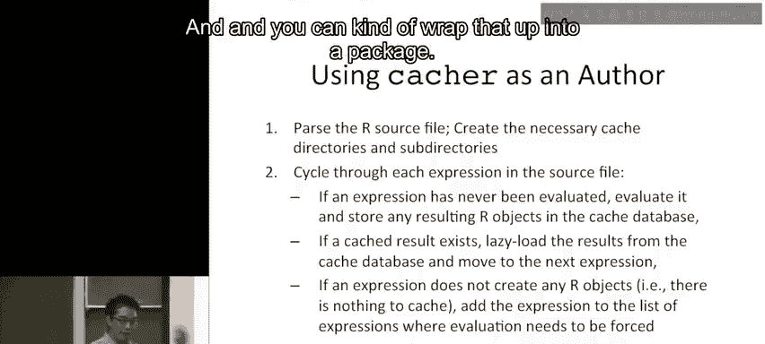

我们开发了两个包：一个是与S语言交互的**CacheS**（本次不讨论），另一个是独立的**CacheR**包。

其基本假设是，你有一个包含代码的R文件。该包会读取你的代码，评估它，并将结果存储在一个键值数据库中。每个代码表达式都会被赋予一个SHA1哈希值，以便跟踪任何更改并在必要时重新评估。

其理念是，你可以将代码和数据打包成一个“缓存包”分发给他人。其他人可以克隆这个分析，查看代码子集或检查特定的数据对象。这里的一个重要假设是，其他人可能没有与你相同的计算资源，他们可能不想运行整个耗时的马尔可夫链蒙特卡洛模拟，而只想查看特定的最终结果。这种方式允许他们像剥洋葱一样层层深入，而不是直接触及核心。

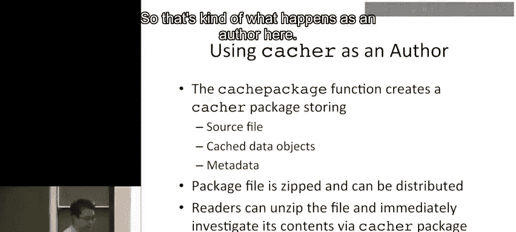

基本模型是：你有一个源代码文件，代码和数据作为输入，产生结果。

作为作者，缓存包的工作流程如下：

1.  它解析源文件。
2.  它创建用于存储内容的目录和子目录。
3.  它评估每个表达式。如果一个表达式没有改变，再次运行时它不会重新执行，而是直接从数据库加载结果。
4.  它为每个表达式写出一堆元数据。
5.  一旦你评估了整个分析（这可能耗时很长），所有中间结果都存储在数据库中。
6.  你可以将其打包成一个可分发的包（本质上是一个zip文件）。

以下是一个简单分析的例子：

```r
library(datasets)
data(airquality)
fit <- lm(Ozone ~ Wind + Temp + Solar.R, data = airquality)
summary(fit)
plot(fit)
```

任何创建了变量的表达式，其结果都会被存储在数据库中。如果一个表达式只是向控制台打印内容，则不会存储。图形本身不会被存储，但生成图形的代码和结果会被记录。

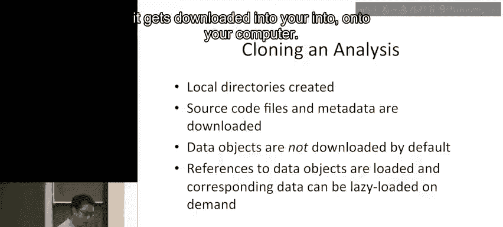

生成的包会有一个标识符（如SHA1哈希值）。在文章中，你可以说明文章中的所有内容都可以在这个包中找到，并给出标识字符串。通常，使用前四个字符就足以唯一标识该包。

---

## 读者视角：探索与验证缓存分析 🔍

上一节我们从作者角度了解了如何创建缓存包。本节中，我们切换到读者视角，看看如何使用和验证这些包。

作为读者，如果你在期刊上看到这样的文章，你可以获取那个标识字符串（例如前四个字符），然后克隆整个分析包。克隆后，本地会创建一些目录，源代码文件和元数据会被下载。

但数据本身默认不会立即下载，因为它们可能很大。不过，对已创建的各种数据对象的引用会被加载。这些引用是“惰性加载”到环境中的，只有当你想要查看某个对象时，它才会被下载到你的计算机上。

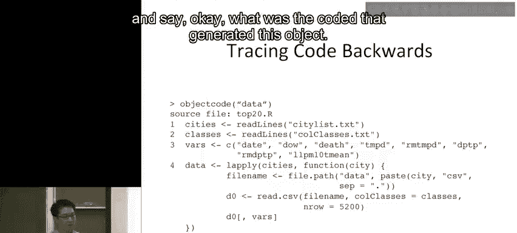

你可以查看代码，甚至可以生成代码的图形化概览。这个图形会展示分析中所有数据对象是如何组合在一起的。例如，变量A、B和C共同创建了数据集D，然后数据集D与某个函数结合生成了估计值，等等。

如果你对某个特定数据对象感兴趣，你可以使用`objectCode`函数。它会显示生成该对象所涉及的具体代码行（可能只是整个文件中的一部分）。

你还可以使用`runCode`函数执行代码。默认情况下，它不会从头执行所有计算，而是从数据库加载对象以使过程更快。当然，你也可以强制它从头运行所有计算。

重要的是，`checkCode`函数会从头评估所有表达式，不加载数据库中的任何内容。然后，它会将评估结果与存储的结果进行比对检查（通过检查对象的“签名”是否匹配）。为了实现这一点，你需要设置随机数生成器的种子等参数。

此外，还有一个辅助函数可以检查每个单独的数据对象，查看是否有损坏（基本上就是检查签名）。

使用`loadCache`函数，你可以加载指向特定数据对象的指针（这些对象可能存储在服务器上）。每当你访问该对象（例如打印到屏幕或绘图）时，它才会从存储位置传输过来。一旦加载到你的系统中，后续访问就无需再次传输。

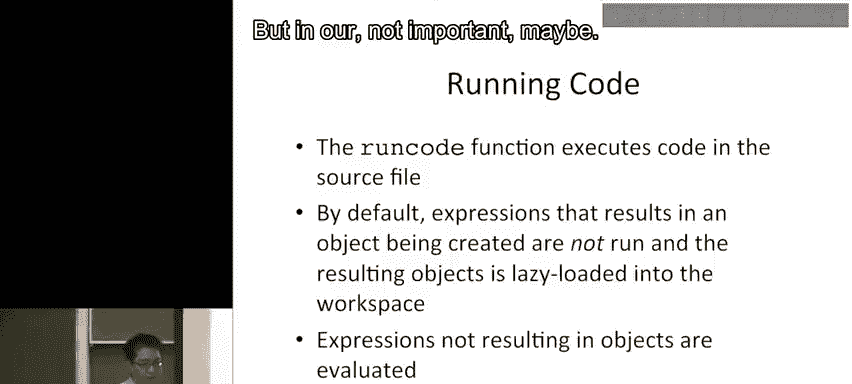

---

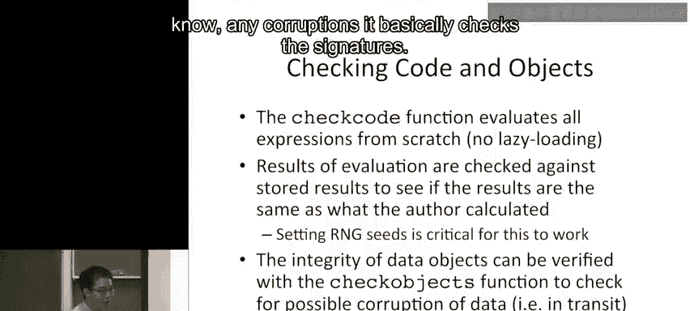

## 总结与目标 🎯

本节课中，我们一起学习了缓存计算在可重复研究中的应用。

我们首先介绍了**文学化统计编程**的理念，它将代码、数据和解释性文本融为一体。接着，我们探讨了如何构建一个可分享的**研究数据库**，将分析过程与最终论文一同发布。

然后，我们深入了解了**CacheR包**的工作原理。从作者视角，它通过缓存中间结果、跟踪代码更改，将整个分析打包成一个可分发的单元。从读者视角，它允许用户克隆分析、按需探索特定对象或代码，而无需耗费大量资源重新运行整个复杂分析。

最后，我们看到了读者如何使用工具来**探索和验证**缓存的分析，例如查看代码依赖图、检查生成特定对象的代码，以及验证结果的完整性。

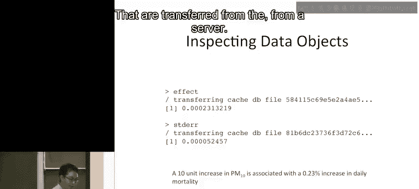

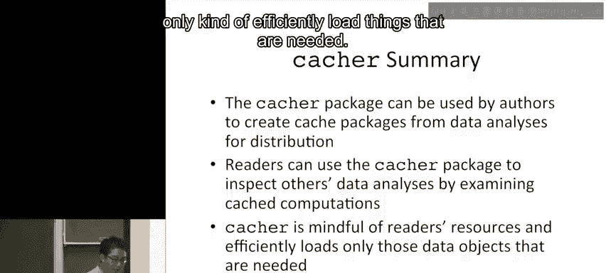

这个包的基本目标是：** mindful of readers' resources**（体谅读者的资源），并高效地仅加载所需内容，从而在保持分析完整性和深度的同时，降低分享和复现的门槛。