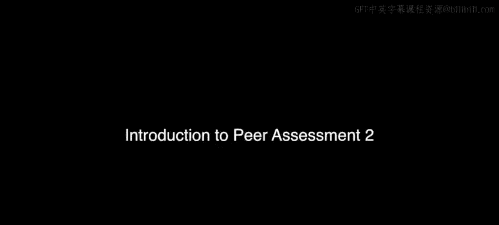

# 033：同行评估2介绍 📊

在本节课中，我们将介绍本周的同行评估任务。本次任务要求你基于美国国家海洋和大气管理局的风暴事件数据库进行一次数据分析。

为了让你更清晰地理解我的思路和期望，我已经撰写了一份示例数据分析报告。你可以在本讲座旁找到该报告的链接，或者访问与本讲座相关的课程网站链接。

上一节我们介绍了评估的基本要求，本节中我们来看看如何获取和分析数据。

以下是获取示例分析报告的步骤：
*   你可以在本视频讲座的旁边找到示例报告的链接。
*   你也可以访问课程网站上与本讲座相关联的链接。

---

本节课中我们一起学习了本周同行评估的任务目标，即使用NOAA风暴数据库进行数据分析，并了解了获取示例分析报告的途径。祝你本周评估顺利，我期待看到大家的成果。