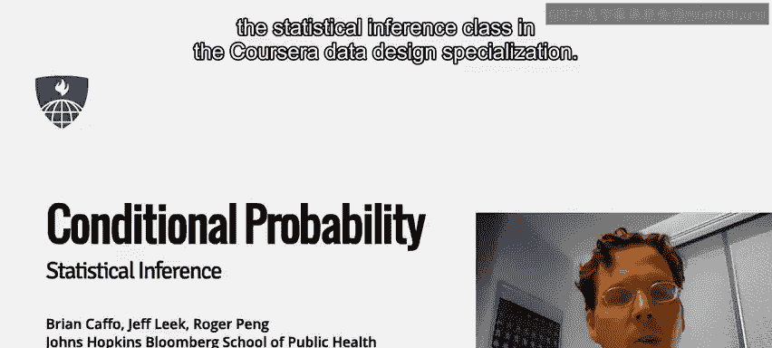
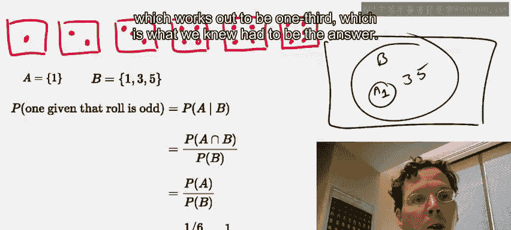

# 005：条件概率 🎲

在本节课中，我们将要学习**条件概率**的概念。条件概率是统计学中一个核心且实用的工具，它描述了在已知某些信息（事件发生）的情况下，另一事件发生的概率。理解条件概率对于进行更精确的统计推断至关重要。

---

## 一个生动的例子：漫画中的条件概率

上一节我们介绍了条件概率的基本概念，本节中我们来看看一个生动的例子。

有一幅XKCD漫画很好地阐释了“条件”的作用。漫画中，两个人站在雷雨天的树下。一人说：“我们应该进屋。”另一人回答：“被闪电击中的概率只有大约七百万分之一，我们很安全。”漫画的标题是：“**知道这个统计数据的人的死亡率是六分之一。**”

这幅漫画强调，这个人**没有根据他所处的具体情境来调整概率**。如果我们将条件设定为“在雷雨天站在树下的人”，那么被闪电击中的概率将远高于七百万分之一。

---

## 从骰子游戏理解条件概率

让我们通过一个更简单的概念性例子来深入理解。

假设掷一个标准骰子，得到点数为1的概率是 **1/6**。

现在，如果有人提供了额外信息：“掷出的点数是奇数（即1、3或5）。”那么，在这个新信息条件下，你还会认为得到1的概率是1/6吗？不会。现在，样本空间从{1,2,3,4,5,6}缩小到了{1,3,5}。因此，得到1的概率变成了 **1/3**。

这就是条件概率：**在已知事件B发生的情况下，事件A发生的概率**。

---

## 条件概率的定义与公式

以下是条件概率的正式定义。

设事件B的概率大于零（`P(B) > 0`），这是有意义的，因为我们不能对一个不可能发生的事件进行条件化。

事件A在给定B发生下的**条件概率**，记作 `P(A|B)`，其计算公式为：

`P(A|B) = P(A ∩ B) / P(B)`

其中：
*   `P(A ∩ B)` 是事件A和事件B**同时发生**的概率。
*   `P(B)` 是事件B发生的概率。

**关于独立性的说明**：如果事件A和B是统计独立的（即一个事件的发生不影响另一个），那么 `P(A|B)` 就等于 `P(A)`。此时，已知B发生并未提供关于A的任何新信息。

---

## 应用公式：验证骰子例子

让我们用公式来验证之前骰子的例子。

*   定义事件 **B** = {点数为奇数} = {1, 3, 5}
*   定义事件 **A** = {点数为1}

我们想求 `P(A|B)`，即已知点数为奇数时，点数为1的概率。

根据公式：
`P(A|B) = P(A ∩ B) / P(B)`

1.  **计算 `P(A ∩ B)`**：A（点数为1）完全包含在B（点数为奇数）中，所以 `A ∩ B = A`。因此，`P(A ∩ B) = P(A) = 1/6`。
2.  **计算 `P(B)`**：B包含三个等可能的结果，所以 `P(B) = 3/6 = 1/2`。

代入公式：
`P(A|B) = (1/6) / (1/2) = (1/6) * (2/1) = 1/3`

计算结果与我们之前的直观判断完全一致。

---

## 总结

本节课中我们一起学习了**条件概率**。

*   我们通过漫画和骰子的例子，理解了“条件”如何改变我们对概率的判断。
*   我们掌握了条件概率的核心公式：`P(A|B) = P(A ∩ B) / P(B)`。
*   我们了解到，当事件相互独立时，条件概率等于其本身的概率。

理解条件概率是学习贝叶斯统计、回归分析等更高级主题的基石。在下一讲中，我们将探讨如何利用条件概率进行更复杂的推断。