# 007：独立性 🔗

在本节课中，我们将要学习概率论中的一个核心概念——独立性。我们将探讨独立性的定义、计算方法，并通过实例理解为什么不能随意地将概率相乘。最后，我们将了解独立同分布随机变量的概念及其在数据分析中的重要性。

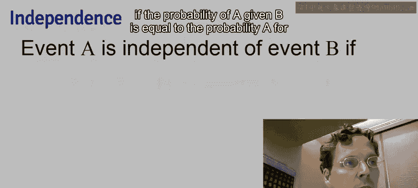

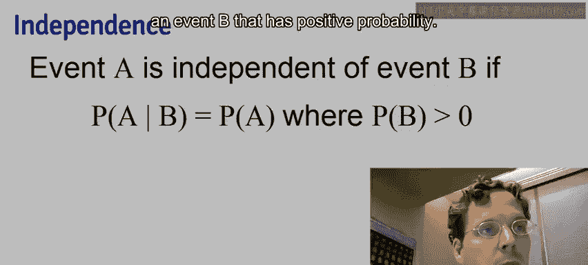

## 独立性的定义 📖

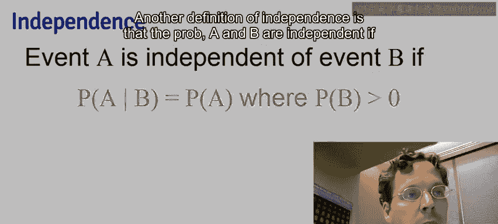

上一节我们介绍了条件概率，本节中我们来看看独立性。如果事件B的概率为正，且事件A在给定B发生条件下的概率等于事件A自身的概率，则称事件A独立于事件B。其核心公式为：

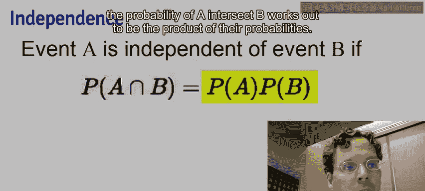

**P(A | B) = P(A)**

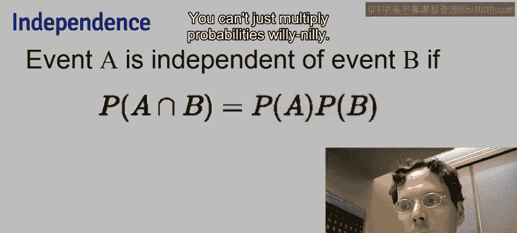

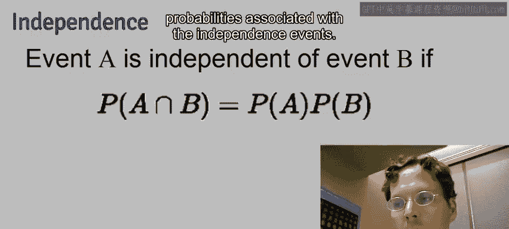

另一种等价的定义是：如果事件A与事件B的交集概率等于它们各自概率的乘积，则称A与B独立。其核心公式为：

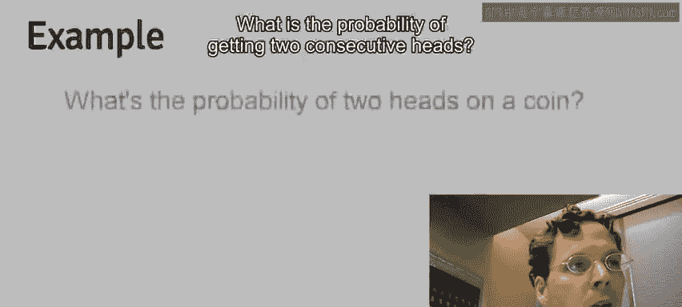

**P(A ∩ B) = P(A) × P(B)**

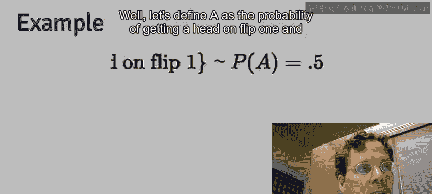

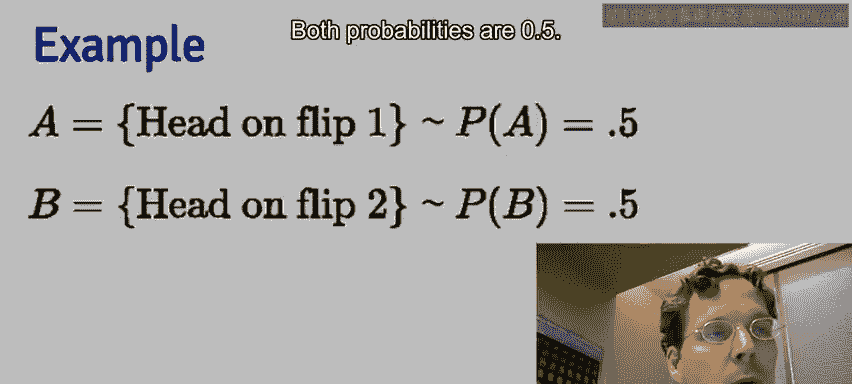

这引出了一个非常重要的原则：不能随意地将概率相乘，只能对相互独立的事件进行概率乘法运算。

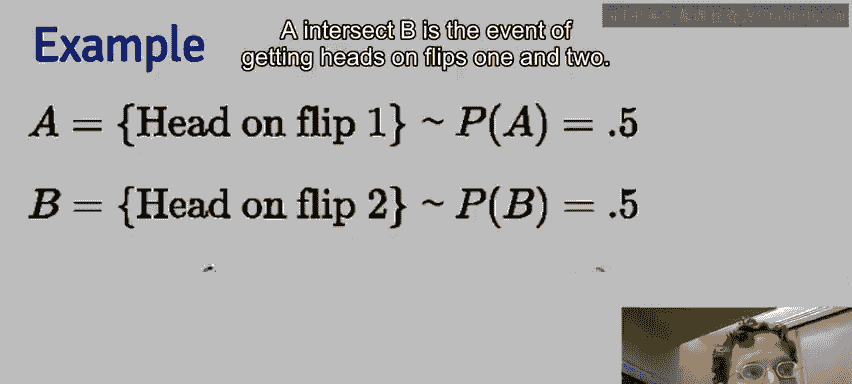

## 一个数值示例 🪙

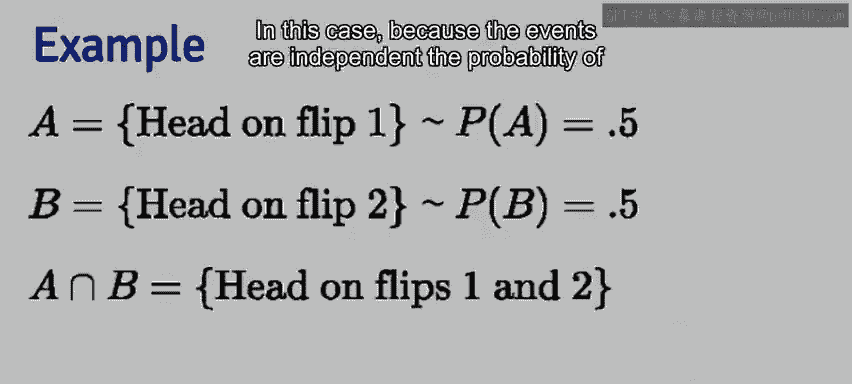

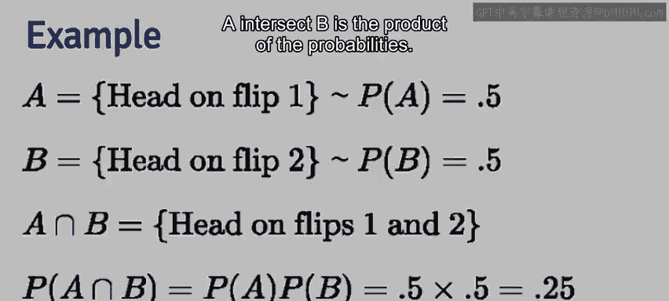

以下是理解独立性计算的一个简单例子：计算连续两次抛掷公平硬币都得到正面的概率。

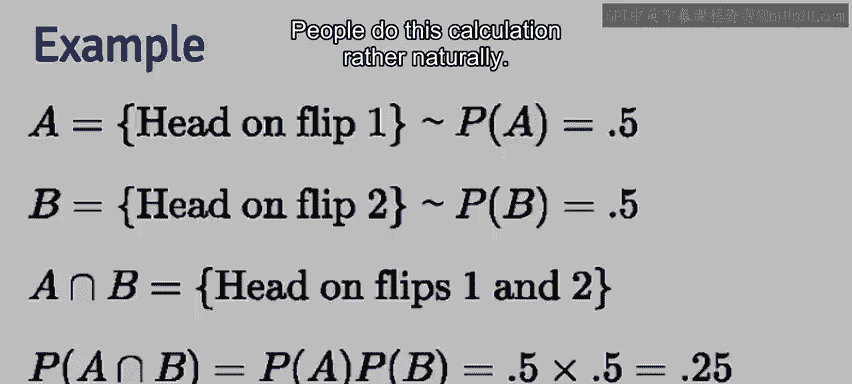

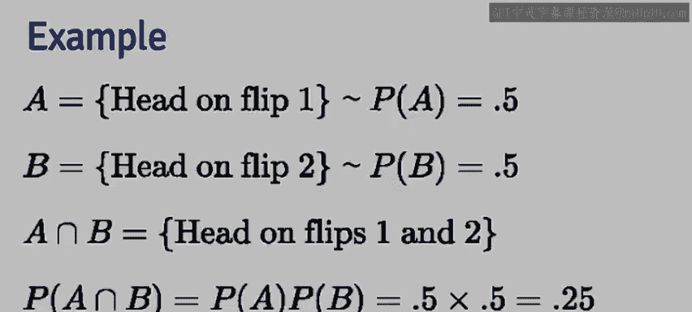

定义事件A为“第一次抛掷得到正面”，事件B为“第二次抛掷得到正面”。对于公平硬币，有：
**P(A) = 0.5**
**P(B) = 0.5**

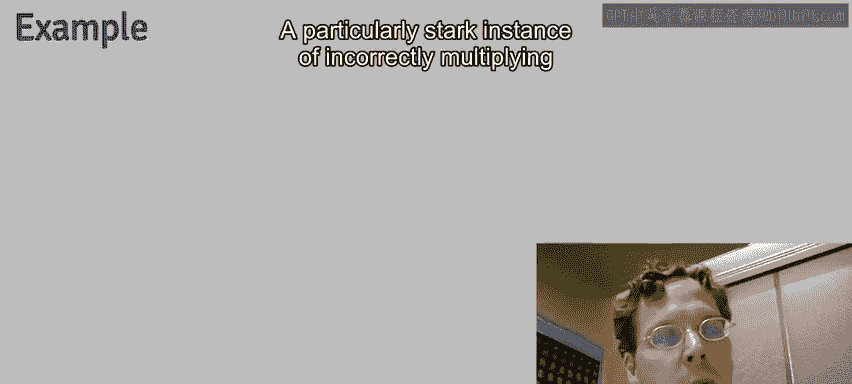

事件A与B的交集（A ∩ B）表示“第一次和第二次抛掷都得到正面”。由于两次抛掷是独立的，我们可以使用乘法公式：

**P(A ∩ B) = P(A) × P(B) = 0.5 × 0.5 = 0.25**

人们通常会自然地完成这个计算。

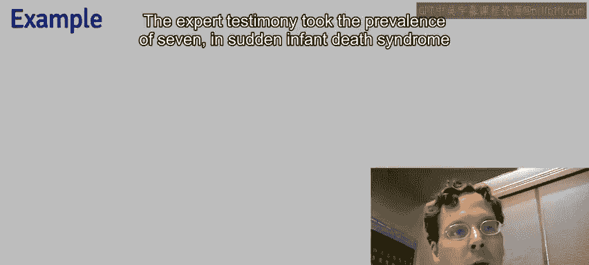

## 错误应用独立性的案例 ⚖️

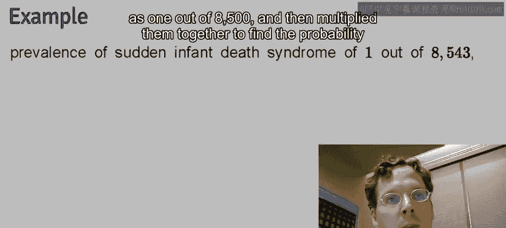

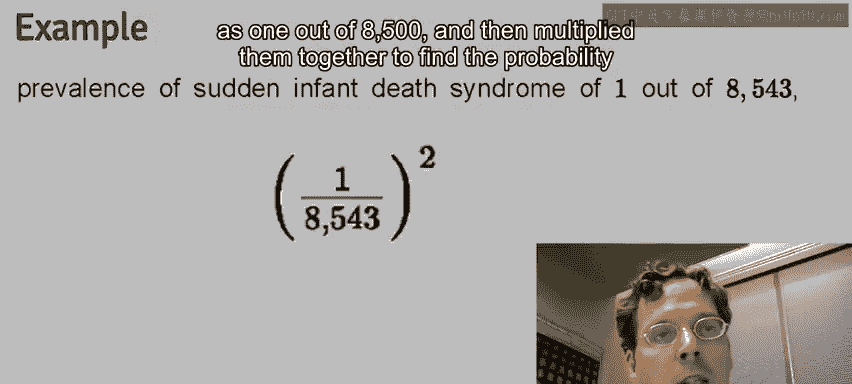

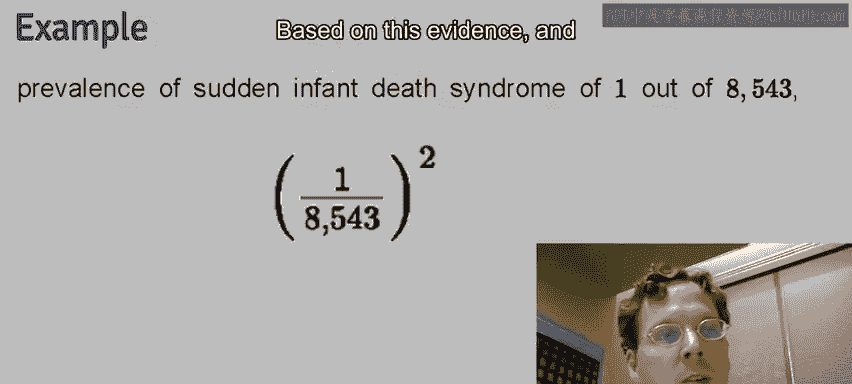

问题在于，人们有时会在不应该的情况下错误地相乘概率。

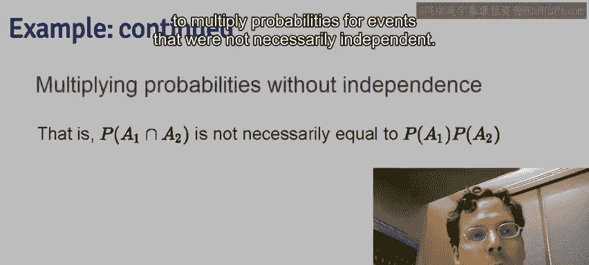

一个特别突出的错误案例发生在《科学》杂志第309卷的报道中。该报道涉及一位在刑事审判中提供专家证词的医生。该审判涉及一位母亲，她的两个孩子均死于婴儿猝死综合征。

专家证词将婴儿猝死综合征的患病率取为1/8500，然后将这两个概率相乘，得出同一母亲的两个孩子都患此病的概率。基于此证据（以及其他证据），受审的母亲被判定犯有谋杀罪。

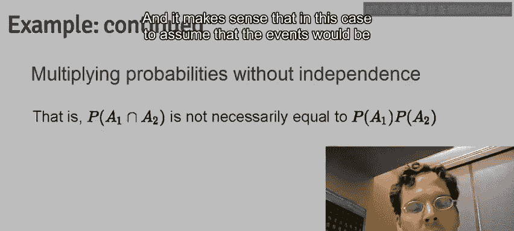

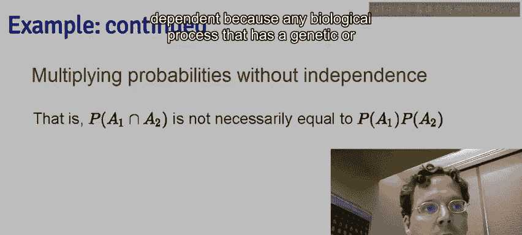

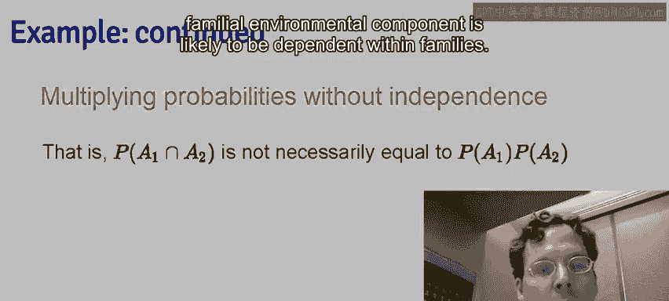

与本课程相关的是，其主要错误在于对不一定独立的事件概率进行了相乘。在这种情况下，假设事件是依赖的是合理的，因为任何具有遗传或家族环境因素的生物过程，在家庭内部很可能是相互依赖的。

## 独立同分布随机变量 📊

在本课程中，我们使用独立性的主要方式是假设一组随机变量是独立且来自相同分布的。我们称这样的随机变量为**独立同分布**。

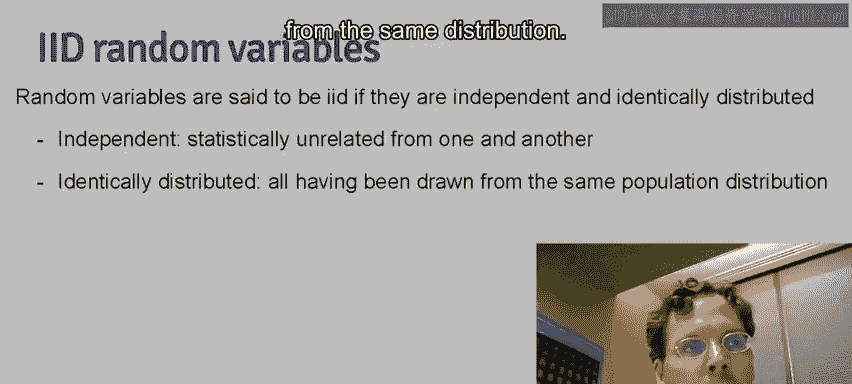

例如，多次抛掷硬币可以看作是独立同分布的，因为一次抛掷的结果与下一次是独立的，并且它们都来自相同的分布：正面概率为0.5，反面概率为0.5。

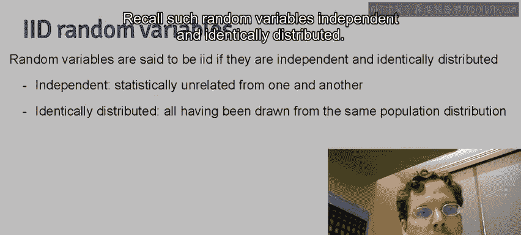

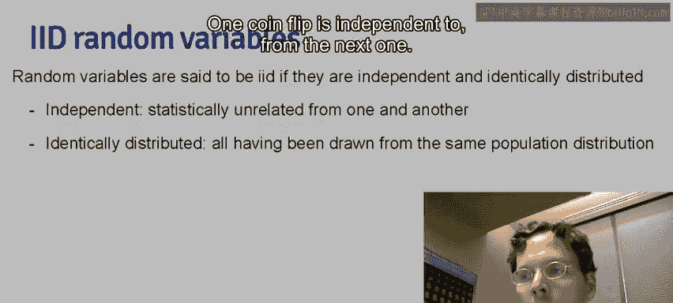

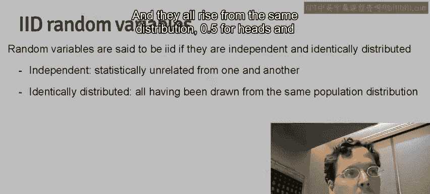

独立同分布抽样是我们对随机样本的默认模型。无论我们是否拥有真正的随机样本，我们经常使用随机抽样或独立同分布模型作为分析数据的概念模型。这将是本课程的主要分析模式。

## 总结 ✨

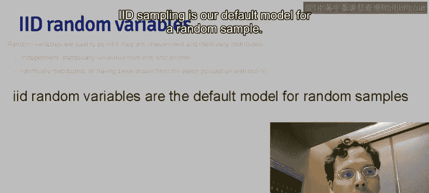

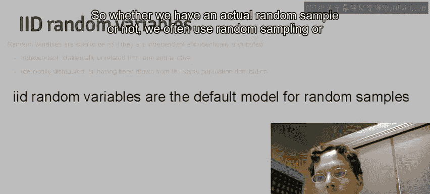

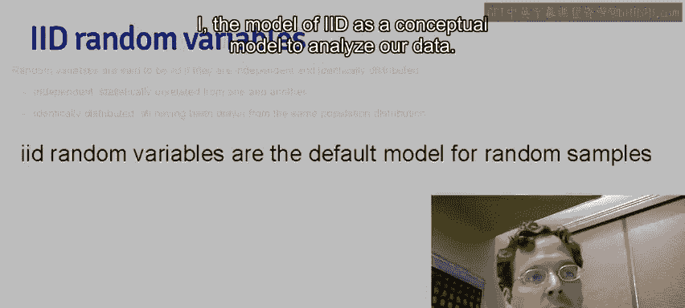

本节课中我们一起学习了概率论中的独立性概念。我们掌握了独立性的两种等价定义，并通过抛硬币的例子练习了如何计算独立事件的联合概率。我们还通过一个真实的法律案例，深刻理解了错误假设独立性、随意相乘概率可能导致的严重后果。最后，我们引入了**独立同分布**这一在统计推断中至关重要的基础模型，它将成为我们后续分析数据的核心框架。记住，只有在事件相互独立时，才能使用概率乘法法则。