# 009：期望值简单示例

在本节课中，我们将通过几个简单的例子来学习如何计算随机变量的**期望值**。期望值是描述随机变量长期平均结果的核心概念，我们将使用抛硬币和掷骰子这两个经典场景来直观地理解它。

上一节我们介绍了期望值的概念，本节中我们来看看如何具体计算它。

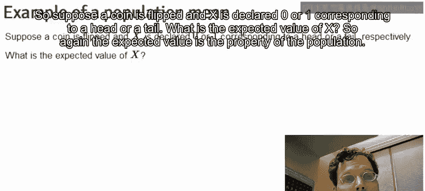

## 计算抛硬币的期望值

假设我们抛掷一枚硬币，并定义一个随机变量 **X**：当结果为正面时，X = 1；当结果为反面时，X = 0。

那么 **X** 的期望值是多少？期望值是总体的一个属性。

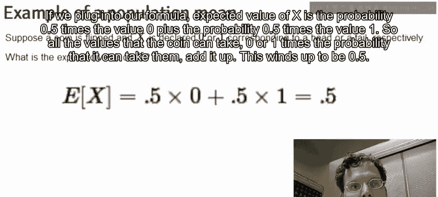

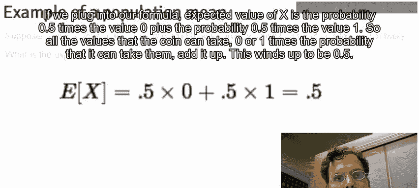

根据期望值的计算公式，我们将随机变量每个可能的值乘以其发生的概率，然后将所有结果相加。

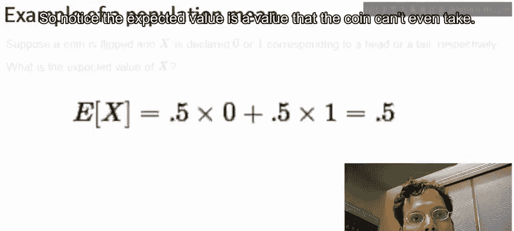

以下是计算过程：
*   **E[X] = P(X=0) × 0 + P(X=1) × 1**
*   **E[X] = 0.5 × 0 + 0.5 × 1**
*   **E[X] = 0.5**

计算结果是 0.5。需要注意的是，期望值 0.5 是硬币实际结果（0 或 1）无法取到的一个数值。

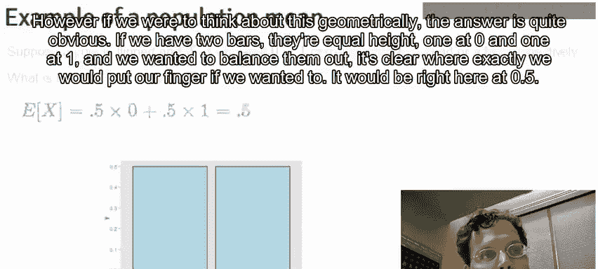

然而，如果我们从几何角度思考，这个答案就非常明显了。想象我们有两根高度相等的柱子，一根在位置 0，一根在位置 1。

如果我们想找到一个支点来平衡这两根柱子，很明显支点应该放在正中间，也就是 0.5 的位置。

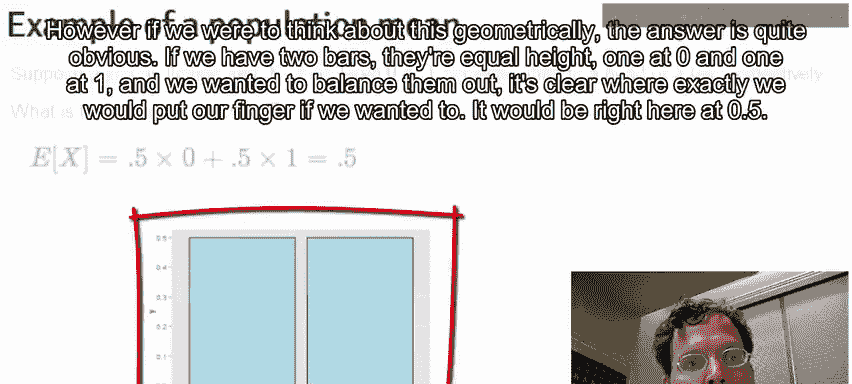

## 计算有偏硬币的期望值

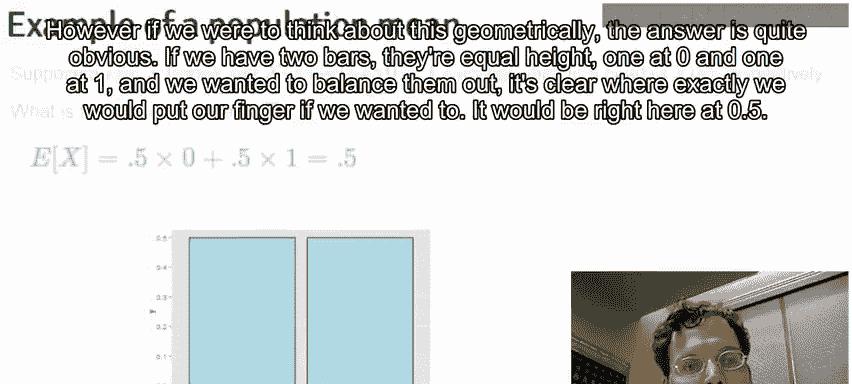

现在，假设一枚硬币是有偏的。随机变量 **X** 取值 1（正面）的概率是 **p**，取值 0（反面）的概率是 **1-p**。

其期望值可以直接代入公式计算：

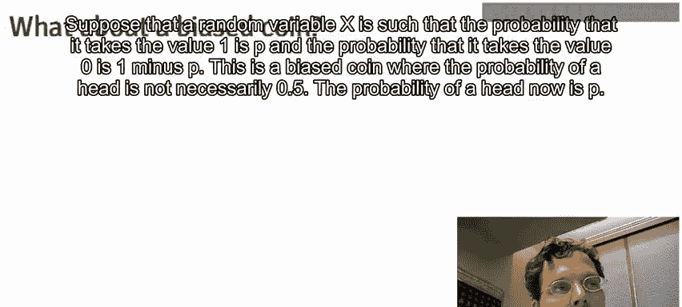

以下是计算过程：
*   **E[X] = P(X=0) × 0 + P(X=1) × 1**
*   **E[X] = (1-p) × 0 + p × 1**
*   **E[X] = p**

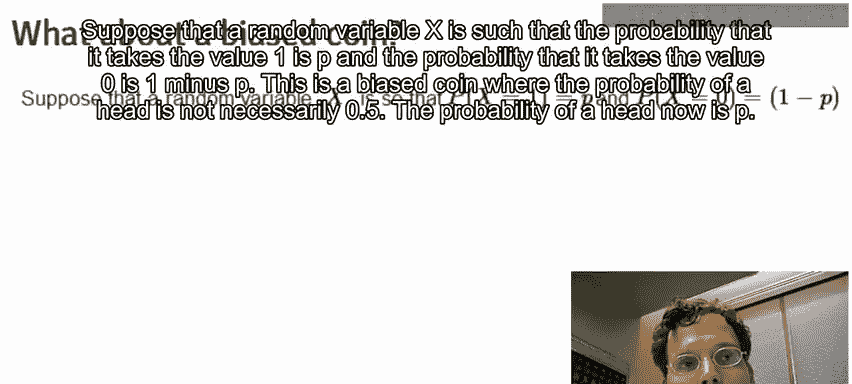

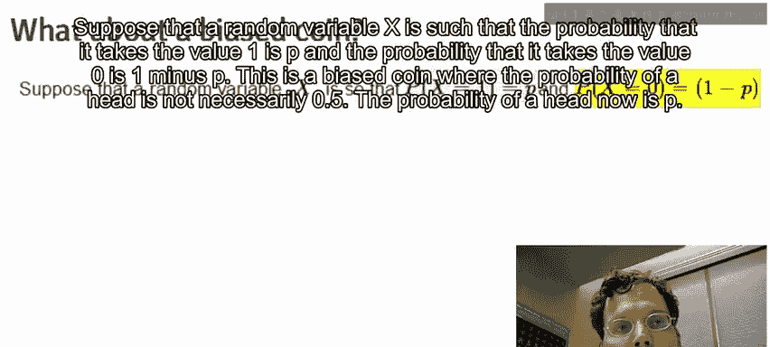

因此，一枚硬币（即使是有偏的）的期望值，恰好等于在无限次抛掷中你会得到的正面朝上的真实长期比例 **p**。

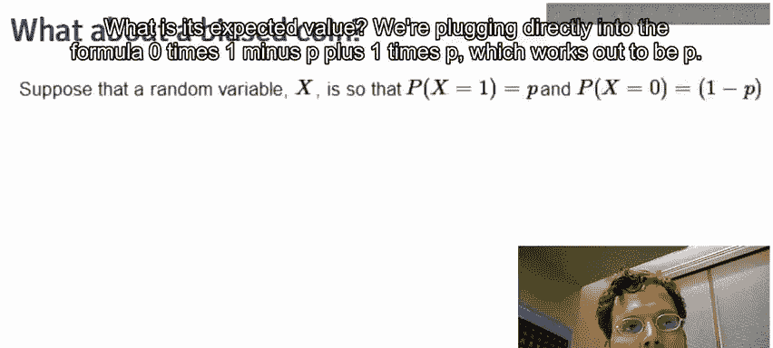

## 计算掷骰子的期望值

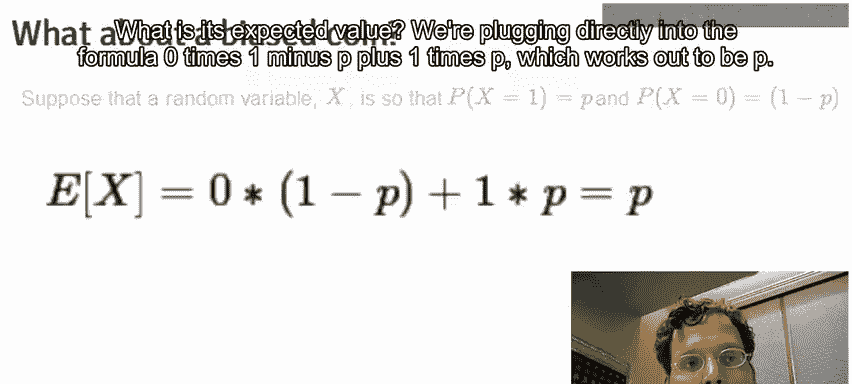

让我们看一个稍有不同的例子。假设掷一个标准的六面骰子，随机变量 **X** 表示朝上的点数。

**X** 的期望值是多少？

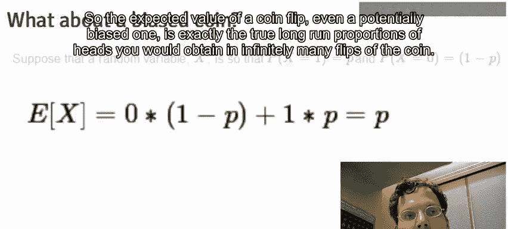

我们同样将每个可能的值乘以其概率（每个面朝上的概率都是 1/6），然后求和。

以下是计算过程：
*   **E[X] = (1 × 1/6) + (2 × 1/6) + (3 × 1/6) + (4 × 1/6) + (5 × 1/6) + (6 × 1/6)**
*   **E[X] = (1+2+3+4+5+6) / 6**
*   **E[X] = 21 / 6 = 3.5**

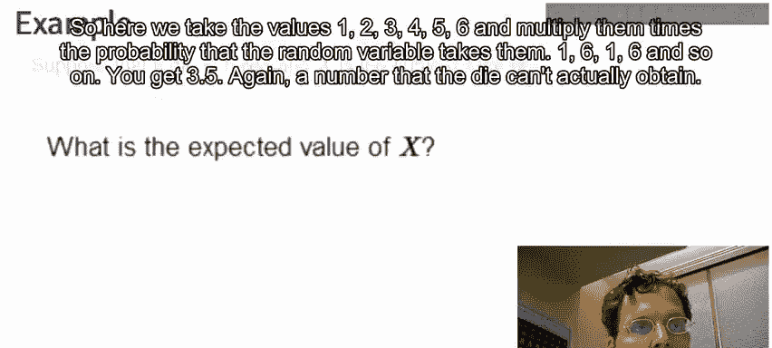

计算结果同样是骰子实际无法掷出的一个数值：3.5。

同样，几何观点让这变得显而易见。我们有六根高度均为 1/6 的柱子，分别位于 1 到 6 的位置。

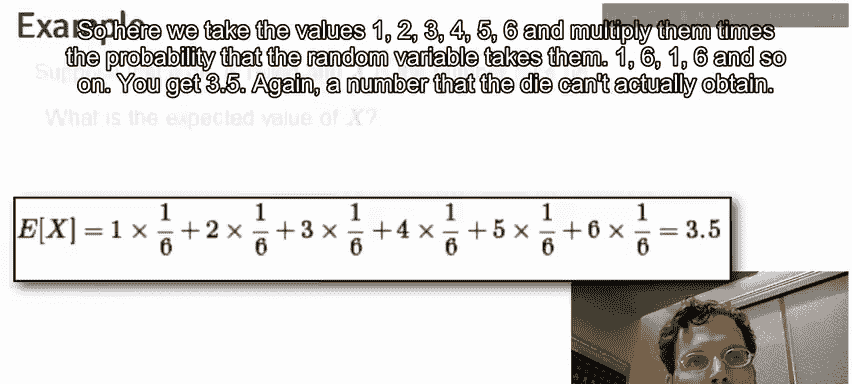

如果要平衡它们，支点显然应该放在 3.5 的位置。

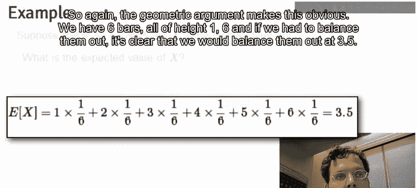

---

本节课中我们一起学习了如何计算离散随机变量的期望值。我们通过抛硬币（公平和有偏）以及掷骰子的例子，实践了期望值的计算公式 **E[X] = Σ [x * P(X=x)]**，并理解了期望值作为“概率加权平均值”或“长期平均结果”的直观意义。记住，期望值不一定等于随机变量可能取得的某个具体值。