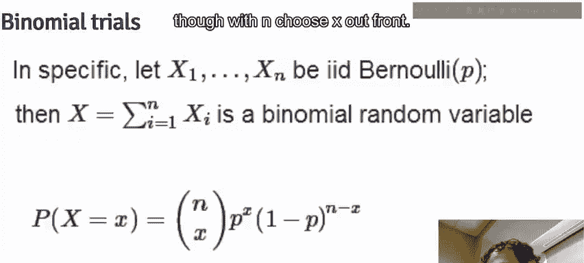
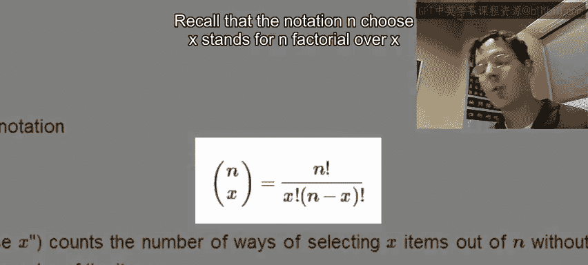
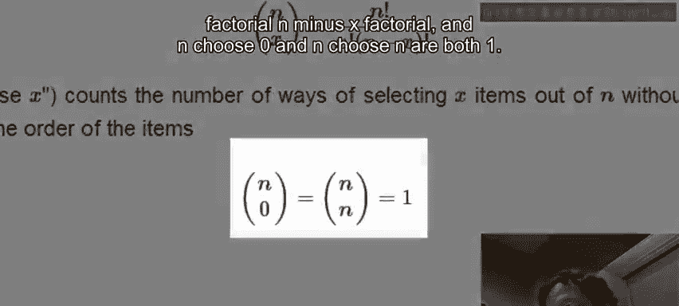
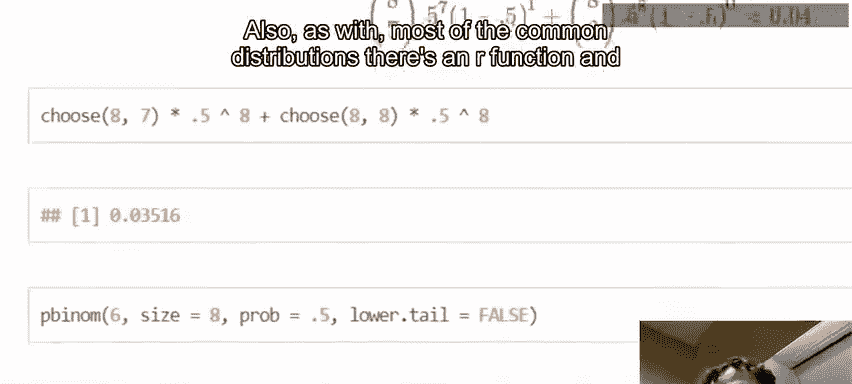

# 015：二项分布 📊

在本节课中，我们将学习统计学中两种基础且重要的概率分布：伯努利分布与二项分布。它们是理解许多统计推断概念的基石。

---

## 伯努利分布 🪙

伯努利分布以数学家雅各布·伯努利命名。它源于最简单的随机试验——抛硬币。

在伯努利试验中，一个随机事件只有两种可能的结果。我们通常将这两种结果编码为：`0`（代表“失败”，如硬币反面）和 `1`（代表“成功”，如硬币正面）。这个“成功”的定义是技术性的，并不一定代表实际意义上的好事。

假设硬币正面朝上的概率为 `p`，那么反面朝上的概率就是 `1 - p`。


伯努利分布的概率质量函数可以写成：
`P(X = x) = p^x * (1-p)^(1-x)`，其中 `x` 只能是 0 或 1。


一个伯努利随机变量的均值（期望值）是 `p`，方差是 `p * (1-p)`。

---

## 二项分布 🔢

上一节我们介绍了描述单次试验的伯努利分布。本节中，我们来看看如何描述一系列独立重复伯努利试验的总结果，这就是二项分布。

二项分布随机变量可以看作是一系列独立同分布的伯努利随机变量之和。具体来说，它表示在 `n` 次独立试验中，获得“成功”（编码为1）的总次数。

数学上，设 `X1, X2, ..., Xn` 是服从伯努利分布 `Bernoulli(p)` 的独立随机变量，那么它们的和 `X = X1 + X2 + ... + Xn` 就是一个服从二项分布 `Binomial(n, p)` 的随机变量。

二项分布的概率质量函数为：
`P(X = x) = C(n, x) * p^x * (1-p)^(n-x)`，其中 `x` 可以取 0 到 `n` 之间的任何整数。

这里的 `C(n, x)` 是组合数，计算公式为 `n! / (x! * (n-x)!)`。它解决了在不考虑顺序的情况下，从 `n` 个物品中选取 `x` 个的组合方式数量问题。

---

## 二项分布计算示例 🧮



为了更直观地理解，让我们看一个计算示例。

假设一位朋友有8个孩子，其中7个是女孩，并且没有双胞胎。如果每次生育的性别是独立的，且生女孩的概率为50%，那么得到7个或更多女孩（即7个或8个女孩）的概率是多少？



以下是计算步骤：



1.  计算恰好有7个女孩的概率：`P(X=7) = C(8,7) * (0.5)^7 * (0.5)^1`
2.  计算恰好有8个女孩的概率：`P(X=8) = C(8,8) * (0.5)^8 * (0.5)^0`
3.  将这两个概率相加，得到“7个或更多女孩”的概率。

计算结果约为 **4%**。

在R语言中，我们可以使用 `pbinom` 函数方便地进行此类计算。以下是计算代码：

```r
# 计算累积概率：P(X <= 6)，即最多6个女孩的概率
p_less_than_7 <- pbinom(6, size = 8, prob = 0.5)

# “7个或更多女孩”的概率等于1减去“最多6个女孩”的概率
p_7_or_more <- 1 - p_less_than_7
print(p_7_or_more)
```

---

## 总结 📝

本节课中我们一起学习了两种基础离散分布：
*   **伯努利分布**：描述了单次二元随机试验（成功/失败）的结果。
*   **二项分布**：描述了一系列独立伯努利试验中成功次数的分布，是多个伯努利随机变量之和。



理解这些分布是进行更复杂统计建模和假设检验的重要第一步。