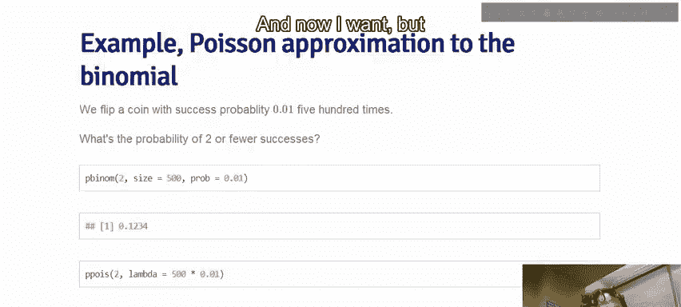
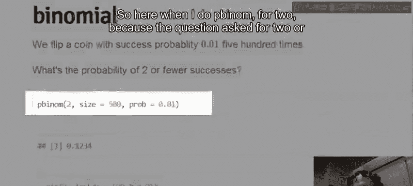
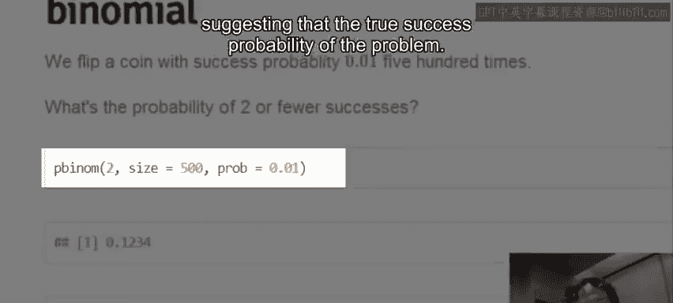
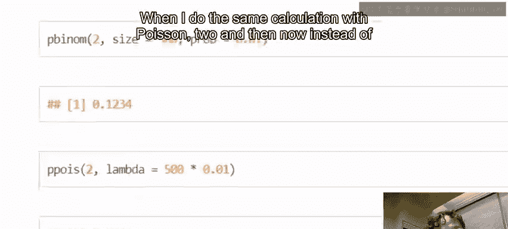
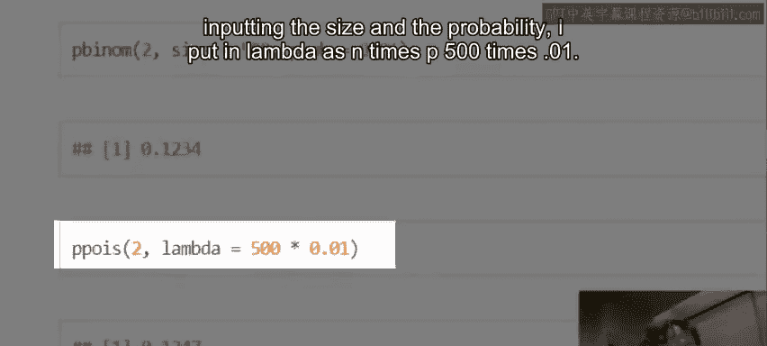
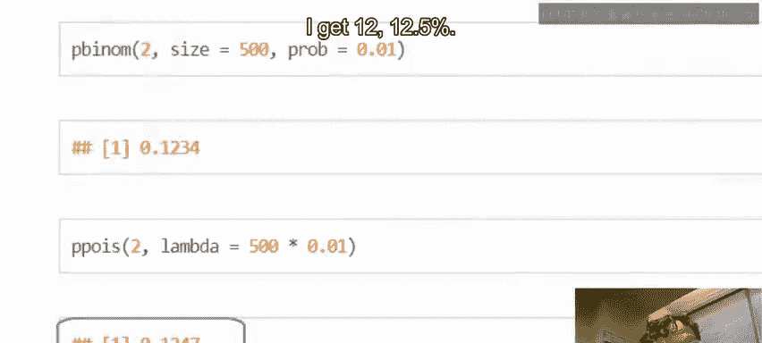

# 017：泊松分布

在本节课中，我们将要学习泊松分布。泊松分布是统计学中用于建模计数数据的核心工具之一，尤其在事件发生次数无上限或发生率较低的场景中非常有用。我们将介绍其定义、性质、应用场景，并探讨其与二项分布的关系。

***

## 📝 泊松分布的定义与性质

上一节我们介绍了正态分布，本节中我们来看看泊松分布。泊松分布用于对计数数据进行建模。

泊松分布的概率质量函数为：

\[
P(X = x) = \frac{\lambda^x e^{-\lambda}}{x!}
\]

其中，\( x \) 取值为非负整数（0, 1, 2, …），\( \lambda \) 是分布的参数。

泊松随机变量的均值是 \( \lambda \)，其方差也是 \( \lambda \)。这意味着，当你使用泊松分布建模时，数据的均值与方差必须相等。这是一个可以通过实际数据检验的假设。

***

## 🎯 泊松分布的应用场景

泊松分布在许多领域都有广泛应用。以下是其主要应用场景：

*   **计数数据建模**：任何你想对计数数据进行建模的情况，泊松分布都是一个候选模型，特别是当这些计数没有明确上限时。
*   **生存分析**：在生物统计学领域，处理事件时间或生存数据时（例如癌症试验中病人症状复发的时间），泊松分布与处理“删失”数据的统计技术有深刻联系。
*   **列联表分析**：当你对人群进行抽样，并根据某些特征（如发色、种族）进行分类计数，形成列联表时，泊松分布是建模此类数据的默认分布。它与多项分布、二项分布等模型有内在联系。
*   **流行病学中的罕见事件**：在流行病学中，当二项分布的试验次数 \( n \) 很大而成功概率 \( p \) 很小时，常使用泊松分布进行近似。例如，研究空气污染与城市中新增呼吸道疾病病例数的关系时，城市人口（\( n \)）很大，但新增病例数（事件数）相对很小。

***

## ⏱️ 泊松分布用于建模发生率

泊松分布也常用于对发生率进行建模。

假设 \( X \) 服从泊松分布，其参数为 \( \lambda T \)。这里，\( \lambda \) 是有单位的，它表示**单位时间内事件的平均发生次数**，而 \( T \) 是以相同时间单位表示的总观察时间。因此，\( \lambda \) 是单位时间的期望计数，\( \lambda T \) 是整个观察期内的总期望计数。

**示例**：假设到达公交车站的人数服从泊松分布，均值为每小时2.5人。我们观察车站4小时，问在此期间有3人或更少人到达的概率是多少？

我们需要计算 \( X \sim \text{Poisson}(\lambda T = 2.5 \times 4 = 10) \) 时，\( P(X \leq 3) \) 的概率。这需要计算 \( x = 0, 1, 2, 3 \) 时的泊松概率之和。

***

## 🔄 泊松分布近似二项分布

当二项分布的试验次数 \( n \) 很大，而每次试验的成功概率 \( p \) 很小时，泊松分布可以非常精确地近似二项分布。

具体来说，设 \( X \sim \text{Binomial}(n, p) \)，并定义 \( \lambda = n p \)。在 \( n \) 很大且 \( p \) 很小的条件下，\( X \) 的概率分布可以用参数为 \( \lambda \) 的泊松分布来近似。

**示例**：假设我们抛一枚成功概率为 \( p = 0.01 \) 的硬币500次。求成功次数为2次或更少的概率。

1.  **二项分布精确计算**：
    \[
    P_{\text{binom}}(X \leq 2) \approx 0.123
    \]
    这通过二项分布公式计算得出，概率约为12.3%。

2.  **泊松分布近似计算**：
    参数 \( \lambda = n p = 500 \times 0.01 = 5 \)。
    \[
    P_{\text{pois}}(X \leq 2) \approx 0.125
    \]
    使用参数 \( \lambda = 5 \) 的泊松分布计算，概率约为12.5%。可见两者结果非常接近。

***

## 📚 课程总结

本节课中我们一起学习了泊松分布。我们首先定义了泊松分布的概率质量函数，并指出其均值和方差相等这一关键特性。接着，我们探讨了泊松分布在计数数据、生存分析、列联表以及流行病学罕见事件建模等多个领域的应用。最后，我们学习了在二项分布的 \( n \) 很大且 \( p \) 很小时，如何使用泊松分布对其进行近似计算，并通过实例验证了这种近似的有效性。泊松分布是处理计数和发生率问题时一个极其强大且实用的工具。