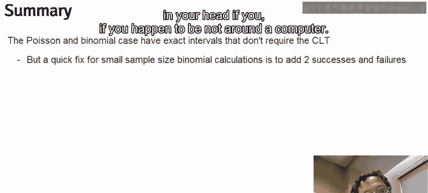

# 020：渐近性与置信区间 📊


在本节课中，我们将学习如何将中心极限定理应用于实际问题，并构建置信区间来估计未知的总体参数。我们将从样本均值的分布出发，逐步推导置信区间的公式，并通过具体例子（如身高数据、抛硬币、核泵故障率）来演示其应用和解释。


---


## 中心极限定理的实用推导 🔄


上一节我们介绍了中心极限定理的基本概念。本节中，我们来看看如何利用它构建一个实用的工具——置信区间。

回忆一下，样本均值 `X̄` 近似服从正态分布，其总体均值等于 `μ`，标准差等于均值的标准误 `σ / √n`。

`X̄ ~ N(μ, σ/√n)`

在这个分布中，`μ + 2` 个标准误的位置已经处于分布的右尾深处。对于一个标准正态分布，观测值大于右尾两个标准差的概率仅为 2.5%。


类似地，`μ - 2` 个标准误的位置处于左尾深处，观测值小于左尾两个标准差的概率也仅为 2.5%。


因此，`X̄` 大于 `μ + 2` 个标准误 **或** 小于 `μ - 2` 个标准误的总概率是 5%。等价地说，`μ` 落在这两个界限之间的概率是 95%。


我们可以互换 `X̄` 和 `μ` 的角色而不改变概率不等式，从而得到：区间 `X̄ ± 2` 个标准误以 95% 的概率包含 `μ`。


这里需要记住，我们将区间 `X̄ ± 2` 个标准误视为随机的（因为 `X̄` 随样本变化），而 `μ` 是固定的参数。所以我们谈论的是“区间包含 `μ` 的概率”。

这个结论的实际解释是：如果我们从总体中重复抽取大小为 `n` 的样本，并为每个样本构建置信区间，那么在所有构建的区间中，大约有 95% 会包含我们试图估计的参数 `μ`。


需要注意的是，数字“2”是对 97.5% 正态分位数（约 1.96）的近似取整。如果你想要一个 90% 的置信区间，你需要每边尾部各留 5% 的概率，因此需要用 1.645 替换这里的“2”。


---

## 一个简单示例：儿子身高 📏

让我们通过一个简单的例子来应用上述理论。


考虑 `UsingR` 包中的 `father.son` 数据。定义 `x` 为儿子的身高。我们将计算样本均值加上或减去 0.975 正态分位数乘以均值的标准误。


以下是计算步骤：
1.  计算样本均值 `mean(x)`。
2.  计算标准误：`sd(x) / sqrt(length(x))`，其中 `length(x)` 是样本量 `n`。
3.  构建区间：`mean(x) ± Z * (sd(x)/sqrt(n))`，其中 `Z` 是正态分位数。

```r
# R 代码示例
x <- father.son$sheight
n <- length(x)
mean_x <- mean(x)
se <- sd(x) / sqrt(n)
z <- qnorm(0.975) # 约等于 1.96
ci <- mean_x + c(-1, 1) * z * se
ci / 12 # 将单位从英寸转换为英尺
```


除以 12 是为了将置信区间从英寸转换为英尺。我们得到的置信区间是 [5.710, 5.738] 英尺。

如果我们愿意假设这些儿子的身高数据是来自目标总体的一个独立同分布样本，那么儿子平均身高的 95% 置信区间就是 5.71 到 5.74 英尺。


---


## 二项分布案例：抛硬币置信区间 🪙


现在考虑抛硬币的例子，我们要为硬币正面朝上的成功概率 `p` 构建置信区间。


在这种情况下，每个观测 `Xi` 是 0 或 1，具有共同的成功概率 `p`。回忆一下，抛硬币的方差是 `p(1-p)`，其中 `p` 是硬币真实的成功概率。


那么，样本均值（即样本比例 `p̂`）的标准误是 `√[p(1-p)/n]`。


因此，置信区间的形式为：`p̂ ± Z * √[p(1-p)/n]`。


问题在于，我们不知道真实的 `p`（这正是我们要估计的），因此无法计算这个标准误。一个自然的做法是用估计值 `p̂` 来代替 `p`。这样得到的置信区间称为 **Wald 置信区间**，以伟大的统计学家 Wald 命名。


有一个有用的性质：`p(1-p)` 在 `p = 0.5` 时取得最大值 `0.25`，所以 `√[p(1-p)]` 的最大值是 `0.5`。当我们为 95% 区间乘以 2 时，`0.5 * 2 = 1`，它们相互抵消。因此，对于 95% 的 Wald 区间，一个非常快捷的近似是 `p̂ ± 1/√n`。


**应用场景**：假设你正在竞选公职，你的竞选顾问告诉你，在 100 名可能投票的选民随机样本中，有 56 人打算投票给你。你能放松吗？这场竞选稳赢了吗？100 人中有 56 人（56%）的样本证据是否足以得出结论：你很可能获得超过 50% 的选票？


假设你没有电脑或计算器。你可以快速计算：`1/√100 = 0.1`。因此，这个粗略的估算给出了一个近似的 95% 置信区间：`0.56 ± 0.1`，即 `[0.46, 0.66]`。


这个置信区间表明，我们不能以 95% 的置信度排除支持率低于 0.5（即 50%）的可能性。所以你还不能放松，最好去做更多的竞选活动。


以下是一些通用的粗略准则，用于二项实验中获得特定小数位精度所需的样本量：
*   需要 `n=100` 来获得一位小数的精度（标准误约 `1/10=0.1`）。
*   需要 `n=10,000` 来获得两位小数的精度（标准误约 `1/100=0.01`）。
*   需要 `n=1,000,000` 来获得三位小数的精度（标准误约 `1/1000=0.001`）。

下图展示了 10 的幂次方对应的 `1/√n` 值。


如果我们进行精确计算，将 `p̂=0.56` 代入标准误公式：
`0.56 ± 1.96 * √[0.56*0.44/100]`
计算得到区间 `[0.46, 0.66]`，与之前的快速估算一致。


在 R 中，使用 `binom.test` 函数（进行 100 次试验，56 次成功）并提取置信区间部分，也会得到一个非常相似的区间 `[0.46, 0.66]`。

`binom.test` 函数提供的是“精确”置信区间，意味着无论样本量 `n` 大小如何，它都能保证至少 95% 的覆盖率（即覆盖真实参数的概率）。这些所谓的精确过程是对大样本过程（如 Wald 区间）的良好补充。它们往往涉及无法手工完成的计算，并且可能比较保守（即区间更宽），但它们不依赖于中心极限定理。


---


## 模拟：Wald 区间的覆盖概率 🔁

为了理解置信区间的表现，我们进行一个模拟。我们将反复抛一枚具有给定成功概率 `p` 的硬币，并计算我们的 Wald 区间覆盖真实概率 `p` 的百分比。


模拟设置如下：
*   每次模拟进行 `n=20` 次抛硬币。
*   真实的成功概率 `p` 从 0.1 到 0.9，步长为 0.05。
*   对每个 `p` 值，进行 1000 次模拟。
*   在每次模拟中，计算样本比例 `p̂`，构建 Wald 置信区间，并检查区间是否包含用于生成数据的真实 `p` 值。
*   最后，计算覆盖概率（覆盖次数/总模拟次数）。

以下是模拟的核心步骤描述：


然后，我们将覆盖概率绘制成关于真实概率 `p` 的函数图。


下图显示了覆盖概率随真实 `p` 值变化的曲线。


例如，在 `p=0.5` 处，我们抛硬币 20 次，计算样本比例和置信区间。如果区间包含 0.5，则记录为 1，否则为 0。重复 1000 次后，覆盖概率略高于 95%。这表明当 `p=0.5` 时，Wald 区间表现良好。


然而，在 `p` 接近 0.1 或 0.9 的区域（例如大约 12% 处），覆盖概率远未达到 95%。


**原因**：这是因为对于这个特定的样本量 `n=20` 和这些极端的 `p` 值，中心极限定理的近似效果不够好。样本分布（二项分布）与正态分布的差异较大。


---

## 一个快速修正：Agresti-Coull 区间 🛠️

针对小样本量 `n` 的问题，有一个简单的修正方法。


这个快速修正称为 **Agresti-Coull 区间**。方法很简单：在你的成功次数 `X` 上加上 2，在失败次数上也加上 2。然后使用新的样本比例 `p̃ = (X+2) / (n+4)` 来构建 Wald 区间。

`p̃ = (X + 2) / (n + 4)`


这个操作相当于将样本比例向 0.5 方向“收缩”了一点。然后像往常一样进行置信区间计算，但使用这个调整后的 `p̃`。


在展示“加2”区间的结果之前，我们先看看当样本量增大时 Wald 区间的表现。将模拟中的 `n` 从 20 增加到 100。


下图是 `n=100` 时的覆盖概率曲线。可以看到，在整个 `p` 值范围内，覆盖概率都更接近 95% 的基准线，没有像 `n=20` 时那样跌破 90%。这说明大样本下中心极限定理的近似效果更好。


现在回来看 `n=20` 的情况，但这次使用 Agresti-Coull 区间（加2法）。


下图比较了 Wald 区间和 Agresti-Coull 区间在 `n=20` 时的覆盖概率。可以看到，Agresti-Coull 区间在大部分 `p` 值上的覆盖概率都更接近或高于 95%，改善了 Wald 区间在极端 `p` 值处覆盖不足的问题。

然而，过于保守（覆盖概率过高）也不一定是好事，因为这通常意味着区间过宽。尽管如此，经过研究，一个非常明确的建议是：**通常应该使用 Agresti-Coull 区间（加2法）而不是 Wald 区间**，尤其是在样本量较小或 `p` 接近 0 或 1 时。


---


## 泊松分布案例：核泵故障率 ⚛️


我们也可以使用“估计值 ± 分位数 × 标准误”的公式为泊松率创建置信区间。这同样基于中心极限定理，尽管泊松分布如何应用中心极限定理可能不那么直观。


假设一个核泵在 94.32 天中发生了 5 次故障。请给出故障率（每天）的 95% 置信区间。


我们假设故障次数服从泊松分布，故障率为 `λ`，`T` 是监测时间。
*   故障率的估计值为：`λ̂ = 故障次数 / 总监测时间 = X / T`。
*   该估计值的方差为 `λ / T`。因此，我们使用 `λ̂ / T` 作为经验方差估计。

`λ̂ = X / T`
`Var(λ̂) ≈ λ / T`，用 `λ̂ / T` 估计。


在 R 中进行计算：
```r
x <- 5 # 故障次数
t <- 94.32 # 监测时间（天）
lambda_hat <- x / t # 估计的故障率
se <- sqrt(lambda_hat / t) # 标准误
z <- qnorm(0.975) # 95% 置信水平的 Z 值
ci <- lambda_hat + c(-1, 1) * z * se
round(ci, 3) # 保留三位小数
```


计算得到故障率的估计值及其 95% 置信区间。


除了大样本区间，我们还可以计算“精确”泊松置信区间。R 中的 `poisson.test` 函数可以做到这一点。我们输入事件次数和监测时间，然后提取置信区间部分。这里的“精确”同样意味着它能保证覆盖率（可能比较保守，区间较宽），但不依赖于中心极限定理。



```r