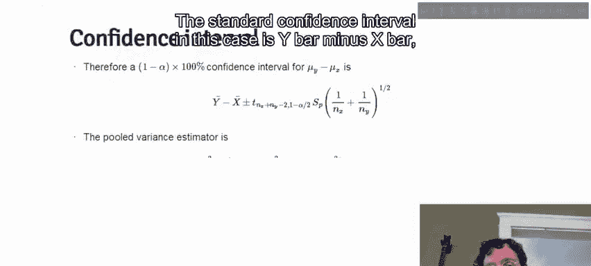
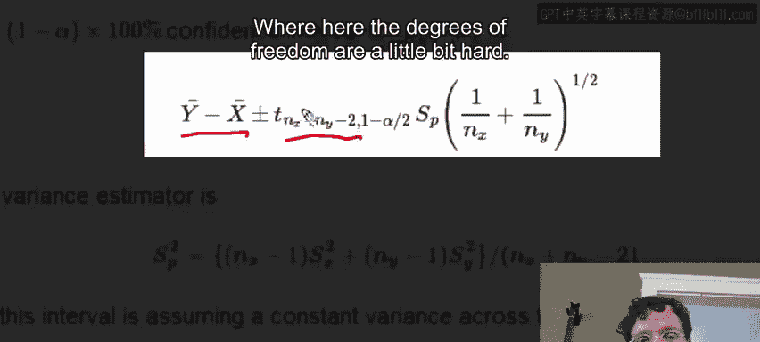
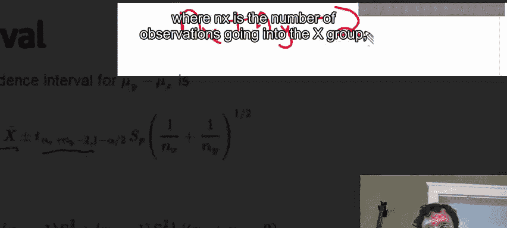
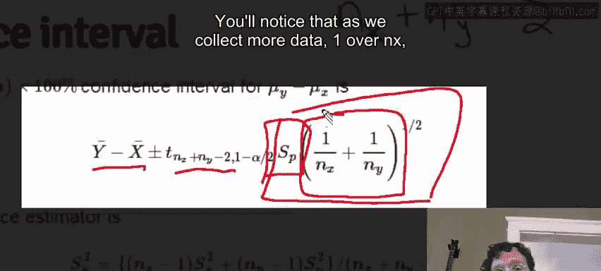
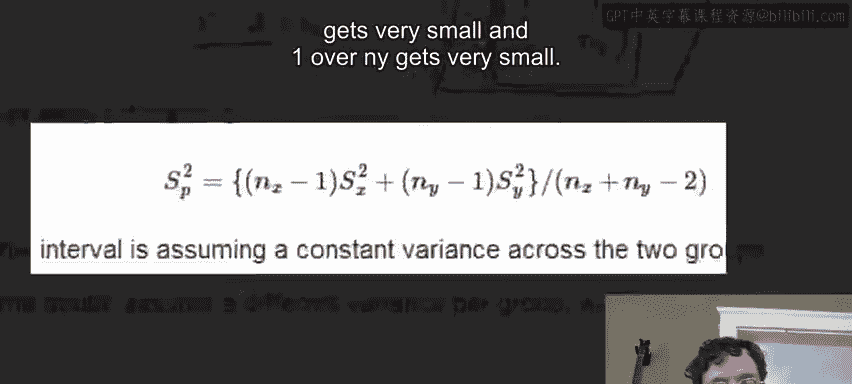
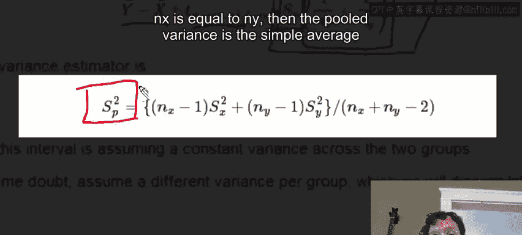
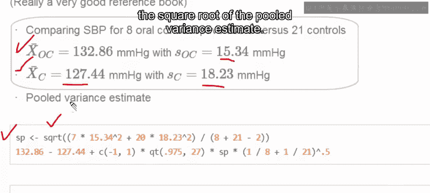
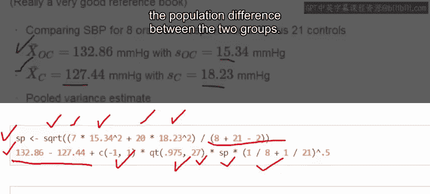
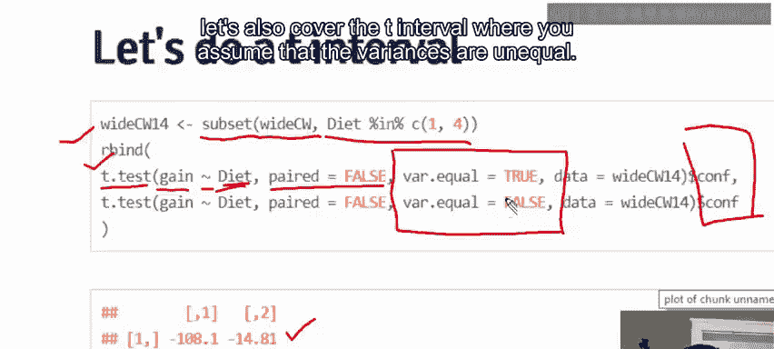

# 023：独立组t区间 📊

## 概述
在本节课中，我们将学习如何比较两个独立组的均值，例如在随机试验中比较治疗组和安慰剂组的平均血压。我们将重点介绍独立组t置信区间的构建方法、核心公式及其应用场景。



---

## 独立组比较的背景
假设我们想在一项随机试验中比较两组之间的平均血压：接受治疗的一组和接受安慰剂的一组。这类似于数据科学中常说的A/B测试。无论是在A/B测试还是随机试验中，进行随机化的目的是平衡那些可能干扰结果的未观测协变量。由于执行了随机化，直接使用t置信区间或t检验来比较两组是合理的。





不过，我们不能使用配对t检验，因为两组之间的受试者没有匹配关系。因此，我们现在介绍用于比较独立组的方法。





---

## 标准置信区间公式
在这种情况下，标准置信区间公式为：

**公式：**
\[
\bar{Y} - \bar{X} \pm t_{df} \cdot S_p \sqrt{\frac{1}{n_X} + \frac{1}{n_Y}}
\]



其中：
*   \(\bar{Y} - \bar{X}\) 是一组的平均值减去另一组的平均值。
*   \(t_{df}\) 是相关的t分位数。
*   自由度 \(df\) 为 \(n_X + n_Y - 2\)，\(n_X\) 是X组的观测数，\(n_Y\) 是Y组的观测数。
*   \(S_p \sqrt{1/n_X + 1/n_Y}\) 是差异的标准误。

你会注意到，随着我们收集更多数据，\(1/n_X\) 和 \(1/n_Y\) 会变得非常小。

---

## 合并方差估计
\(S_p^2\) 是所谓的合并方差，其平方根 \(S_p\) 是合并标准差。

如果我们愿意假设两组的方差相同（这在执行随机化时是合理的），那么我们对方差的估计在某种程度上应该是第1组方差估计和第2组方差估计的平均值。然而，如果样本量不同，我们希望给予样本量更大的组其方差估计更高的权重。这正是合并方差估计所做的。

如果两组观测数相等（\(n_X = n_Y\)），那么合并方差就是X组方差和Y组方差的简单平均值。



**公式：**
\[
S_p^2 = \frac{(n_X - 1)S_X^2 + (n_Y - 1)S_Y^2}{n_X + n_Y - 2}
\]

但请记住，这个区间假设两组方差恒定。如果这个假设被违反，那么这个区间将无法提供正确的覆盖率。如果有疑问，可以简单地假设每组方差不同，我们将在后面介绍一个略有不同的区间。

---



## 实例计算：血压数据
这里我们使用Rosner的《生物统计学基础》书中的一个例子。该例子比较了8名口服避孕药使用者与21名对照者的血压。

*   口服避孕药使用者：平均收缩压为133 mmHg，标准差为15.34。
*   对照组：平均收缩压为127 mmHg，标准差为18.23。

让我们手动构建一次独立组区间以熟悉计算。在实际操作中，你通常会使用 `t.test` 之类的函数，因为你有原始数据。

首先，计算合并标准差估计值 \(S_p\)：

**计算步骤：**
1.  计算合并方差：
    \[
    S_p^2 = \frac{(8-1) \times 15.34^2 + (21-1) \times 18.23^2}{8 + 21 - 2}
    \]
2.  对方差取平方根得到标准差 \(S_p\)。

然后，构建置信区间：
*   均值差：\(133 - 127 = 6\)
*   自由度：\(8 + 21 - 2 = 27\)
*   查找相应的t分位数 \(t_{27}\)。
*   计算标准误：\(S_p \times \sqrt{1/8 + 1/21}\)
*   最终区间：\(6 \pm t_{27} \times \text{标准误}\)

计算得到大约为-10到20的区间。这个区间包含0，因此我们不能排除两组总体差异为0的可能性。

---

## 实例回顾：睡眠药物数据
让我们回顾之前看过的两种睡眠药物的例子，但这次假设受试者没有匹配。这里 \(n_1 = n_2 = 10\)。

以下是构建过程：
1.  计算合并标准差估计值 \(S_p\)。
2.  计算均值差。
3.  计算均值差的标准误：\(S_p \times \sqrt{1/n_1 + 1/n_2}\)。
4.  手动构建置信区间：均值差 ± t分位数 × 标准误。

在R中，我们可以使用 `t.test` 函数：
```r
t.test(group1, group2, paired = FALSE, var.equal = TRUE)$conf.int
```
为了对比，我们也看一下考虑配对时的区间（`paired = TRUE`）。你会发现，忽略配对会得到一个包含0的区间，而考虑配对时，区间完全在0以上。查看数据图可以清楚地看出原因：组间变异很大，但匹配受试者后，差异的变异中很大一部分可以由受试者间的变异解释。

---

## 实例分析：小鸡体重数据
R中的 `ChickWeight` 数据集包含了小鸡从出生到几周后的体重数据。

首先加载并整理数据：
```r
library(datasets)
data(ChickWeight)
library(reshape2)
# 将数据从长格式转换为宽格式，以便按时间点分析
chick_wide <- dcast(ChickWeight, Diet + Chick ~ Time)
# 重命名列并计算体重变化（最终体重 - 基线体重）
library(dplyr)
chick_wide <- mutate(chick_wide, weight_gain = `21` - `0`)
```

通过绘制“意大利面图”和“小提琴图”初步观察数据，比较不同饮食方案（如饮食1和饮食4）下体重增加的分布。观察发现，饮食1和饮食4的方差可能不同（方差异质性）。

为了比较饮食1和饮食4，我们进行t检验。注意，`t.test` 公式形式要求解释变量只有两个水平，所以我们先筛选数据：
```r
subset_data <- subset(chick_wide, Diet %in% c(1, 4))
```

然后进行检验，并比较方差相等和方差不等的假设下的区间：
```r
# 假设方差相等
t.test(weight_gain ~ Diet, data = subset_data, var.equal = TRUE)$conf.int
# 假设方差不相等（Welch校正）
t.test(weight_gain ~ Diet, data = subset_data, var.equal = FALSE)$conf.int
```
两种情况下得到的区间都完全在0以下（例如，一个可能是-108到-14，另一个是-104到-18），表明饮食1的体重增加显著少于饮食4。但具体的区间范围会根据方差假设的不同而有所变化。

---

## 方差不等的t区间
当怀疑两独立组的方差不相等时，应使用经过Welch校正的t区间。其公式与合并方差版本类似，但标准误的计算和自由度的估计更为复杂，通常由统计软件（如R的 `t.test` 函数，设置 `var.equal = FALSE`）自动处理。该区间不假设方差齐性，因此在方差异质时更稳健。

---

## 总结
本节课我们一起学习了独立组t置信区间的构建与应用。核心内容包括：
1.  理解了在随机化实验或A/B测试中比较两独立组均值的场景。
2.  掌握了标准独立组t区间的公式及其组成部分，特别是合并方差 \(S_p^2\) 的计算。
3.  通过血压、睡眠药物和小鸡体重的实例，演练了区间的手动计算与R语言实现。
4.  认识到方差齐性假设的重要性，并初步了解了当该假设不满足时可使用的Welch校正t区间。
5.  强调了在分析前通过图形等方式探索数据（如检查方差）的必要性。



记住，选择正确的检验方法（如配对与否、方差是否相等）对于得出有效结论至关重要。