# 030：统计推断 🧮｜P值计算进阶示例

在本节课中，我们将通过两个具体的例子，深入学习如何计算P值。我们将回顾一个二项分布的例子，并探讨一个新的泊松分布案例，以巩固对P值概念和计算方法的理解。

---

## 回顾：二项分布P值计算示例

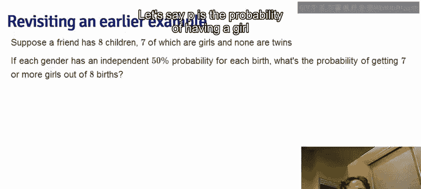

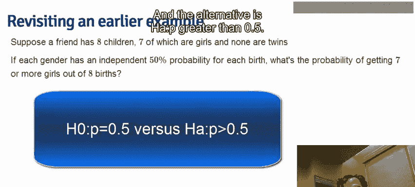

上一节我们介绍了P值的基本概念。本节中，我们来看看一个具体的二项分布案例。

假设我们研究一个家庭的孩子性别分配问题。为简化模型，我们将其视为抛硬币过程。设 **P** 为生女孩的概率。我们关注的问题是：一个朋友有8个孩子，其中7个是女孩。我们想检验生女孩的概率 **P** 是否等于0.5，还是大于0.5。

因此，我们的假设是：
*   零假设 **H₀**: P = 0.5
*   备择假设 **Hₐ**: P > 0.5

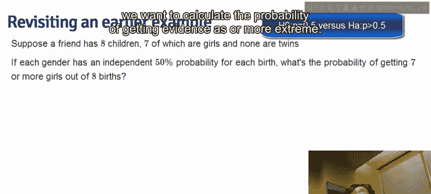

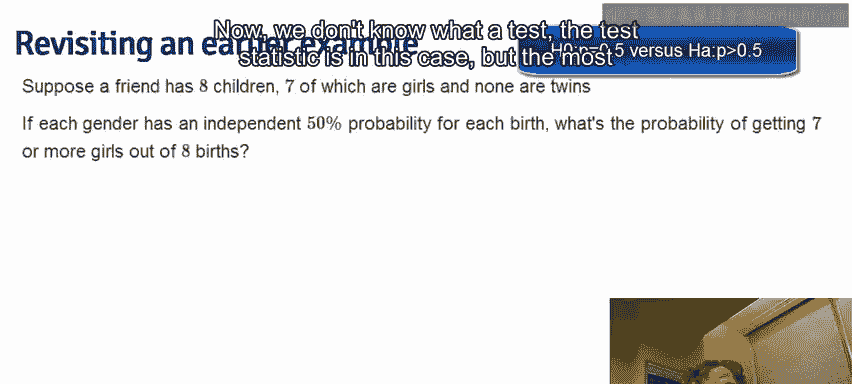

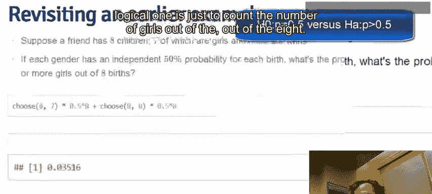

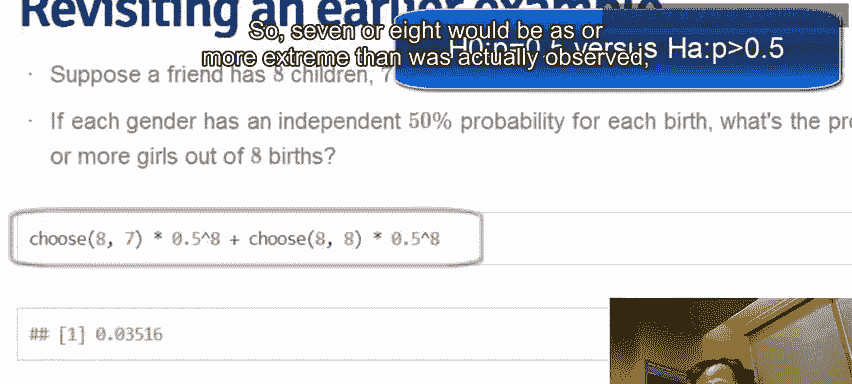

在零假设成立的前提下，我们需要计算获得与观测数据（7个女孩）同样极端或更极端证据的概率。此案例中最合理的检验统计量是女孩的计数。

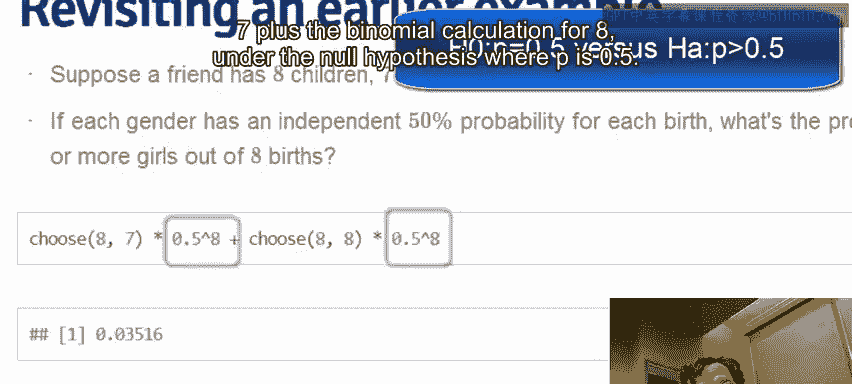

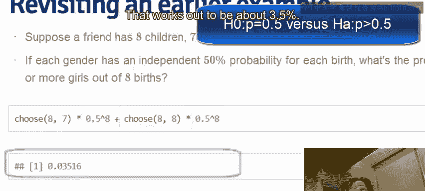

因此，“同样极端或更极端”的情况是指获得7个或8个女孩。P值的计算就是在零假设（P=0.5）下，计算获得7个或8个女孩的二项概率之和。

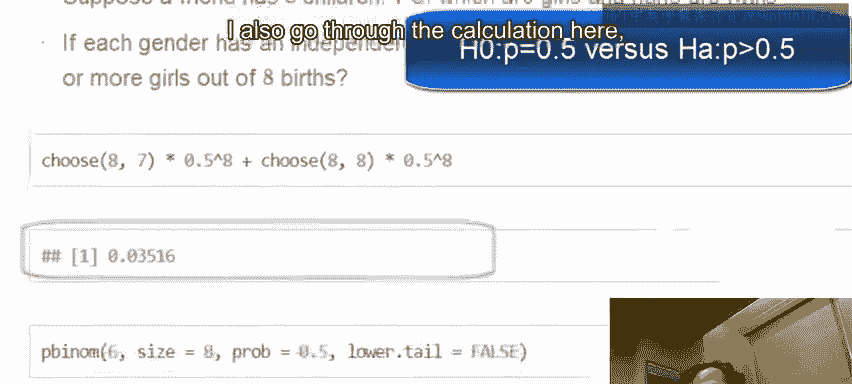

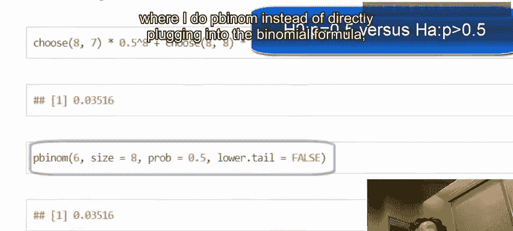

以下是P值的计算公式：
`P值 = P(X=7) + P(X=8)`，其中 `X ~ Binomial(n=8, p=0.5)`

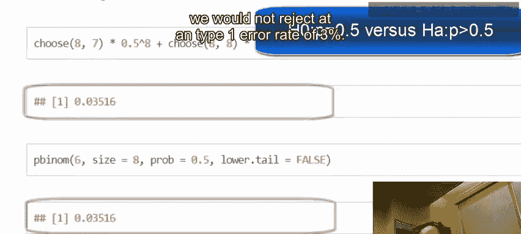

计算结果约为3.5%。

如果我们在5%或4%的显著性水平下检验该假设，我们会拒绝零假设。但在3%的显著性水平下，则不会拒绝。

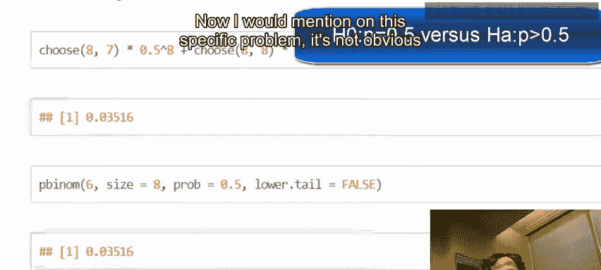

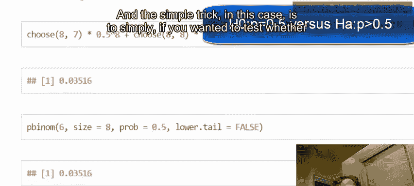

---

## 双侧P值的计算技巧

对于上述问题，如果要检验P是否等于0.5（双侧检验），而非是否大于0.5（单侧检验），P值的计算则有所不同。

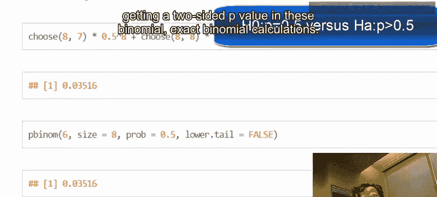

以下是计算双侧P值的一个简单方法：
1.  分别计算两个单侧P值。
    *   一个方向：获得7个或更多女孩的概率（即我们刚计算的3.5%）。
    *   另一个方向：获得7个或更少女孩的概率。
2.  取这两个单侧P值中较小的一个。
3.  将其乘以2。

这个结果就是针对此类精确二项分布计算的双侧P值。

---

## 新案例：泊松分布P值计算

现在，我们来看一个新的泊松分布案例，以应用P值的计算逻辑。

假设一家医院的感染率为每100个风险人日发生10次感染，即每风险人日0.1次感染。而0.05次感染/风险人日是一个重要基准，如果感染率超过此值，医院就需要启动质量控制程序。我们希望通过假设检验来区分真实的高感染率与随机波动。

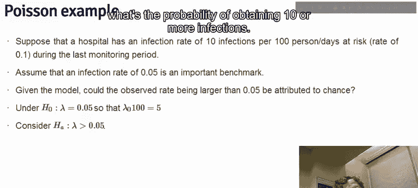

我们假设感染计数服从泊松分布。对于最近这个100风险人日的监测期，我们的假设是：
*   零假设 **H₀**: λ × 100 = 5 （即真实感染率为每100风险人日5次）
*   备择假设 **Hₐ**: λ × 100 > 5

我们需要计算的是：如果真实感染率确实是每100风险人日5次（零假设成立），那么观察到10次或更多感染的概率是多少？

这是一个泊松概率计算问题。我们关注的是上尾概率（10次及以上）。对于离散分布计算严格大于某个值的上尾概率时，需要注意一个细节：通常需要将目标值减1。

以下是使用R语言 `ppois` 函数计算此P值的代码：
`P值 = ppois(9, lambda=5, lower.tail=FALSE)`

这段代码计算的是在均值为5的泊松分布下，获得大于9（即10及以上）的观测值的概率。计算结果约为3%。

这意味着，如果真实的感染率确实是每100风险人日5次，那么观察到多达10次感染的概率仅有3%，这是一个相对较低的概率。因此，该医院或许应该考虑启动质量控制程序。

---

## 总结

本节课中我们一起学习了P值的实际计算方法。核心要点是：**P值是在零假设成立的条件下，计算获得与实际观测数据同样极端或更极端（支持备择假设方向）的证据的概率**。

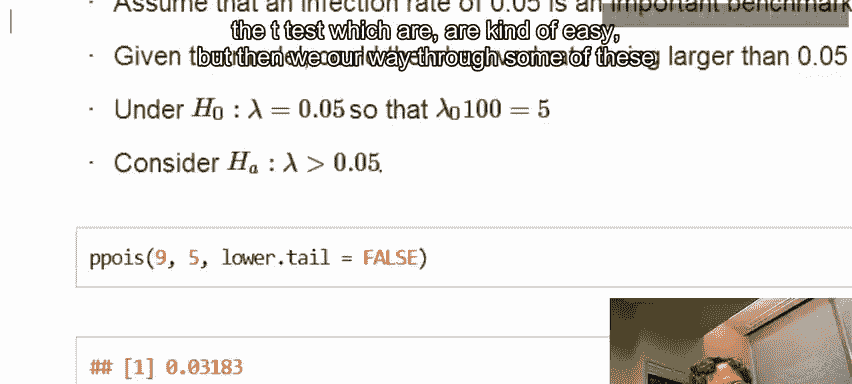

我们通过逻辑推导处理了二项分布和泊松分布的示例，这有助于我们理解，P值的计算本质上是基于零假设下的概率模型，对检验统计量的极端性进行评估。