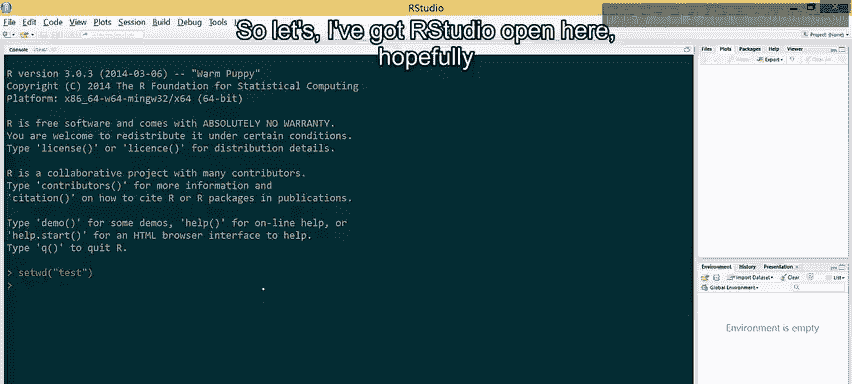
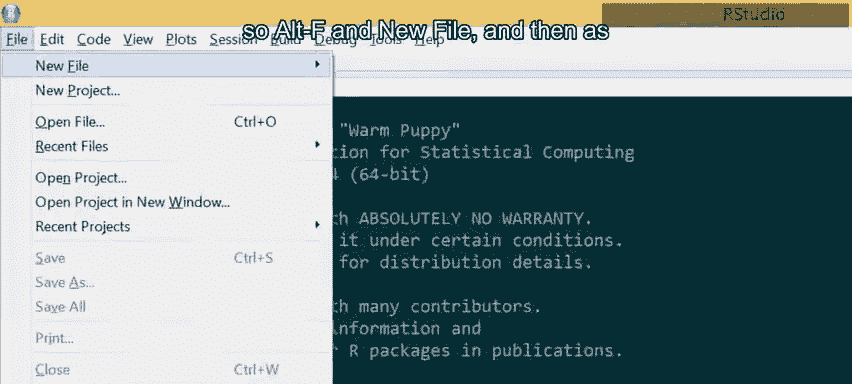
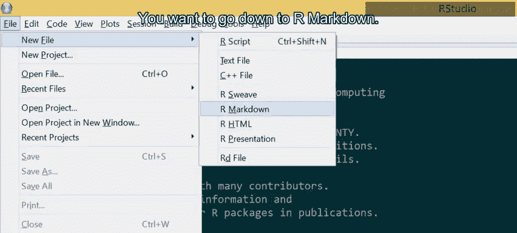
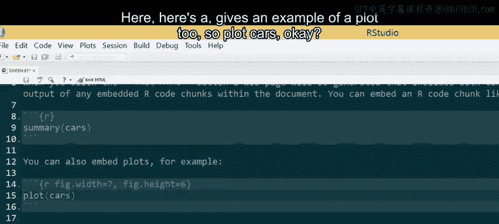
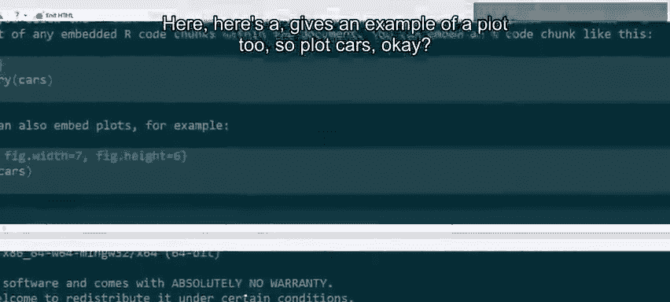
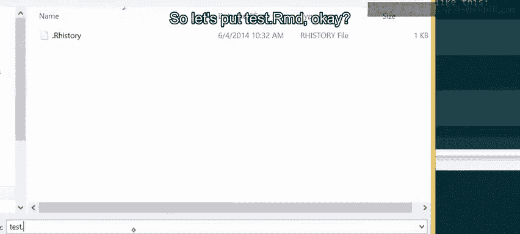
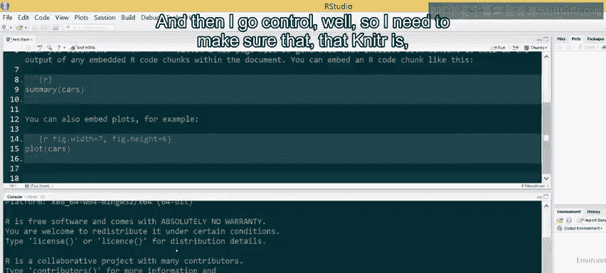
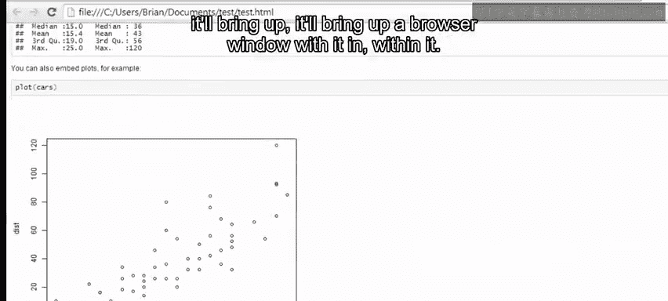

# 031：使用knitr完成项目 📝

在本节课中，我们将学习如何使用knitr来创建和生成R Markdown文档，这是完成课程作业项目所必需的基本技能。knitr能将R代码、结果和文本整合到一个格式美观的文档中。

## 概述

我们将通过一个简单的示例，演示如何在RStudio中创建一个R Markdown文件，添加内容，并使用knitr将其编译成HTML报告。整个过程旨在让你掌握提交作业所需的最小化knitr操作。





## 创建R Markdown文件

首先，我们需要在RStudio中创建一个新的R Markdown文件。

打开RStudio，点击菜单栏的 **File**，然后选择 **New File**，最后在下拉列表中选择 **R Markdown**。




选择后，RStudio会自动生成一个包含示例内容的基本R Markdown文档模板。


## 编辑文档内容

接下来，我们可以编辑这个模板。例如，修改标题为“这是一个测试knitr文档”。文档主体部分包含说明文本和示例R代码块。

R代码块由三个反引号（\`\`\`）包裹，并在开头用`{r}`标识。这是嵌入和执行R代码的核心语法。

```r
```{r}
# 这里是R代码
```
```

在`{r}`后面可以添加逗号来设置代码块选项，控制代码的执行和输出方式。

## 理解代码块选项

代码块选项非常有用，它们能让你精细控制代码的呈现方式。以下是一些最常用的选项：

*   **eval**: 控制是否执行代码。设置为`FALSE`时，仅显示代码而不运行。
*   **echo**: 控制是否在最终文档中显示代码本身。设置为`FALSE`时，只显示代码运行结果。
*   **results**: 控制结果的显示格式。`‘markup’`会进行语法高亮，`‘hide’`则会隐藏结果。
*   **cache**: 控制是否缓存代码结果以提高重复编译时的速度。

例如，以下代码块设置了不显示代码本身，但会执行并显示结果：

```r
```{r, echo=FALSE}
summary(cars)
```
```

模板中已包含一个绘制图形的示例代码块 `plot(cars)`。



## 保存与编译文档


编辑完成后，需要保存文件。点击 **File** -> **Save As**，将文件命名为例如 `test.Rmd`。







保存后，即可编译文档。在RStudio中，点击 **Knit** 按钮（通常显示为“Knit to HTML”），knitr便会开始处理文档。



处理完成后，RStudio会生成一个同名的HTML文件（如 `test.html`），并在预览窗格中打开它。这个HTML文件就是你的最终报告。

## 查看输出结果


生成的HTML文件是一个独立的网页文件。你可以在文件系统中找到它，也可以用R命令在浏览器中直接打开它：

```r
browseURL(“test.html”)
```

执行此命令后，系统默认浏览器会打开并显示你的knitr报告。



## 总结


本节课我们一起学习了使用knitr完成R项目报告的基本流程。我们掌握了如何在RStudio中创建和编辑R Markdown（.Rmd）文件，理解了用反引号和`{r}`标识代码块的核心语法，认识了控制代码执行的几个关键选项（如`eval`和`echo`），并最终通过Knit按钮将文档编译成便于分享和提交的HTML格式报告。这就是完成课程项目所需的knitr核心操作。