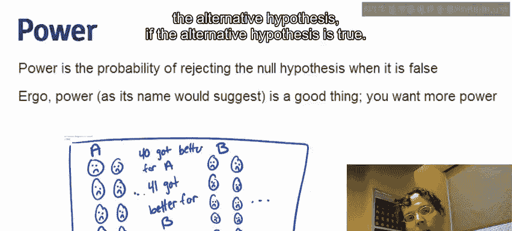
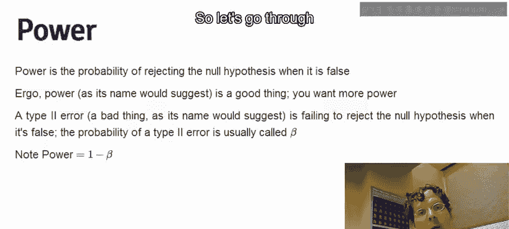
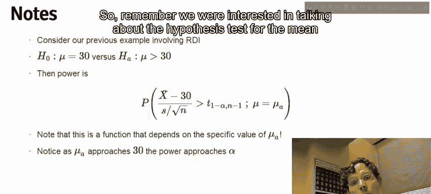
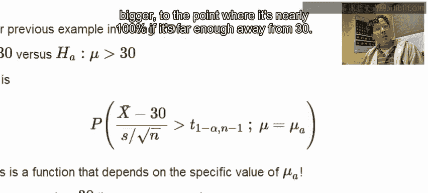

# 032：31_11 01 功效 🎯

在本节课中，我们将要学习统计推断中的一个核心概念——**功效**。功效描述了当原假设实际上为假时，我们能够正确拒绝它的概率。理解功效对于设计和解读研究至关重要，尤其是在我们未能拒绝原假设时。

## 什么是功效？💡

功效是当原假设为假时，拒绝原假设的概率。顾名思义，功效是一件好事，我们希望拥有更高的功效。

有趣的是，功效在**未能拒绝原假设**时比在拒绝原假设时扮演着更重要的角色。让我们来解释一下。

想象一下，如果你进行了一项功效很低的研究。例如，你想比较治疗A和治疗B，但只随机分配了3个人接受治疗A，3个人接受治疗B。那么，当你比较两种治疗的结果时，得到一个“无显著差异”的结果（即未能拒绝原假设）并不令人惊讶，因为每组只有3个人，你几乎没有能力检测出组间有意义的差异。因此，这个“无差异”的结果某种程度上是意料之中的，或者仅凭偶然就可能发生。

另一方面，如果治疗A和治疗B各有300人，而你仍然未能拒绝原假设，那么这个结果就很有意义了。因为你收集了如此多的数据，理应期望看到差异。

这就是为什么功效实际上在“无显著差异”的结果中比在“有显著差异”的结果中更受关注。功效最常用的场景是在**研究设计阶段**。你希望设计一项研究，使其在备择假设为真时，有合理的机会检测到它。

## 功效与错误类型 🔄

上一节我们介绍了功效的基本概念，本节中我们来看看它与假设检验中两类错误的关系。

**第二类错误**是一件坏事。顾名思义，错误是指在原假设为假时，未能拒绝它。第二类错误的概率通常用 **β** 表示。

**功效** 则定义为 **1 - β**。

因此，在假设检验的错误率方面，两个最有意义的量是：
*   **α**：第一类错误率（错误地拒绝真原假设）。
*   **β**：第二类错误率（错误地接受假原假设）。

但我们通常不常谈论 β，而是更多地谈论 **1 - β**，即功效这个概念。

## 概念性示例 📊

现在，让我们通过一个具体的例子来理解功效的计算。还记得我们讨论过的关于特定肥胖人群平均呼吸紊乱指数的假设检验吗？

我们想检验的假设是：
*   **原假设 (H₀)**：μ = 30
*   **备择假设 (H₁)**：μ > 30

我们使用了 **t 统计量**，其公式为：
`t = (样本均值 - 30) / 均值的标准误`

在原假设（μ = 30）成立的前提下，我们假设这个统计量服从 t 分布。

如果我们计算该统计量大于 t 分布上 **1 - α** 分位数的概率，在原假设（μ = 30）下，这个概率就是 **α**（即第一类错误率）。

## 功效的计算 🧮

上一节回顾了假设检验的框架，本节中我们来看看如何计算功效。

**功效**的计算本质上与上述过程相同，但关键区别在于：我们计算概率时，代入的不是原假设下的均值（μ = 30），而是**备择假设下某个大于30的具体值 μ_A**。这样计算出的概率就是功效。

让我们来思考一下：
*   如果我代入的 μ_A 是 **60**，那么 `(样本均值 - 30)` 会是一个很大的数，功效也会很高。这很合理，对吗？如果我们想检测总体均值是30还是其他值，而真实均值是60，那么我们应该有很强的能力（高功效）检测到它，因为我们收集的数据会围绕60分布，而不是30。
*   相反，如果真实的备择均值是 **30.00001**，那么我们检测到它的功效就会很低，因为它非常接近原假设值30。

因此，功效是一个**函数**，它依赖于备择假设下的均值 μ_A：
*   如果我们代入接近30的值，功效值会接近第一类错误率 α。
*   如果我们代入远离30的值，功效会变得越来越大，直到如果距离足够远，功效接近100%。

---

**本节课总结**

在本节课中，我们一起学习了统计推断中的**功效**。
1.  我们定义了功效是当原假设为假时正确拒绝它的概率，是研究设计中的一个关键考量。
2.  我们明确了功效与第二类错误率 β 的关系：**功效 = 1 - β**。
3.  我们通过一个假设检验的例子，说明了功效的计算逻辑：它是在备择假设为真的特定条件下，拒绝原假设的概率。
4.  我们理解了功效的大小取决于真实效应量与原假设值的差距，效应量越大，功效通常越高。

理解功效能帮助我们在解读“无显著差异”的研究结果时更加审慎，并在设计研究时确保其有足够的能力检测到有意义的效应。