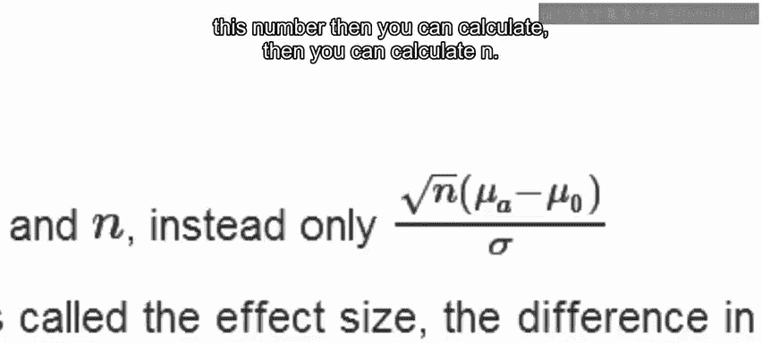
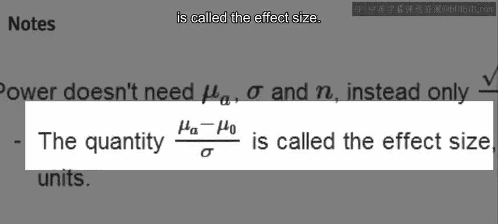

# 034：关于统计功效的笔记 📊

在本节课中，我们将学习统计功效（Power）的概念、计算公式及其在假设检验中的应用。我们将探讨如何通过已知参数计算功效，以及功效如何随不同因素变化。

---

## 统计功效的定义与公式

上一节我们介绍了假设检验的基本框架，本节中我们来看看统计功效的具体计算。

当我们检验备择假设 **μ > μ₀** 时，统计功效定义为 **1 - β**，其中 **β** 是第二类错误（即错误地接受原假设）的概率。

统计功效的计算公式如下：

**功效 = P( x̄ > μ₀ + z₁₋α × SE )**

其中，该概率是在 **μ = μₐ**（备择假设为真）的条件下计算的。这里，**x̄** 服从正态分布，其均值为 **μₐ**，方差为 **σ²/n**。

---

## 公式中的参数关系

在上述公式中，涉及多个参数。理解它们的关系对实验设计至关重要。

公式中的未知参数包括：**μₐ**（备择均值）、**σ**（标准差）、**n**（样本量）以及 **β**（或等效的 **功效**）。已知参数通常是 **μ₀**（原假设均值）和 **α**（第一类错误率，通常设定为0.05）。

这是一个包含多个变量的方程。只要指定其中任意三个参数，就可以解出第四个。

以下是几种常见的应用场景：

*   如果你知道想要检测的 **μₐ**、假定的 **σ** 和计划的 **n**，就可以计算统计功效。
*   如果你想要达到特定的 **功效**，并指定了 **μₐ** 和 **σ**，就可以解出所需的样本量 **n**。这在临床试验设计等场景中非常常见。
*   通常，研究者最关心的是 **n**（样本量）或 **β**（功效）。要么是“为了达到目标功效，我需要多少样本？”，要么是“给定我的样本量，我的检验功效是多少？这研究值得做吗？”。
*   当然，你也可以在已知其他参数的情况下，求解 **μₐ** 或 **σ**。

---

## 统计功效的影响因素

了解哪些因素会影响统计功效，能帮助我们更好地设计实验。以下是几个基本规律：

*   **α 增大，功效增大**：提高第一类错误的容忍度（放宽α），会直接提升检验功效。
*   **单侧检验的功效高于双侧检验**：这是因为在双侧检验中，α 被平分到了分布的两侧（使用 **z₁₋α/₂**，如1.96），而单侧检验将所有α放在一侧（使用 **z₁₋α**，如1.645），使得拒绝域更宽，更容易拒绝原假设。
*   **|μₐ - μ₀| 增大，功效增大**：备择均值与原假设均值差距越大，越容易被检测出来，功效越高。
*   **n 增大，功效增大**：样本量增加，样本均值的变异性（标准误）减小，使得检验更灵敏，功效提高。
*   **σ 减小，功效增大**：总体标准差减小，同样会降低样本均值的变异性，从而提高功效。

---

## 效应量：一个关键概念

统计功效并不单独依赖于所有上述参数，而是依赖于它们的一个组合函数。在这个案例中，这个函数是一维的。

**功效主要取决于效应量（Effect Size）**，其计算公式为：

**效应量 = |μₐ - μ₀| / σ**

效应量是**无量纲**的，因为它将均值差异用标准差进行了标准化。这使得效应量可以在不同问题、不同测量单位的研究之间进行比较和解释，成为一个非常实用的指标。知道了效应量，你就能更便捷地计算所需的样本量或预估的统计功效。

---

## 总结

本节课中，我们一起学习了统计推断中关于统计功效的核心内容。我们明确了功效的定义（1 - β），推导了其计算公式，并分析了公式中各个参数（μₐ, σ, n, α）的相互关系。我们了解到，功效随着α的增大、效应量的增大、样本量n的增大或标准差σ的减小而提高。最后，我们引入了**效应量**这个关键的无量纲概念，它是连接所有参数、决定统计功效大小的核心度量。掌握这些知识，对于科学地设计实验和评估假设检验的可靠性至关重要。