# 037：自举法 🚀

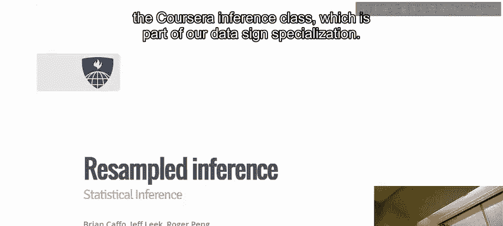

## 概述

在本节课中，我们将要学习一种极其重要的统计推断工具——**自举法**。自举法由著名统计学家埃夫龙于1979年提出，它极大地简化了构建置信区间和标准误的过程，使数据分析师无需依赖复杂的数学推导即可进行统计推断。我们将通过简单的例子，了解自举法的核心思想、操作步骤及其应用场景。

---

## 自举法的重要性与起源

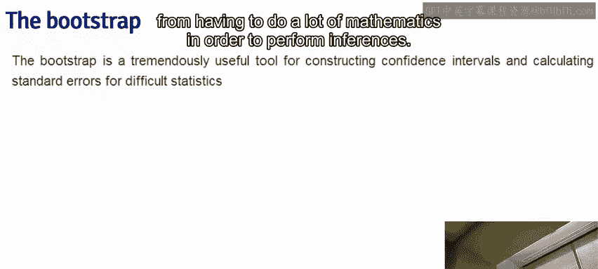

自举法在统计学历史上是一项极其重要的发现。它真正**解放了数据分析师**，使得人们无需进行大量复杂的数学运算，就能理解所计算统计量的分布特性。

例如，如果你想为**中位数**构建一个置信区间，虽然可以借助一些复杂的渐近理论，但这涉及大量数学。相反，你可以直接使用自举法，无需进行那些繁琐的工作就能获得中位数的置信区间。

“自举”这个名称来源于短语“靠自己的鞋带把自己拉起来”。虽然这个短语本意是指完成一件不可能的事，但统计中的自举法并非如此——它从所用信息到所得推断的逻辑链条是清晰且可行的。这项技术非常重要，非常具有解放性，并且非常符合数据科学的精神。

---

## 从一个例子理解自举思想

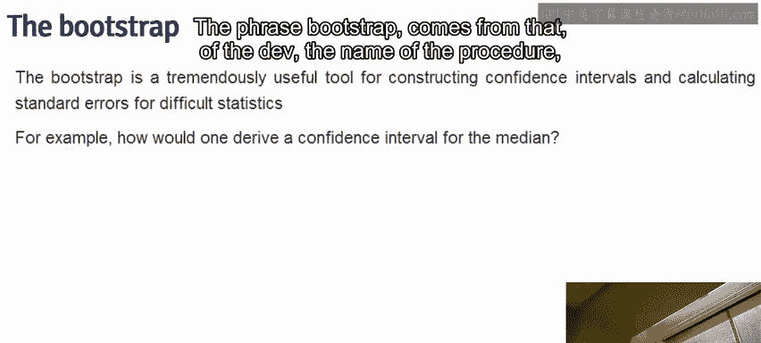

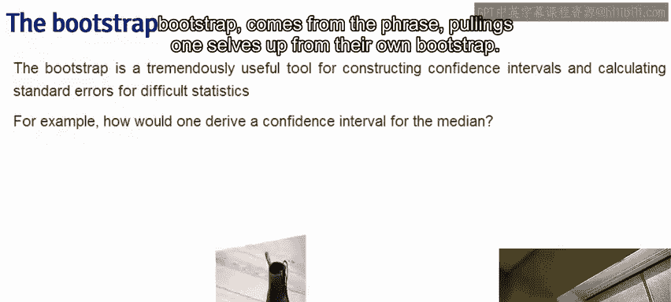

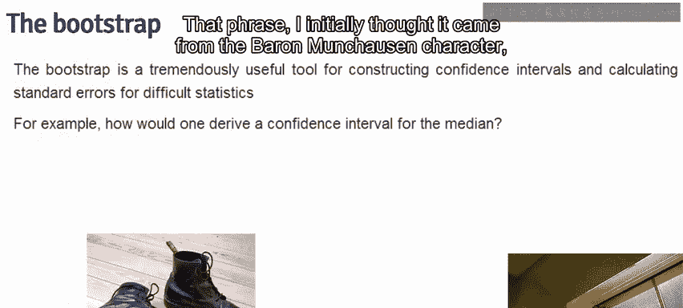

为了理解自举法，让我们考虑一个例子：评估**投掷50次骰子所得平均值**的分布行为。

我们的总体分布是左侧的分布，即在数字1到6上权重相等的条形图。

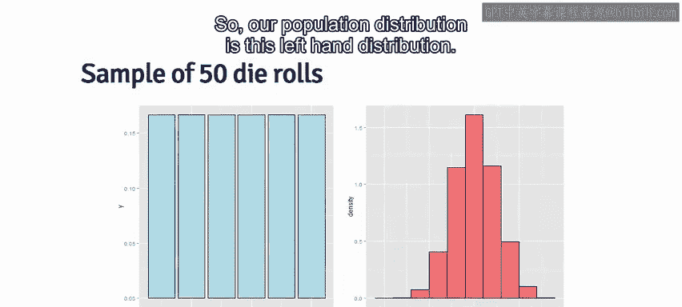

我们有几个方法可以做到这一点：
*   一种方法是尝试纯粹用数学计算出50次骰子平均值的分布，不进行模拟，只做相关的代数计算。
*   另一种方法是投掷一个骰子50次，得到一个平均值，然后反复重复这个过程，得到许多个50次投掷的平均值。

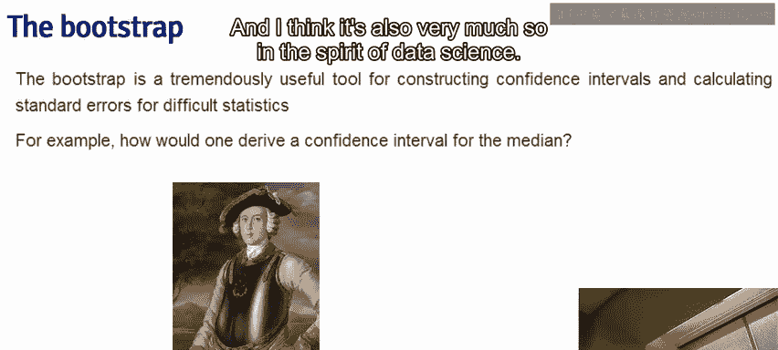

但第二种方法的前提是，我们知道真实的总体分布是每个数字的概率为六分之一。不过，这似乎是一种简单的方法，因为精确计算出得到某个特定平均值（例如5.5）的概率很困难，而反复投骰子模拟则更容易。

对于平均值，我们其实不需要这样做，因为我们知道平均值分布的一些性质：我们知道它以总体均值为中心，我们知道它的方差是σ²/n，等等。但我首先会围绕平均值来讨论，然后你将看到这个方法如何扩展到平均值以外的其他统计量。

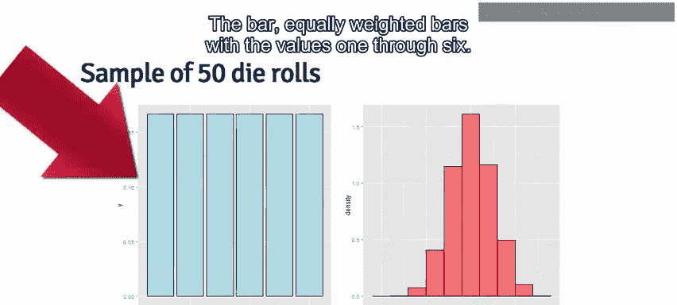

---

## 引入自举法的场景

现在，让我们考虑一个非常相似但更现实的问题。想象一下，你**不知道**生成你数据的骰子是否公平。我们不知道它落在1、2、3、4、5或6上的概率。

我们拥有的只是一个容量为50的样本。因此，我们只有一个平均值，而不是从生成数据的骰子那里得到的平均值分布。

在左侧，我向你展示的是我们从总体中抽取的一个具体样本实现中，各个数字出现次数的直方图。

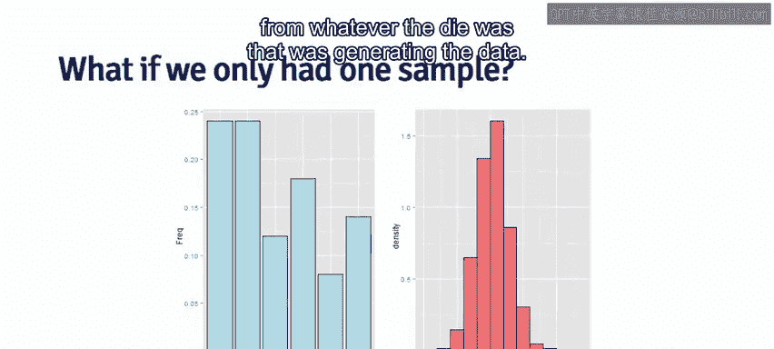

我无法评估从这个总体中抽取50次骰子投掷的平均值行为，因为我不知道总体是什么。我不知道该用什么骰子来执行模拟实验。

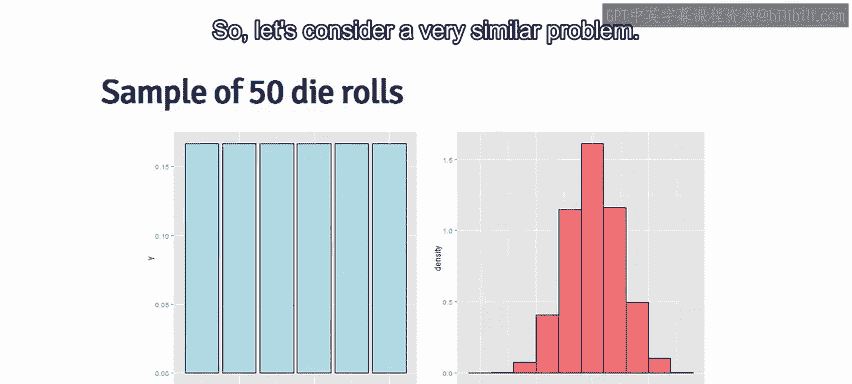

---

## 自举法的核心原则

那么，自举法说的是：好吧，我们为什么不退而求其次呢？我们为什么不从我们的**经验分布**中重复抽样呢？

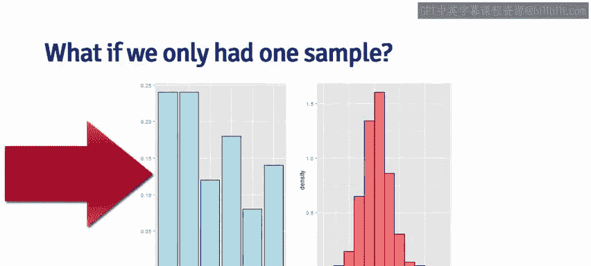

我们不是从真实分布中抽样，而是从我们容量为50的样本所估计的分布中抽样。在这个例子中，我将从这些蓝色条形图中抽样，抽样的概率与条形图的高度相关。

我会一遍又一遍地这样做，得到平均值，即从这个分布中抽取50次的重复平均值。这将告诉我平均值的分布情况，即使我只能从真实总体中观察到一个真实的平均值。

这就是自举的过程。从机械操作上讲，我们所做的是：将每个观测值（我们得到的每个1、2、3、4、5或6）放入一个袋子中，然后从中抽取容量为50的样本，并且是**有放回地**抽取，因此同一个数据点在这个过程中可能被抽出两次。

从这个袋子中抽取容量为50的样本，计算平均值，并反复重复这个过程。

但其根本思想是：精确地复制我们本可以进行的模拟实验——如果我们能用观察到的、由我们得到的那个具体的50次骰子投掷实现所生成的分布，来投掷真实的总体骰子的话。

---

## 基本自举原则总结

以上就是基本的自举原则：
1.  我们使用观测数据来构建一个估计的总体分布。
2.  我们从那个总体分布中进行模拟，以找出我们感兴趣的统计量的分布。

这就是基本思想。接下来，我们将通过一些比这个骰子例子更真实的场景来深入探讨。

---

## 总结

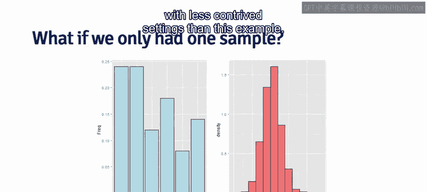

本节课中，我们一起学习了**自举法**。我们了解了它如何通过从单一观测样本的经验分布中重复抽样，来模拟统计量（如平均值）的抽样分布，从而绕过复杂的数学推导进行统计推断。其核心在于用样本数据估计总体，并基于此估计进行模拟实验。在接下来的课程中，我们将看到自举法在更实际场景中的应用。