# 📊 课程6：《统计推断》｜P12：方差模拟示例

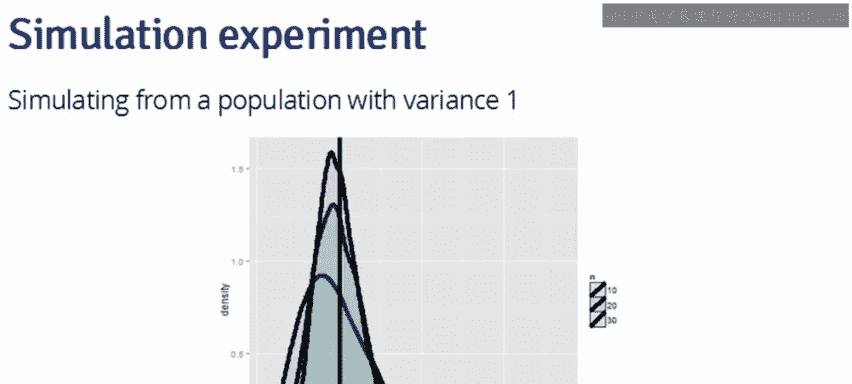

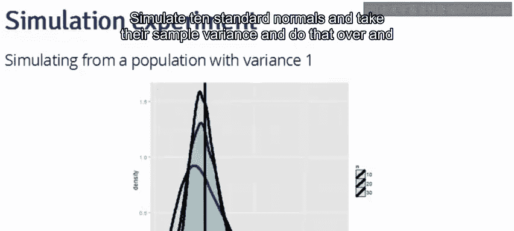

在本节课中，我们将通过模拟实验来理解样本方差的分布特性。我们将看到，样本方差如何随着样本量的增加，更准确地估计总体方差，并验证其无偏性。

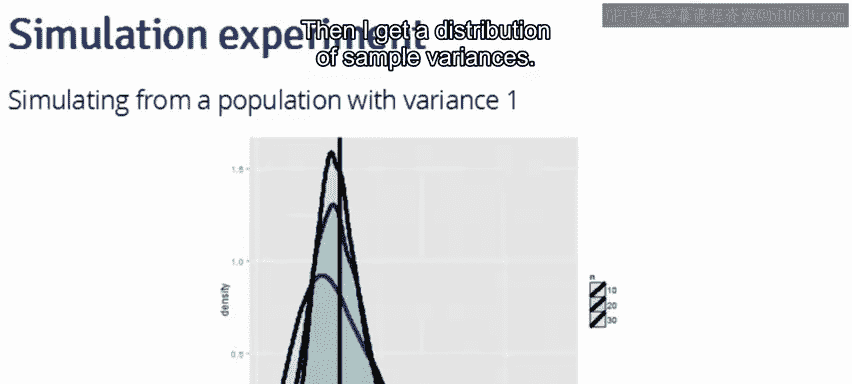

---

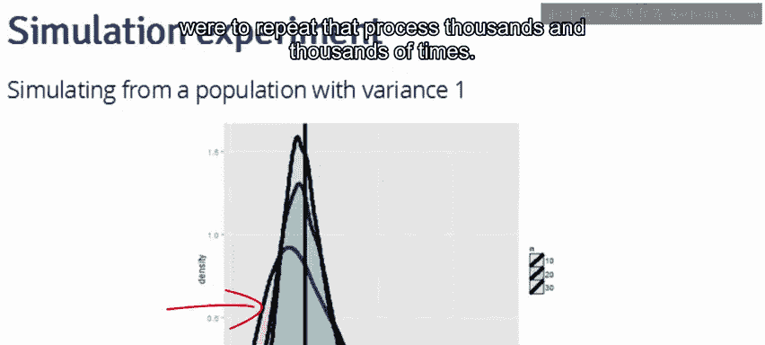

上一节我们讨论了样本方差作为总体方差估计量的性质。本节中，我们通过具体的模拟例子来直观展示这些性质。

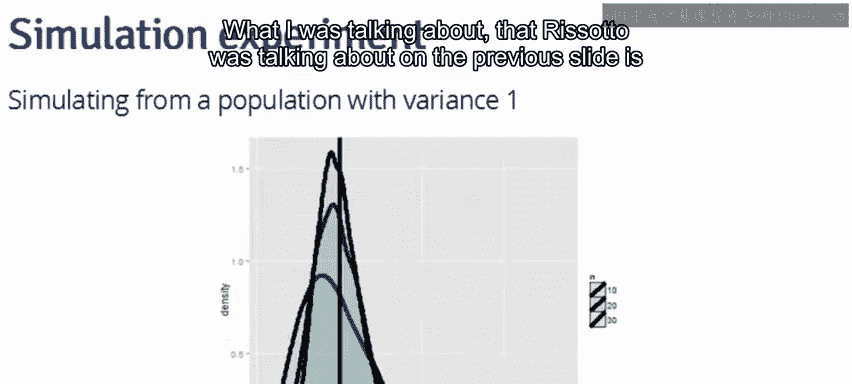

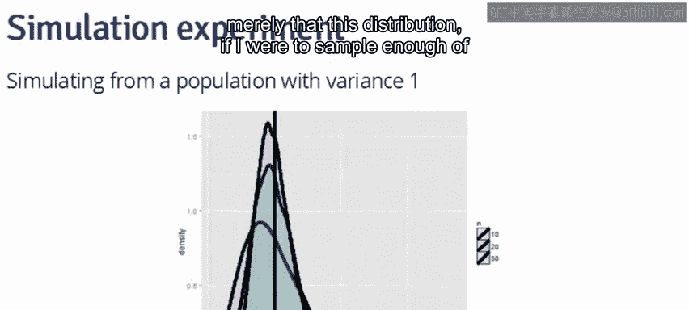

想象进行以下操作：重复模拟10个标准正态分布的随机数，计算其样本方差，并将此过程重复成千上万次。

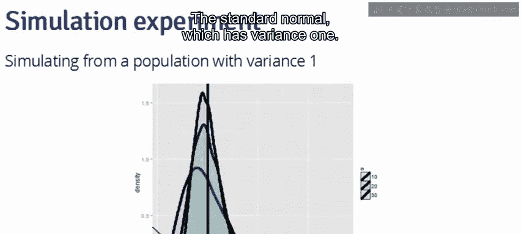

以下是模拟步骤：
1.  从标准正态分布中抽取10个观测值。
2.  计算这10个数的样本方差。
3.  将步骤1和2重复大量次数（例如10000次）。
4.  绘制所有这些样本方差的分布图。

通过这个模拟过程，我们得到了一个样本方差的分布。图中三文鱼色的密度曲线正是这个分布，它代表了来自方差为1的标准正态总体的、样本量为10的样本方差的分布。

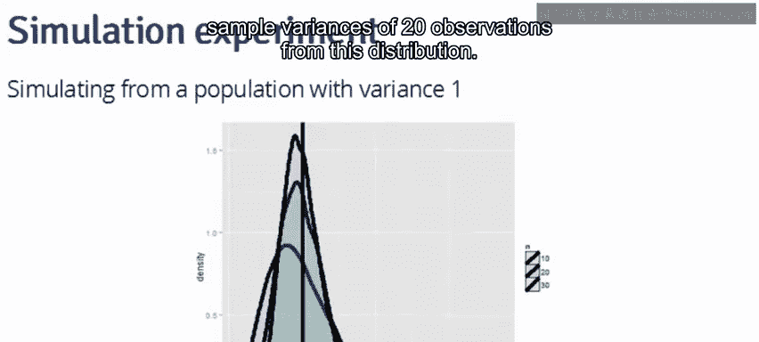

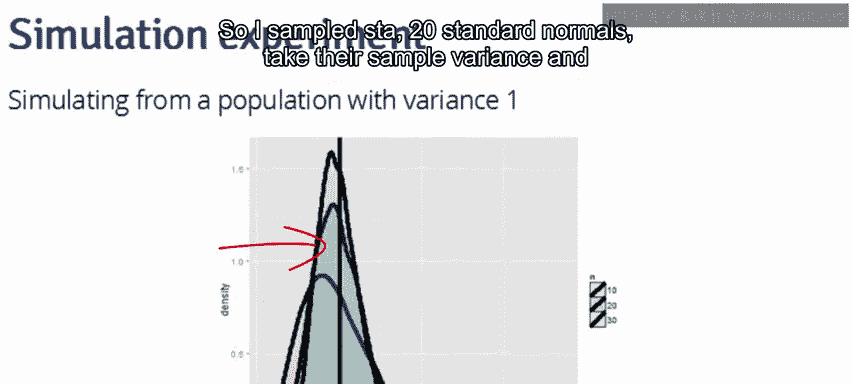

之前幻灯片中提到的结论是：如果我们抽取足够多的样本方差，这个分布的中心（均值）将恰好等于1，也就是我们抽样的原始总体（标准正态分布）的方差。

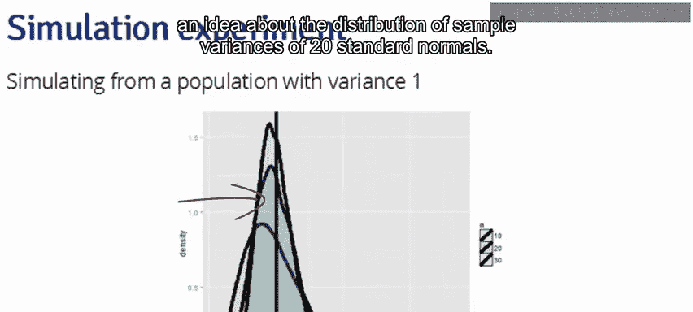

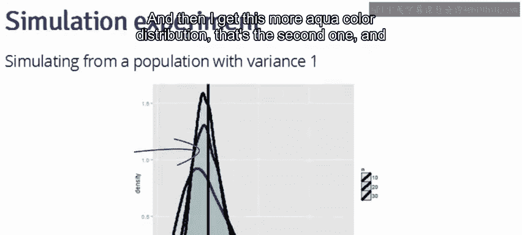

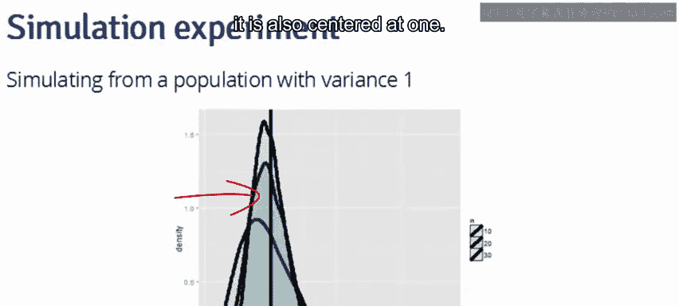

同样的原理也适用于样本量为20的情况。以下是操作步骤：
1.  从标准正态分布中抽取20个观测值。
2.  计算其样本方差。
3.  重复此过程大量次数。
4.  绘制分布图。

我们得到了第二个更偏向水蓝色的分布。可以看到，它同样以总体方差1为中心。

当我们对样本量为30的数据进行同样的模拟时，会得到第三个分布。请注意发生的变化：样本方差分布的方差（即离散程度）随着数据量的增加而变得更集中。

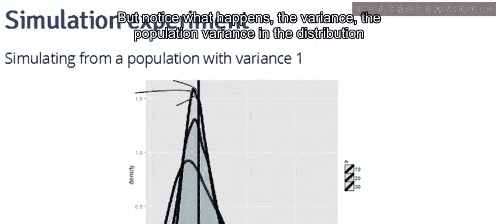

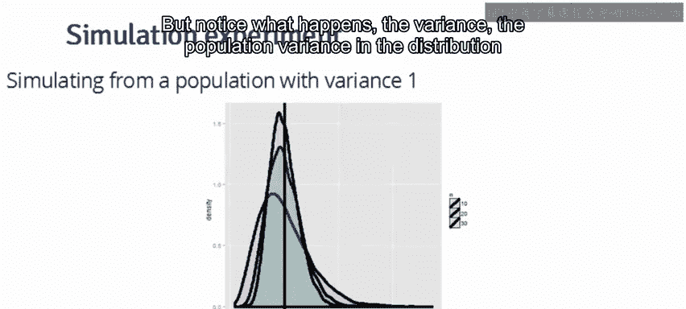

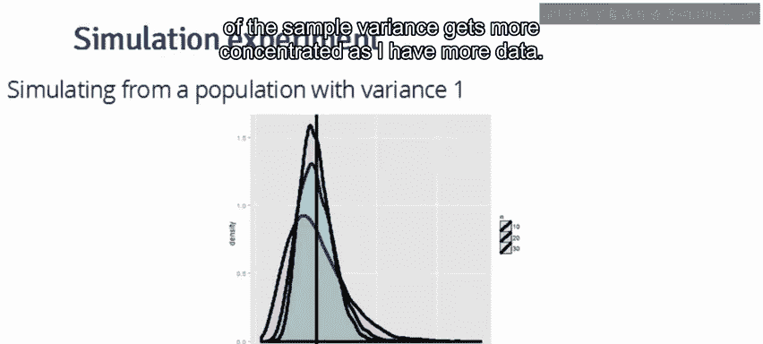

换句话说，更多的数据将产生一个更好、更集中的估计值，围绕样本方差试图估计的目标（本例中为1，因为总体方差为1）。

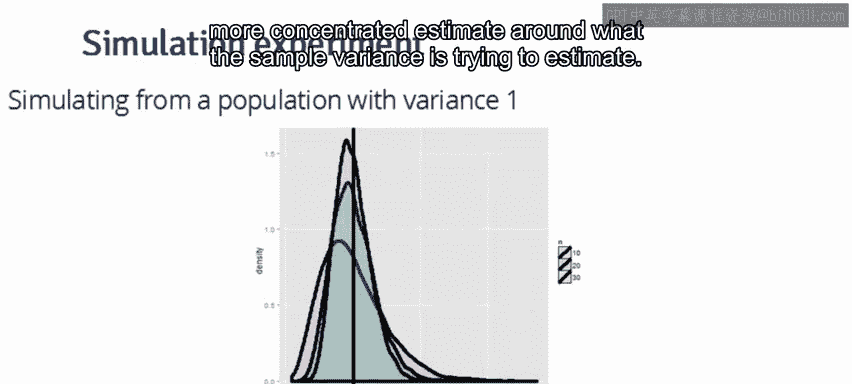

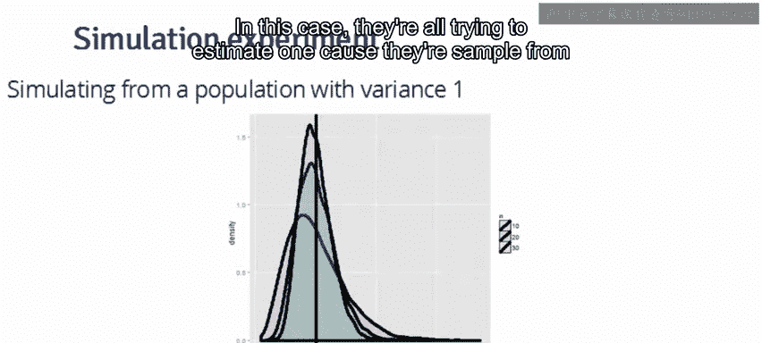

---

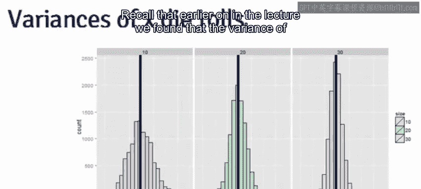

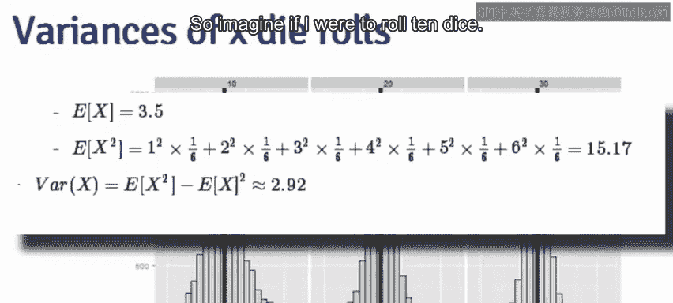

现在，让我们将这个概念应用到一个不同的例子中。回忆本课程早些时候的内容，我们计算出一个骰子点数的总体方差是2.92。

想象一下，如果我投掷10个骰子，并计算朝上一面点数的样本方差。

以下是模拟步骤：
1.  模拟投掷10个骰子，记录点数。
2.  计算这10个点数的样本方差。
3.  将此过程重复大量次数。

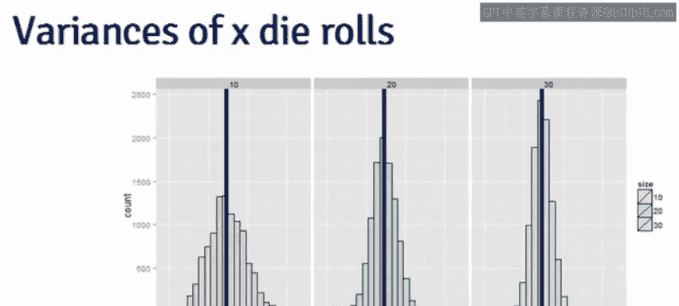

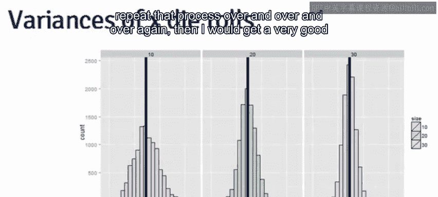

通过计算机进行成千上万次的模拟，我们得到了10个骰子点数的样本方差分布。可以注意到，这个分布的中心正好围绕在2.92附近，即单个骰子的总体方差。

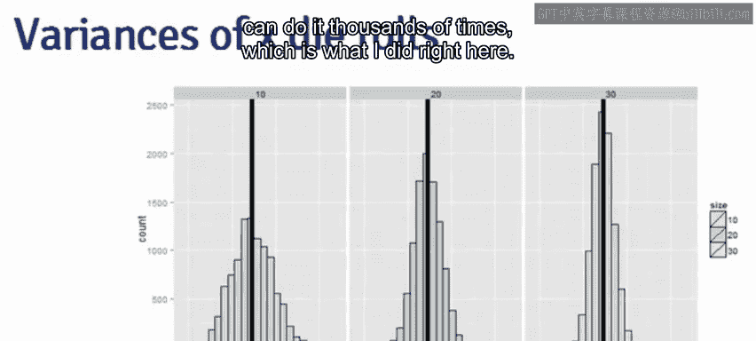

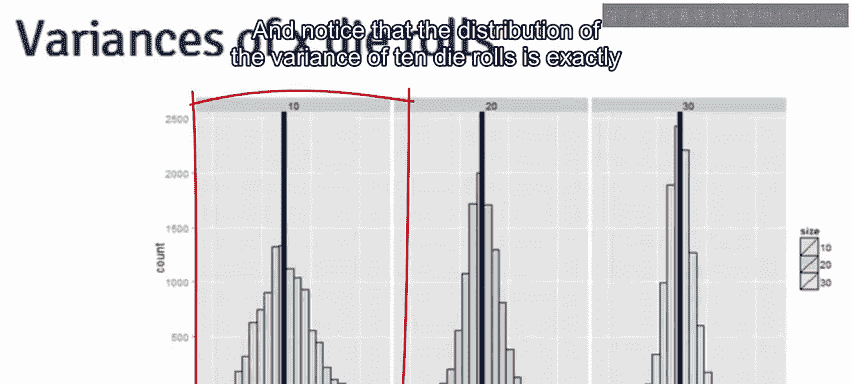

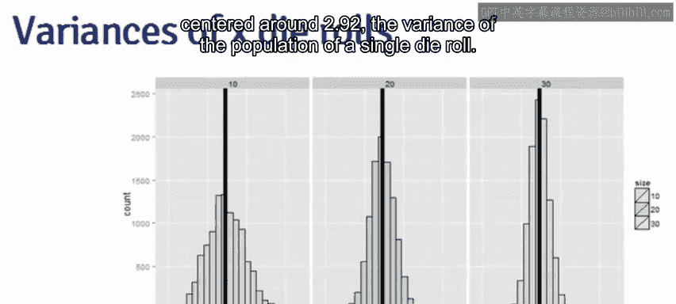

当我将样本量增加到20和30时，分布仍然以同一个值（2.92）为中心，但围绕中心估计值的分布变得更加集中。

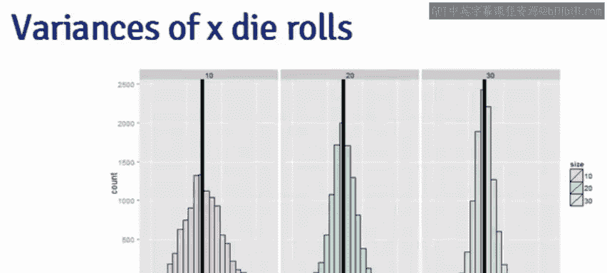

这基本上说明，样本方差是总体方差的一个良好估计量。随着我们收集更多数据，样本方差的分布会越来越集中于它试图估计的目标，并且其中心位置是正确的，也就是说它是**无偏的**。

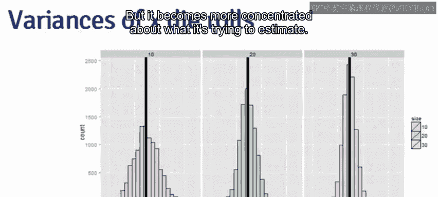

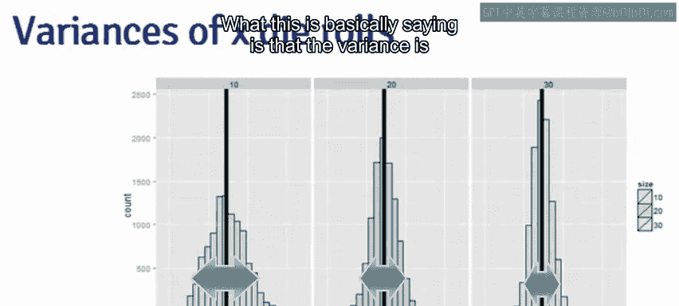

这种无偏性正是我们在计算样本方差时除以 **`n-1`** 而不是 **`n`** 的原因。除以 `n-1` 的修正使得样本方差成为总体方差的无偏估计量。

---

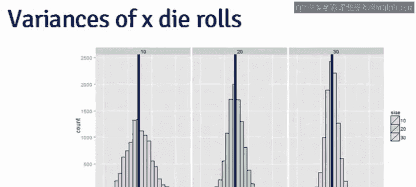

本节课中，我们一起通过模拟实验学习了样本方差的分布特性。我们验证了样本方差是总体方差的无偏估计量，并且随着样本量的增加，估计会变得更加精确和集中。理解为什么使用 `n-1` 作为分母是保证这一无偏性的关键。