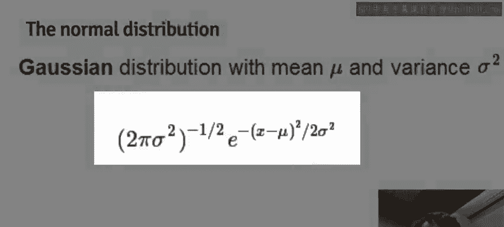
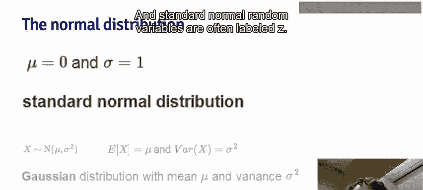
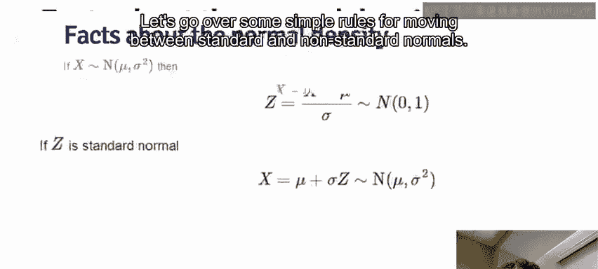
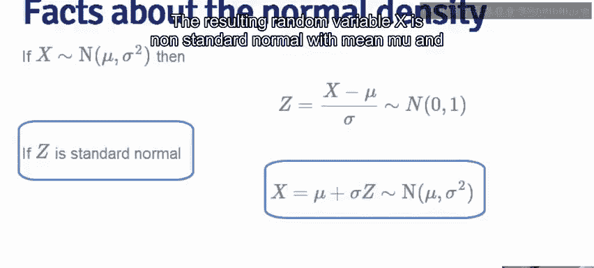
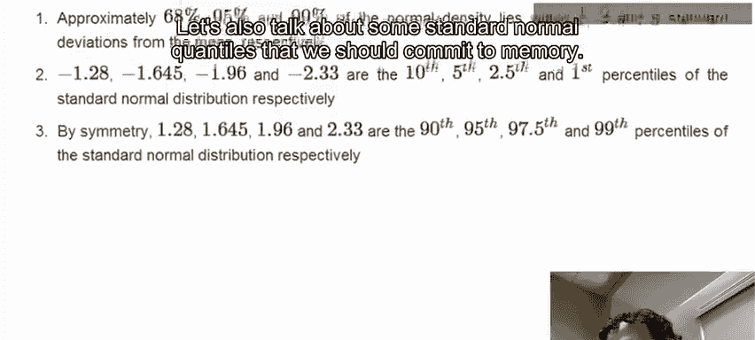
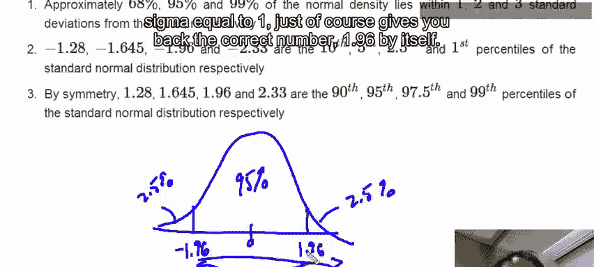

# 📊 课程6：《统计推断》｜P16：正态分布

在本节课中，我们将要学习统计学中最重要的分布之一——正态分布。我们将了解其定义、特性、标准正态分布的概念，以及如何计算正态分布的概率和分位数。通过具体示例，你将掌握处理正态分布相关问题的基本方法。




---



正态分布无疑是最重要的分布。在后续课程中，我们将看到它如此重要的原因。可以说，如果所有分布要选举一个“领导者”，那必定是正态分布。

当一个随机变量服从均值为 **μ**、方差为 **σ²** 的正态（或高斯）分布时，其概率密度函数就是著名的钟形曲线，我们稍后会展示。


如果随机变量 **X** 具有此密度函数，那么它的期望值 **E(X) = μ**，方差 **Var(X) = σ²**。我们通常简写为：
**X ~ N(μ, σ²)**

当 **μ = 0** 且 **σ = 1** 时，得到的分布称为标准正态分布。标准正态随机变量通常用 **Z** 表示。


上图绘制了标准正态密度函数，即你可能见过的著名钟形曲线。记住，对于标准正态分布，其均值为0，标准差和方差均为1。图中标注了均值上下1个、2个和3个标准差的位置。

标准正态的单位可以看作是标准差单位。例如，向均值一侧移动一个单位，就是移动了一个标准差。

值得注意的是，对于非标准正态分布，统计学家习惯于通过谈论“距离均值的标准差数”将其转换回标准正态。例如，想知道一个非标准正态变量落在 **μ ± 1σ** 区间内的概率，这完全等同于标准正态落在 **-1 到 +1** 区间内的概率。本质上，所有正态分布的形状都相同，唯一改变的是坐标轴上的单位。当谈论正态概率时，如果将其转换为“距离均值的标准差数”，那么所有概率计算都回归到标准正态的计算。我们稍后会通过例子说明，但这是基本的直觉。


---



上一节我们介绍了正态分布的基本概念，本节中我们来看看标准正态分布的一些关键概率值，记住它们对快速估算概率很有帮助。

以下是标准正态分布（或任何正态分布）中，关于均值对称区间的概率质量：

*   **在均值 ±1 个标准差内**：概率质量约为 68%。即，约34%在均值左侧一个标准差内，34%在右侧。
*   **在均值 ±2 个标准差内**：概率质量约为 95%。这意味着两侧尾部各剩约2.5%的质量。我们在讨论置信区间时会频繁用到这一点。
*   **在均值 ±3 个标准差内**：概率质量约为 99%。






你应该记住这些参考概率。

---

了解了基本概率后，我们来看看如何在标准正态和非标准正态之间转换。

以下是转换的基本规则：




*   如果 **X ~ N(μ, σ²)**，那么通过标准化（减去均值 μ 再除以标准差 σ）得到的变量 **Z = (X - μ) / σ** 就是一个标准正态变量，即 **Z ~ N(0, 1)**。
*   反之，如果有一个标准正态变量 **Z**，通过逆转换（乘以标准差 σ 再加上均值 μ）得到的变量 **X = μ + σZ** 就是一个均值为 μ、方差为 σ² 的非标准正态变量。

我们已经讨论过，正态分布中约有68%、95%和99%的质量分别落在距离均值1个、2个和3个标准差的范围内。

---

除了区间概率，我们还需要记住一些标准正态的关键分位数。

以下是几个重要的分位数及其含义：


*   **-1.28**：在标准正态分布中，这是使得10%的质量低于该点、90%高于该点的分位数。对于非标准正态 **N(μ, σ²)**，对应的点是 **μ - 1.28σ**。
*   **1.28**：由对称性，这是使得10%的质量高于该点、90%低于该点的分位数。对于非标准正态，对应点是 **μ + 1.28σ**。
*   **±1.96**：这是更重要的分位数（常近似为2）。**-1.96** 是使得2.5%的质量低于该点的分位数；**+1.96** 是使得2.5%的质量高于该点的分位数。这意味着两者之间有95%的质量。对于非标准正态，对应的区间是 **[μ - 1.96σ, μ + 1.96σ]**。


当然，对于标准正态（μ=0, σ=1），这些点就是 ±1.28 和 ±1.96 本身。

---

现在，让我们通过几个难度递增的计算示例来应用所学知识。

**示例1：计算分位数**
问题：正态分布 **N(μ, σ²)** 的第95百分位数（即95%的值小于它）是多少？
*   **R语言方法**：使用 `qnorm` 函数。
    ```r
    qnorm(0.95, mean = μ, sd = σ) # 注意 sd 是标准差，不是方差
    ```
*   **概念方法**：我们知道对于标准正态，使得95%质量低于它的点是 **1.645**（即距离均值1.645个标准差）。因此，对于非标准正态，该点就是 **μ + 1.645σ**。

**示例2：计算概率（通用问题）**
问题：对于正态分布 **N(μ, σ²)**，**X** 大于某个值 **x** 的概率是多少？即求 **P(X > x)**。
*   **R语言方法**：使用 `pnorm` 函数，并指定计算上尾概率。
    ```r
    pnorm(x, mean = μ, sd = σ, lower.tail = FALSE)
    # 或 1 - pnorm(x, mean = μ, sd = σ)
    ```
*   **概念方法**：将 **x** 标准化，计算它距离均值多少个标准差：**z = (x - μ) / σ**。然后计算标准正态下 **Z > z** 的概率。例如，如果 **z ≈ 2**，我们知道概率大约为2.5%。

---

让我们将上述通用问题放入一个具体情境中。

**具体示例：广告点击量**
假设一家公司每日广告点击量近似服从正态分布，均值为 **1020** 次/天，标准差为 **50** 次/天。我们假设每天的数据是来自该总体的一个独立随机样本。

**问题A：** 某一天点击量超过 **1160** 次的概率是多少？
1.  **估算**：1160 比均值1020多出140次。由于标准差是50，这相当于 **140 / 50 = 2.8** 个标准差。我们知道3个标准差已经很极端，所以这个概率应该很小。
2.  **R语言计算**：
    ```r
    pnorm(1160, mean = 1020, sd = 50, lower.tail = FALSE)
    ```
    结果约为 **0.003**。
3.  **标准化验证**：计算标准分数 **z = (1160-1020)/50 = 2.8**，然后计算标准正态的上尾概率：
    ```r
    pnorm(2.8, lower.tail = FALSE)
    ```
    得到相同结果（约0.003）。

**问题B：** 点击量达到多少，才能使得75%的天的点击量低于该值？（即求第75百分位数）
1.  **估算**：均值1020也是中位数（50%分位数）。所以答案肯定大于1020。再考虑均值上一个标准差的位置：1070。我们知道约84%的质量低于1070（因为均值到+1σ间约34%，加上左侧50%）。因此，第75百分位数应在1020和1070之间。
2.  **R语言计算**：
    ```r
    qnorm(0.75, mean = 1020, sd = 50)
    ```
    结果约为 **1054**，确实在我们估算的区间内。


---


本节课中我们一起学习了：
1.  **正态分布的定义**：表示为 **N(μ, σ²)**，其概率密度函数为钟形曲线。
2.  **标准正态分布**：均值为0，标准差为1的正态分布，记为 **N(0, 1)**，常用 **Z** 表示。
3.  **关键概率**：正态分布中约68%、95%、99%的数据分别落在距离均值1、2、3个标准差的范围内。
4.  **标准化与反标准化**：通过 **Z = (X - μ)/σ** 可将任何正态变量转换为标准正态；通过 **X = μ + σZ** 可转换回来。
5.  **重要分位数**：如标准正态的 **±1.28** (对应10%/90%尾)、**±1.96** (对应2.5%尾，中间95%)。
6.  **计算应用**：使用R语言的 `pnorm` 计算概率，`qnorm` 计算分位数；或通过标准化结合记忆的分位数进行快速心算估算。


掌握正态分布是理解许多统计推断方法的基础，务必熟悉其特性和基本计算。