# 课程6：统计推断 - P25：假设检验 🔍

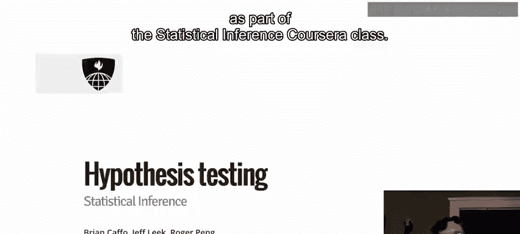

在本节课中，我们将要学习假设检验的基本概念。假设检验是统计推断的核心工具之一，它利用数据来做出决策。我们将从定义零假设和备择假设开始，然后讨论决策过程中可能出现的两类错误，最后介绍进行假设检验的一般步骤。

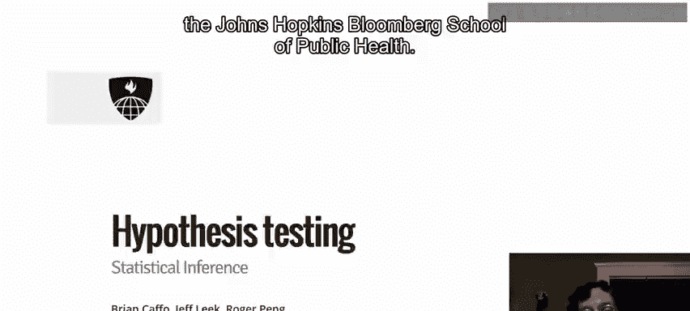

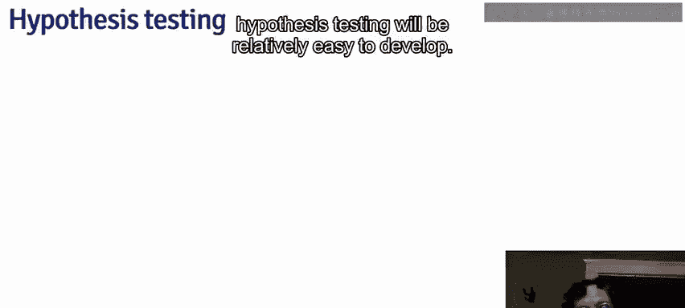

---

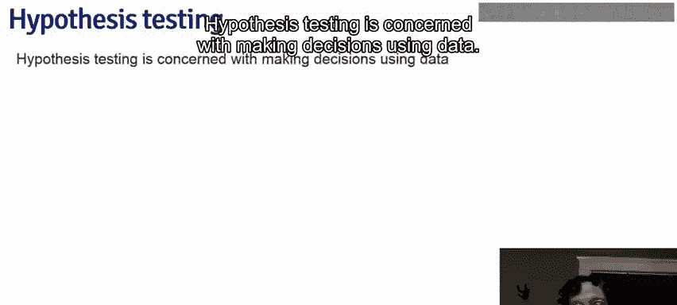

## 概述 📋

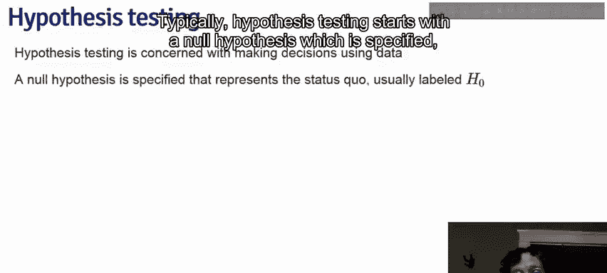

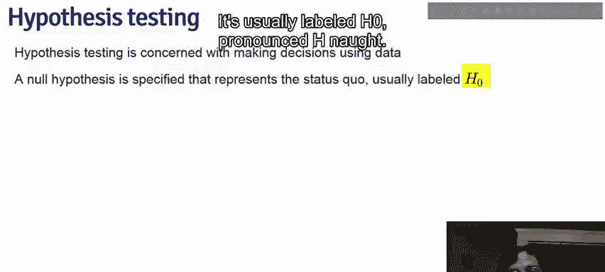

假设检验基于已有的置信区间知识，其发展相对容易。它关注于使用数据做出决策。通常，检验从一个代表现状的**零假设**开始，我们需要统计证据来拒绝它，以支持**备择假设**（或称研究假设）。

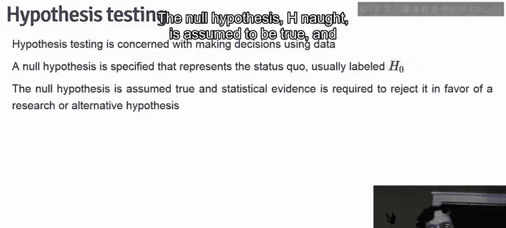

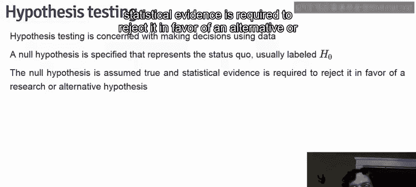

## 零假设与备择假设 ⚖️

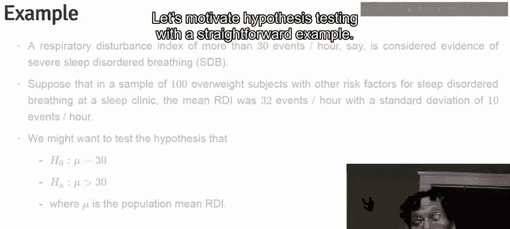

假设检验通常始于一个零假设，它代表现状，通常标记为 **H₀**。

零假设 **H₀** 被假定为真，需要统计证据才能拒绝它，转而支持一个备择假设或研究假设。

让我们通过一个简单的例子来引入假设检验。

**示例**：呼吸紊乱指数超过每小时30次事件被认为是严重睡眠呼吸障碍的证据。假设在一个睡眠诊所中，从100名有其他睡眠呼吸障碍风险因素的超重受试者中抽取样本，测得平均RDI为每小时32次事件，标准差为每小时10次事件。我们想检验从中抽取样本的总体均值是否等于30（严重睡眠呼吸障碍的基准值），或者是否大于30。

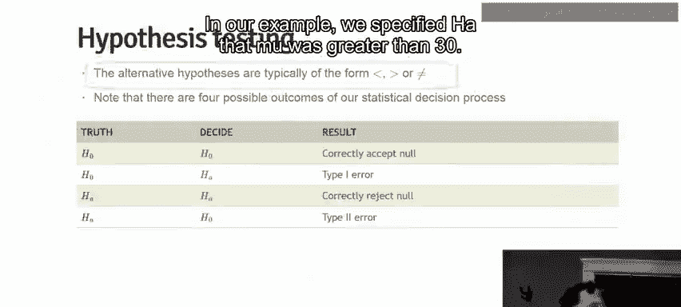

因此，我们设定：
*   零假设 **H₀**: μ = 30
*   备择假设 **Hₐ**: μ > 30

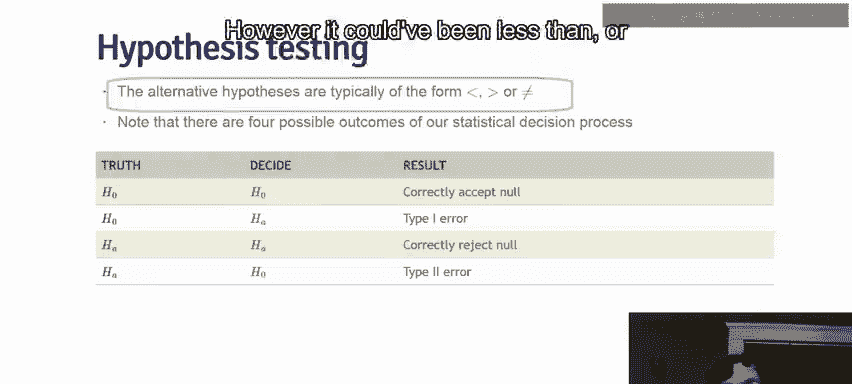

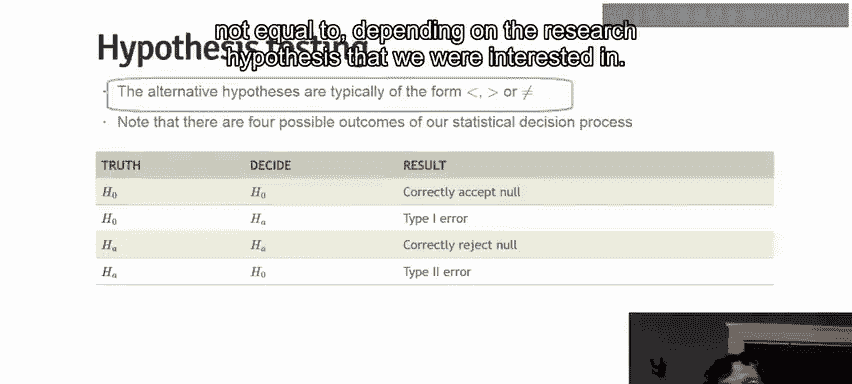

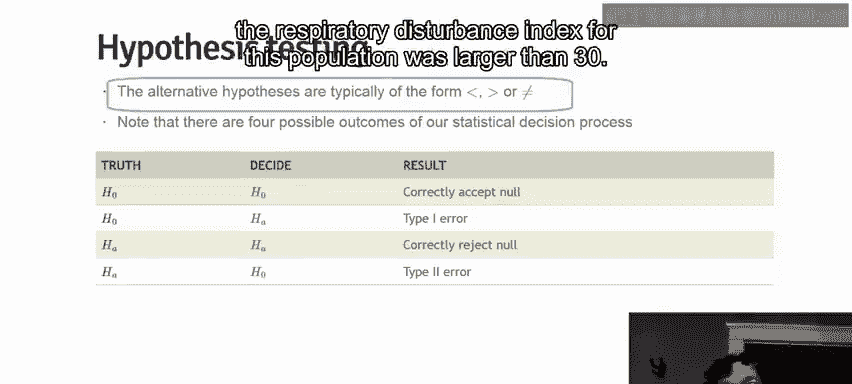

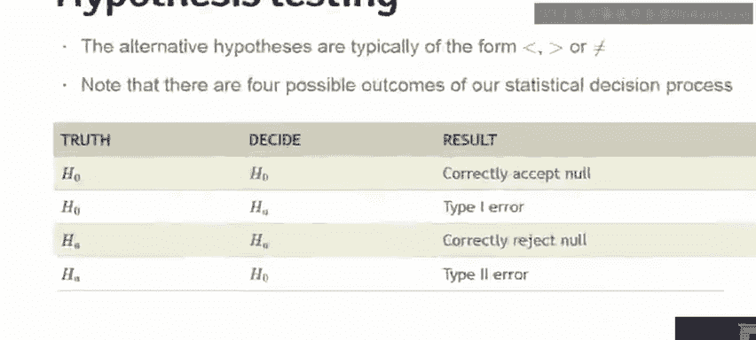

在我们的例子中，我们设定 **Hₐ** 为 μ > 30。然而，根据具体研究兴趣，备择假设也可以是小于或不等于。

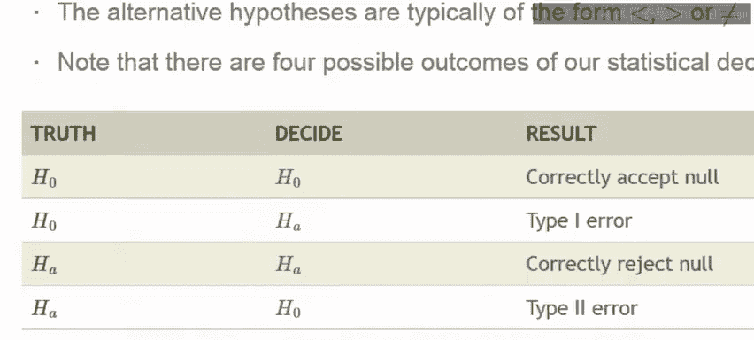

## 决策与两类错误 ⚠️

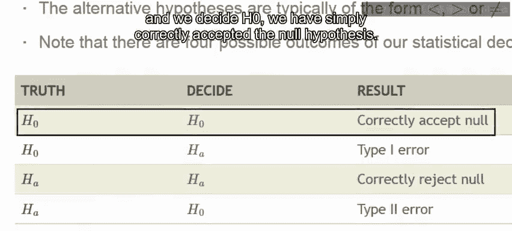

请注意，事实要么是 **H₀** 为真，要么是 **Hₐ** 为真。而我们的决策要么是 **H₀**，要么是 **Hₐ**。

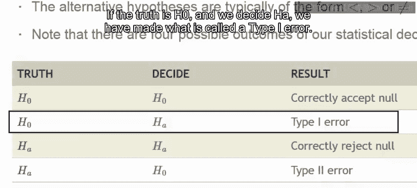

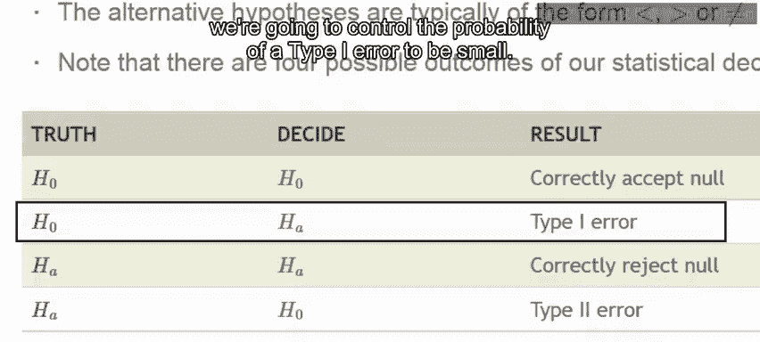

因此，只有四种可能性：

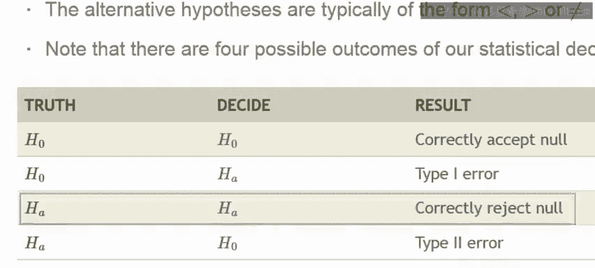

以下是四种决策结果：
1.  如果 **H₀** 为真，我们决定 **H₀**，那么你**正确接受**了零假设。
2.  如果 **H₀** 为真，我们决定 **Hₐ**，那么我们犯了所谓的 **第一类错误**。
3.  如果 **Hₐ** 为真，我们决定 **Hₐ**，即拒绝零假设，那么我们**正确拒绝**了零假设。
4.  如果 **Hₐ** 为真，我们决定 **H₀**，那么我们犯了所谓的 **第二类错误**。

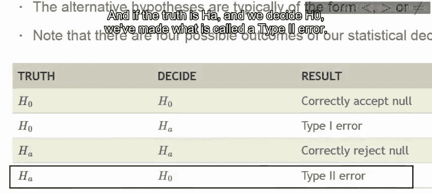

在我们将要介绍的假设检验版本中，我们将控制第一类错误的概率，使其保持较小。

第一类错误率和第二类错误率是相关的，当第一类错误率增加时，第二类错误率会下降，反之亦然。我们可以通过考虑法庭来轻松说明这一点。

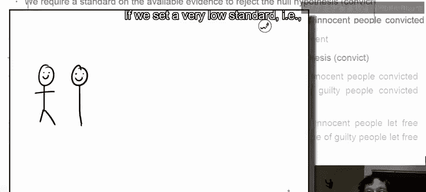

在大多数法庭中，零假设是被告在被证明有罪之前是无辜的。在这里，拒绝零假设就是判定被告有罪。我们需要证据和该证据的标准来拒绝假设。

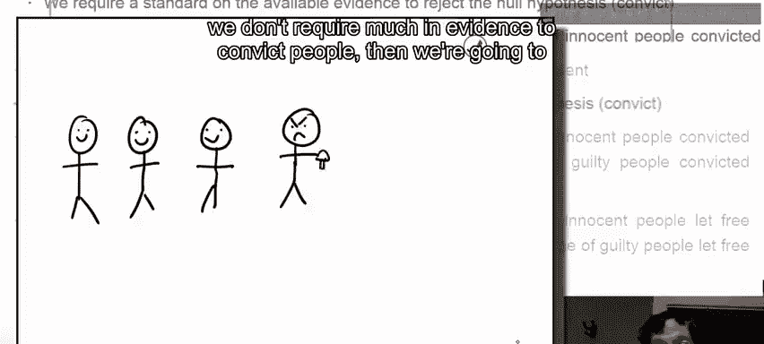

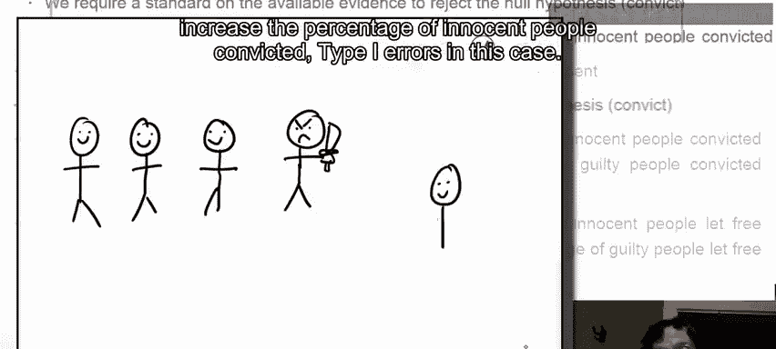

如果我们设定一个非常低的标准（即我们不需要太多证据来定罪），那么我们将增加无辜者被定罪（在此情况下为第一类错误）的百分比。然而，它也会增加有罪者被定罪（即正确拒绝零假设）的百分比。

如果我们设定一个非常高的标准（基本上，一个人必须手上有确凿证据才能定罪），那么我们将增加无辜者被释放（正确接受零假设的好事）的百分比，同时也会增加有罪者被释放（即所谓的第二类错误）的百分比。这说明了第一类和第二类错误是如何相关的。

当然，理想情况下，你希望对于给定的标准获得更好的证据，这就是增加样本量等做法的意义。但在讨论这些问题之前，让我们谈谈如何进行假设检验。

---

## 总结 ✨

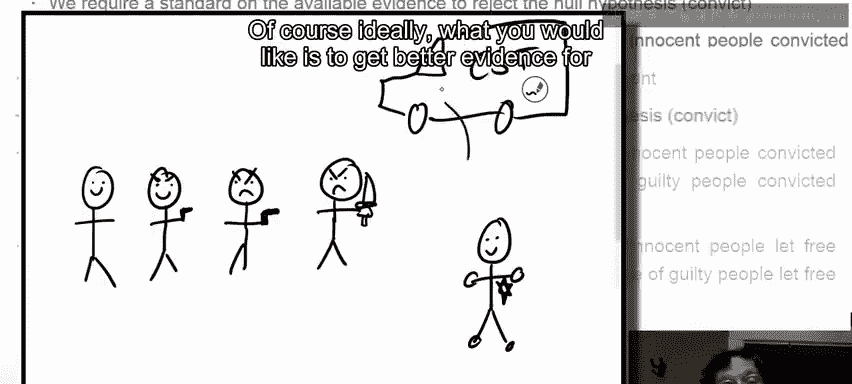

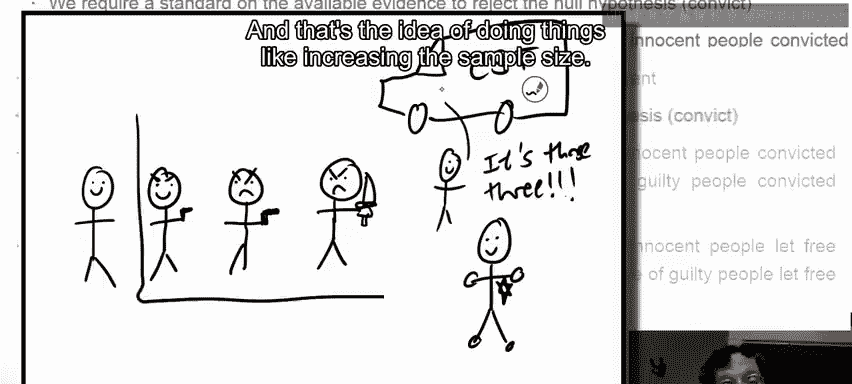

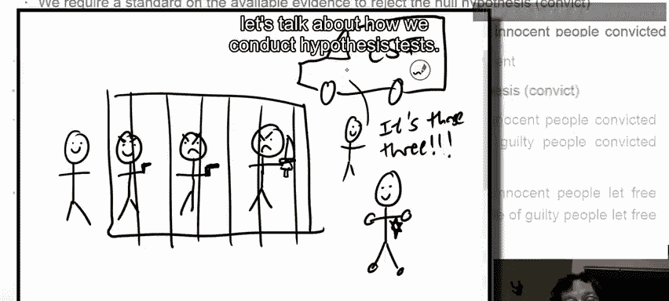

本节课中，我们一起学习了假设检验的基础。我们定义了零假设 **H₀** 和备择假设 **Hₐ**，理解了在基于数据做出决策时可能发生的**第一类错误**（拒真）和**第二类错误**（纳伪），并认识到这两类错误率之间存在此消彼长的关系。最后，我们了解到可以通过如增加样本量等方式来改善证据质量，为后续学习具体的检验步骤奠定了基础。