# 课程6：《统计推断》｜P26：选择拒绝区域的示例 📊

在本节课中，我们将学习如何为假设检验设定一个拒绝区域。我们将通过一个具体的呼吸障碍指数示例，详细讲解如何选择一个临界值C，使得第一类错误率α控制在可接受的水平（例如5%）。理解这个过程是掌握假设检验决策规则的关键。

## 概述

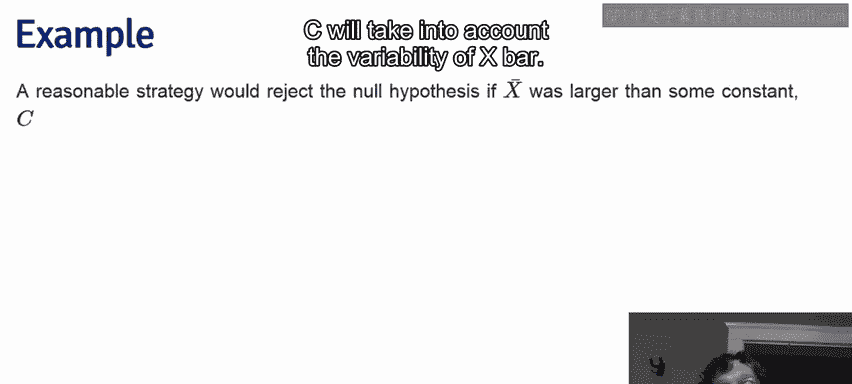

假设检验的核心是建立一个决策规则，以决定何时拒绝原假设。这个规则通常基于一个“拒绝区域”。如果样本统计量落入这个区域，我们就拒绝原假设。本节课程将演示如何根据期望的第一类错误率α来计算这个拒绝区域的边界。

## 回顾示例：呼吸障碍指数

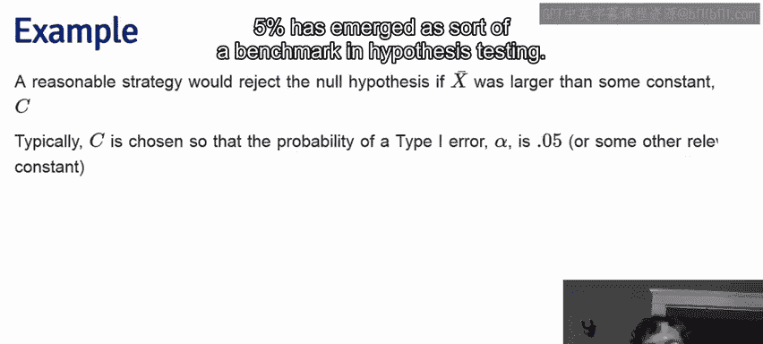

上一节我们介绍了假设检验的基本框架。本节中我们来看看一个具体的应用。

再次考虑我们的呼吸障碍指数示例。一个合理的策略是，如果样本平均呼吸障碍指数大于某个常数C，我们就拒绝原假设。

## 设定第一类错误率α

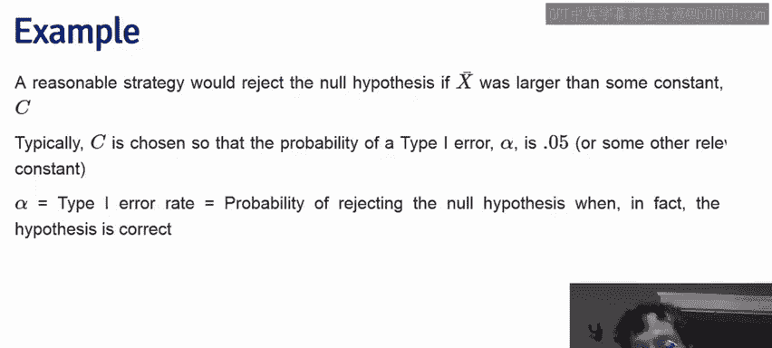

常数C的选择需要考虑样本均值`X bar`的变异性。通常，C被设定为使第一类错误率α保持在一个较低的水平。

*   **第一类错误（Type I Error）**：当原假设为真时，错误地拒绝原假设的概率。我们用α表示。
*   **常用基准**：在假设检验中，5%已成为一个常见的α基准值。

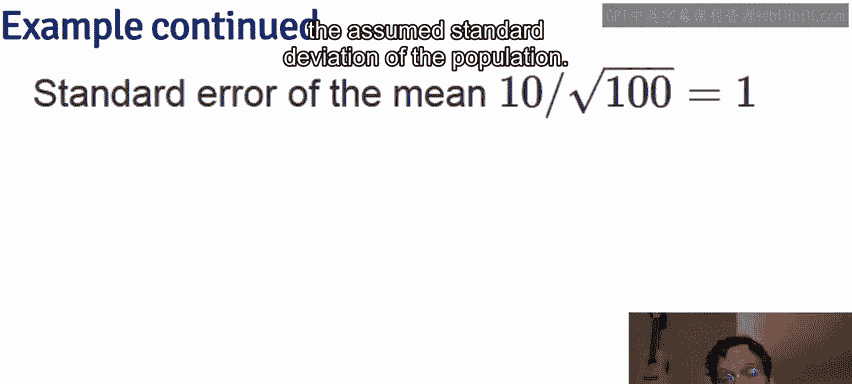

我们不希望犯第一类错误，但也不能将α设得过低，否则我们将永远无法拒绝原假设。我们的目标是选择一个常数C，使得拒绝原假设的概率恰好是我们可以容忍的低水平，例如5%。

## 计算标准误

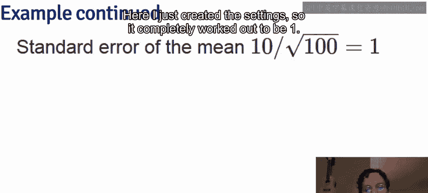

在我们的示例中，总体标准差假设为10，样本量为100。因此，样本均值的标准误计算如下：

**公式：**
`标准误 = σ / √n = 10 / √100 = 1`

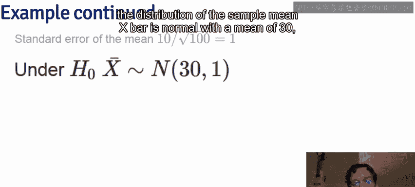

这里，我们暂时不区分总体标准差是已知给定值还是从数据中估计的。

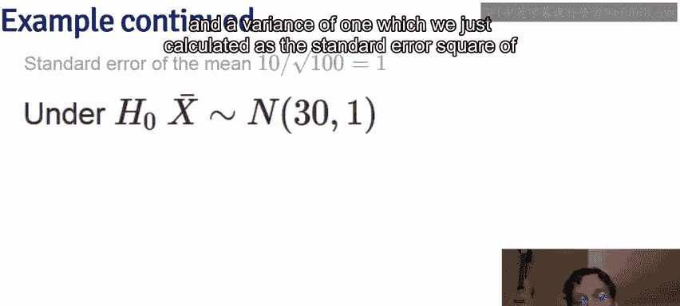

## 原假设下的样本均值分布

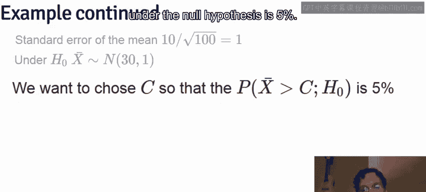

在原假设H₀成立（即总体均值μ = 30）的条件下，样本均值`X bar`的分布是正态分布：

**公式：**
`X bar ~ N(μ = 30, 方差 = 标准误² = 1²)`

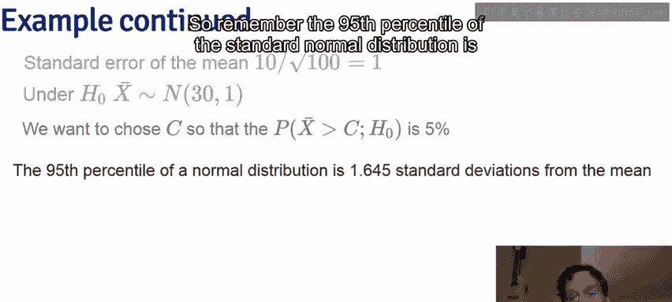

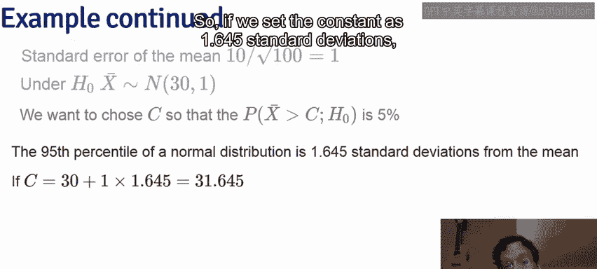

也就是说，`X bar`服从均值为30、方差为1的正态分布。

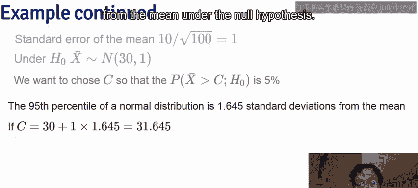

## 确定临界值C

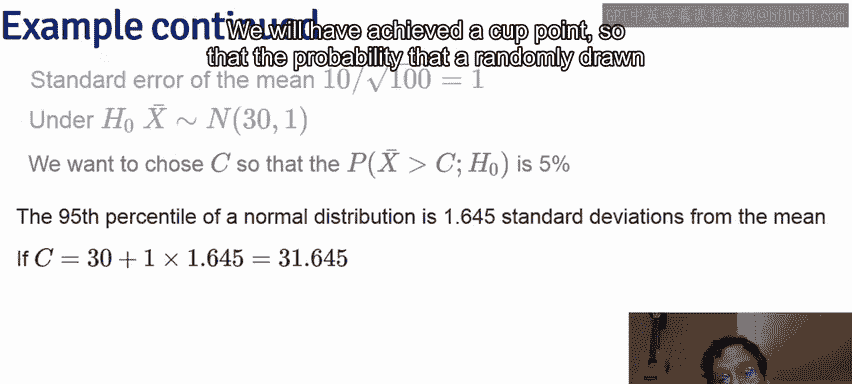

我们希望选择常数C，使得在原假设下`X bar`大于C的概率为5%。

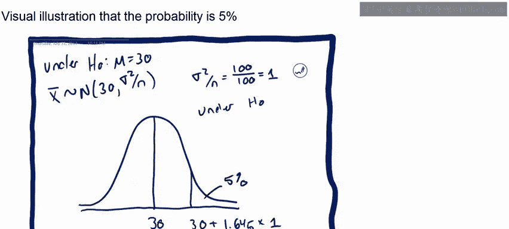

**公式：**
`P(X bar > C | H₀) = 0.05`

我们知道标准正态分布的95%分位数是1.645。这意味着，如果我们设定的常数C距离原假设均值有1.645个标准误，那么`X bar`大于C的概率就正好是5%。

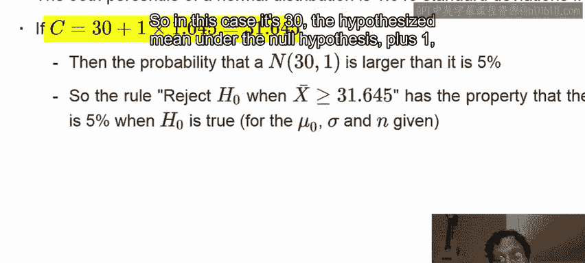

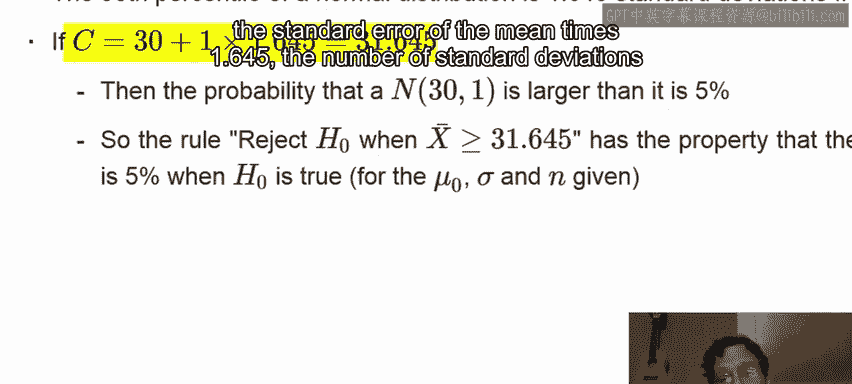

因此，临界值C的计算如下：

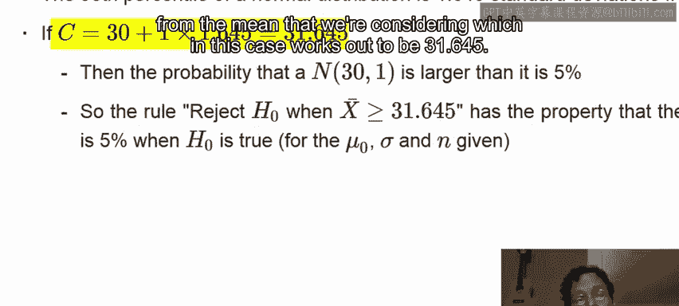

**公式：**
`C = μ₀ + (标准误 × Z₀.₉₅) = 30 + (1 × 1.645) = 31.645`

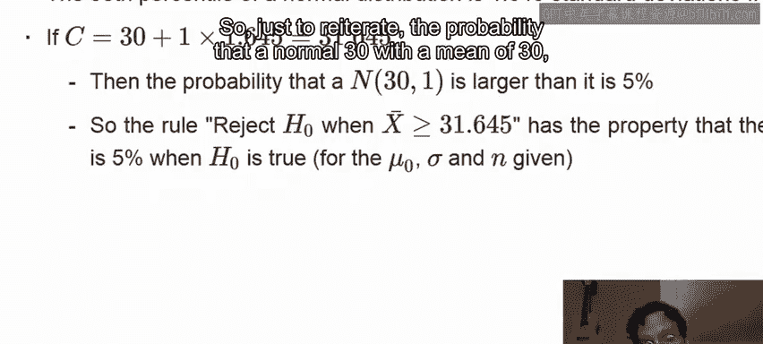

重申一下：一个服从`N(30, 1)`分布的随机变量，其值大于31.645的概率是5%。

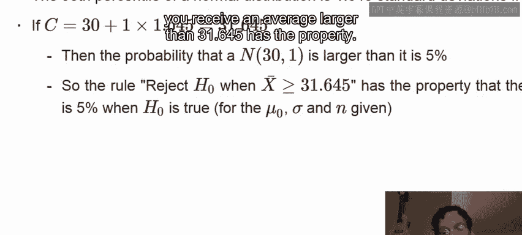

## 构建决策规则

于是，我们得到决策规则：**当观测到的样本均值大于31.645时，拒绝原假设。**

这条规则的性质是：在原假设为真的情况下，我们有5%的概率会（错误地）拒绝它。这个结论基于样本量恰好为100且总体标准差恰好为10的设定。

## 标准化检验统计量

上一张幻灯片中，我们将拒绝区域C换算回了数据的原始单位。然而，这个问题的本质是：无论具体数值如何，只要你检验的是“大于”的情况，那么只要样本均值距离假设均值超过1.645个标准误，你就会拒绝原假设。30和标准误为1这两个数字本身并不特殊。

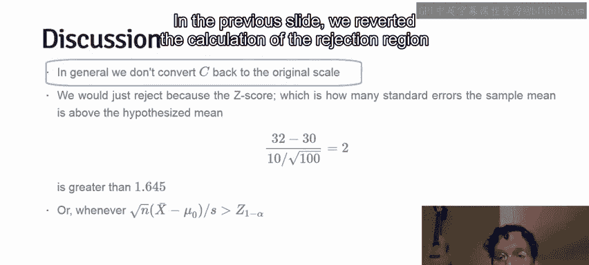

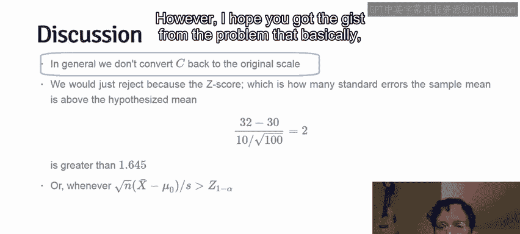

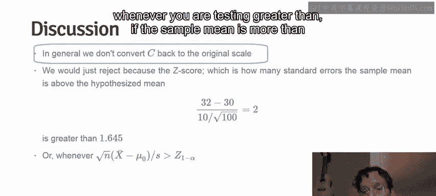

因此，我们通常不将临界值换算回原始单位，而是将样本均值本身转换为它距离假设均值有多少个标准误。这引出了“检验统计量”的概念。

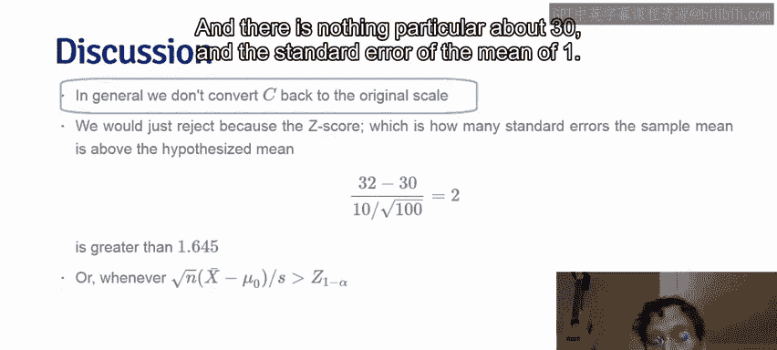

以下是如何应用这个规则：

假设我们观测到的样本均值是32。
*   假设均值 μ₀ = 30
*   标准误 = 10 / √100 = 1 （在实际问题中，10通常由样本标准差s估计）

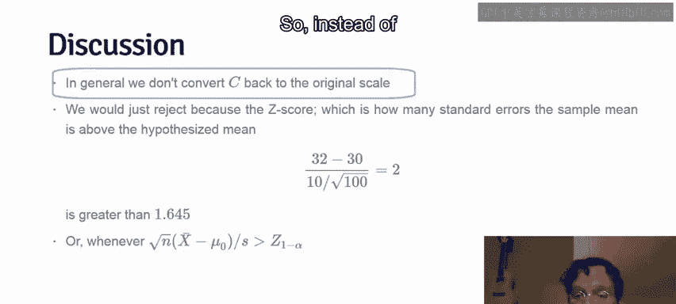

计算检验统计量Z：

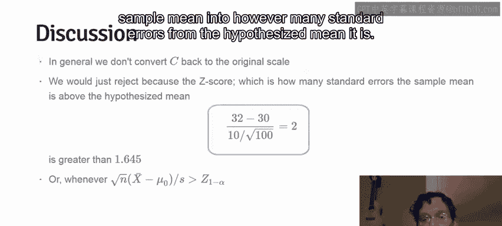

**公式：**
`Z = (X bar - μ₀) / 标准误 = (32 - 30) / 1 = 2`

由于2 > 1.645，这意味着在原假设下，出现这种情况的概率小于5%。因此，我们将拒绝原假设，支持备择假设。

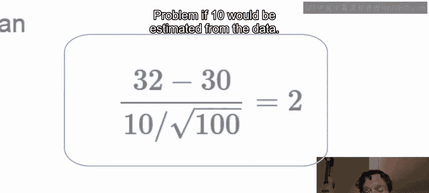

## 通用拒绝规则

我们可以将上述决策规则一般化地写出来：

**规则：** 当检验统计量 `(X bar - μ₀) / 标准误` 大于标准正态分布的上α分位数（记为`Z₁₋α`）时，拒绝原假设。

对于α=0.05的单侧（右侧）检验，`Z₁₋α`就是`Z₀.₉₅ = 1.645`。

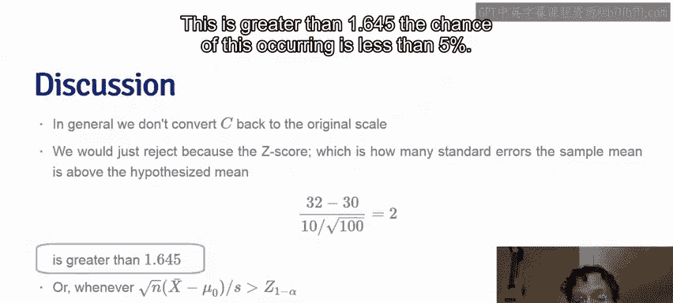

## 总结

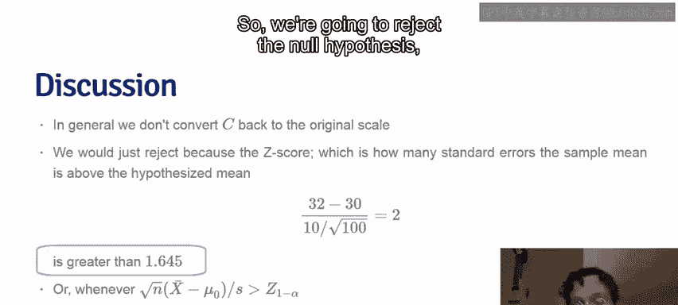

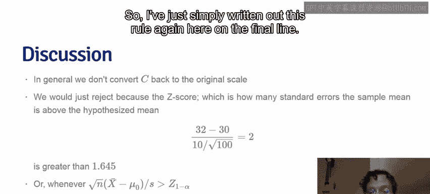

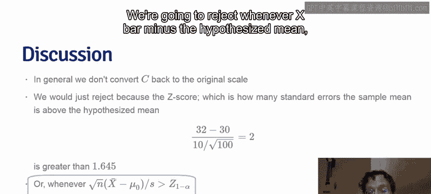

本节课中我们一起学习了如何为假设检验设定拒绝区域。我们通过呼吸障碍指数的例子，演示了如何根据控制第一类错误率α（如5%）的目标，计算临界值C。关键步骤包括：
1.  确定原假设下样本均值的分布。
2.  利用标准正态分布的分位数，找到对应α的Z值。
3.  计算临界值 `C = μ₀ + Z₁₋α × 标准误`。
4.  更常见的做法是计算标准化的检验统计量 `Z = (X bar - μ₀) / 标准误`，并将其与临界Z值比较。

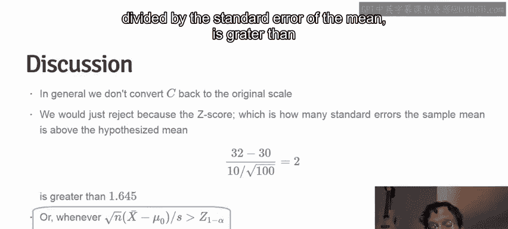

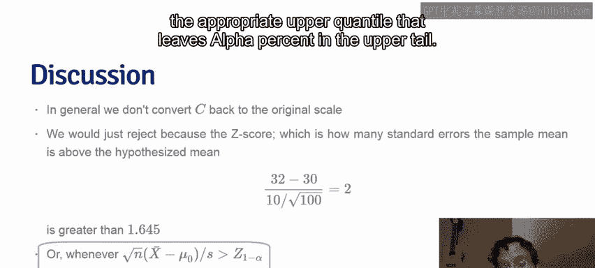

最终，我们得到了一个清晰的决策规则：如果检验统计量超过临界Z值，就拒绝原假设。这是执行假设检验的核心步骤。