# 课程6：统计推断 - P28：两组检验 📊

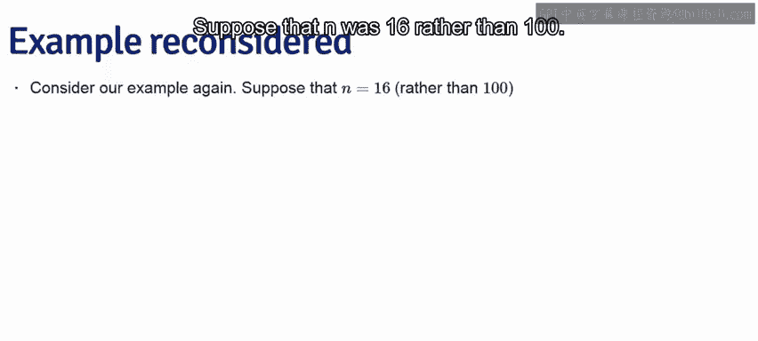

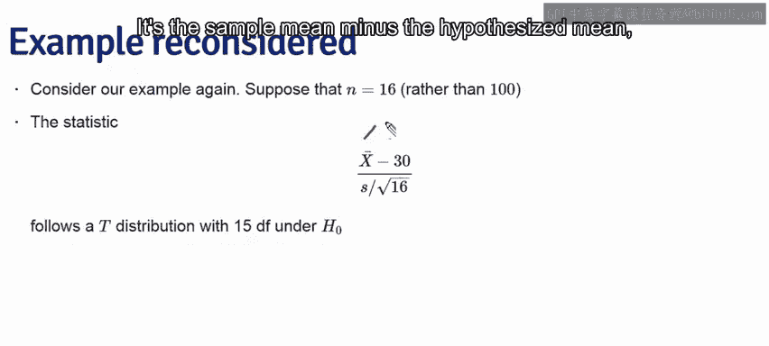

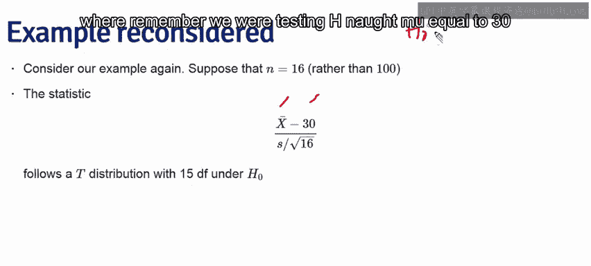

在本节课中，我们将学习如何对两组数据进行假设检验。我们将从回顾单组检验开始，然后扩展到两组比较，并探讨置信区间与假设检验之间的关系。

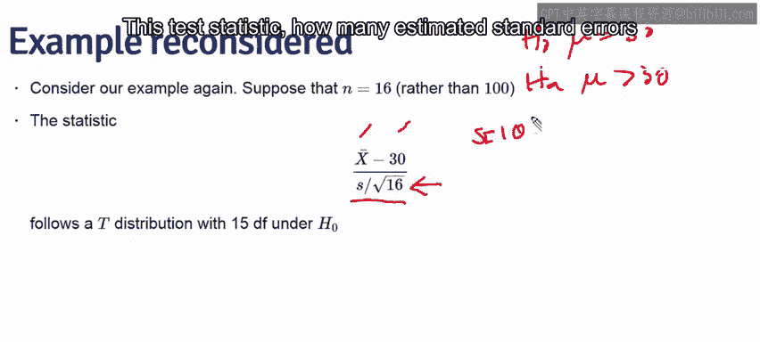

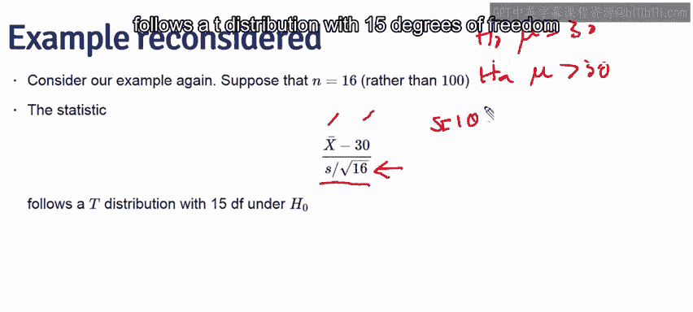

---

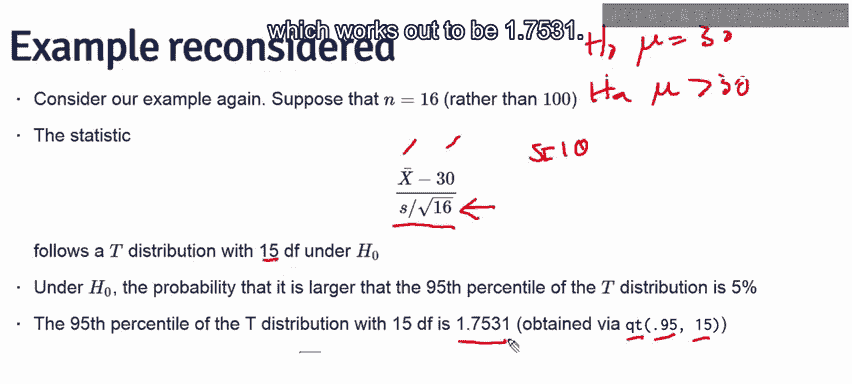

## 回顾单组t检验 🔄

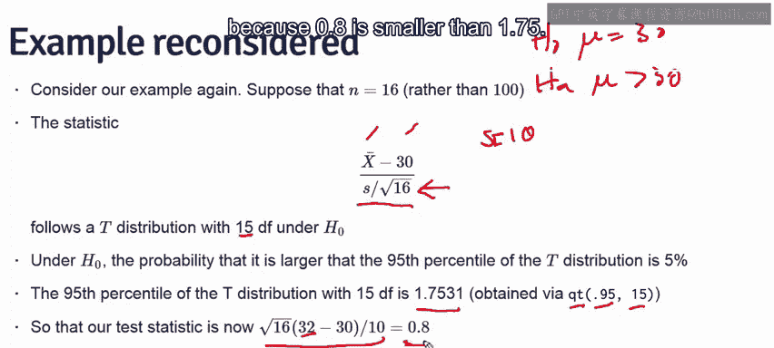

上一节我们介绍了单样本的假设检验。本节中我们来看看当样本量较小时，如何使用t分布进行检验。

考虑一个例子，假设样本量n是16，而不是100。我们的检验统计量保持不变，它是样本均值减去假设的均值。我们检验的原假设是H₀: μ = 30，备择假设是H₁: μ > 30。然后除以均值的标准误，现在是 `sqrt(16)` 而不是 `sqrt(100)`，并回忆样本标准差s是10。

这个检验统计量衡量了样本均值距离假设均值有多少个估计的标准误。在n=16的情况下，它服从自由度为15的t分布。

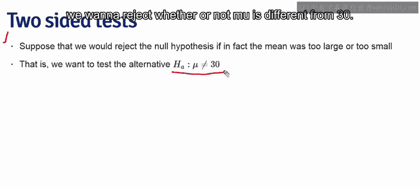

在原假设下，统计量大于该t分布第95百分位数的概率是5%。我们需要计算t分布的这个百分位数，可以用R的 `qt(.95, df=15)` 完成，结果是1.7531。

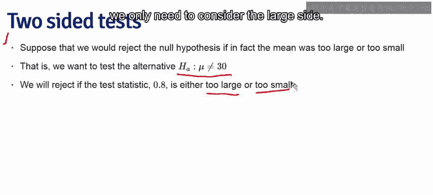

如果我们代入样本均值 `x̄ = 32` 和 `s = 10`，计算出的检验统计量是0.8。由于0.8小于1.7531，我们未能拒绝原假设。

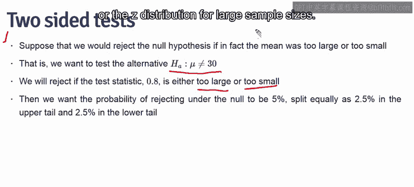

---

## 双侧检验 ↔️

有时我们需要进行双侧检验，即当均值显著大于或小于假设值时都拒绝原假设。虽然在我们之前的肥胖人群呼吸障碍指数例子中，只关心是否大于30更有科学意义，但许多情况下仍要求进行双侧检验。

对于双侧检验，我们希望拒绝原假设如果μ与30不同。这意味着如果检验统计量太大或太小，我们都会拒绝。由于我们的统计量是正的，我们只需考虑“太大”的一侧。

关键变化在于，为了在两侧尾部总共获得5%的拒绝域，我们需要将概率平分，每侧尾部各占2.5%。对于小样本使用t分布，大样本使用Z分布。

因此，我们现在使用 `qt(.975, df=15)` 来计算临界值。我们会拒绝原假设，如果检验统计量的绝对值大于这个临界值。

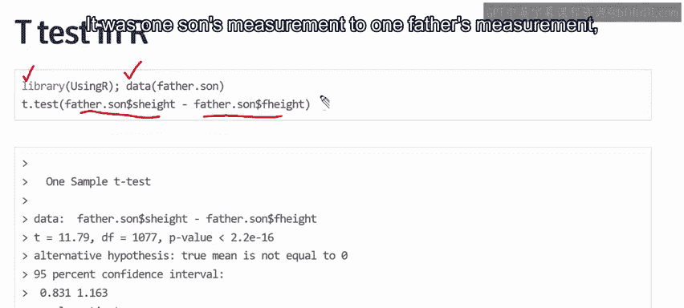

在这个例子中，我们未能拒绝单侧检验，同样也未能拒绝双侧检验。通常，如果你未能拒绝单侧检验，那么你也无法拒绝对应的双侧检验，因为双侧检验的拒绝域更靠分布的两端。

---

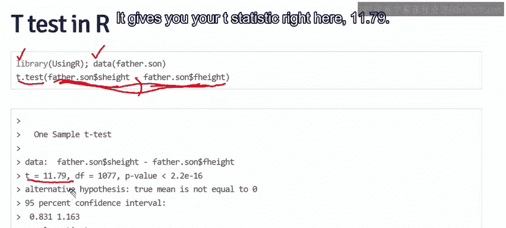

## 使用R进行t检验 💻

通常我们不会手动计算拒绝域，而是使用像 `t.test()` 这样的函数。

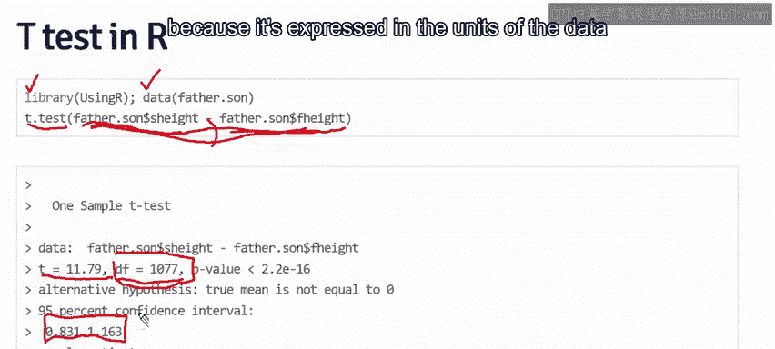

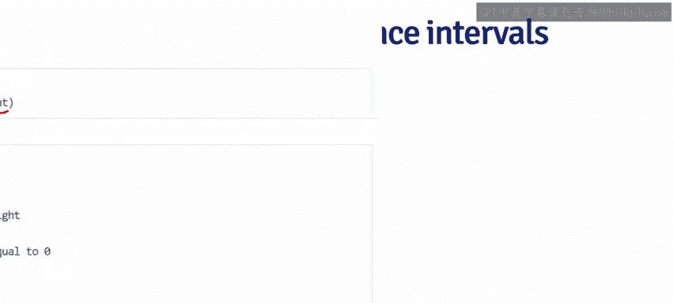

以下是使用R进行配对t检验的例子。我们使用 `father.son` 数据集，检验父亲与儿子身高的总体均值是否相等。由于观测是配对的（一个儿子对应一个父亲），我们计算身高差，并检验差值是否为0。

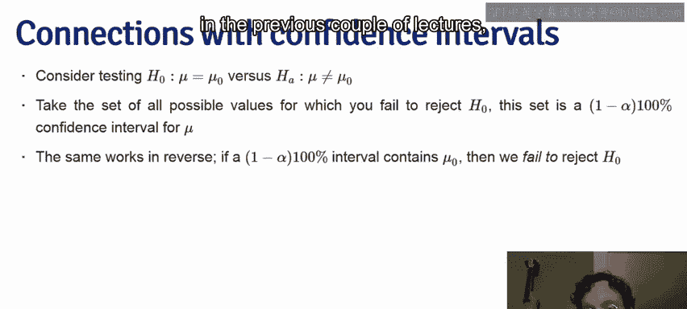

你可以将差值向量直接传递给 `t.test()`，或者传递两个向量并设置参数 `paired = TRUE`。函数输出会给出t统计量（例如11.79）、自由度（例如1077）以及置信区间。

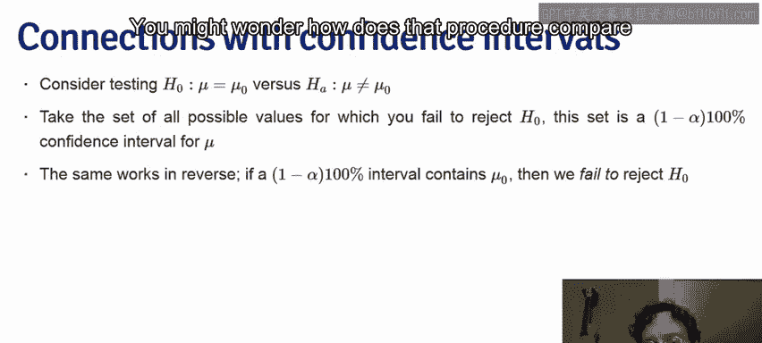

查看置信区间总是有益的，因为它能很好地连接统计显著性和实际显著性，并以你关心的数据单位呈现可能的值范围。

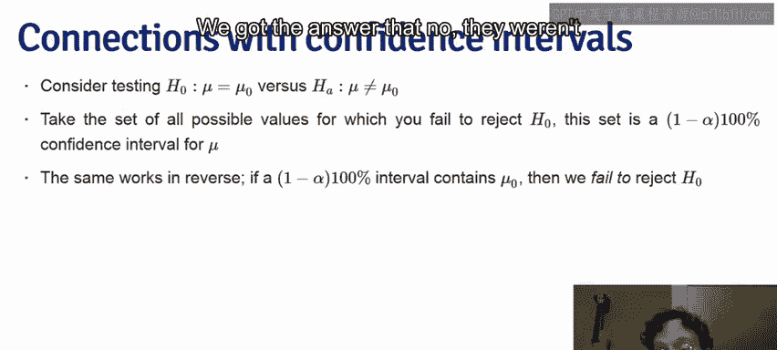

---

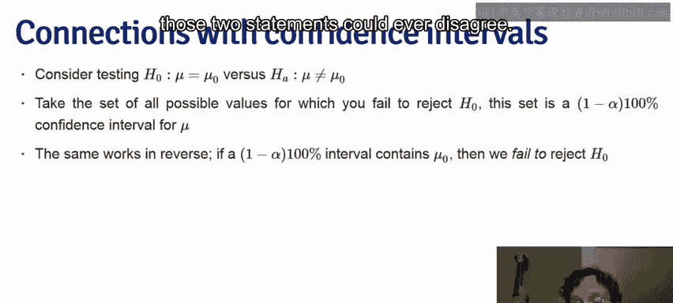

## 置信区间与假设检验的联系 🔗

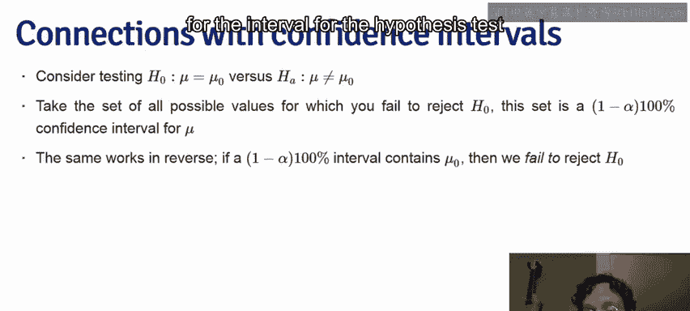

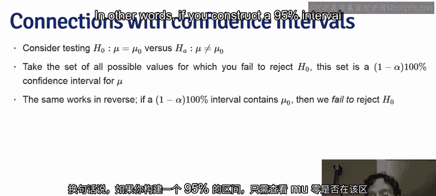

在之前的课程中，我们通过检查假设值是否落在置信区间内，来评估该值是否被数据支持。你可能会问，这个过程与正式进行假设检验（例如，检验均值是否等于某个特定值）相比如何？

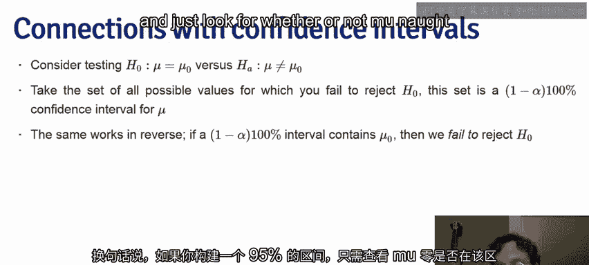

考虑之前的父子身高例子。假设检验的结论是拒绝“均值差为0”的原假设。同时，95%的置信区间也不包含0。

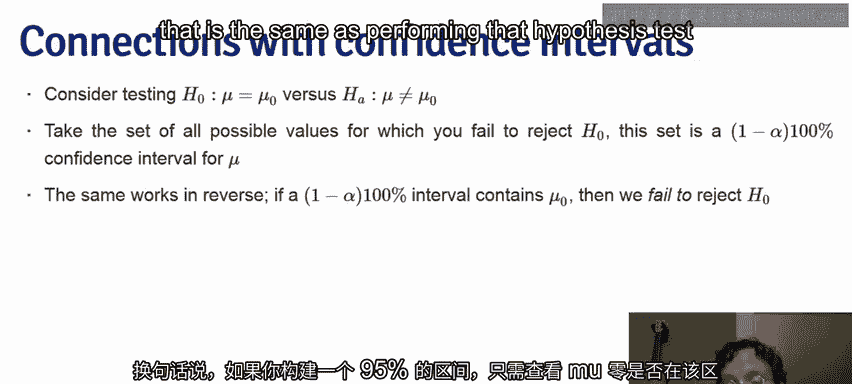

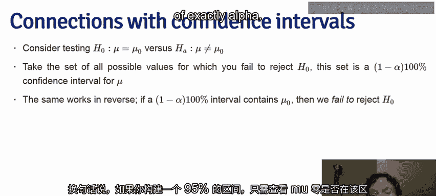

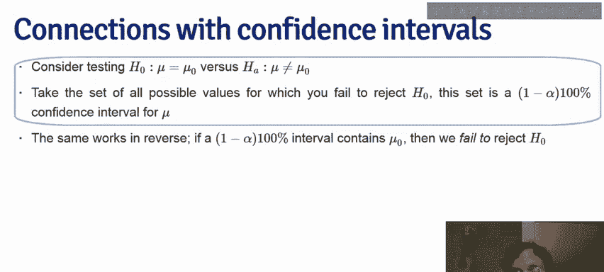

这两者永远不会矛盾。检查μ₀是否在 `(1-α)%` 置信区间内，完全等价于在α水平上进行双侧假设检验。具体来说：

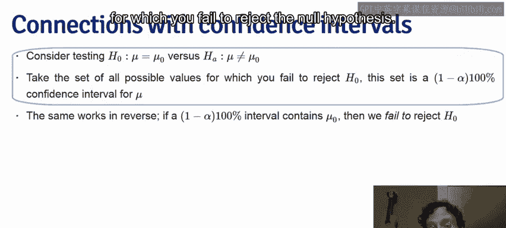

*   如果你构建了一个95%的置信区间，并查看μ₀是否在其中。
*   若μ₀在区间内，则未能拒绝H₀；若在区间外，则拒绝H₀。
*   这等同于进行了一个α=0.05的双侧假设检验。

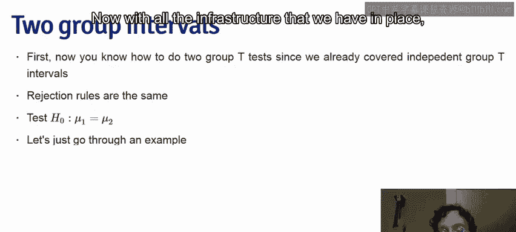

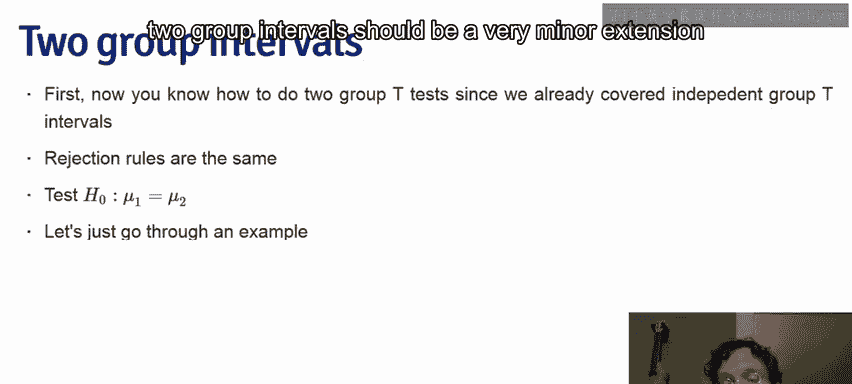

因此，置信区间可以被定义为所有能使你无法拒绝原假设的可能值的集合。

---

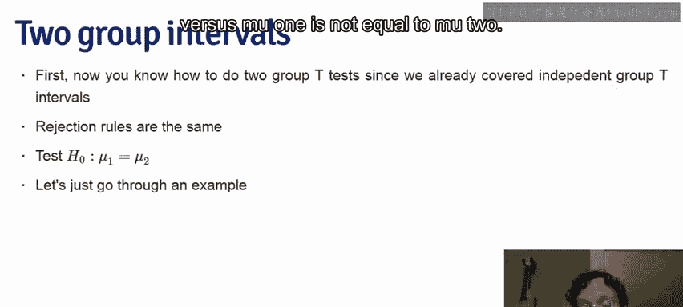

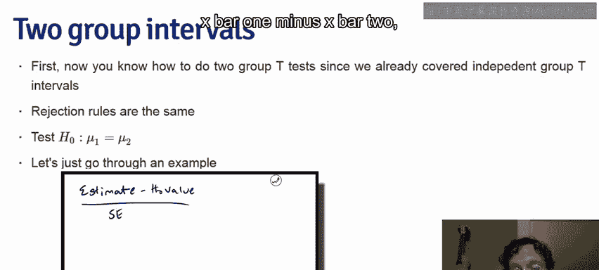

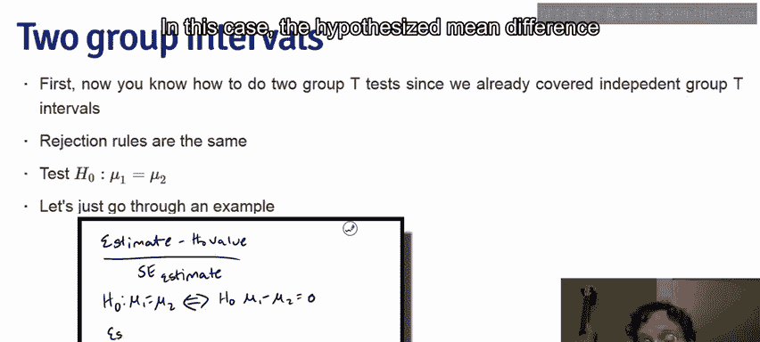

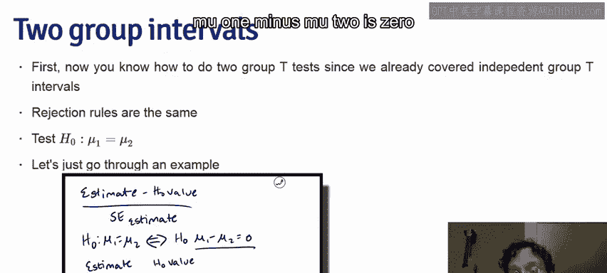

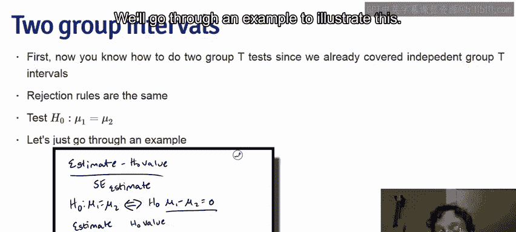

## 扩展到两组检验 ➕➖

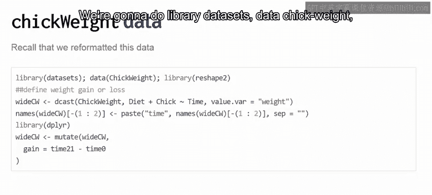

有了单组置信区间和假设检验的基础，两组检验只是一个简单的扩展。

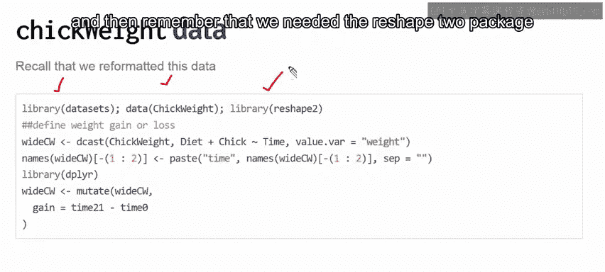

基本思想是相同的。我们现在想检验第一组的均值（μ₁）是否等于第二组的均值（μ₂）。备择假设可以是μ₁ > μ₂，μ₁ < μ₂，或μ₁ ≠ μ₂。

我们的检验统计量公式如下：

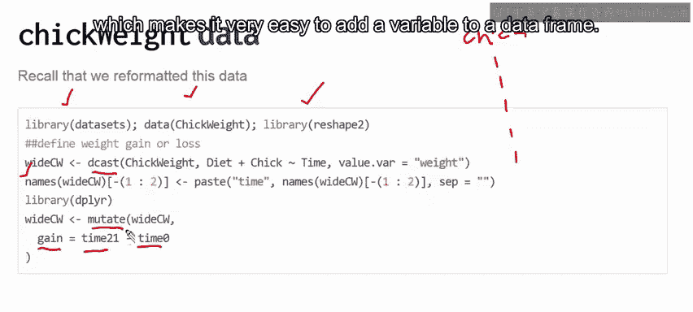

**公式：**
`T = (x̄₁ - x̄₂ - (μ₁ - μ₂)₀) / SE(x̄₁ - x̄₂)`

其中，`(μ₁ - μ₂)₀` 是假设的均值差，通常为0。分母是均值差的标准误。

---

## 实例：小鸡体重数据 🐥

我们通过一个实例来说明。使用R内置的 `ChickWeight` 数据集，比较两种不同饲料（Diet 1 和 Diet 4）对小鸡体重增长的影响。

以下是分析步骤的简要说明：

1.  加载并整理数据，计算每只小鸡从第0天到第21天的体重增长。
2.  筛选出饲料为1和4的数据。
3.  使用 `t.test` 函数进行两独立样本t检验，设置 `var.equal = TRUE`（尽管根据之前分析，方差不等的假设可能更合适，建议自行尝试 `var.equal = FALSE`）。

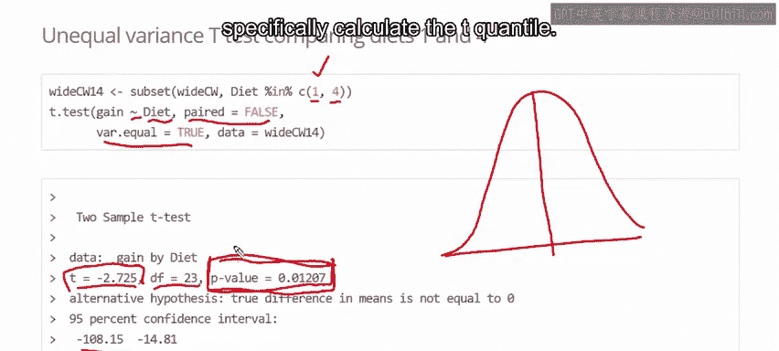

函数输出会给出t统计量、自由度、p值和置信区间。在这个例子中，t统计量为-2.7，是一个相对极端的值，如果进行5%水平的检验，我们很可能会拒绝“两种饲料效果相同”的原假设。在学习了p值后，判断会更加直接。

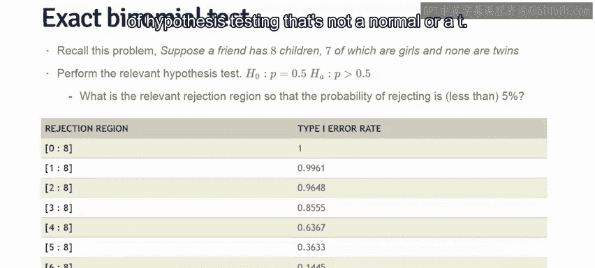

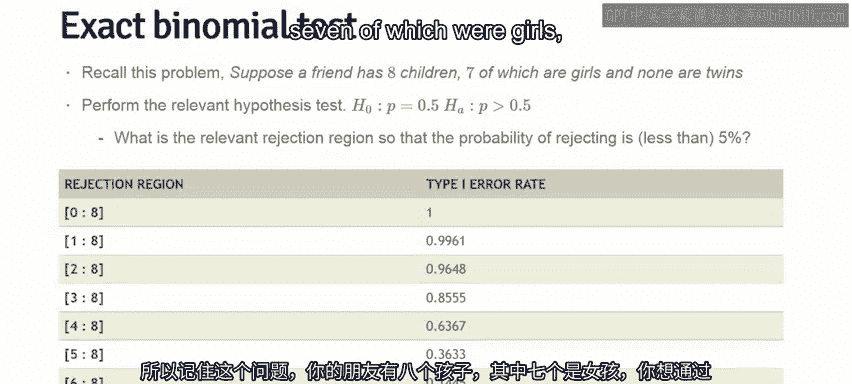

---

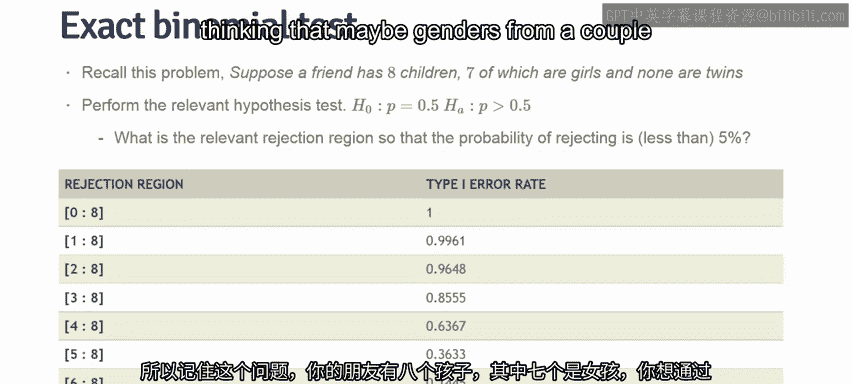

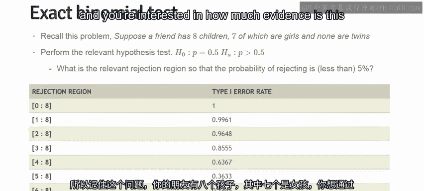

## 二项分布检验示例 🪙

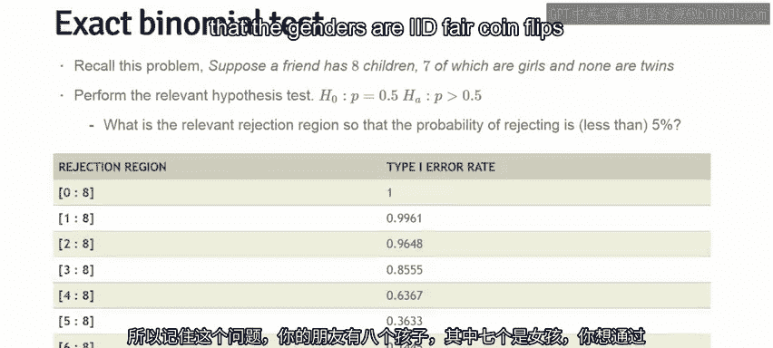

最后，我们看一个非正态（或t）分布的简单假设检验例子。

假设你的朋友有8个孩子，其中7个是女孩。你想评估这是否为性别像公平抛硬币一样独立同分布的证据。你想检验原假设H₀: p（生女孩的概率）= 0.5，备择假设H₁: p > 0.5。

问题是：在α=0.05的水平下，拒绝域应该设为有多少个女孩？

由于二项分布是离散的，我们无法得到恰好5%的拒绝域。计算不同拒绝域下的第一类错误率（在原假设下拒绝的概率）：
*   拒绝域为 {7, 8} 个女孩：概率 ≈ 3.5%
*   拒绝域为 {6, 7, 8} 个女孩：概率 ≈ 14.5%

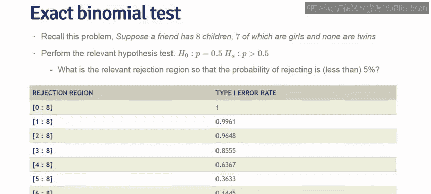

因此，最接近5%的拒绝域是 {7, 8}。由于你的朋友有7个女孩，我们拒绝“生男生女概率相等”的原假设。

关于这个检验的几点说明：
1.  由于二项分布的离散性，无法获得精确的5%水平检验。
2.  对于大样本，可以使用正态近似。
3.  双侧检验在此情境下不那么直观，我们将在下一讲关于p值的课程中讨论。
4.  事实上，精确的二项分布或泊松分布置信区间，正是通过反转这种双侧假设检验构造出来的。

---

## 总结 📝

本节课中我们一起学习了：
1.  回顾了单样本t检验，包括小样本下的应用。
2.  理解了单侧检验与双侧检验的区别与联系。
3.  掌握了使用R的 `t.test()` 函数进行假设检验并解读结果，特别是关注置信区间。
4.  明确了置信区间与假设检验在数学上的等价性：一个 `(1-α)%` 的置信区间包含所有在α水平上无法被拒绝的假设值。
5.  将假设检验的概念扩展到两组比较，学习了检验统计量的构建。
6.  通过小鸡体重的实例实践了两独立样本t检验。
7.  探讨了一个基于二项分布的非参数检验例子，理解了离散分布检验的特点。

下一讲，我们将深入探讨**p值**的概念，这将使执行和解释假设检验变得更加容易和直观。