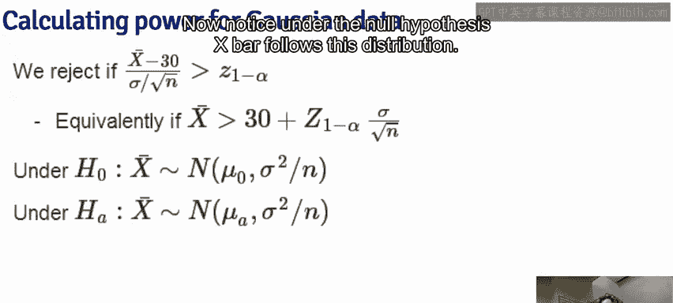
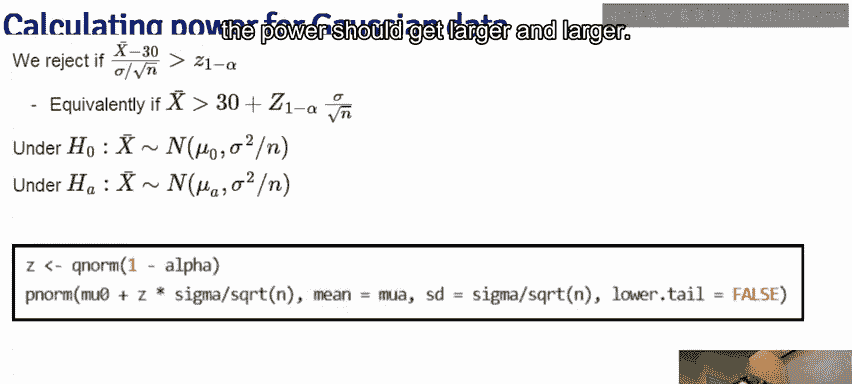
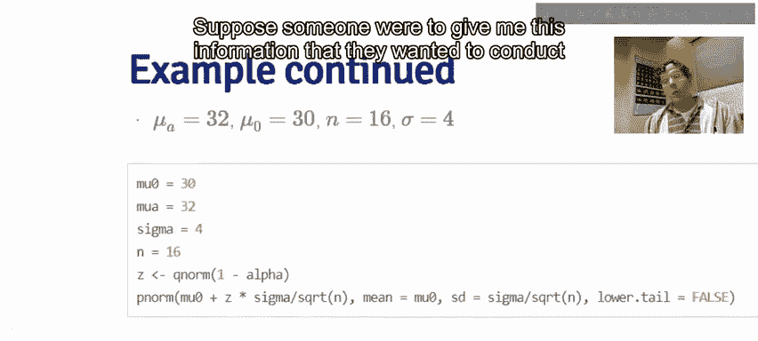
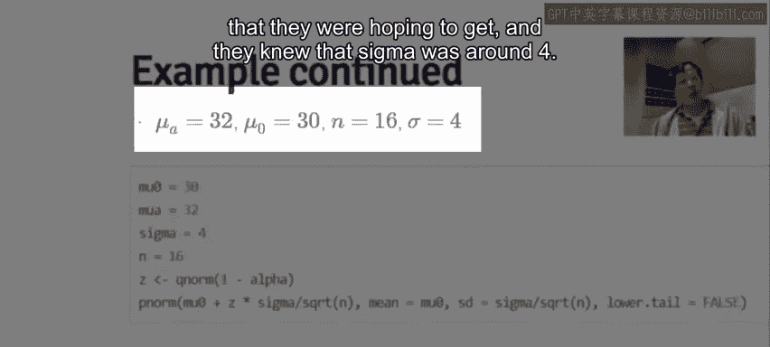
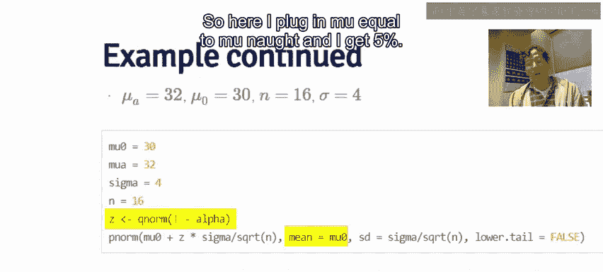
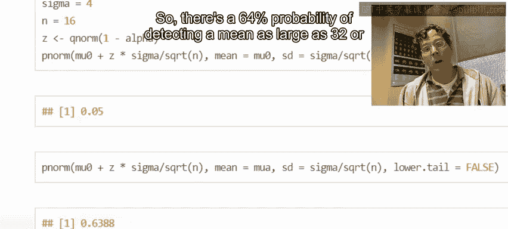
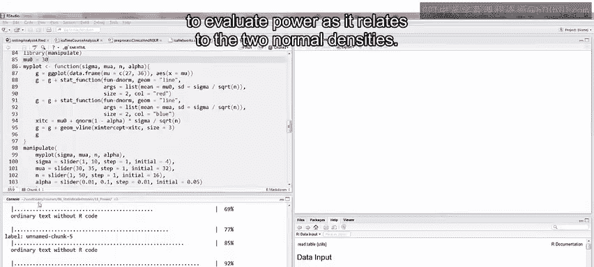
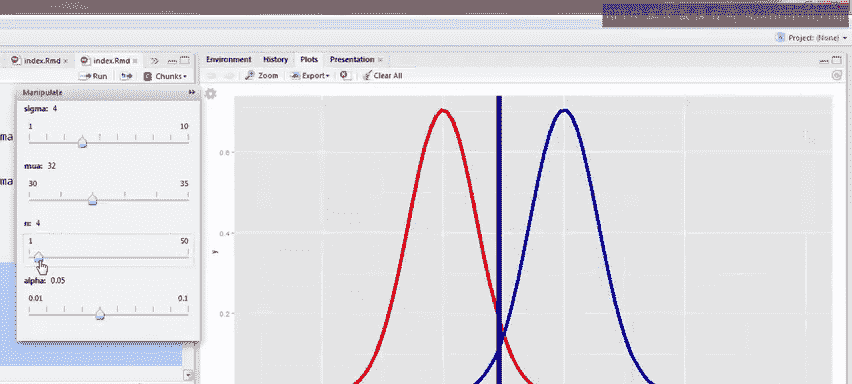

# 课程6：统计推断 - P33：计算功效 📊

## 概述
在本节课中，我们将学习如何计算统计检验的功效。功效是指当备择假设为真时，正确拒绝原假设的概率。我们将通过一个具体的例子，使用R语言来演示功效的计算，并探讨影响功效的各种因素。

---

## 假设与设定
首先，我们假设样本均值 `X_bar` 服从正态分布。这个假设可能源于我们愿意接受它，也可能是因为样本量足够大，可以应用中心极限定理，或者我们直接假设总体本身服从正态分布。




为了讨论方便，我们假设 `X_bar` 服从正态分布，并且总体的标准差 `sigma` 是已知的。

在这种情况下，如果我们的Z统计量 `(X_bar - 30) / 标准误` 大于 `z_{1-alpha}`，我们就会拒绝原假设。这等价于说，当 `X_bar > 30 + z_{1-alpha} * 标准误` 时，我们拒绝原假设。

需要注意的是，在原假设下，`X_bar` 服从均值为 `mu_n`（本例中为30）、方差为 `sigma^2 / n` 的正态分布。在备择假设下，它服从相同的分布，唯一的区别是均值变为 `mu_a`，即备择假设下的值。





---



## 用R计算功效
在R语言中，我们可以很容易地写出功效的计算公式。我们想要计算的是，在备择假设为真的情况下，获得一个大于或等于 `mu_n + z * sigma / sqrt(n)` 的样本均值的概率。

以下是计算功效的R代码：
```r
power <- pnorm(mu_n + z * sigma / sqrt(n), mean = mu_a, sd = sigma / sqrt(n), lower.tail = FALSE)
```
在这个公式中，`mean` 参数设为 `mu_a`，`sd` 是均值的标准误，`lower.tail = FALSE` 表示我们计算的是上尾概率。





如果我们把 `mu_a` 设为 `mu_n`，那么计算出的功效应该等于 `alpha`。随着 `mu_a` 逐渐远离 `mu_n`，功效会变得越来越大。

---

## 实例分析
让我们尝试一个具体的例子。假设有人计划进行一项研究，他们想检验总体均值 `mu` 是否等于30，还是大于30。因此，原假设 `mu_n = 30`。

他们希望检测出与30相差2的效应，即 `mu_a = 32`。他们计划收集的样本量 `n = 16`。他们已知总体标准差 `sigma` 大约为4。

现在，我们代入这些数值：`mu_n = 30`，`mu_a = 32`，`sigma = 4`，`n = 16`。`z` 是正态分布的分位数。

首先，如果我们把 `mu_a` 设为 `mu_n`（即30），计算出的功效应该是5%（即 `alpha`）。然后，我们把 `mu_a` 设为32，可以看到功效跃升至64%。这意味着，如果我们进行这个实验，有64%的概率能检测到均值等于或大于32的效应。



---

## 功效曲线
我们可以绘制功效曲线，即功效随 `mu_a` 变化的函数图，并用不同颜色表示不同的样本量 `n`。

在图中，横轴代表 `mu_a` 的值，纵轴代表功效。所有曲线（包括 `n=8` 的这条）都在 `mu_a` 接近30时汇聚于0.05。随着 `mu_a` 增大，功效也随之增加。这意味着，我们想要检测的效应量越大，检测到它的概率就越高，这非常合理。

此外，图中样本量依次翻倍（从 `n=8` 到 `n=128`）。可以看到，随着样本量增加，曲线整体向上、向左移动，这意味着对于特定的 `mu_a` 值，功效变得更高、更早。这也非常合理，因为收集更多数据应该能提高检测到特定效应的概率。因此，`n=128` 的曲线始终位于 `n=64` 的曲线上方，依此类推。

---

## 使用交互式函数探索功效
我们可以使用RStudio的 `manipulate` 函数，通过交互式地调整参数来观察两个正态分布密度图如何影响功效。

首先，我们定义一个绘图函数，它依赖于总体标准差 `sigma`、备择假设下的均值 `mu_a`、样本量 `n` 和第一类错误率 `alpha`。这个函数会生成一个包含两个分布的图：
*   **红色曲线**：代表原假设下样本均值的分布，中心在 `mu_n`。
*   **蓝色曲线**：代表备择假设下样本均值的分布，中心在 `mu_a`。
*   **黑色竖线**：代表拒绝域的临界值。我们设定这条线，使得红色曲线下该线右侧的面积（即第一类错误率 `alpha`）为5%。

功效，就是在蓝色曲线为真的情况下，样本均值落在黑色竖线右侧的概率（即蓝色曲线下该线右侧的面积）。

现在，让我们开始调整参数，看看会发生什么：

以下是调整不同参数时发生的变化：

*   **调整 `alpha`**：
    *   将 `alpha` 降低到1%：黑色竖线会向右移动，以确保红色曲线右侧面积仅为1%。此时，功效（蓝色曲线右侧面积）会下降。这意味着我们让拒绝原假设变得更严格，虽然第一类错误率降低了，但功效也降低了，第二类错误率升高。
    *   将 `alpha` 增加到10%：黑色竖线向左移动，功效显著提高。这意味着我们更愿意在证据稍弱时拒绝原假设，从而获得了更好的功效，但代价是更高的第一类错误率。

*   **调整 `sigma`**：
    *   将 `sigma` 减小到1：样本均值的变异性降低，两条分布曲线变得更窄、更高。黑色竖线也会移动以保持 `alpha` 为5%。此时，功效几乎达到100%。这说明测量噪声越小，功效越高。
    *   将 `sigma` 增大：分布曲线变得更宽、更扁平。功效会显著降低。这说明测量噪声越大，功效越低。

*   **调整 `mu_a`**：
    *   增大 `mu_a`：蓝色分布曲线向右移动，远离红色曲线。黑色竖线不变，因此功效（蓝色曲线右侧面积）急剧增加。效应量越大，越容易被检测到。
    *   减小 `mu_a`，使其接近30：蓝色曲线向红色曲线靠拢，功效降低。当 `mu_a` 等于 `mu_n` 时，功效恰好等于 `alpha`（5%）。

*   **调整样本量 `n`**：
    *   增大 `n`：样本均值的标准误减小，两条分布曲线都变得更窄、更高（变异性降低）。黑色竖线会移动以保持 `alpha` 为5%。此时，功效显著提高。
    *   减小 `n`：分布曲线变宽，黑色竖线移动，功效降低。

强烈建议你运行这段 `manipulate` 实验的代码，以理解在这个特定设置下功效是如何工作的。它非常直观，你可以看到功效有多个“旋钮”，转动它们，功效会以不同的方式变化。

---

## 总结
本节课中，我们一起学习了统计检验功效的计算与影响因素。

我们首先在样本均值服从正态分布且总体标准差已知的假设下，推导了功效的计算公式，并用R语言实现了计算。通过一个具体实例，我们看到当备择假设的均值从30变为32时，功效从5%提升到了64%。



接着，我们通过绘制功效曲线，直观地观察到功效随效应量增大而增加，随样本量增大而整体提升的规律。

最后，我们利用交互式工具深入探讨了影响功效的四个关键因素：
1.  **第一类错误率 `alpha`**：降低 `alpha` 会降低功效，提高 `alpha` 会增加功效。
2.  **总体标准差 `sigma`**：测量误差（噪声）越小，功效越高。
3.  **效应量（`mu_a` 与 `mu_n` 的差距）**：想要检测的效应量越大，功效越高。
4.  **样本量 `n`**：样本量越大，功效越高。

理解这些关系，对于科学实验的设计和样本量的规划至关重要。