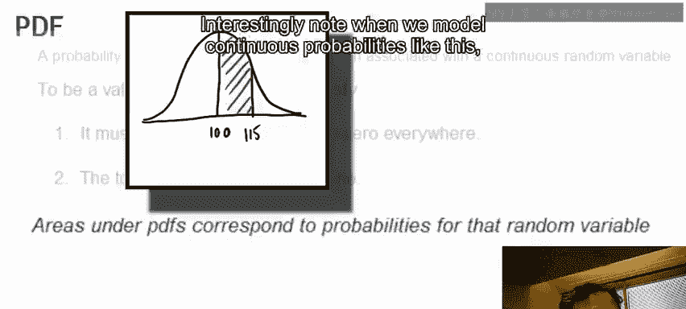
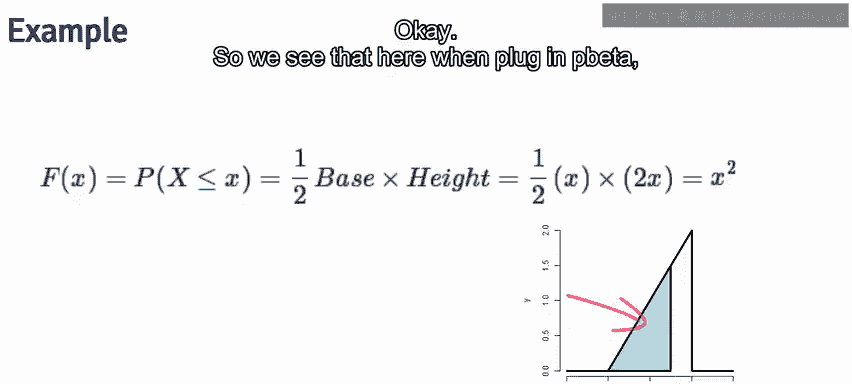
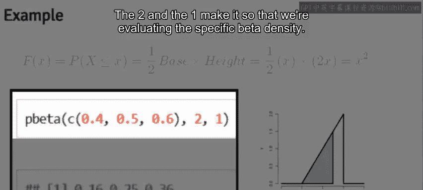
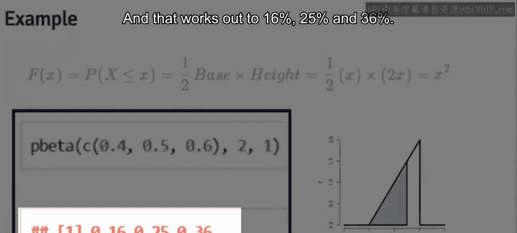
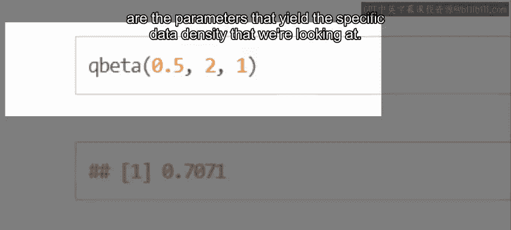
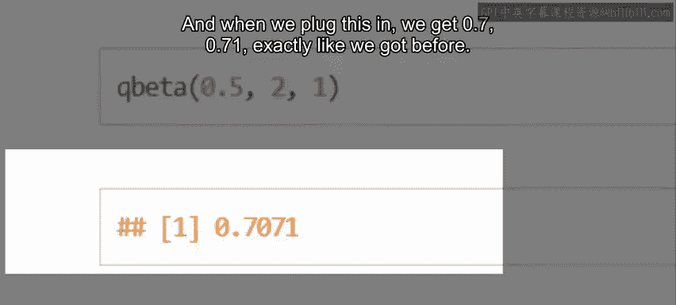
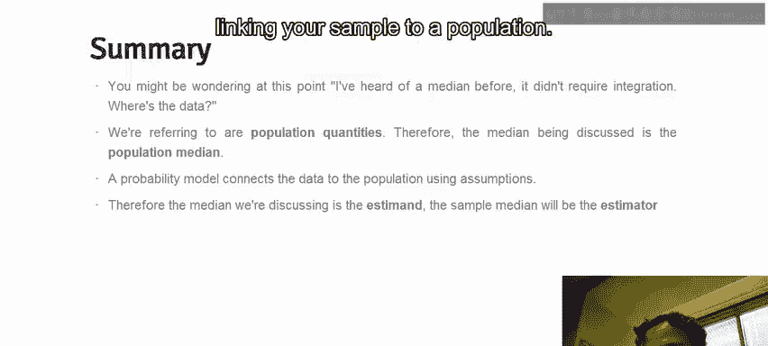

# 📊 课程6：《统计推断》｜P4：概率密度函数

在本节课中，我们将学习**概率密度函数**。这是用于描述连续随机变量的核心工具，与之前讨论的离散随机变量的概率质量函数相对应。我们将了解其定义、性质，并通过一个简单的例子学习如何计算概率和分位数。

---

## 📈 概率密度函数简介

上一节我们介绍了离散随机变量的概率质量函数。本节中，我们来看看连续随机变量的对应概念——**概率密度函数**。

与为离散随机变量的具体值分配概率的概率质量函数不同，概率密度函数与连续随机变量相关联。

就像概率质量函数必须遵循特定规则一样，一个有效的概率密度函数也必须满足特定条件：
*   函数值处处大于或等于0。
*   函数曲线下的总面积为1。

概率密度函数的基本规则是：**概率密度函数曲线下的面积对应于该随机变量的概率**。

例如，如果说智商服从均值为100、标准差为15的正态分布，这意味着总体遵循一个特定的钟形曲线。并且，如果我从该总体中抽取一个样本，那么样本中一个人的智商在100到115之间的概率，就是曲线下对应的这块面积。




再次注意，概率密度函数是关于总体（本例中是智商总体）的陈述，而不是关于数据本身的陈述。我们将使用数据来评估这个假设以及关于总体概率的陈述，但本质上，每当提到“概率”一词时，我们谈论的都是一个总体量。

有趣的是，当我们这样为连续随机变量建模时，它取任何特定值的概率实际上为0，因为一条线的面积为0。这并非问题，这只是将随机变量建模为具有无限精度时的一个特性，但完全不会影响实际工作。

---

## 🔺 一个简单的例子：三角分布

事实证明，钟形曲线是一种处理起来相当复杂的密度函数。至少在你学会如何操作之前是如此，我们将在另一节课中学习。所以，现在让我们使用一个简单得多的密度函数。

具体来说，我们使用一个看起来像直角三角形的密度函数：
`F(x) = 2x`，其中 `x` 在0和1之间，否则为0。

我们给它一些背景：假设这是某热线在随机一天内得到处理的求助电话的比例。

这意味着，在一天内处理了20%到60%的来电的概率，由这块面积给出。

我们首先要问：这在数学上是一个有效的密度函数吗？以下是其图像，它看起来像一个直角三角形。


注意，R代码在课件幻灯片中给出。因为幻灯片是使用slideify格式创建的，所以实际使用Git拉取课程仓库非常重要。你可以查看RMD或R Markdown文件，获取所有课程示例的所有代码。

无论如何，我们需要讨论这个概率密度函数是否有效。
1.  注意它总是大于或等于0。
2.  其次，计算它的面积。这并不难，因为它是一个直角三角形。面积是底乘以高的一半，即 `(1/2) * 底 * 高 = (1/2) * 1 * 2 = 1`。

所以，面积确实为1。因此，这是一个有效的概率密度函数。

---

## 🧮 使用密度函数计算概率

让我们通过一个例子来学习如何使用这个密度函数。

问题是：从这个总体中随机抽取一天，处理了75%或更少来电的概率是多少？

这很简便，因为我们需要计算的只是另一个直角三角形的面积。在 `x=0.75` 处，函数高度为 `2 * 0.75 = 1.5`。底边长度为0.75。因此，面积为 `(1/2) * 0.75 * 1.5 = 0.5625`，即56.25%。




这个密度实际上是已知分布（称为**Beta分布**）的一个特例。以下是直接从Beta分布获取此概率的R代码。当然，我们不需要它，因为处理三角形很简单。然而，在更复杂的情况下，我们将需要这些函数。

```r
pbeta(0.75, 2, 1)
```

注意，函数名前的字母 `p` 表示求概率。所以 `pbeta` 是求Beta分布中小于等于0.75的概率。参数 `2` 和 `1` 是特定的参数，使其成为我们正在使用的这个精确的三角形。你会得到相同的数字：0.5625。

---

## 📊 累积分布函数与生存函数

密度函数的某些区域非常有用，我们给它们命名。

*   **累积分布函数**：随机变量X的累积分布函数返回该随机变量小于等于值x的概率，即 `P(X ≤ x)`。这个定义无论X是离散还是连续都适用。在我们刚才查看的Beta分布中，R中的 `pbeta` 函数返回的就是累积分布函数的值。
*   **生存函数**：有时使用生存函数比分布函数更有趣，它只是1减去分布函数，即 `S(x) = 1 - F(x) = P(X > x)`。

假设我们想求之前考虑的密度函数的累积分布函数。例如，我们想知道在给定一天内，40%或更少来电被接听的概率、50%或更少来电被接听的概率、以及60%或更少来电被接听的概率（基于我们当前这个直角三角形总体概率密度函数模型）。

对于这些数字中的任何一个，看图计算，类似于我们为0.75所做的。它将是一个直角三角形，面积总是 `(1/2) * 底 * 高 = (1/2) * x * (2x) = x^2`。

所以函数 `F(x) = x^2` 接收你想要评估的数值x，并给出在随机抽取的一天中，该比例或更少的来电被接听的概率。



当我们为这三个值（0.4， 0.5， 0.6）代入R中的累积分布函数 `pbeta` 时，参数 `2` 和 `1` 确保我们评估的是这个特定的Beta密度，结果分别是16%， 25% 和 36%。

```r
pbeta(c(0.4, 0.5, 0.6), 2, 1)
```




因此：
*   在给定一天内，40%或更少来电被接听的概率是16%。
*   在给定一天内，50%或更少来电被接听的概率是25%。
*   在给定一天内，60%或更少来电被接听的概率是36%。

生存函数则是 `S(x) = 1 - x^2`。

未来，我们将处理更复杂的密度函数，但实际上会更容易，因为我们将依赖像 `pnorm` 和 `pbeta` 这样的函数，而不是直接计算它们。

---

## 🎯 总体分位数

你可能听说过样本分位数。例如，如果你在一次考试中得分处于第95百分位数（即0.95分位数），这意味着95%的学生得分比你差，5%的学生得分比你好。这些就是所谓的样本分位数。现在，我们将定义它们的总体对应物。

在样本分位数中，如果你想定义第95百分位数，你会将观测值从小到大排列，然后找到那个使得95%的观测值低于它的考试分数或点。

具有分布函数 `F` 的分布的 `α` 分位数，是满足 `F(x_α) = α` 的点 `x_α`。这有点绕口，让我们画个图来理解。


对于密度函数 `f(x)`，分布函数 `F(x)` 在点x处的值，是x点以下的面积，即从该总体中抽取的随机变量小于等于x的概率。你可以把它想象成一个无限学生总体的考试成绩总体。`F(x)` 就是从这个总体中随机抽取一名学生，得分低于或等于x的概率。

`α` 分位数是：我们移动这条垂直线，直到找到点 `x_α`，使得恰好有 `α` 的概率位于它之下。这正是我们在数据中寻找经验分位数时所做的事情。例如，我们不断寻找数据点，使得95%的考试成绩低于它，那就是样本的第95百分位数。现在，我们沿着x轴移动点，直到在总体分布中找到这样一个点，使得低于它的概率是95%。

同样，百分位数只是用百分比表示的 `α` 分位数（`α` 是比例）。最著名的分位数可能是中位数，即第50百分位数。

我们将大量使用分位数，因此值得强化这一点。

总体分布的第95百分位数是这样一个点：从该总体中抽取的随机变量小于该值的概率是95%，大于该值的概率是5%。

---

## 🔍 计算中位数：一个例子

让我们用之前的例子来计算一下。我们之前处理的分布的中位数是多少？

记住，该分布看起来像一个直角三角形，其分布函数（即小于等于x的比例的概率）是 `F(x) = x^2`，其中x必须是0到1之间的值才有意义。

在这种情况下，我们要求解 `0.5 = F(x) = x^2`，得到解 `x = sqrt(0.5) ≈ 0.7071`。

这意味着，在大约50%的日子里，70%或更少的电话被接听；在大约50%的日子里，70%或更多的电话被接听。

我们经常处理分位数，尤其是正态分布的分位数。我们几乎从不直接通过密度函数来计算分位数，因为我们处理的分布是常见的，并且这已经为我们做好了。在R中，有一个简单的技巧。

基本上，在函数名（密度名称）前加 `q` 表示求分位数。在本例中，我们知道这是一个Beta密度。所以 `qbeta` 给出相关的分位数。我们代入0.5。

```r
qbeta(0.5, 2, 1)
```


记住，R将分位数的参数视为比例，所以如果你代入0.5（代表50%），它会工作；如果你代入50（代表50%），则不会。参数 `2` 和 `1` 是我们尚未详细描述的参数，但你需要相信，正是这些参数产生了我们正在看的这个特定的Beta密度。当我们运行这行代码时，我们得到大约0.7071，和之前得到的结果完全一样。


---

## 🔗 连接样本与总体

此时你可能想知道：我以前听说过中位数，但没这么复杂。我只是将观测值从最小到最大排序，然后取中间的那个（如果观测值是偶数个，就取中间两个的平均值）。





那是**样本中位数**。它是一个**估计量**。在这门课程中，我们不仅要建立估计量，还要建立**估计的目标**或**被估计量**。

在本例中，你的样本中位数是在估计你的总体中位数。例如，从我们之前的例子来看，样本中位数是：如果我们抽取几天的数据，计算那些天被接听的电话百分比，将这些百分比排序，然后取中间的那个值，那就是中位数。我们会将其视为对总体（即被接听电话的真实中位数百分比）的一个估计量。

当然，我们需要做出许多假设才能将样本与总体联系起来。然而，我们将正视这些假设，并正式地建立它们。

总之，在这门课程中，每一个估计量都有一个对应的被估计量：
*   样本均值估计总体均值。
*   样本中位数估计总体中位数。
*   样本标准差估计总体标准差。
*   以此类推。

这就是统计推断的正式过程：将你的样本与一个总体联系起来。


---

## 📝 总结

本节课中，我们一起学习了概率密度函数的核心概念。我们了解到：
1.  概率密度函数用于描述连续随机变量，其曲线下的面积代表概率。
2.  一个有效的概率密度函数必须非负，且曲线下总面积为1。
3.  我们通过一个简单的三角分布（Beta分布的特例）例子，学习了如何计算特定事件的概率，这对应于计算密度函数曲线下特定区域的面积。
4.  我们介绍了累积分布函数和生存函数，它们是描述分布不同方面的有用工具。
5.  我们定义了总体分位数（如中位数），并理解了它是样本分位数所估计的目标。
6.  最后，我们强调了统计推断的核心：使用样本统计量（如样本均值、中位数）来推断总体参数。



理解概率密度函数是掌握连续数据统计推断的基础，在后续课程中，我们将应用这些概念来分析更复杂的分布和进行实际的统计推断。