# 002：简单最小二乘法简介 📊

在本节课中，我们将学习回归分析的基础——最小二乘法。我们将通过弗朗西斯·高尔顿的历史数据，直观地理解如何寻找数据的“中心”，并以此作为预测的起点。

---

## 数据背景与准备

首先，我们来看弗朗西斯·高尔顿在1885年首次使用的数据。弗朗西斯·高尔顿是统计学史上一位非常有趣的人物，他的个性和贡献都颇具特色。

为了进行后续分析，我们需要在R中安装并使用 `UsingR` 包。这个包收录了《R语言入门统计学》一书中使用的多个数据集，非常适合我们的学习。

---

## 数据的边际分布

在探讨变量间关系之前，我们先分别查看父母身高和子女身高的**边际分布**。这意味着我们暂时忽略父母与子女之间的关联，单独分析每一组数据。

以下是使用 `ggplot2` 绘制的两个直方图：
*   左侧直方图展示了子女的身高分布（单位：英寸，范围60-75英寸），Y轴表示每个身高区间内的子女数量。
*   右侧蓝绿色直方图展示了父母的身高分布。这里对父母身高进行了性别校正（例如，将女性身高乘以1.08），并同样忽略了其与子女身高的关联。

我们将利用这些分布引入最小二乘法的概念，之后再探讨双变量间的关联。

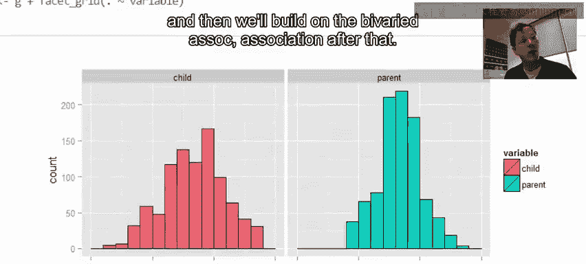

---

## 寻找数据的“中心”

现在，我们暂时只关注子女身高，先不考虑用父母身高进行预测。我们想找到一个**最佳预测值**，在没有任何其他信息的情况下预测任意一个孩子的身高。这个最佳预测值很可能就是数据的“中心”。

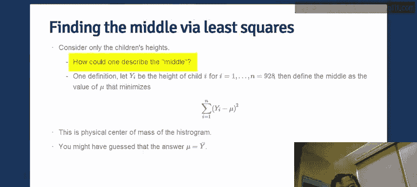

那么，如何定义这个“中心”呢？

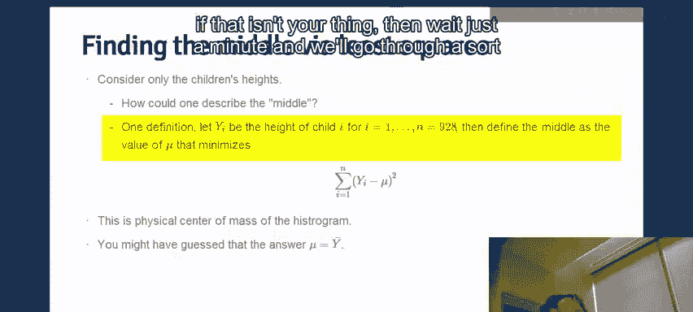

### 数学定义

我们将通过数学符号来精确定义。如果你对数学推导不感兴趣，可以稍作等待，我们随后会通过一个可视化的物理实验来直观解释。

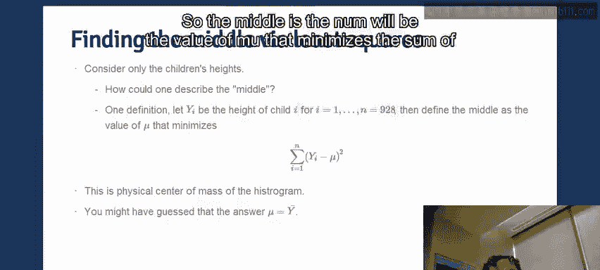

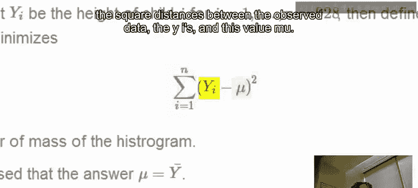

我们用 **Y_i** 表示第 **i** 个孩子的身高，其中 **i** 从1到 **N**（在本数据集中 N=928）。我们定义的“中心”是一个值 **μ**，它使得所有观测值 **Y_i** 与 **μ** 之间的**距离平方和**最小。

用公式表示，即寻找 **μ**，使得以下值最小：
`∑ (Y_i - μ)^2`

这个定义与物理学中的**质心**概念相关。如果把之前直方图中的每个柱子看作有质量的物理实体，那么使这个系统平衡的支点就是质心，也就是我们通过最小二乘法找到的“中心”。

你可能已经猜到，这个“中心”就是数据的**平均值**。事实确实如此，我们稍后会进行证明。当然，如果你不想深究证明过程，也完全可以理解核心思想。

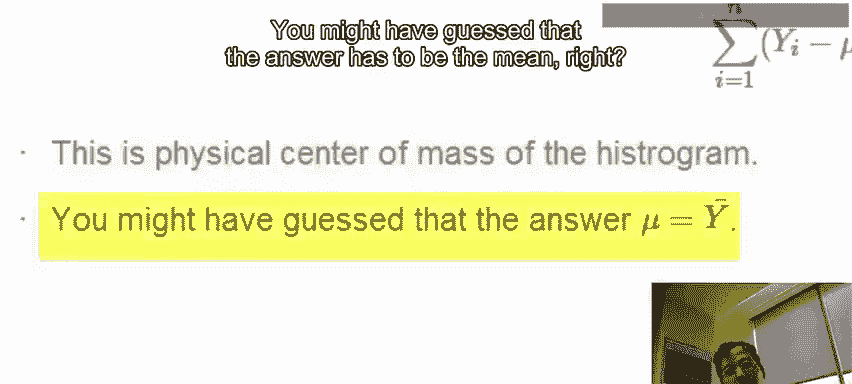
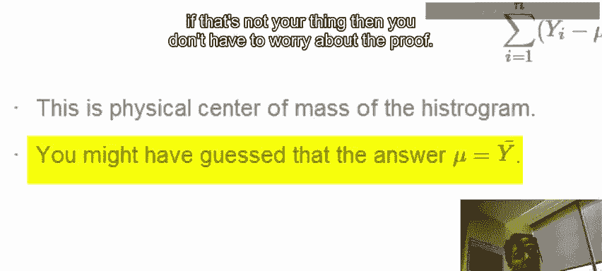

---

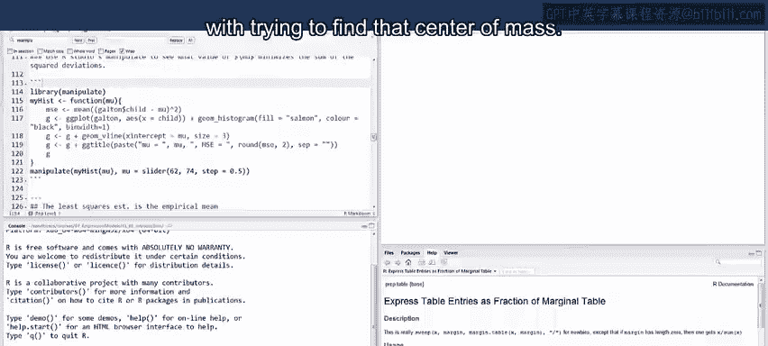

### 可视化实验

为了更直观地感受，我们使用RStudio的 `manipulate` 函数来做一个实验，手动寻找这个“质心”。

我已经加载了 `manipulate` 包和 `Galton` 数据集，并定义了一个绘制直方图的函数。这个函数接受一个参数 `mu`，即我们尝试寻找的中心值。

运行 `manipulate` 命令后，会出现一个滑块。上方会显示当前 `mu` 的值以及对应的**均方误差**。均方误差就是所有数据点与当前 `mu` 值距离平方的**平均值**（即总和除以N）。

以下是实验过程：
*   当我移动滑块时，可以看到随着 `mu` 接近直方图的中心区域，均方误差逐渐减小。
*   在某个位置（大约68.34英寸附近），均方误差达到最小。
*   如果将滑块移动到远离中心的位置（比如很高或很低），均方误差会再次变大。

通过这个实验，你可以亲身体验到，使观测数据点与 `mu` 之间距离平方和最小的那个点，正是平衡这个直方图系统的“质心”。虽然我们知道答案就是身高的平均值，但实验能帮助我们直观地验证这一结论。

---

## 代码与结论

这里再次提供了实验的R代码。需要提醒的是，本专业所有课程的讲义都以R Markdown格式提供，你可以通过名为 `index.Rmd` 的文件获取每节课的所有代码。

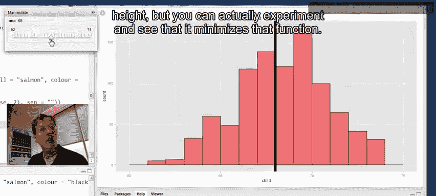

最后，我们重申结论：**最小二乘估计值就是样本的均值**。下图展示了均值在数据分布中的位置，并附上了生成该图的 `ggplot2` 命令。

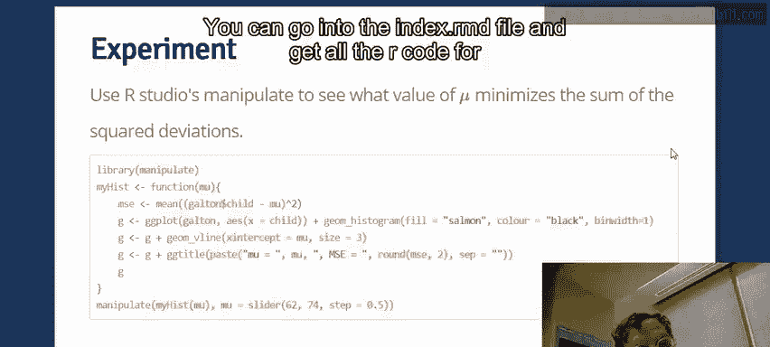
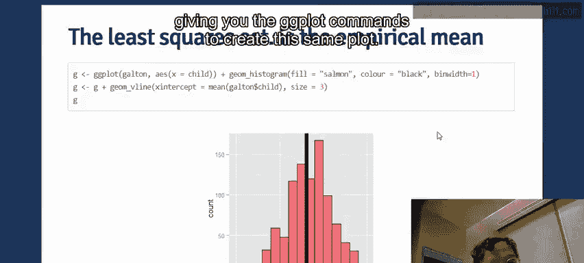

---

## 总结

本节课中，我们一起学习了最小二乘法的基本思想。我们从分析数据的边际分布开始，定义了通过最小化平方误差和来寻找数据“中心”的方法，并通过数学和可视化实验两种方式，验证了这个“中心”就是数据的平均值。这为后续学习如何利用一个变量（如父母身高）预测另一个变量（如子女身高）的回归模型奠定了重要基础。