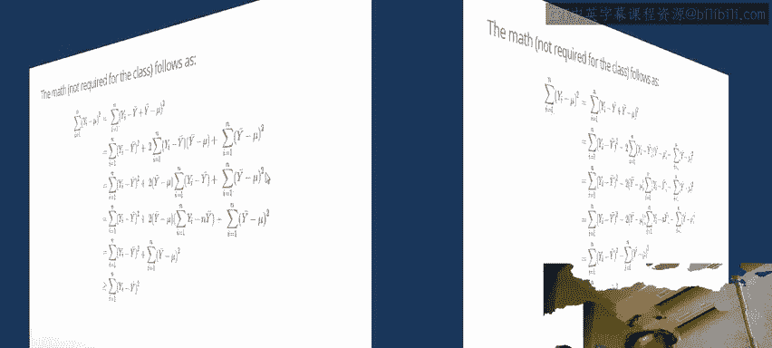
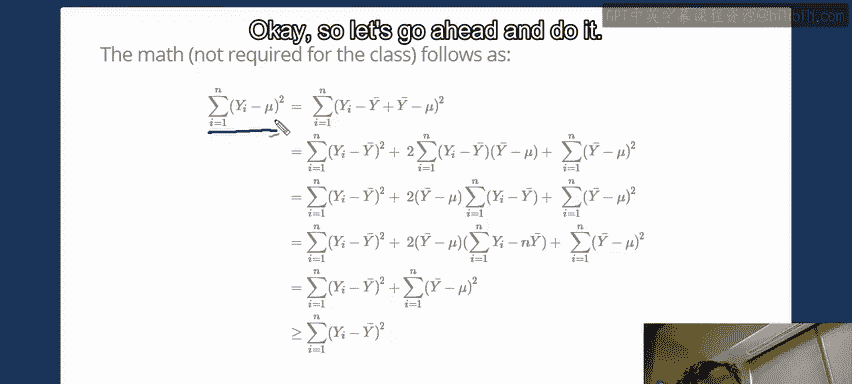
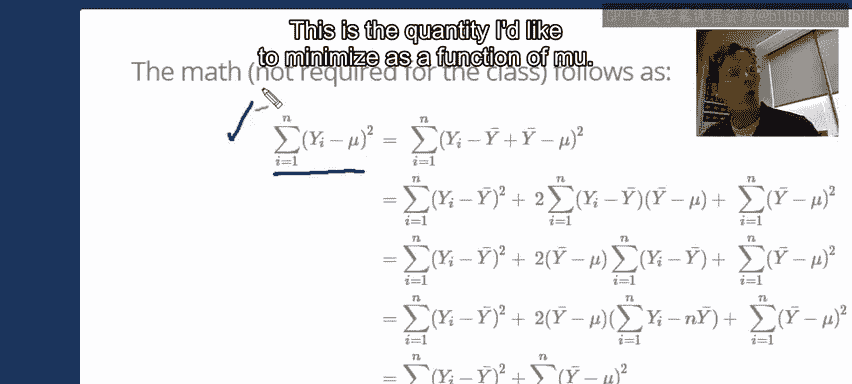
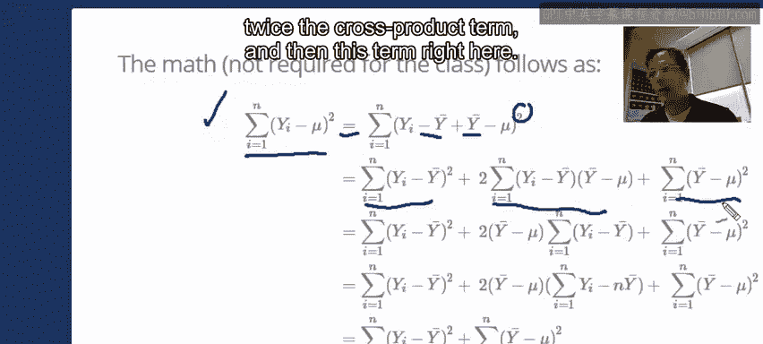
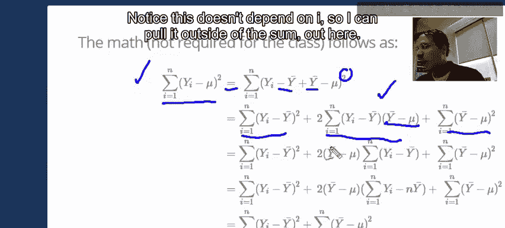
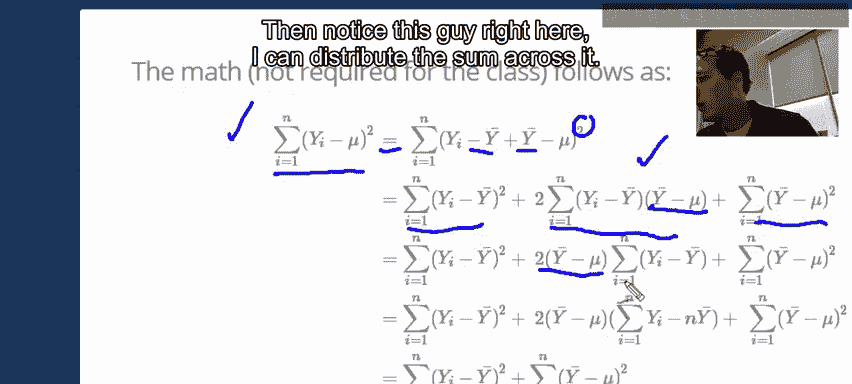
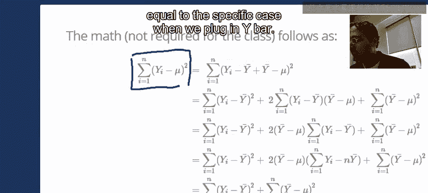
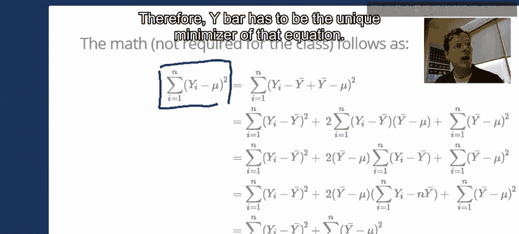

# 003：证明样本均值是最小化平方和的最优解 📊

在本节课中，我们将学习一个重要的数学证明：为什么样本均值是使残差平方和最小的最优解。这个结论是回归模型和许多统计方法的基础。

上一节我们介绍了回归模型的基本概念，本节中我们来看看如何从数学上证明样本均值的最优性。

## 证明概述

我们想要证明，对于给定的观测数据点 \( Y_i \)，样本均值 \( \bar{Y} \) 是使以下平方和函数最小的唯一值：

\[
\sum_{i=1}^{n} (Y_i - \mu)^2
\]

其中 \( \mu \) 是我们想要优化的参数。

## 证明步骤

以下是证明的核心步骤。

首先，我们在表达式中同时减去和加上样本均值 \( \bar{Y} \)，这相当于加零，不会改变原式的值：

\[
\sum (Y_i - \mu)^2 = \sum [(Y_i - \bar{Y}) + (\bar{Y} - \mu)]^2
\]

接着，我们展开平方项：

\[
\sum [(Y_i - \bar{Y})^2 + 2(Y_i - \bar{Y})(\bar{Y} - \mu) + (\bar{Y} - \mu)^2]
\]

现在，让我们仔细观察交叉项 \( 2(Y_i - \bar{Y})(\bar{Y} - \mu) \)。由于 \( (\bar{Y} - \mu) \) 不依赖于索引 \( i \)，我们可以将其提到求和符号外面：

\[
2(\bar{Y} - \mu) \sum (Y_i - \bar{Y})
\]

根据样本均值的定义 \( \bar{Y} = \frac{1}{n} \sum Y_i \)，我们可以推导出：

\[
\sum (Y_i - \bar{Y}) = \sum Y_i - n\bar{Y} = n\bar{Y} - n\bar{Y} = 0
\]

因此，整个交叉项为零。于是，原始平方和可以简化为：

\[
\sum (Y_i - \mu)^2 = \sum (Y_i - \bar{Y})^2 + \sum (\bar{Y} - \mu)^2
\]

请注意，\( \sum (\bar{Y} - \mu)^2 \) 是一系列平方项的和，它总是大于或等于零。如果我们舍弃这一项，原式只会变小或保持不变：

\[
\sum (Y_i - \mu)^2 \geq \sum (Y_i - \bar{Y})^2
\]

这个不等式对任何 \( \mu \) 都成立，并且等号仅在 \( \mu = \bar{Y} \) 时取得。因此，样本均值 \( \bar{Y} \) 是使残差平方和最小的唯一解。

## 总结

本节课中我们一起学习了如何证明样本均值是最小化平方和的最优解。我们通过代数变换，展示了对于任何其他值 \( \mu \)，其对应的平方和都大于或等于使用样本均值时的平方和。这个结论是理解最小二乘法原理的关键基础。