# 004：3_介绍性的数据示例

在本节课中，我们将通过一个具体的数据示例，学习回归分析的基本思想。我们将使用父母与子女身高的数据，探讨如何用一条直线来描述两者之间的关系，并介绍“最小二乘法”这一核心概念。

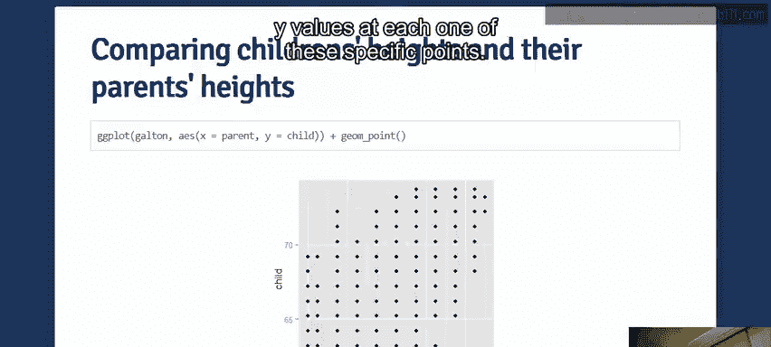

---

## 数据可视化与问题

到目前为止，我们尚未使用父母的身高数据。处理此类数据时，首先要做的是绘制子女身高与父母身高的散点图。这里我使用了 `ggplot2` 包。

这张图存在许多缺陷。一个主要缺陷是数据点过度重叠。在许多特定的坐标点上，存在多个不同的父母-子女身高配对（X，Y值）。

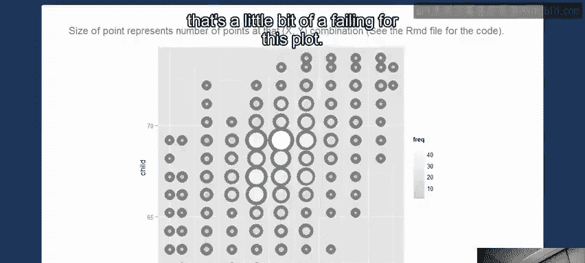

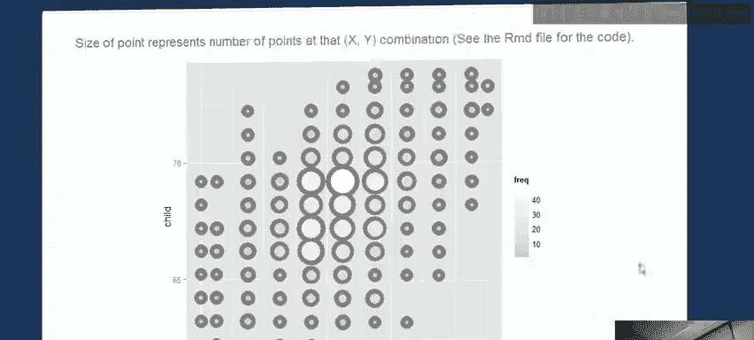

这里我提供了一张更好的图。😡 图中点的大小代表了在该特定（X，Y）位置上的父母-子女配对数量。颜色越浅（接近白色）代表频率接近40，而颜色越偏蓝或越深（相对而言）则代表频率向10或更低递减。因此，点的大小和颜色代表了该特定（X，Y）配对中父母-子女组合的频率。这是一张更好的图，因为它没有丢失这些信息。

我认为这张图还有另一个缺陷，例如，我没有在两个坐标轴上标注单位（英寸）。在坐标轴上标注单位是良好的实践，所以这也是此图的一个小缺点。如果你想查看代码，可以在R Markdown文件中找到。

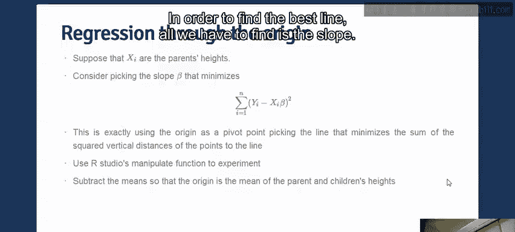

---

## 回归直线的初步构想

现在，假设我们想用父母的身高来解释子女的身高，并且我们想用一条直线来实现。为了使问题简化，我们暂时强制这条直线通过原点。具体来说，它必须通过点（0，0），也就是说它的y轴截距为0。

那么，这条直线就是 `y = βx`，其中β是斜率。`y = βx` 定义了一条通过原点的直线。为了找到最佳直线，我们只需要找到最佳的斜率β。

以下是我们的做法：我们希望找到斜率β，使得观测数据点（Yi）与直线上拟合点（Xiβ）之间的垂直距离的平方和最小。我们将这个距离平方后求和。这直接类比于我们之前几页幻灯片中计算的最小二乘均值。这本质上就是以原点为支点，选择一条使所有点到该直线垂直距离的平方和最小的直线。

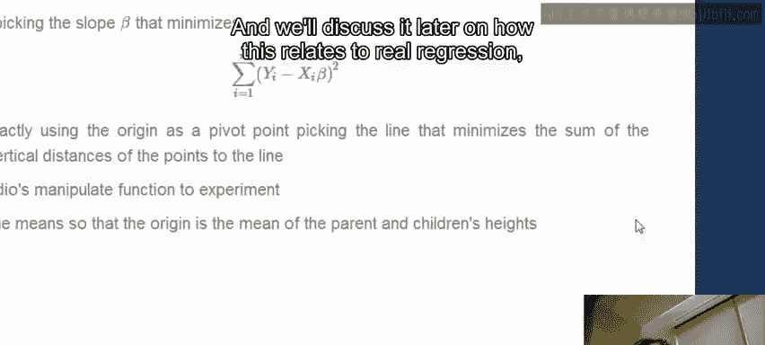

我们将使用RStudio的 `manipulate` 函数来实验并尝试找到这条直线。

通过原点的回归在解释某些问题时很有用，因为我们只有一个参数（斜率），而不是两个参数（斜率和截距）。但强制回归线通过点（0，0）通常是不可取的。一个简单的解决方法是：从父母身高和子女身高中分别减去各自的均值，这样（0，0）点就位于数据的中心。这将使这个解决方案更合理。我们稍后会讨论这与同时拟合斜率和截距的真实回归之间的关系。

---

## 核心概念图解

让我用一张图来说明其中一些概念。

这里有一个散点图，Y轴和X轴上都有一些数据。我想用我的X变量来预测Y变量。红色十字准线是我的数据点。我们正在做的“通过原点的回归”将点（0，0）视为支点，然后尝试找到最佳直线。

以这条线为例。对于每个观测点Yi，它会计算垂直距离。这个高度是Yi，这个长度是Xi，直线上的那个点是Xiβ。所以这里的距离就是 `Yi - Xiβ`。如果我们将其平方，就得到平方距离。

因此，通过原点的回归试图找到所有观测高度与拟合线之间垂直距离的平方和，并使这个总和最小。因为记住，通过原点的直线由一个简单方程 `y = βx` 定义，你只需要一个参数，即斜率。

现在，这条线看起来不会很好。如果你观察，这条线实际上应该穿过这里的某个地方，所以“回归到原点”似乎不太合理。我们通过对数据“中心化”（减去均值）所做的，就是将原点设置在数据的中心。通过减去均值，现在（0，0）点位于数据的中间。这基本上是重新定位坐标轴，使（0，0）点正好位于数据中央。现在，只考虑斜率来寻找穿过数据的回归线就显得合理多了。我们稍后会发现，这与同时拟合截距和斜率的解决方案是等价的。

让我们尝试用RStudio的 `manipulate` 函数来做这个。我认为因为这是接下来几节课的中心主题之一，我们会反复讨论这些要点，它们非常基础。

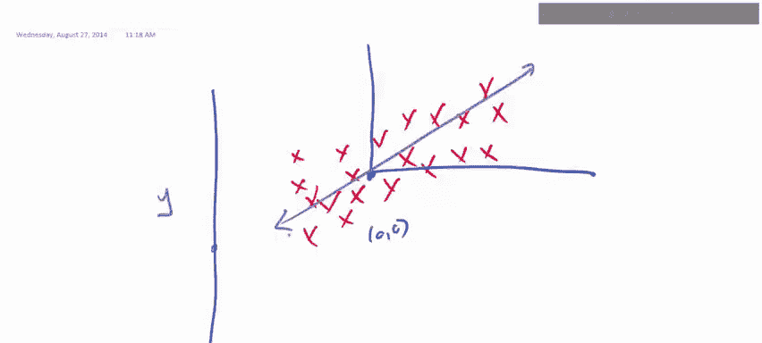

---

## 动手实验与R代码实现

我不展示运行代码的过程，因为你可以从R Markdown文件中获取代码。我希望在专业课程的这一阶段，你已经熟悉运行R代码。

这是我的图。在图上，我有一个回归线的特定值。请注意，子女身高的中心在这里是0，因为我减去了均值；父母身高的中心也是0。所以我有一个支点正好在中间的（0，0）点。

我还想指出，在这里我给出了斜率 `β = 0.6` 和均方误差。均方误差再次是Y数据点减去父母身高乘以这个因子0.6后的平方和。它计算每个点的垂直距离，将其平方后求和。同样，由于在任何（X，Y）组合处都有多个点，你可以考虑将这个平方距离乘以该特定组合的适当点数（因为过度绘图）。

在（0，0）点，我们的直线将围绕该点旋转，因为我们只拟合必须通过原点的直线，只考虑斜率。

让我们开始操作，看看均方误差如何随斜率变化。0.6看起来不错。让我们移动到一个不那么好的值。均方误差变得糟糕得多。现在把它一直调高，到了5.8。你可以看到均方误差在降低。当斜率降到大约0.6左右时，效果相当好。0.64对应5.0，然后0.62对应5.002，所以又上升了。看起来最佳斜率大约是0.64。

有趣的是，斜率为1并不好。斜率为1意味着你想预测子女身高，就直接用父母身高。但在这个案例中，我们必须乘以一个因子（0.6）才能得到比直接用父母身高更好的预测。这就是斜率为我们所做的。

这里我给出了 `manipulate` 代码，同样，所有代码都在R Markdown文件中。所以不要从幻灯片上重新输入，直接从R Markdown文件中获取实际文本。

既然我们已经用 `manipulate` 找到了斜率，我将展示如何在R中快速完成这个操作。函数 `lm()` 用于拟合线性模型。

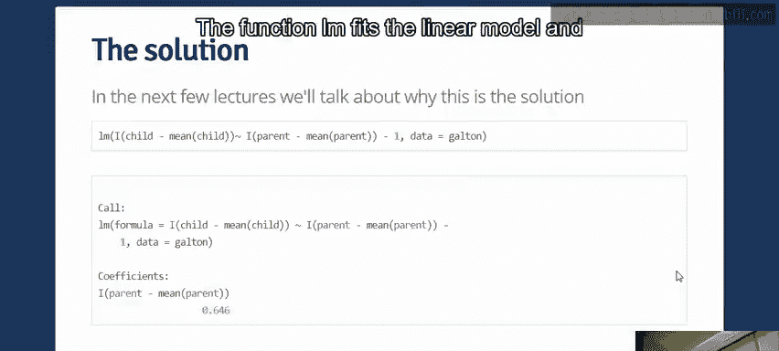
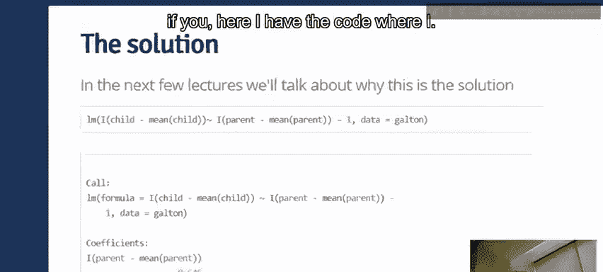

这里是我使用 `lm()` 的代码。我的结果变量（y值）是中心化后的子女身高（减去了均值）。这里是中心化后的父母身高（减去了父母的均值）。`-1` 表示去掉截距，因为我们讨论的是通过原点的回归，不考虑Y轴截距。然后我指定要拟合的数据集是 `Galton`。它给出的斜率是 **0.646**。

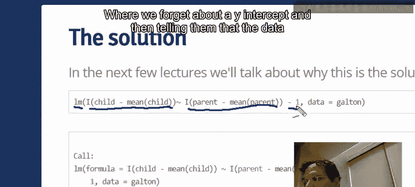

我们将详细讨论这一点，并在课程的其余部分深入探讨。

---

## 最终拟合线与总结

在本讲的最后一张幻灯片中，我给出了拟合的直线。由于我们强制模型通过中心化子女身高和中心化父母身高的（0，0）点，它必须通过子女身高和父母身高的均值。我已经重新调整了绘图，使那个（0，0）点回到了原始位置。

所以，这里是我们斜率为 **0.646** 的直线。在接下来的课程中，我们将讨论如何得到这些结果、背后的动机以及我们可以用这条拟合线做的所有事情。我们可能会花接下来几节课的时间来讨论这个。

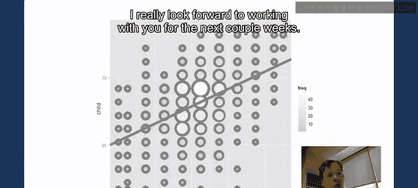

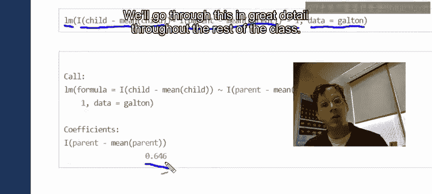

欢迎来到回归分析入门。实际上，我们在第一讲中已经涵盖了很多材料，我非常期待在接下来的几周里与大家一起学习。

---

## 本节课总结

在本节课中，我们一起学习了：
1.  **数据可视化的重要性**：通过改进的散点图展示数据重叠问题。
2.  **回归的基本思想**：用一条直线（`y = βx`）描述变量间关系。
3.  **最小二乘法原理**：通过最小化垂直距离的平方和（`∑(Yi - Xiβ)²`）来寻找最佳拟合直线。
4.  **中心化的作用**：通过减去均值将数据原点移至中心，使“通过原点的回归”更具解释性。
5.  **R语言工具**：使用 `manipulate` 包交互式探索斜率，并使用 `lm()` 函数快速拟合模型，得到斜率估计值 **0.646**。

我们为理解回归分析奠定了坚实的基础，接下来的课程将在此基础上深入展开。