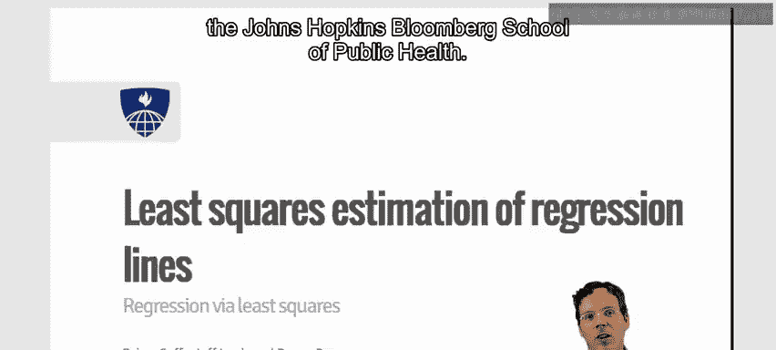
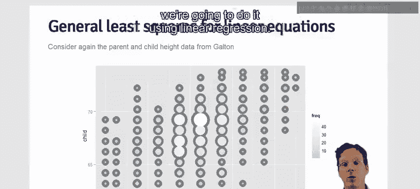
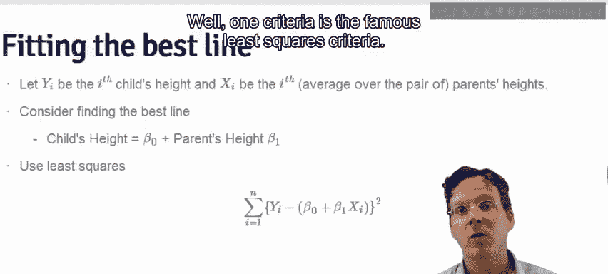
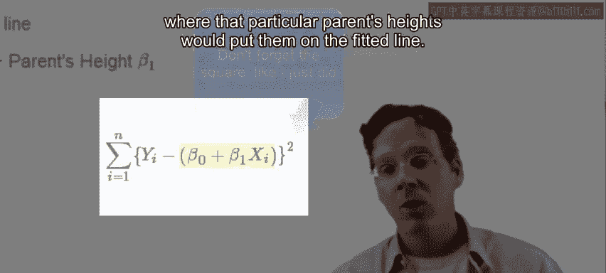
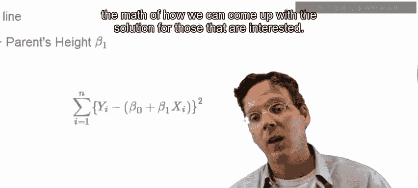
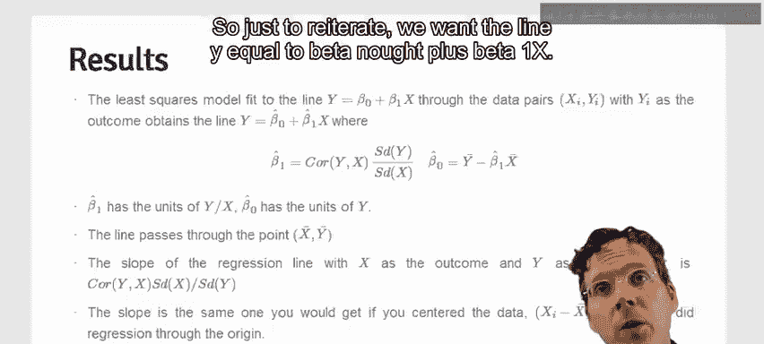
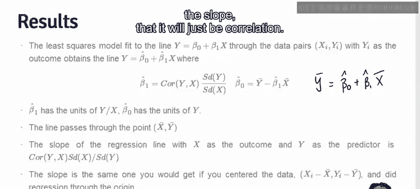

# 006：线性最小二乘法

在本节课中，我们将要学习线性回归的核心估计方法——最小二乘法。我们将了解如何通过最小化误差平方和，找到数据的最佳拟合直线。

---

## 引言与数据背景

上一节我们介绍了回归模型的基本概念，本节中我们来看看如何具体计算回归线。

再次考虑高尔顿数据中父母身高与子女身高的散点图。图中圆圈的大小代表了特定（X，Y）组合出现的频率。我们希望利用父母身高来解释子女身高，并将通过线性回归来实现这一目标。

---

## 模型与符号定义

我们将使用上一讲中建立的符号体系。

*   令 **Y_i** 表示第 i 个孩子的身高。
*   令 **X_i** 表示第 i 个父母的身高。

我们希望找到一条最佳直线，其形式为：
**子女身高 = 截距 + 斜率 × 父母身高**

用公式表示为：
`Y_i = β_0 + β_1 * X_i`

其中，**β_0**（截距）和 **β_1**（斜率）是我们未知但希望求得的参数。

---

## 最小二乘准则

我们需要一个标准来定义“最佳”拟合线。一个著名的标准就是**最小二乘准则**。

其基本思想是：我们希望最小化数据点（即子女身高）与拟合线上对应点之间的**垂直距离的平方和**。

用公式可以写为：
**最小化 Σ [ Y_i - (β_0 + β_1 * X_i) ]²**

---

## 准则的直观理解

让我们通过图示来理解最小二乘准则的含义。

假设我们有一个数据集。最小二乘准则寻找最佳回归线的过程如下：

1.  它为数据拟合一条直线。
2.  对于每个数据点（例如点 (X_1， Y_1)），它计算该点的实际 Y 值（Y_1）与直线上对应 X 值的预测 Y 值（β_0 + β_1 * X_1）之间的垂直距离。
3.  将这个距离（可能为正或负）进行平方，以消除符号影响。
4.  对数据集中的所有点重复此过程，并将所有平方距离相加。

最终，最小二乘法通过调整 **β_0** 和 **β_1** 的值，来最小化这个总的平方误差和。每个数据点对误差的贡献是相等的。

---

## 最小二乘解

当我们执行这个模型拟合时，解是什么？

我们寻找的直线是 `Y = β_0 + β_1 * X`，通过一系列点 (X_i， Y_i) 进行拟合，其中 Y_i 是结果变量。我们在 **β_0** 和 **β_1** 上加上“帽子”符号（^）来表示它们的估计值。

解的具体形式如下：

*   **斜率估计值 β̂₁** 的计算公式为：
    `β̂₁ = Cor(Y， X) * (S_y / S_x)`
    其中 `Cor(Y， X)` 是 Y 与 X 的相关系数，`S_y` 是 Y 的标准差，`S_x` 是 X 的标准差。

*   **截距估计值 β̂₀** 的计算公式为：
    `β̂₀ = Ȳ - β̂₁ * X̄`
    其中 `Ȳ` 是 Y 的均值，`X̄` 是 X 的均值。

---

## 解的性质与推论

了解这个结果后，我们可以推导出几个重要性质：

以下是关于最小二乘解的几个关键点：

1.  **单位**：斜率 **β̂₁** 的单位是 Y 的单位除以 X 的单位。这可以从公式中看出：相关系数是无单位的，`S_y` 带有 Y 的单位，`S_x` 带有 X 的单位。
2.  **穿过均值点**：拟合直线总是穿过数据的中心点 **(X̄， Ȳ)**。从截距公式重新排列即可得到 `Ȳ = β̂₀ + β̂₁ * X̄`。
3.  **角色互换**：如果我们将 Y 和 X 的角色互换，将 X 作为结果变量，Y 作为预测变量，那么得到的斜率将是 `Cor(X， Y) * (S_x / S_y)`。这与以 Y 为结果、X 为预测变量时得到的斜率不同。
4.  **数据中心化**：如果先将数据**中心化**（即每个 X_i 减去 X̄，每个 Y_i 减去 Ȳ），然后强制回归线穿过原点（0， 0）进行拟合，得到的斜率是相同的。
5.  **数据标准化**：如果先将数据**标准化**（即中心化并缩放，使标准差为1），那么斜率就等于相关系数 `Cor(Y， X)`，因为此时 `S_y` 和 `S_x` 都等于1。

---

## 总结

本节课中我们一起学习了线性回归的核心估计方法——最小二乘法。我们定义了通过最小化垂直距离平方和来寻找最佳拟合线的准则，并给出了斜率和截距估计值的具体计算公式。我们还讨论了该解的几个重要性质，包括其单位、必然穿过数据均值点，以及在数据经过中心化或标准化后的表现。理解最小二乘法是掌握线性回归建模的基础。