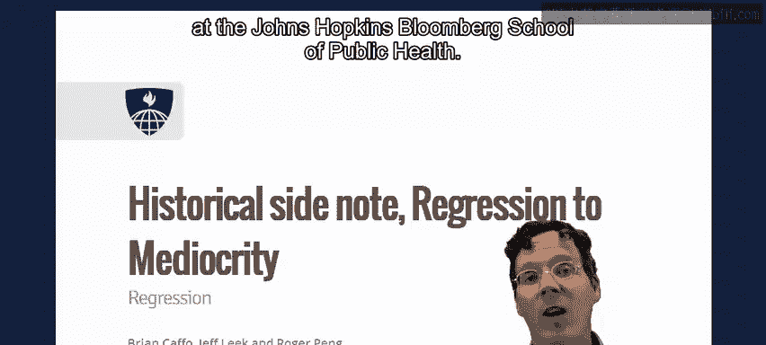
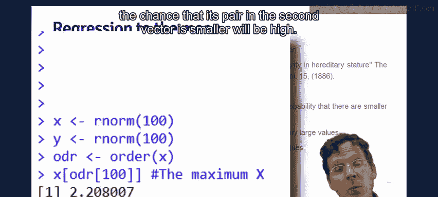
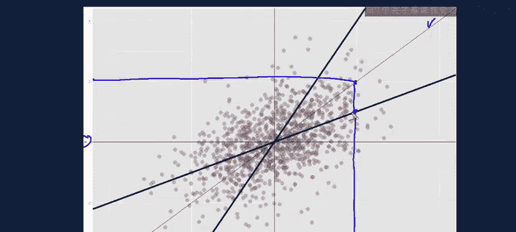

# 009：回归至均值 📈

## 概述



在本节课中，我们将学习“回归至均值”这一重要概念。回归至均值是回归分析发展史上的一个里程碑，由弗朗西斯·高尔顿发现。我们将探讨其含义、常见例子，并学习如何使用相关系数来量化这一现象。

---

## 什么是回归至均值？

上一节我们介绍了回归模型的基础。本节中，我们来看看一个有趣且普遍的现象——回归至均值。

回归至均值提出类似这样的问题：为什么非常高的父母所生的孩子也往往很高，但通常没有父母那么高？同样，为什么非常矮的父母所生的孩子也往往很矮，但通常没有父母那么矮？

这种现象也出现在其他领域。例如，表现最佳的运动员在第二年往往表现稍差，而表现最差的运动员在第二年往往表现稍好。股票市场也常被如此讨论，一些表现最佳的股票之后往往会下跌。

我们将讨论其原因，并区分这究竟是内在规律，还是回归至均值效应，这是一个重要的问题。

这些现象都是所谓的“回归至均值”的例子。

---

## 弗朗西斯·高尔顿的贡献

正如上一张幻灯片提到的，回归至均值由弗朗西斯·高尔顿在其著名论文《遗传身高中向平庸的回归》中提出。



我喜欢通过考虑100%回归至均值的极端情况来理解这个概念。

想象我模拟生成两对独立的标准正态随机变量，它们之间没有线性关系，是独立的。

在我生成的第一组标准正态随机变量中，如果我取最大值，那么它在第二组中的配对值更小的概率会很高。


这简单地表明，给定一个非常大的X值，Y小于X的概率会随着X趋向于非常大的值而增大。

换句话说，给定一个非常小的X值，Y大于X的概率会随着X趋向于更小的值而增大。

然而，在大多数情况下，是内在成分和噪声的混合。例如，如果我给班上每个学生两次非常难的测验。

表现最好的学生很可能确实更了解材料。但是，测验是不完美的工具，测验作为工具存在很多误差，因此存在一些噪声。

所以，表现最好的学生可能确实比其他人更了解材料一点，但也可能受益于一些噪声，因此在第二次测验中他们的表现可能会稍差一些，可能仍然很好，但会稍差。对于表现最差的学生也是如此。

思考体育讨论中有多少内容实际上只是在谈论回归至均值，这常常很有趣。一个棒球运动员在某一年打击率惊人，下一年往往会稍低一些。这只是回归至均值吗？如果能量化它就好了。

这就是弗朗西斯·高尔顿在首次处理回归至均值时用回归所做的事情。

---

## 如何量化回归至均值？

我们想讨论弗朗西斯·高尔顿如何利用回归的思想，特别是相关系数（我们知道它与线性回归密切相关）来量化回归至均值。我们将主要通过一张图来展示，但在展示R代码之前，我想先设置好这张图。

在这个案例中，我的X将是孩子的身高，Y将是父母的身高。我将使用一个数据集，其中父母是单亲，即父亲。这些数据都已标准化，Y和X的均值为0，方差为1，我们现在应该对此非常熟悉。

回想一下，如果我这样做了，那么我的回归线将通过点(0,0)。并且，无论孩子的身高是结果变量还是父母的身高是结果变量，斜率现在都简单地等于相关系数。

我还想提一下创建图表时的一个小技巧：如果X是结果变量，而你恰好将结果变量绘制在横轴上，那么你绘制的直线的斜率需要是1除以相关系数。这只是因为我将结果变量绘制在了X轴上，所以提醒你一下，如果你对代码感到有点困惑。

---

## R代码实现与解读

以下是创建图表的R代码步骤：

```r
# 加载数据
library(UsingR)
data(father.son)

# 标准化数据：减去均值，除以标准差
y <- (father.son$sheight - mean(father.son$sheight)) / sd(father.son$sheight)
x <- (father.son$fheight - mean(father.son$fheight)) / sd(father.son$fheight)

# 计算相关系数
rho <- cor(x, y)

# 加载绘图库
library(ggplot2)

# 创建基础散点图
g <- ggplot(data.frame(x = x, y = y), aes(x = x, y = y))
g <- g + geom_point(colour = "salmon", alpha = 0.6, size = 2)
g <- g + xlim(-4, 4) + ylim(-4, 4) + coord_equal()

# 添加对角线（恒等线）
g <- g + geom_abline(intercept = 0, slope = 1, colour = "black")

# 添加坐标轴
g <- g + geom_hline(yintercept = 0)
g <- g + geom_vline(xintercept = 0)


# 添加两条回归线
# 1. 以父亲身高预测儿子身高 (y ~ x)
g <- g + geom_abline(intercept = 0, slope = rho, colour = "blue", size = 1.5)
# 2. 以儿子身高预测父亲身高 (x ~ y)，注意斜率是 1/rho
g <- g + geom_abline(intercept = 0, slope = 1/rho, colour = "darkgreen", size = 1.5)

print(g)
```

运行代码后，我们得到相关系数 `rho` 约为 0.5。这意味着父亲身高和儿子身高之间的相关系数是 0.5。

现在让我们解读这张图，并用它来描述回归至均值。


如果观测值完美地落在一条线上，那么在这张图上，它必须是恒等线，因为我们已经标准化了X和Y。提醒一下，父亲身高被绘制为X变量，儿子身高被绘制为Y变量。

所以，如果我们有一个父亲身高为2（即高于均值2个标准差），并且没有噪声，我们会预测儿子身高也为2（即高于均值2个标准差）。

然而，当我们查看数据时，存在很多噪声。所以现在的预测不是2，而是在回归线上（蓝色线）。由于我们的设置方式，这简单地等于2乘以斜率，即相关系数。现在的预测点在这里（蓝色线与X=2的垂线的交点），介于2和0之间。

事实上，它正好等于2乘以相关系数。这就是回归至均值。这种乘法收缩就是弗朗西斯·高尔顿测量回归至均值的方式。



这个相关系数向水平线收缩的程度，就给出了回归至均值的程度。

如果我们讨论没有噪声的情况，这条线将完美地落在恒等线上。考虑全是噪声的情况，父亲身高对儿子身高没有信息，那么相关系数为0，这条线就会在水平轴上。那么，如果你必须根据父亲身高来预测儿子身高，你最终总会得到0的预测。

这个现象就是回归至均值。当然，我们也可以将其翻转过来考虑。

如果我们把儿子身高作为预测变量，父亲身高作为结果变量，你可以在这张图上可视化这一点，因为我用这条线（深绿色线）展示了这个图。回归至均值就是它向纵轴收缩的程度。

这是一个非常聪明的想法，我认为这是导致我们现在所认为的现代回归的基本思想之一。然而，回归至均值的概念在统计学中仍然占有重要地位，例如，当你研究纵向数据时，思考回归至均值的概念非常重要。

---

## 总结

本节课中，我们一起学习了“回归至均值”的核心概念。我们了解到：

*   回归至均值描述了极端观测值在后续测量中倾向于更接近平均值的现象。
*   它由弗朗西斯·高尔顿在研究遗传身高时发现并命名。
*   这种现象普遍存在于许多领域，如教育测试、体育表现和金融市场。
*   我们可以通过**相关系数 `ρ`** 来量化回归至均值的程度。预测值会向均值“收缩”，收缩因子就是相关系数。
*   在标准化数据中，回归线的斜率等于相关系数，这为我们可视化理解回归至均值提供了直观工具。

理解回归至均值有助于我们区分真实效应与统计波动，是数据分析中一个至关重要的概念。