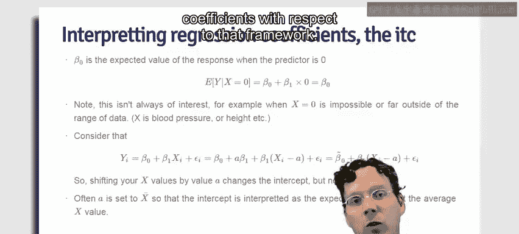
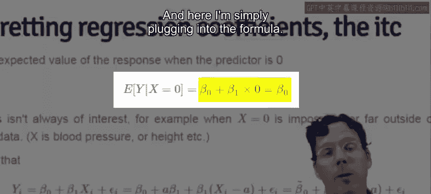
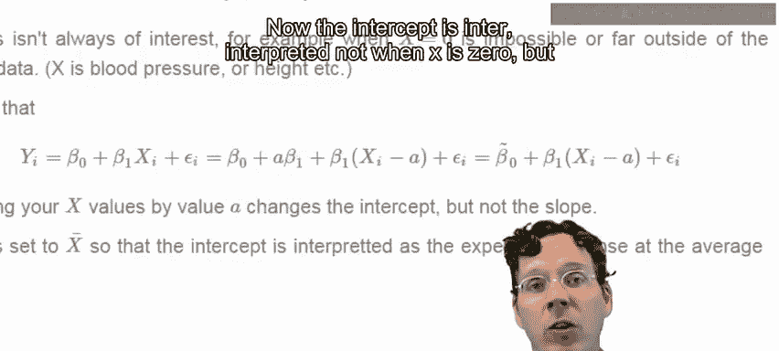

# 011：解释回归系数 📊

在本节课中，我们将学习如何解释线性回归模型中的系数。我们将重点关注截距和斜率的统计含义，并探讨如何通过平移或缩放自变量来改变系数的解释方式，使其更具实际意义。

---

## 建立统计框架

上一节我们介绍了线性回归的正式统计框架。本节中，我们将基于这个框架来解释回归系数。

回归模型的基本形式为：
\[
Y = \beta_0 + \beta_1 X + \epsilon
\]
其中，\(\beta_0\) 是截距，\(\beta_1\) 是斜率，\(\epsilon\) 是误差项。

---

## 解释截距

截距 \(\beta_0\) 是当自变量 \(X = 0\) 时，响应变量 \(Y\) 的期望值。公式表示为：
\[
E[Y | X = 0] = \beta_0
\]

然而，在许多研究中，自变量为零的情况可能没有实际意义。例如，如果 \(X\) 代表血压，那么血压为零的人群的响应值通常不是研究重点。

为了解决这个问题，我们可以对自变量进行平移。考虑将 \(X\) 减去一个常数 \(A\)：
\[
Y = \beta_0 + \beta_1 (X - A) + \epsilon
\]
这等价于：
\[
Y = (\beta_0 - \beta_1 A) + \beta_1 X + \epsilon
\]

我们定义一个新的截距 \(\tilde{\beta_0} = \beta_0 - \beta_1 A\)。模型变为：
\[
Y = \tilde{\beta_0} + \beta_1 X + \epsilon
\]

平移自变量不会改变斜率 \(\beta_1\)，但会改变截距。新的截距 \(\tilde{\beta_0}\) 表示当 \(X = A\) 时 \(Y\) 的期望值。

一个常见的做法是令 \(A\) 等于 \(X\) 的样本均值 \(\bar{X}\)。这样，截距就被解释为当自变量取平均值时，响应变量的期望值。

---

## 解释斜率

斜率 \(\beta_1\) 表示自变量 \(X\) 每增加一个单位，响应变量 \(Y\) 的期望变化量。

我们可以通过以下推导来验证：
\[
E[Y | X = x+1] - E[Y | X = x] = [\beta_0 + \beta_1 (x+1)] - [\beta_0 + \beta_1 x] = \beta_1
\]

因此，\(\beta_1\) 确实代表了 \(X\) 每变化一个单位所引起的 \(Y\) 的期望变化。

---

## 缩放自变量的影响

如果我们将自变量 \(X\) 乘以一个正常数 \(a\)，会发生什么？

原始模型：
\[
Y = \beta_0 + \beta_1 X + \epsilon
\]

将 \(X\) 替换为 \(aX\)：
\[
Y = \beta_0 + \beta_1 (aX) + \epsilon = \beta_0 + (\beta_1 a) X + \epsilon
\]

为了保持模型形式不变，我们定义一个新的斜率 \(\tilde{\beta_1} = \beta_1 a\)。但更常见的解释是：如果我们放大了自变量（乘以 \(a\)），那么为了得到正确的 \(Y\) 预测值，斜率必须被缩小（除以 \(a\)）。实际上，模型可以重写为：
\[
Y = \beta_0 + \left( \frac{\beta_1}{a} \right) (aX) + \epsilon
\]
这显示了乘以 \(a\) 的 \(X\) 对应着除以 \(a\) 的系数。

---

### 一个具体例子

假设我们建立了一个模型，其中：
*   \(X\) 是身高，单位是米（m）。
*   \(Y\) 是体重，单位是千克（kg）。
*   估计出的斜率 \(\beta_1\) 的单位是 **千克/米（kg/m）**。

如果我们将身高的单位从米转换为厘米（cm），我们知道 1 米 = 100 厘米。这相当于将自变量 \(X\) 乘以 100。

为了使模型在新单位下给出相同的预测，斜率系数必须进行相应调整。新的斜率 \(\beta_1^{new}\) 应为：
\[
\beta_1^{new} = \frac{\beta_1}{100}
\]
其单位变为 **千克/厘米（kg/cm）**。

通过这个例子，我们可以清楚地看到缩放自变量如何影响斜率的数值和单位解释。

---

## 总结

本节课中，我们一起学习了如何解释线性回归模型的系数：
1.  **截距** \(\beta_0\) 通常解释为当所有自变量为零时响应变量的期望值。通过平移自变量（例如，减去其均值），可以使截距的解释更具实际意义。
2.  **斜率** \(\beta_1\) 解释了自变量每增加一个单位，响应变量期望值的变化量。这是回归分析的核心解释。
3.  对自变量进行**平移**会改变截距但不改变斜率。
4.  对自变量进行**缩放**（乘以一个常数）会以相反的比例改变斜率的数值和单位，因此在报告和解释系数时，必须清楚说明自变量的测量单位。

理解这些概念对于正确理解和传达回归模型的结果至关重要。