# 014：残差计算与可视化示例


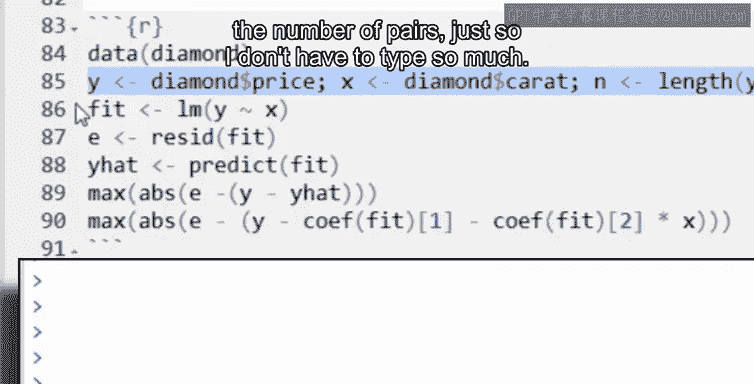

在本节课中，我们将学习如何计算和可视化回归模型的残差。我们将使用钻石数据集作为示例，通过R语言演示残差的计算方法，并探讨如何通过残差图评估模型拟合的优劣。

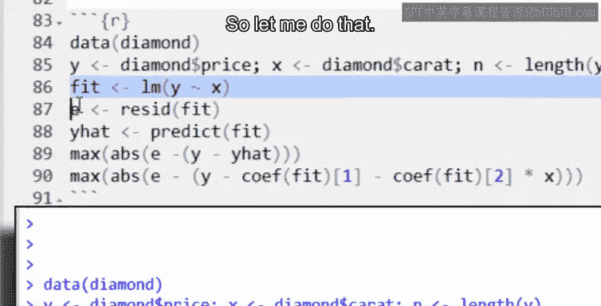

---

## 🔢 计算残差

首先，我们加载钻石数据集并拟合一个简单的线性回归模型，其中价格（`price`）是因变量，克拉数（`carat`）是自变量。

```r
# 加载数据并拟合模型
data(diamonds)
y <- diamonds$price
x <- diamonds$carat
n <- length(y)
fit <- lm(y ~ x)
```

拟合模型后，我们可以通过多种方式获取残差。最直接的方法是使用`resid()`函数。

```r
# 方法一：使用resid()函数
e <- resid(fit)
```

另一种方法是手动计算残差，即观测值减去预测值。

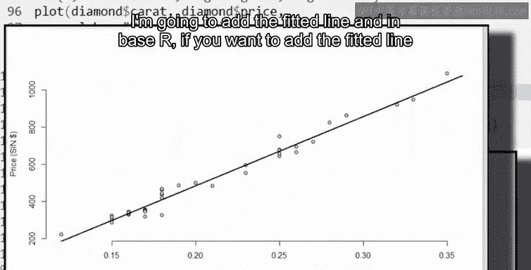

```r
# 方法二：手动计算残差
y_hat <- predict(fit)
e_manual <- y - y_hat
```

我们可以验证这两种方法得到的残差在数值精度上是相同的。

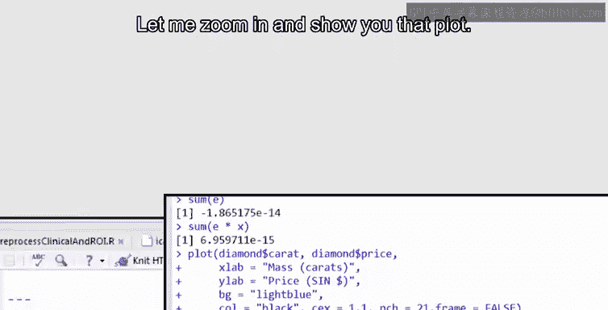

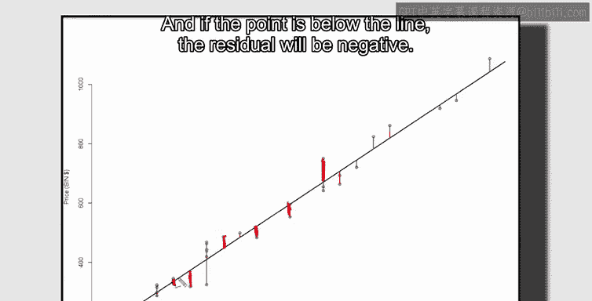

```r
# 验证残差一致性
max(abs(e - e_manual))  # 结果应接近0
```

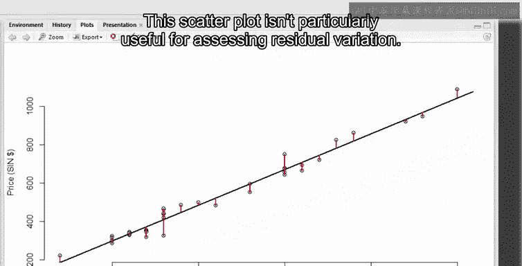

此外，我们还可以验证残差的两个重要性质：残差之和为零，以及残差与自变量的乘积之和为零。

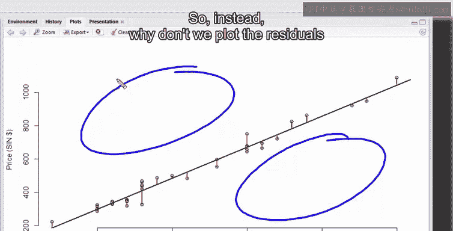

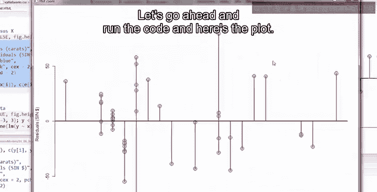

```r
# 验证残差性质
sum(e)               # 应接近0
sum(e * x)           # 应接近0
```

---

## 📊 可视化残差

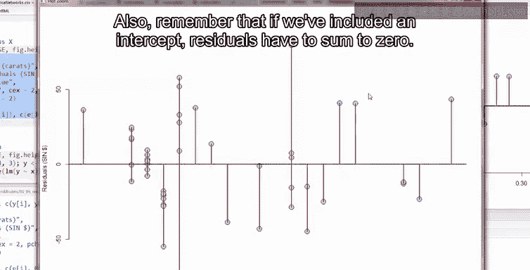

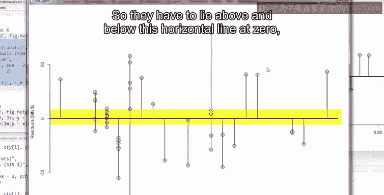

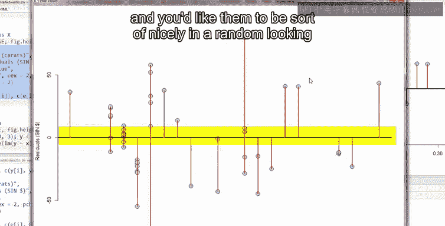

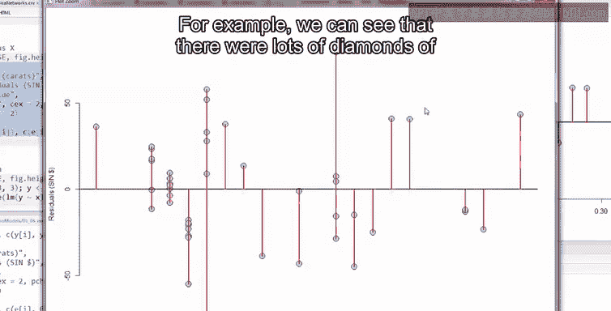

为了更直观地理解残差，我们可以绘制散点图并在图上添加回归线和残差线段。

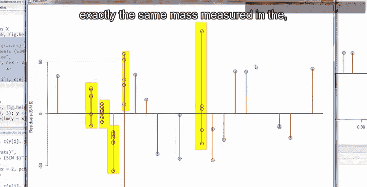

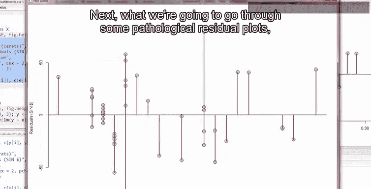

```r
# 绘制散点图与回归线
plot(x, y, main = "钻石价格 vs 克拉数", xlab = "克拉数", ylab = "价格")
abline(fit, lwd = 2, col = "blue")


# 添加残差线段
for (i in 1:n) {
  segments(x[i], y[i], x[i], y_hat[i], col = "red", lwd = 1)
}
```

然而，这种散点图在展示残差变异时可能不够清晰。为了更好地评估残差，我们绘制残差与自变量的关系图。

```r
# 绘制残差图
plot(x, e, main = "残差 vs 克拉数", xlab = "克拉数", ylab = "残差")
abline(h = 0, lty = 2, col = "gray")
```

在残差图中，我们希望看到残差随机分布在水平线（y=0）上下，无明显模式。如果存在明显模式，可能表明模型拟合不足或存在异方差性。

---

## 🔍 残差图的诊断作用

残差图是诊断模型拟合问题的重要工具。以下通过两个模拟示例说明残差图如何揭示模型中的非线性或异方差性。

### 示例一：非线性模式

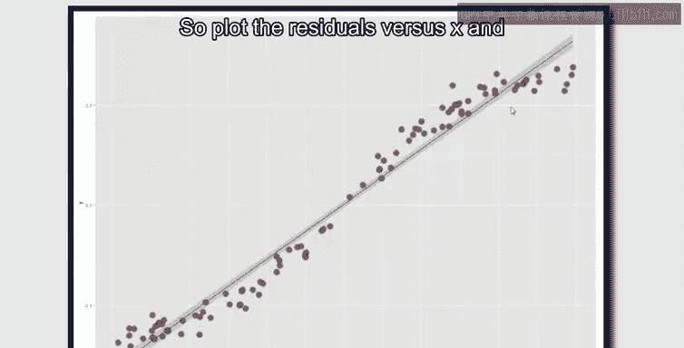

假设真实关系为 `y = x + sin(x) + ε`，但我们用线性模型 `y ~ x` 进行拟合。

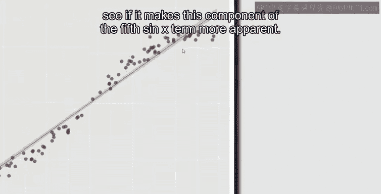

```r
# 生成模拟数据
set.seed(123)
x <- runif(100, -3, 3)
y <- x + sin(x) + rnorm(100, sd = 0.2)

# 拟合线性模型
fit_linear <- lm(y ~ x)

# 绘制残差图
plot(x, resid(fit_linear), main = "残差图（非线性示例）", xlab = "x", ylab = "残差")
abline(h = 0, lty = 2, col = "gray")
```

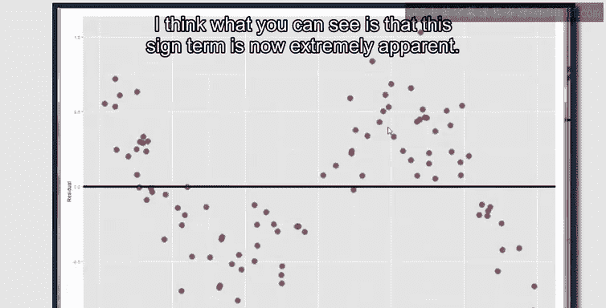

在残差图中，正弦函数的模式变得非常明显，这在线性模型中未被捕捉。

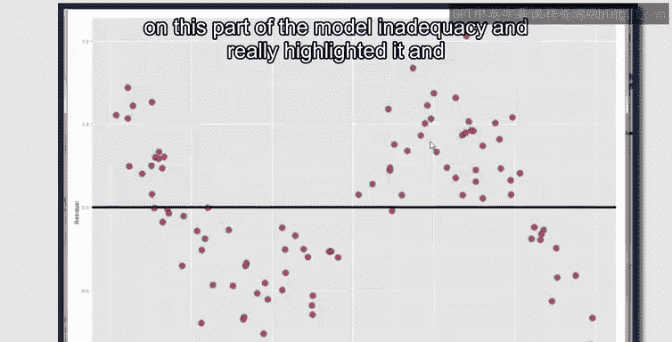

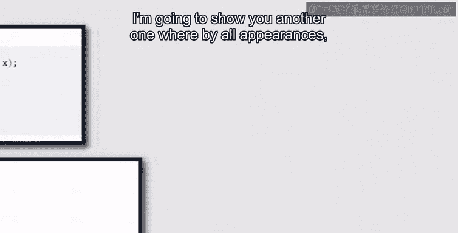

### 示例二：异方差性

假设真实关系为 `y = x + ε`，其中误差的标准差随x增大而增大。

```r
# 生成异方差数据
set.seed(123)
x <- runif(100, 0, 3)
y <- x + rnorm(100, sd = 0.1 * x)

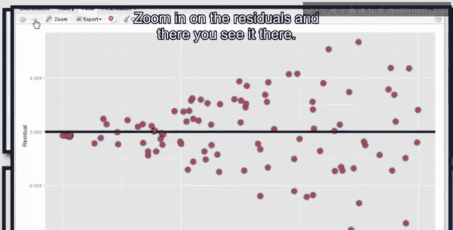

# 拟合线性模型
fit_hetero <- lm(y ~ x)

# 绘制残差图
plot(x, resid(fit_hetero), main = "残差图（异方差示例）", xlab = "x", ylab = "残差")
abline(h = 0, lty = 2, col = "gray")
```

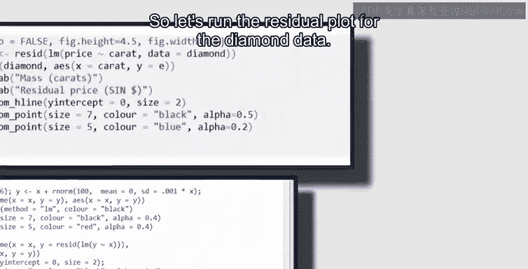

在残差图中，可以清晰看到残差的变异性随x增加而增大，这表明存在异方差性。

---

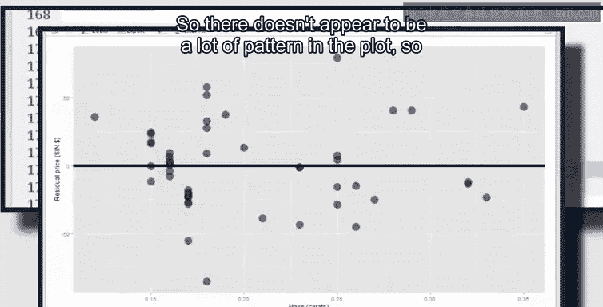

## 💎 钻石数据集的残差分析

回到钻石数据集，我们拟合包含截距和斜率的模型，并比较仅含截距的模型与完整模型的残差。

```r
# 拟合仅截距模型
fit_intercept <- lm(price ~ 1, data = diamonds)
e_intercept <- resid(fit_intercept)

# 拟合完整模型
fit_full <- lm(price ~ carat, data = diamonds)
e_full <- resid(fit_full)

# 创建比较数据框
resid_data <- data.frame(
  residual = c(e_intercept, e_full),
  model = factor(rep(c("仅截距", "截距+斜率"), each = nrow(diamonds)))
)

# 绘制残差比较图
library(ggplot2)
ggplot(resid_data, aes(x = model, y = residual, fill = model)) +
  geom_dotplot(binaxis = "y", stackdir = "center") +
  labs(title = "残差分布比较", x = "模型", y = "残差") +
  theme_minimal()
```

左图展示了钻石价格围绕平均价格的变异，右图展示了围绕回归线的残差变异。通过引入克拉数作为预测变量，我们解释了大部分价格变异，剩余的残差变异较小。

---

## 📝 总结

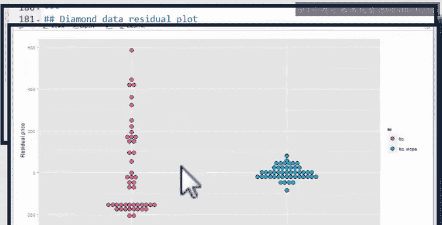

本节课中，我们一起学习了如何计算和可视化回归模型的残差。我们通过钻石数据集演示了残差的计算方法，并探讨了残差图在诊断模型拟合问题中的重要作用。残差图能够有效揭示非线性、异方差性等模型缺陷，是回归分析中不可或缺的工具。在下一节中，我们将深入讨论R平方，进一步量化模型解释的变异比例。