# 015：14_残差方差 📊

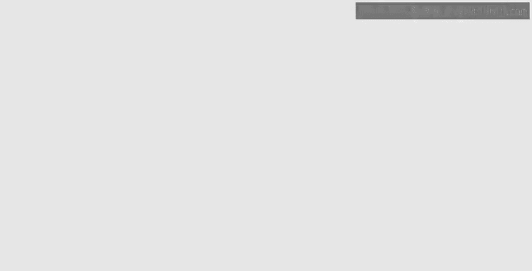

在本节课中，我们将要学习回归分析中的一个核心概念——残差方差。我们将探讨它如何计算，它与总方差及回归方差的关系，以及它如何帮助我们理解模型拟合的度量指标R平方。

## 残差方差的概念

在结束关于R平方的讨论之前，我们快速讲解一下残差方差。

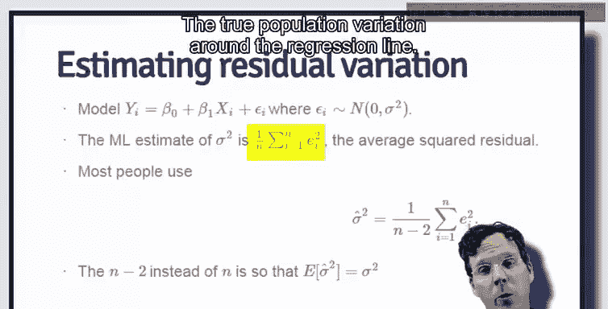

残差方差是数据点围绕回归线的变异程度。残差是观测结果与拟合回归线之间的垂直距离。

如果模型中包含截距项，残差之和必须为零，这意味着它们的均值为零。因此，若要计算残差的方差，只需计算其平方的平均值。

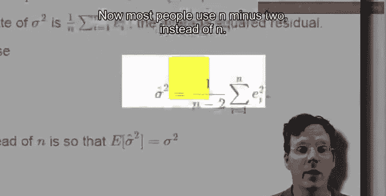

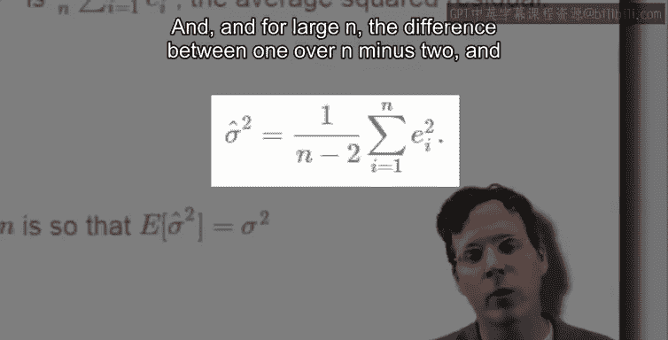

**公式**：残差方差的估计值为 `sum(residuals^2) / n`，其中 `sigma^2` 表示围绕回归线的真实总体方差。

## 自由度与分母调整

然而，在计算中，大多数人使用 `n-2` 作为分母，而不是 `n`。因此，它并非简单的平均平方残差。

对于大样本量 `n`，使用 `1/(n-2)` 和 `1/n` 的差异可以忽略不计，但对于小样本量，这种差异可能很重要。

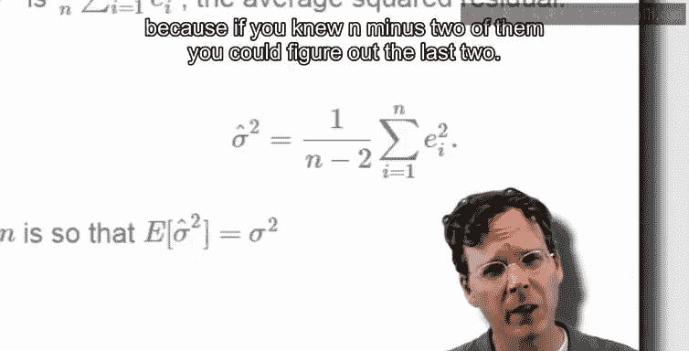

这样考虑的原因是：如果模型包含截距项，残差之和为零，这是一个约束条件。如果你知道 `n-1` 个残差，就能推算出第 `n` 个。此外，如果模型中包含一个协变量（预测变量），这会对残差施加第二个约束条件，因此我们失去了两个自由度。每增加一个回归变量，就会增加一个约束，失去一个自由度。

本质上，这就像说你并非真正拥有 `n` 个独立的残差，而是 `n-2` 个。因为如果你知道 `n-2` 个残差，就能推算出最后两个。这就是分母使用 `n-2` 的原因。

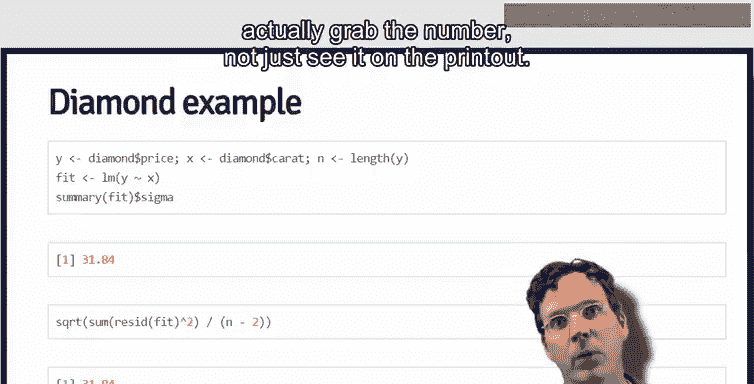

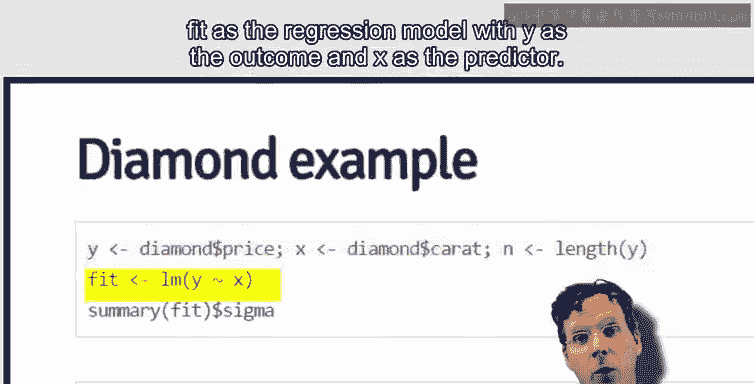

## 在R中提取残差方差

上一节我们介绍了残差方差的理论计算，本节中我们来看看如何在R语言中实际操作并提取这个值。

以下是如何从你的 `lm` 拟合对象中提取残差标准差（即残差方差的平方根），并将其赋值给一个变量，以便在R程序中使用。

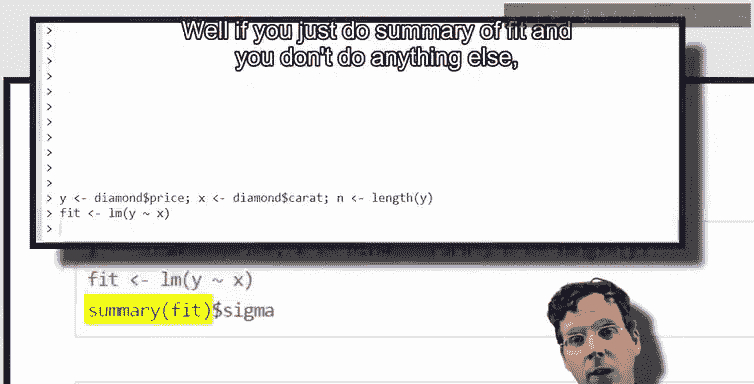

```r
# 定义数据
y <- diamond$price
x <- diamond$carat
# 拟合回归模型
fit <- lm(y ~ x)
```

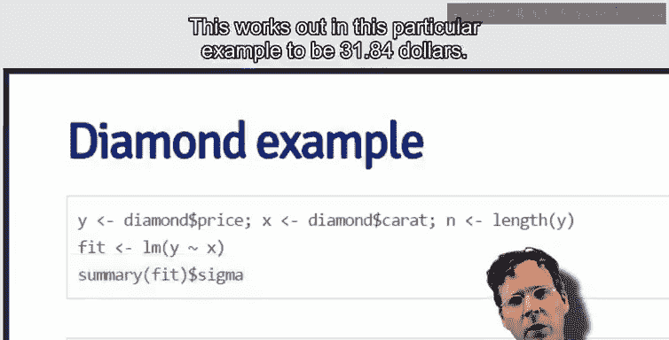

如果直接运行 `summary(fit)`，输出结果会包含回归模型的摘要信息，如截距、斜率估计值等，其中也会显示残差标准差的估计值。

然而，如果你想将其作为一个可以赋值的对象来使用，只需使用 `$sigma` 符号。

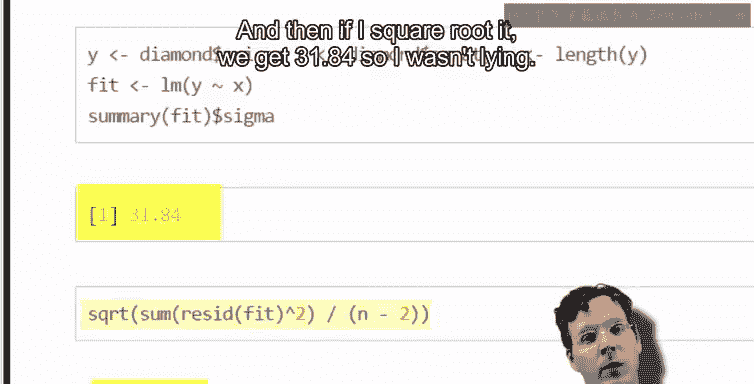

```r
# 提取残差标准差并赋值
sigma_hat <- fit$sigma
```

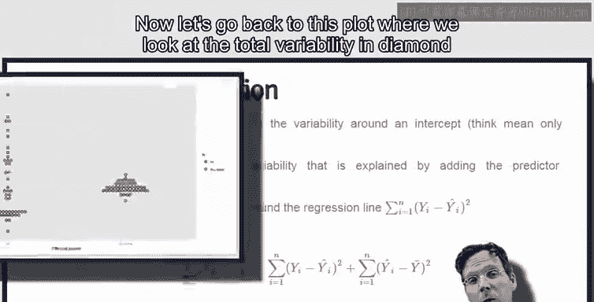

在这个特定的钻石数据示例中，计算出的值约为 `31.84`。

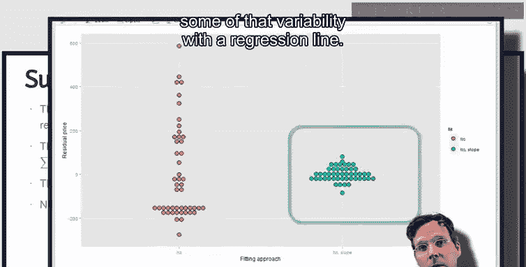

我们可以通过手动计算来验证这个公式。

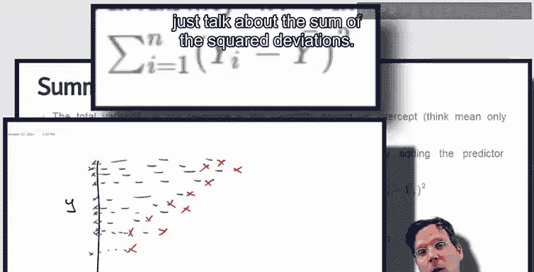

```r
# 手动验证计算
sqrt(sum(resid(fit)^2) / (length(y) - 2))
```

这段代码依次执行以下操作：`resid(fit)` 提取残差，平方后求和，再除以 `n-2` 得到平均平方残差，最后开方得到标准差 `31.84`。这证实了提取方法的正确性。

## 方差分解：总方差、回归方差与残差方差

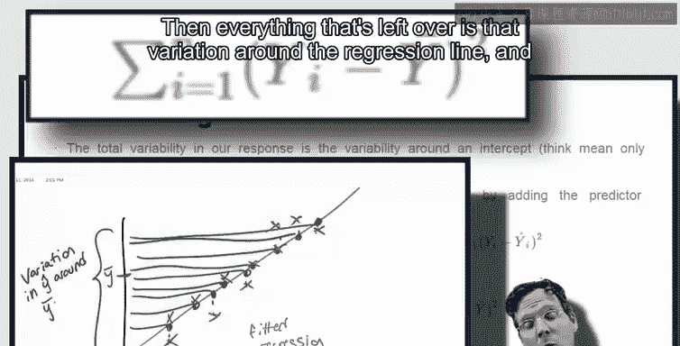

现在，让我们回到分析钻石价格变异性的图表。

总变异性是数据点围绕其均值（中心）的平均平方偏差。为简化，我们暂时忽略分母，只讨论平方偏差的和。

我们可以将回归变异性定义为总变异性中被回归线解释掉的那部分。即，取回归线上点的预测值，计算这些预测值围绕响应变量均值的变异程度。这就是回归方差。

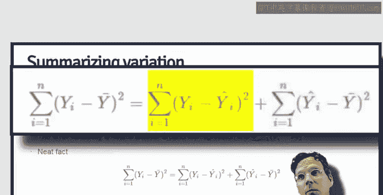

剩余未被解释的变异性，即数据点围绕回归线的变异，就是残差方差。

一个重要的恒等式是：总方差等于回归方差加上残差方差。

**公式**：`总平方和 (SST) = 回归平方和 (SSR) + 残差平方和 (SSE)`

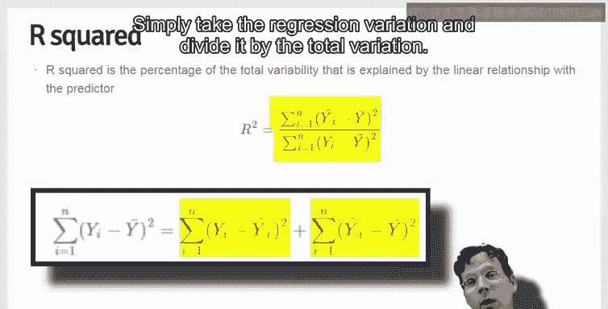

## R平方的定义与性质

因为残差方差和回归方差相加等于总方差，我们可以定义一个量来表示模型所解释的总方差百分比。

只需将回归方差除以总方差即可。这个量被称为R平方。

对于我们的钻石示例，R平方表示钻石价格变异中，能被与质量（克拉）的线性回归关系所解释的百分比。

关于R平方，需要记住以下几点事实：
*   R平方是响应变量的变异中，能被与预测变量的线性关系所解释的百分比。
*   R平方的值必须在0和1之间。因为回归平方和与残差平方和都是正数，且相加等于总平方和，这迫使R平方落在此区间内。
*   如果我们定义 `R` 为预测变量与结果之间的样本相关系数，那么R平方在数值上就等于这个相关系数的平方，即 `R^2`。
*   R平方可能误导对模型拟合度的判断。例如，如果数据有一定噪声，且删除了中间区域的许多数据点，可能会得到更高的R平方值。或者，如果随意向线性模型中添加回归变量，R平方会增加，而均方误差（平均残差方差）会减小。因此，在使用这些指标评估模型拟合时，必须考虑到这些因素。

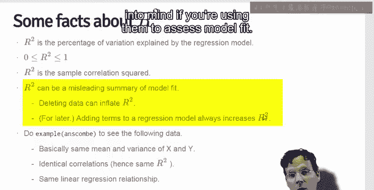

## R平方的局限性：安斯科姆四重奏

安斯科姆构造了一个特别鲜明的例子，展示了四组数据集。它们拥有相同的R平方值、X和Y的均值与方差，以及完全相同的线性回归关系。

然而，当你观察它们的散点图时，会发现拟合线在每种情况下的含义截然不同。

以下是该示例中的四组数据：
1.  第一组是典型的、略带噪声的线性关系，符合我们对良好线性回归的常规认知。
2.  第二组数据明显存在曲线趋势，表明模型中缺少了某个项（如二次项）来捕捉这种曲率。
3.  第三组数据中存在一个明显的离群值。
4.  第四组数据中，几乎所有数据都堆积在一个位置，只有一个点远离主体。这就像在第一组数据的基础上删除了中间大部分点后得到的结果。

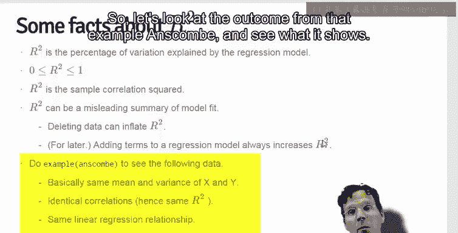

在所有这四种情况下，你都得到了相同的R平方值。但显然，这个单一的汇总数字抛弃了从简单散点图中可以获得的大量重要信息。

## 总结

本节课中我们一起学习了残差方差的核心概念。我们了解到它是衡量数据围绕回归线变异程度的指标，其计算需要考虑自由度调整（使用 `n-2` 作为分母）。我们探讨了总方差如何分解为回归方差（模型解释的部分）和残差方差（模型未解释的部分），并由此引出了R平方的定义——模型解释的方差百分比。

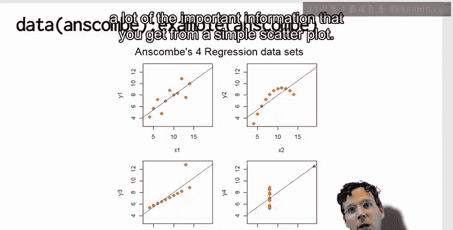

同时，我们通过R代码演示了如何从拟合模型中提取残差标准差，并重点强调了R平方作为模型拟合度指标的局限性，特别是通过安斯科姆四重奏的例子，明白了不能仅依赖R平方来评估模型，必须结合数据可视化等其他方法进行综合判断。