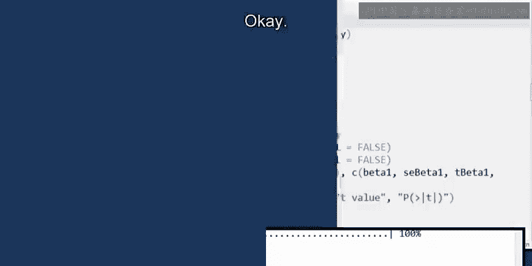
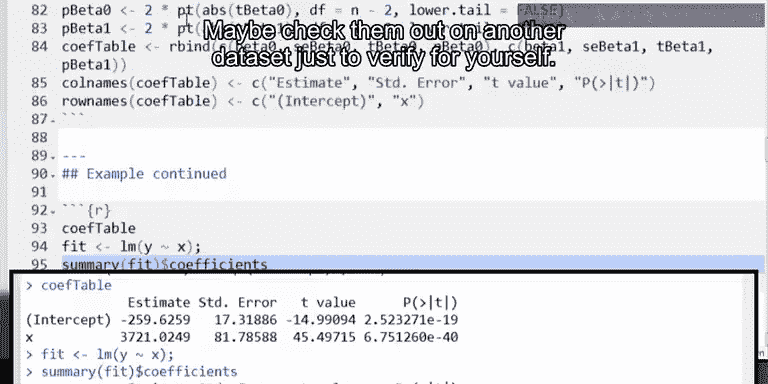
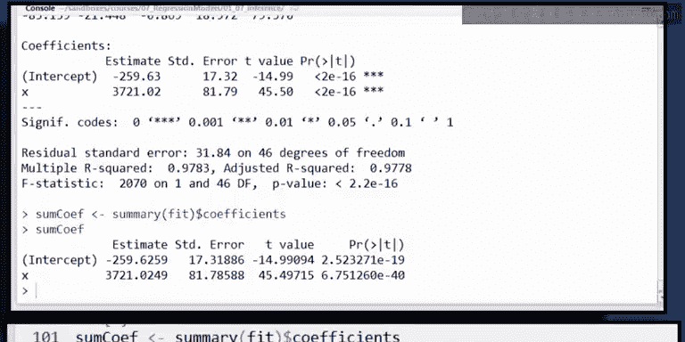

# 017：手动计算与R验证 📊



在本节课中，我们将通过一个具体的编码示例，手动计算简单线性回归的各项统计量，并与R语言`lm()`函数的结果进行对比验证。我们将使用`diamond`数据集，演示如何从原始数据一步步计算出回归系数、残差、标准误、t统计量及p值，并最终构建出与R输出完全一致的系数表。

---

## 数据准备与基础计算

首先，我们加载所需的数据集和库，并定义关键变量。

```r
# 加载数据
library(UsingR)
data(diamond)

# 定义变量
y <- diamond$price
x <- diamond$carat
n <- length(y)
```

接下来，我们根据公式手动计算回归系数。斜率 `beta1` 的计算公式为：

**公式：** `beta1 = cor(y, x) * (sd(y) / sd(x))`

截距 `beta0` 的计算公式为：

**公式：** `beta0 = mean(y) - beta1 * mean(x)`

```r
# 计算斜率 beta1 和截距 beta0
beta1 <- cor(y, x) * sd(y) / sd(x)
beta0 <- mean(y) - beta1 * mean(x)
```

---

## 计算残差与回归标准差

上一节我们计算了回归线。本节中，我们来看看如何评估模型拟合的精度。首先计算残差，即观测值与预测值之间的差异。

**公式：** `residual = y - (beta0 + beta1 * x)`

```r
# 计算残差
residuals <- y - (beta0 + beta1 * x)
```

随后，我们估计回归线周围的标准差 `sigma`。这衡量了数据点围绕回归线的离散程度。注意，这里除以 `n-2` 以进行无偏估计。

**公式：** `sigma = sqrt( sum(residuals^2) / (n-2) )`

```r
# 估计回归标准差 sigma
sigma <- sqrt(sum(residuals^2) / (n - 2))
```

---

## 计算标准误与检验统计量

为了进行统计推断，我们需要计算回归系数的标准误。以下是计算过程。

首先，计算自变量 `x` 的离差平方和（SSxx）。

**公式：** `SSxx = sum( (x - mean(x))^2 )`

```r
# 计算 x 的离差平方和
SSxx <- sum((x - mean(x))^2)
```

接着，分别计算截距 `beta0` 和斜率 `beta1` 的标准误。

**公式：**
*   `SE(beta0) = sigma * sqrt( (1/n) + (mean(x)^2 / SSxx) )`
*   `SE(beta1) = sigma / sqrt(SSxx)`

```r
# 计算标准误
se_beta0 <- sigma * sqrt((1 / n) + (mean(x)^2 / SSxx))
se_beta1 <- sigma / sqrt(SSxx)
```

有了估计值和标准误，我们就可以构建用于检验系数是否为零的 t 统计量。

**公式：** `t_statistic = estimate / standard_error`

```r
# 计算 t 统计量
t_beta0 <- beta0 / se_beta0
t_beta1 <- beta1 / se_beta1
```

最后，根据 t 统计量计算双侧检验的 p 值。

```r
# 计算 p 值（双侧检验）
p_beta0 <- 2 * pt(abs(t_beta0), df = n - 2, lower.tail = FALSE)
p_beta1 <- 2 * pt(abs(t_beta1), df = n - 2, lower.tail = FALSE)
```

---

## 手动构建系数表



以下是手动汇总所有计算结果，并将其整理为与R标准输出格式一致的系数表。

```r
# 手动创建系数表
coef_table <- matrix(c(beta0, beta1, se_beta0, se_beta1, t_beta0, t_beta1, p_beta0, p_beta1),
                     nrow = 2, byrow = FALSE)
rownames(coef_table) <- c("(Intercept)", "x")
colnames(coef_table) <- c("Estimate", "Std. Error", "t value", "Pr(>|t|)")

# 打印手动计算的系数表
print(coef_table)
```

---

## 使用R的`lm()`函数验证结果

现在，我们使用R内置的`lm()`函数来拟合相同的线性模型，以验证我们手动计算的结果。

```r
# 使用 lm() 函数拟合模型
fit <- lm(y ~ x)

# 打印模型摘要中的系数表
summary(fit)$coefficients
```

通过对比，你会发现手动计算的`coef_table`与`summary(fit)$coefficients`的输出在数值上完全一致。这验证了我们所使用公式的正确性。

---

## 计算置信区间 🔍

在验证了基础计算后，我们可以进一步计算回归系数的置信区间。这能为我们提供估计值的不确定性范围。

首先，从拟合模型`fit`中提取所需信息。

```r
# 从模型拟合结果中提取系数表
fit_summary <- summary(fit)
coef_summary <- fit_summary$coefficients

# 获取自由度
df <- fit$df.residual
```

对于截距和斜率，其95%置信区间的计算公式为：



**公式：** `estimate ± t_quantile * standard_error`

其中，`t_quantile` 是自由度为 `df` 的 t 分布在97.5%分位点的值。

```r
# 计算截距的95%置信区间
t_quantile <- qt(0.975, df = df)
ci_intercept <- coef_summary[1, 1] + c(-1, 1) * t_quantile * coef_summary[1, 2]

# 计算斜率的95%置信区间（针对1克拉的变化）
ci_slope_per_carat <- coef_summary[2, 1] + c(-1, 1) * t_quantile * coef_summary[2, 2]
```

在实际解释时，我们可能更关心钻石重量每增加0.1克拉对价格的影响。只需将上述斜率的置信区间除以10即可。

```r
# 计算斜率针对0.1克拉变化的置信区间
ci_slope_per_point1_carat <- ci_slope_per_carat / 10
```

根据结果，我们可以有95%的把握认为，钻石重量每增加0.1克拉，其价格预计将增加356至389新加坡元。

---

## 总结

本节课中，我们一起学习了简单线性回归模型的核心计算过程。我们从定义变量开始，手动计算了回归系数、残差、回归标准差、标准误、t统计量和p值，并成功构建了与R语言`lm()`函数输出完全一致的系数表。最后，我们还演示了如何计算并解释回归系数的置信区间。这个过程不仅验证了理论公式的正确性，也加深了我们对回归模型统计推断底层逻辑的理解。