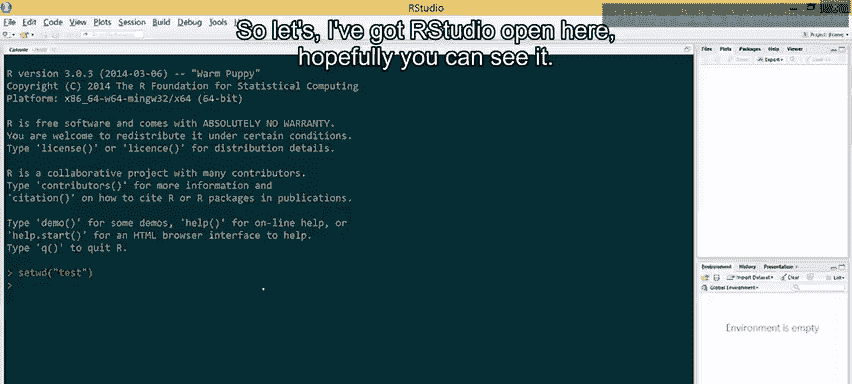
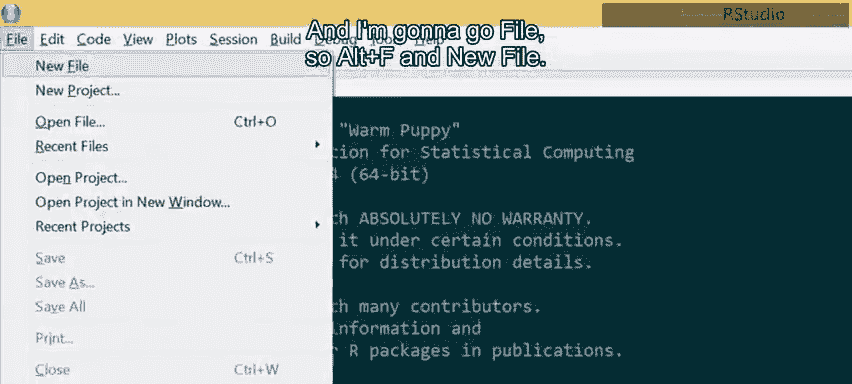
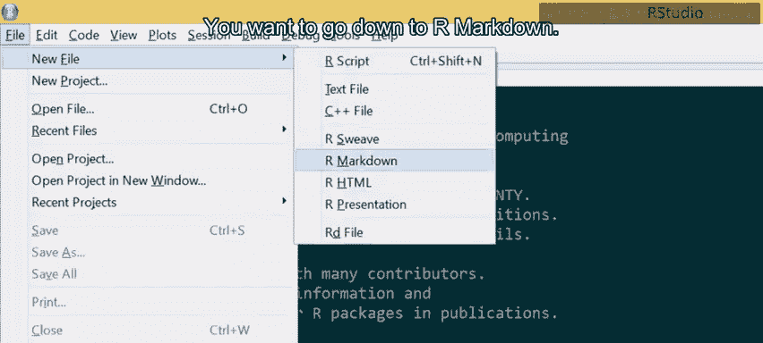
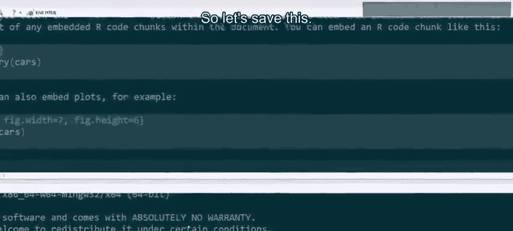
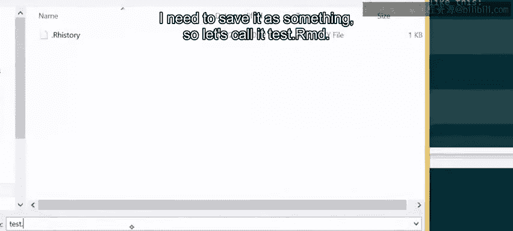
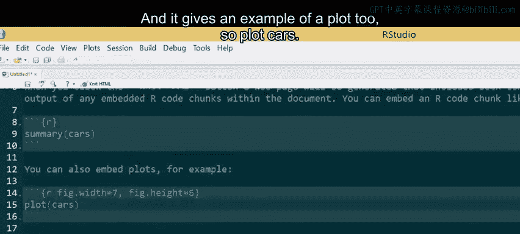
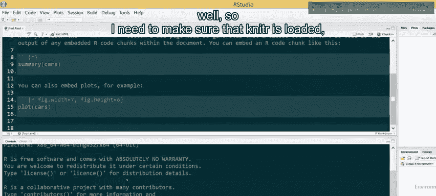
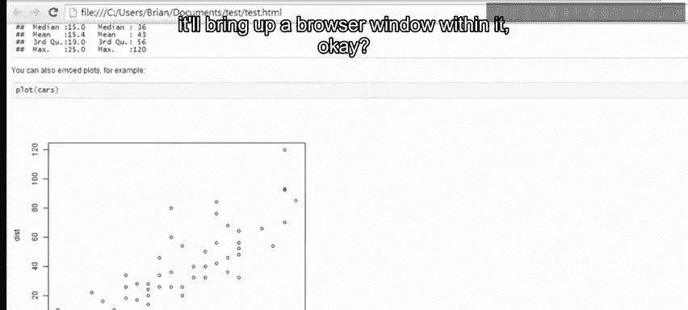

# 019：极速入门knitr 📘

在本节课中，我们将学习如何使用knitr来创建R Markdown文档，这是完成课程作业所需的重要工具。knitr能够将R代码、文本和图表整合到一个文档中，并生成HTML、PDF等多种格式的输出。

## 创建R Markdown文档





上一节我们介绍了knitr的基本概念，本节中我们来看看如何创建一个R Markdown文档。

首先，在RStudio中点击“File”菜单，然后选择“New File”，接着选择“R Markdown”。




此时，RStudio会弹出一个新文档，其中包含一个简单的R Markdown模板。你可以编辑标题，例如将其改为“这是一个测试knitr文档”。


## 理解代码块

文档中包含一个R代码块的示例。以下是R Markdown中代码块的基本结构：

```r
```{r}
# 你的R代码放在这里
```
```

在代码块的开头，你可以使用大括号 `{}` 来设置各种选项。例如，`{r}` 表示这是一个R代码块。在大括号内，你可以添加多个选项来控制代码块的执行和输出。

以下是几个常用的knitr选项：

*   **eval**：控制是否执行代码。例如，`eval=FALSE` 表示只显示代码而不执行。
*   **echo**：控制是否在输出中显示代码。例如，`echo=FALSE` 表示只显示结果，不显示代码。
*   **results**：控制结果的显示方式。例如，`results='hide'` 会隐藏代码的输出结果。
*   **fig**：控制图形的输出选项，如 `fig.width` 和 `fig.height` 可以设置图形的尺寸。

## 保存与编译文档

编辑好文档后，需要将其保存为 `.Rmd` 文件，例如命名为 `test.Rmd`。






保存后，点击RStudio中的“Knit”按钮（通常显示为“Knit HTML”或一个编织图案的图标），knitr就会开始编译文档。




编译过程会执行文档中的所有R代码块，并将结果与文本内容合并，最终生成一个独立的输出文件（如HTML文档）。

## 查看输出结果

编译完成后，knitr会生成一个输出文件（例如 `test.html`）。你可以在RStudio的预览窗格中直接查看，也可以使用R命令在浏览器中打开它。


例如，在R控制台中输入以下命令：
```r
browseURL("test.html")
```

这将在你的默认浏览器中打开生成的HTML文档。




本节课中我们一起学习了knitr的基本使用方法。我们了解了如何创建R Markdown文档，如何编写和设置R代码块，以及如何保存、编译并查看最终的输出文档。掌握这些技能对于完成本课程的数据分析作业至关重要。