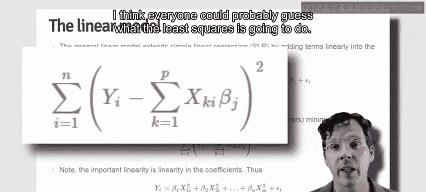
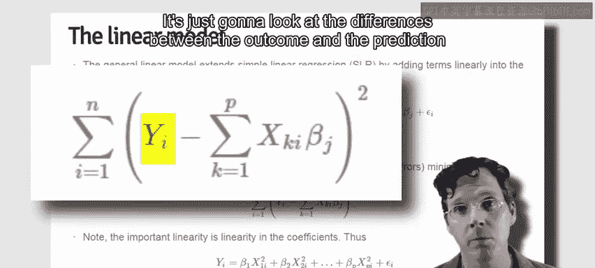
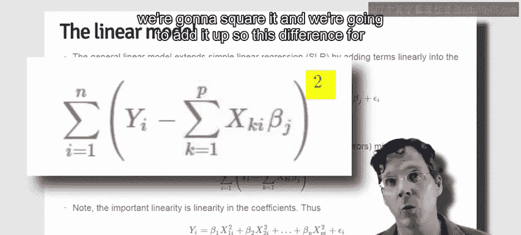
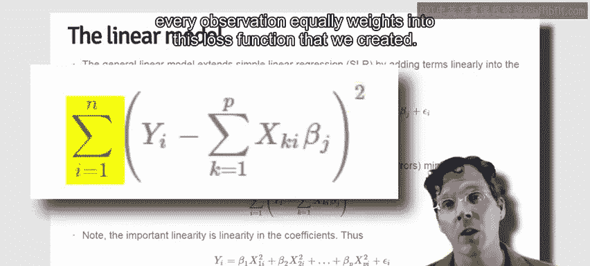
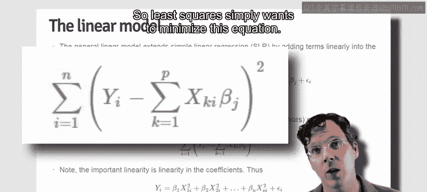
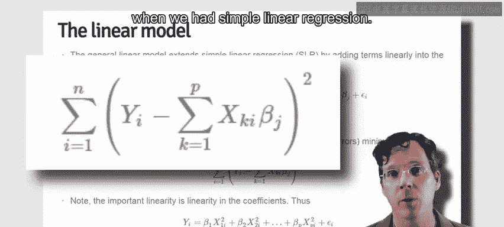

# 020：多变量回归第一部分 🧮


在本节课中，我们将要学习多变量回归。我们将探讨当存在多个潜在预测变量，而非单一预测变量时，如何在线性回归框架下进行分析。多变量回归的核心在于，在考察某个预测变量与响应变量关系的同时，能够“控制”或“调整”其他变量的影响。


---

## 为何需要多变量回归？🤔

在任何使用预测变量 **X** 预测响应变量 **y** 的场景中，如果你发现了一个显著的关系，但该预测变量并非随机分配给受试者或研究单元，那么总存在一个担忧：可能存在另一个已知或未知的变量，能够解释你所发现的这种关系。

让我们来看一个例子。假设你的朋友分析了一些数据，其中包含人们的各种健康信息和饮食信息。他说：“我发现了一个有趣的现象：薄荷糖的使用量与用力呼气容积之间存在显著的回归关系。”用力呼气容积是衡量肺功能的一个指标。

你可能会对此表示怀疑，因为从生物学角度看，薄荷糖（主要成分是糖）与肺功能之间似乎没有合理的直接联系。你可能会想，是否有其他变量可以解释这种关系？这里有两种可能的假设：
1.  你的朋友在众多变量中反复测试，恰好找到了一个显著相关的变量，这可能是多重比较带来的偶然关联。
2.  更可能的情况是，吸烟者往往更常使用薄荷糖，而吸烟本身与肺功能下降有明确的长期关联。因此，薄荷糖与肺功能的关系可能是通过吸烟这个中介变量产生的间接效应，而非直接效应。

那么，如何验证在排除吸烟影响后，薄荷糖是否仍有独立效应呢？一个直观的方法是：分别分析吸烟者群体和非吸烟者群体，看看在每个群体内部，肺功能是否因薄荷糖使用量不同而有差异。这样，我们就在“控制”了吸烟状态的情况下进行比较。

多变量回归正是以线性方式自动化实现这一过程的方法。它通过特定的假设，尝试在考察一个预测变量（如薄荷糖使用量）时，将其他变量（如吸烟状态）的影响“保持恒定”。本节课我们将解释其工作原理、调整方式以及局限性。

---

## 多变量回归的另一个用途：预测 📈

除了上述用于解释变量间关系的用途，多变量回归也是强大的预测工具。

例如，在著名的“遗产健康奖”竞赛中，目标是根据参保人过去的理赔历史，预测其未来一年的住院天数。这对于医院、保险公司和医疗服务提供者至关重要。

竞赛提供了包含海量预测变量的历史理赔数据。简单的单变量线性回归在这里作用有限，它适合快速考察单个变量，但要获得良好的预测效果，需要更复杂的模型。

这涉及到两个关键部分：
1.  **模型搜索**：如何选择纳入模型的预测变量。
2.  **避免过拟合**：如果向模型中放入过多变量（甚至是随机向量），仅凭变量数量就可能使残差为零，但这并不意味着模型好。因此，纳入无关变量或遗漏重要变量都会带来后果。

在数据科学专项课程的《实用机器学习》课程中，你将深入学习与预测相关的模型选择策略。而在本课程中，我们将更侧重于前一部分提到的场景：构建简约的模型，并深入解读线性模型系数的含义。

值得一提的是，在那场预测竞赛中，精心构建的多变量线性模型已经能取得非常接近最优结果的预测性能。更复杂的机器学习方法（如随机森林、提升算法等）通常只能带来微小的额外提升。这充分说明了，对于许多预测问题，构思良好的线性模型是一个强大且有效的起点。

---

## 多变量线性模型公式 📝

我们的多变量线性模型与简单线性模型非常相似，只是包含了更多的预测变量。

模型的基本形式如下：

**公式：**
`y = β₀ + β₁X₁ + β₂X₂ + ... + βₚXₚ + ε`

其中：
*   `y` 是响应变量（如肺功能、未来住院天数）。
*   `β₀` 是截距项。
*   `β₁, β₂, ..., βₚ` 是各个预测变量 `X₁, X₂, ..., Xₚ` 的系数（可理解为“斜率”）。
*   `ε` 是误差项。

例如：
*   在肺功能的例子中，`X₁` 可能是薄荷糖使用量（二元变量），`X₂` 可能是吸烟包年数。
*   在保险预测的例子中，`X₁` 可能是上一年的理赔次数，`X₂` 可能是是否患有特定心脏疾病。

请注意，这里的“线性”指的是模型对于系数 `β` 是线性的。这是一个关键点。即使我们将某个预测变量进行变换（例如，使用 `X²` 而不是 `X`），只要系数本身不被平方或进行其他非线性运算，模型就仍然是线性模型。

**代码示例（概念性）：**
```r
# 假设 lm 是线性模型拟合函数
model <- lm(y ~ X1 + X2 + X3, data = my_data)
# 模型公式 y = β0 + β1*X1 + β2*X2 + β3*X3 即体现了线性于系数的特性
```

---

## 最小二乘估计 ⚖️

上一节我们介绍了多变量线性模型的形式，本节我们来看看如何估计模型中的系数。最小二乘法的思想可以直接从简单线性回归推广到多变量情形。

我们的目标是最小化残差平方和。残差是观测值 `y_i` 与模型预测值 `ŷ_i` 之间的差异。模型预测值是所有预测变量与其系数乘积之和。

因此，我们需要最小化的目标函数（损失函数）是：

**公式：**
`∑ (y_i - (β₀ + β₁X_{i1} + β₂X_{i2} + ... + βₚX_{ip}))²`

对所有观测点 `i` 求和。

最小二乘法就是要找到一组系数 `(β₀, β₁, ..., βₚ)`，使得上述残差平方和达到最小。每个观测点的残差都以同等权重进入这个损失函数。

---

## 总结 🎯





本节课我们一起学习了多变量回归的基础知识。


我们首先探讨了其核心用途之一：在分析一个预测变量与结果的关系时，通过纳入其他变量来“控制”或“调整”混杂因素的影响，从而更准确地估计目标变量的独立效应，并以薄荷糖、吸烟和肺功能的关系为例进行了说明。



接着，我们了解了多变量回归的另一个重要用途——预测，它通过整合多个预测变量的信息来构建有效的预测模型。







然后，我们给出了多变量线性模型的一般公式 `y = β₀ + β₁X₁ + ... + βₚXₚ`，并强调了“线性”是指模型对于系数 `β` 是线性的这一关键点。

最后，我们介绍了用于估计模型系数的最小二乘法原理，其目标是最小化所有观测点的残差平方和。

在接下来的课程中，我们将继续深入多变量回归的细节，包括系数的解释、模型假设以及注意事项。