# 021：多变量回归第2部分 📊

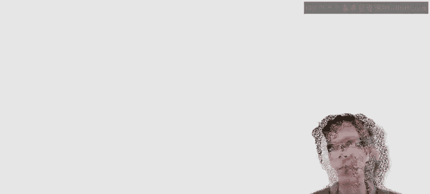

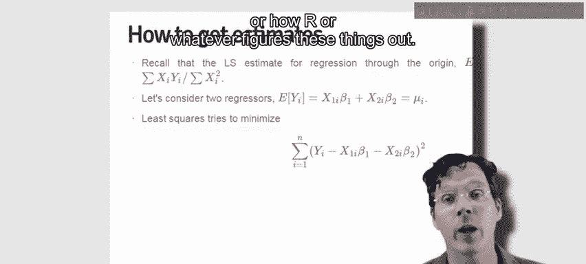

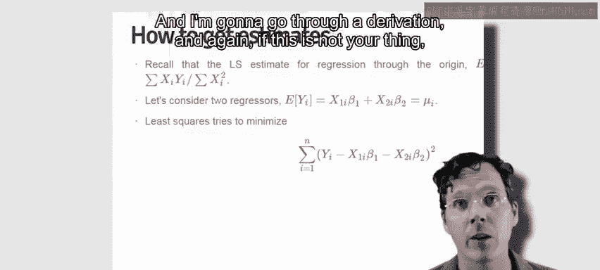

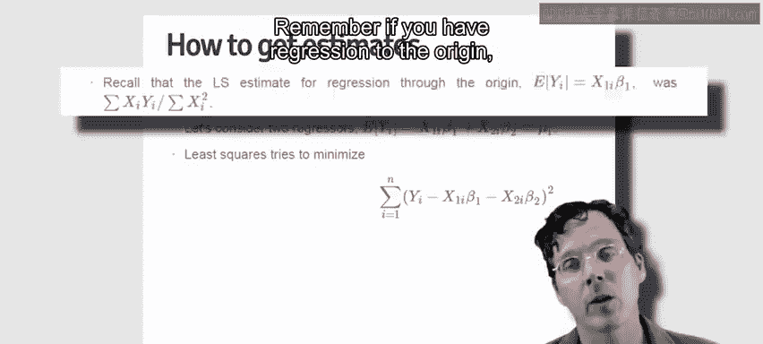

在本节课中，我们将要学习多变量回归模型中回归系数的估计原理。我们将从一个简单的“过原点回归”模型出发，逐步推导出当模型包含两个或多个预测变量时，如何估计其系数。理解这一推导过程，有助于我们深入理解多变量回归“调整”其他变量影响的本质。

---

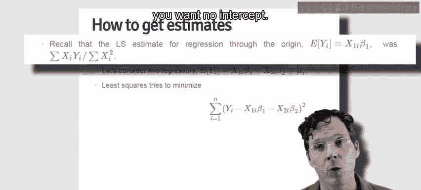

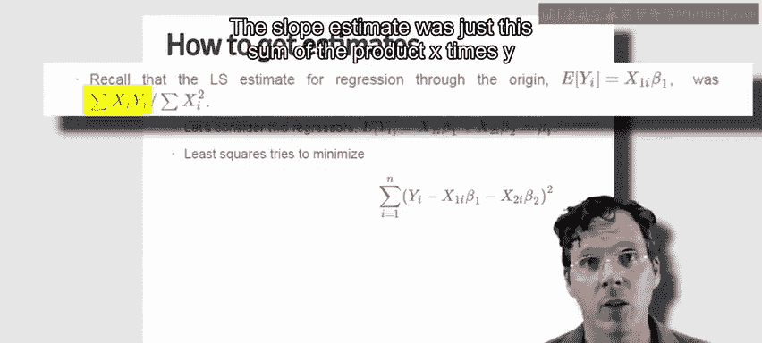

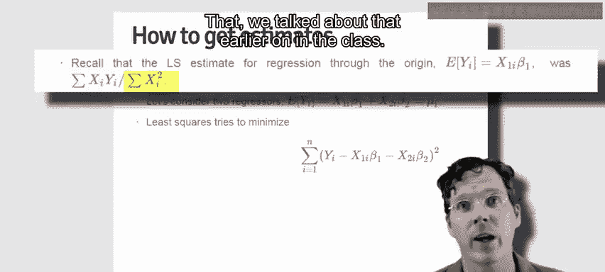

## 从过原点回归出发

上一节我们介绍了回归模型的基本概念，本节中我们来看看如何具体得到回归系数的估计值，或者说R等软件是如何计算出这些结果的。我们将进行一个推导，如果你对此不感兴趣，可以跳过这部分内容。

首先，回忆一下“过原点回归”模型。该模型强制回归线穿过原点，没有截距项。它只有一个预测变量X和一个结果变量Y。其斜率估计公式如下：

**公式：**
`斜率估计值 = Σ(Xi * Yi) / Σ(Xi²)`

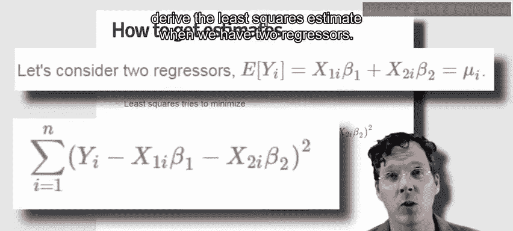

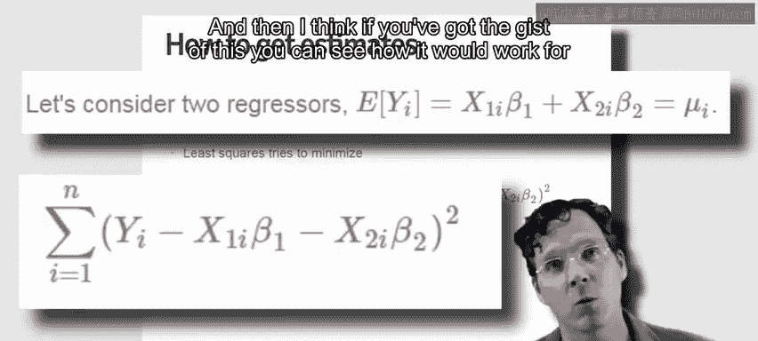

这个公式我们在课程早期讨论过。

---

## 推导两个预测变量的回归估计

现在，让我们尝试利用上面的结果，来推导当模型包含两个预测变量时的最小二乘估计。如果你能理解这个过程，就能将其推广到三个、四个甚至更多预测变量的情况。

我们的目标是推导，或者说构建出估计量。我将展示一个比线性代数方法更直观的推导过程。如果你对线性代数推导感兴趣，我也有一些相关的视频资源。

考虑两个预测变量的情况。我们的最小二乘准则是最小化以下平方和：

**公式：**
`Σ[ Yi - (X1i * β1) - (X2i * β2) ]²`

例如，`X1i`可能代表截距项，`X2i`可能是我们感兴趣的协变量，比如血压。

以下是推导的关键技巧：
1.  假设我们固定了`β1`的值。
2.  定义一个新的变量：`Ỹi = Yi - X1i * β1`。
3.  此时，最小二乘准则变为：`Σ[ Ỹi - X2i * β2 ]²`。
4.  这正好是一个以`X2i`为唯一预测变量、`Ỹi`为结果变量的“过原点回归”问题。因此，我们知道`β2`的估计值必须满足：

    **公式：**
    `β2估计值 = Σ(Ỹi * X2i) / Σ(X2i²)`

5.  注意，`Ỹi`是`β1`的函数。所以，我们可以将这个`β2`的表达式代回原始的最小二乘准则中。
6.  这样，我们就得到了一个只包含`β1`的方程，并且它同样是一个关于`β1`的“过原点回归”问题。

最终推导出的有趣结果是：
*   预测变量`X1`的回归系数`β1`，其估计值恰好等于：先将`X2`从`Y`和`X1`中线性剔除（即分别对`Y`和`X1`做关于`X2`的回归，取残差），然后对这两个残差做“过原点回归”所得到的系数。
*   同理，预测变量`X2`的回归系数`β2`，其估计值等于：先将`X1`从`Y`和`X2`中线性剔除，然后对这两个残差做“过原点回归”所得到的系数。

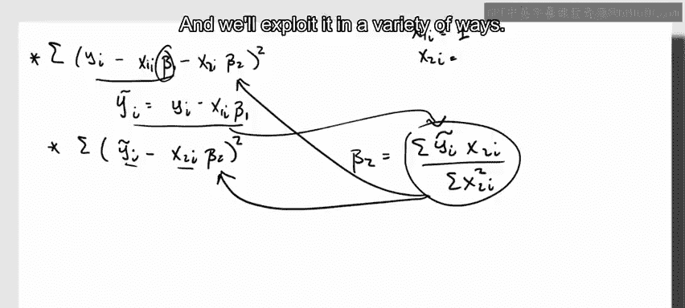

这个观点非常重要，我们将反复强调。多变量回归中，一个变量的系数，是在**剔除了所有其他变量对该变量以及结果变量的线性影响之后**所得到的净效应。这解释了多变量回归在做什么：它通过调整其他变量的影响，来估计某个变量的独立贡献。

---

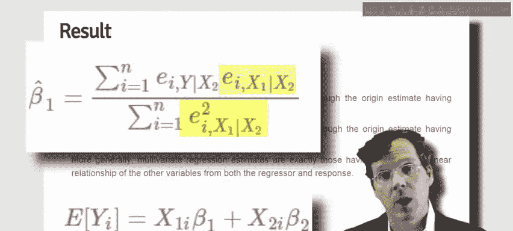

## 核心结论：系数的“调整”含义

为了确保你理解这个重要结论，我们在此重申一遍。

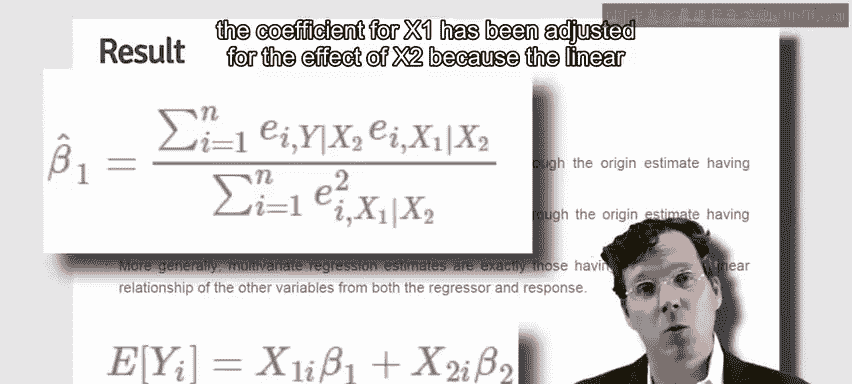

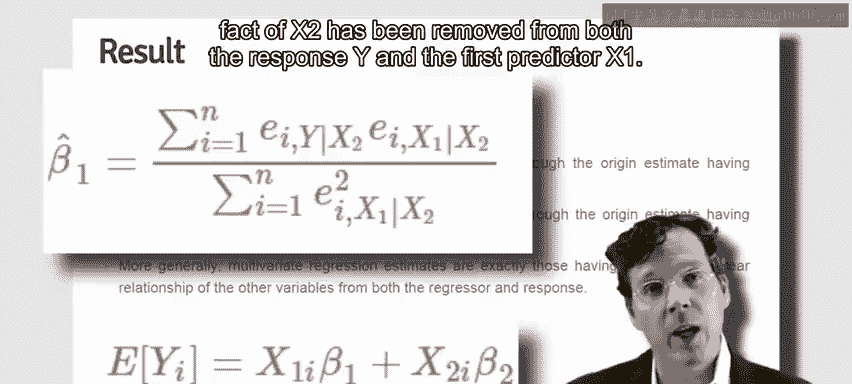

假设我们有两个协变量`X1`、`X2`和一个结果变量`Y`。我们拟合的模型包含这两个协变量及其系数`β1`和`β2`。

核心结论是：
*   拟合得到的系数`β1`，等同于我们先将第二个变量`X2`从结果`Y`和第一个预测变量`X1`中线性剔除，然后对得到的残差进行“过原点回归”所获得的系数。
*   这意味着，`β1`是**针对`X2`的影响进行调整后**的`X1`的效应，因为`X2`对`Y`和`X1`的线性影响已被移除。
*   同样，系数`β2`也可以被类似地解释为针对`X1`调整后的效应。

这就是为什么多变量回归关系通常被认为是“调整了所有其他变量”后的关系。在下一部分，我们将讨论如何将此概念推广到包含多个预测变量的完整多变量回归中。

---

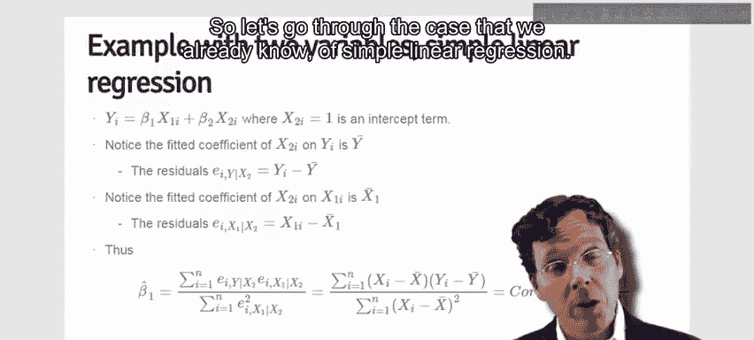

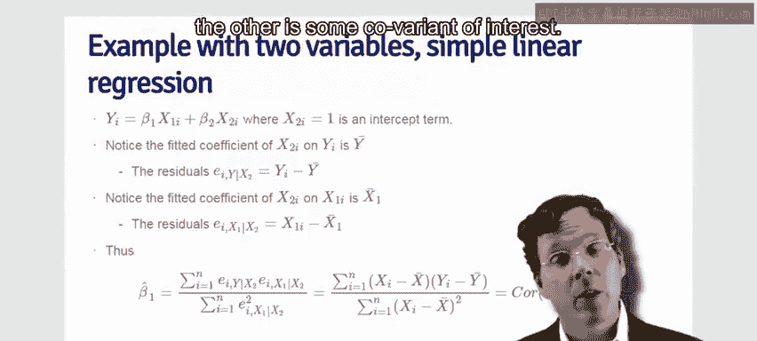

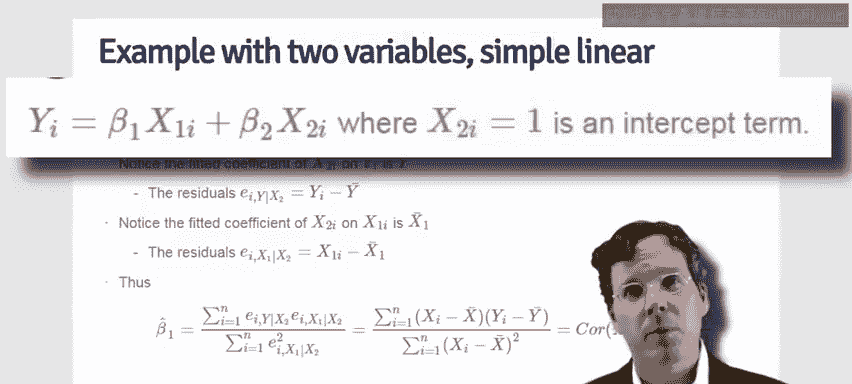

## 应用于简单线性回归的例子

让我们通过一个已知的例子来验证这个结论：简单线性回归，其中一个协变量是截距项，另一个是感兴趣的协变量。

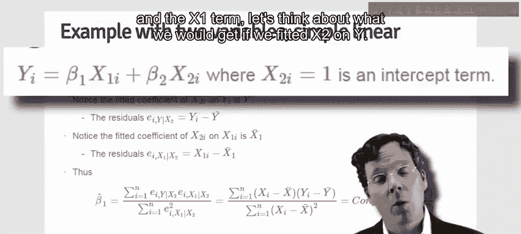

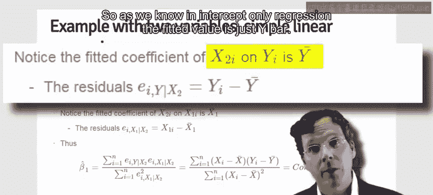

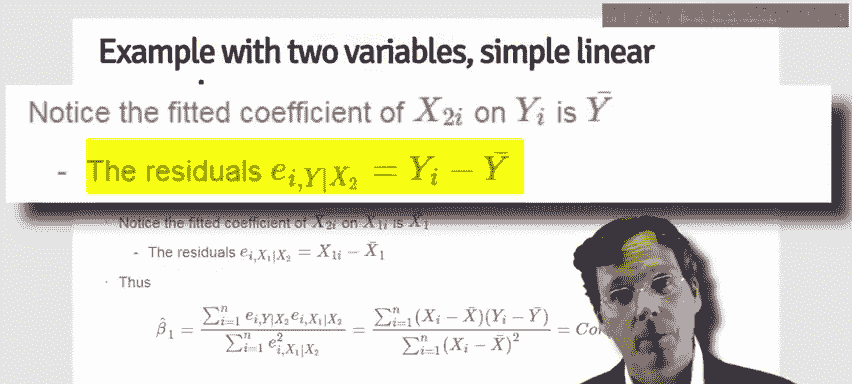

假设模型为：`Yi = β1 * X1i + β2 * X2i`。这里我们假设`X2`是截距项（通常为常数1）。

根据我们的规则，`β1`的估计值是通过将`X2`从`Y`和`X1`中剔除后得到的。
1.  将`X2`（截距）从`Y`中剔除：用`Y`对截距做回归，拟合值就是`Y`的均值`Ȳ`，残差为`Yi - Ȳ`，即`Y`的中心化形式。
2.  将`X2`（截距）从`X1`中剔除：用`X1`对截距做回归，拟合值就是`X1`的均值`X̄1`，残差为`X1i - X̄1`，即`X1`的中心化形式。
3.  然后，对这两个中心化后的变量进行“过原点回归”。`β1`的估计公式为：

    **公式：**
    `β1估计值 = Σ[ (Xi - X̄) * (Yi - Ȳ) ] / Σ (Xi - X̄)²`

这正是标准的简单线性回归斜率公式，也等于相关系数乘以`Y`与`X`的标准差之比。这验证了我们推导的正确性。

---

## 推广到更多变量

现在，让我们将这一思路扩展到两个以上的变量，从而深入理解多变量回归。

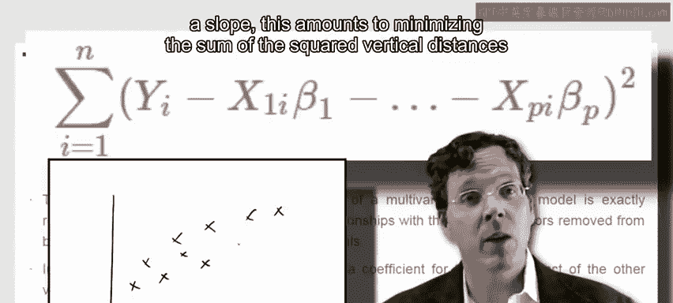

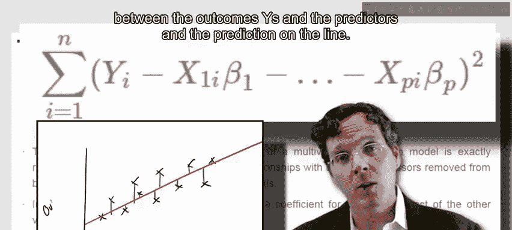

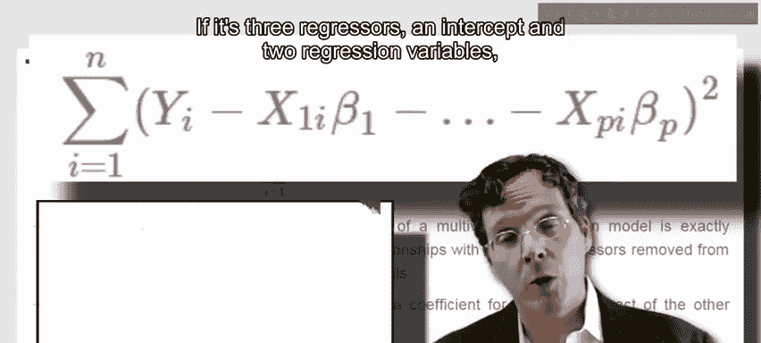

我们的最小二乘准则是最小化观测结果`Yi`与所有预测变量线性组合之间距离的平方和：

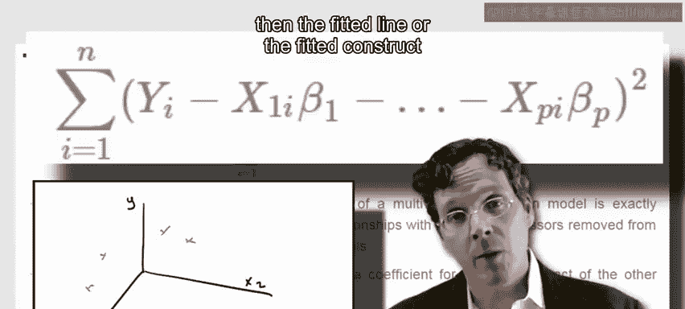

**公式：**
`Σ[ Yi - (β1*X1i + β2*X2i + ... + βp*Xpi) ]²`

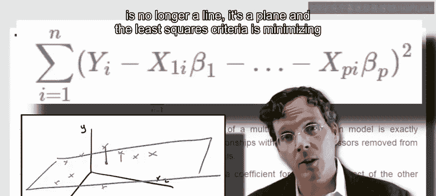

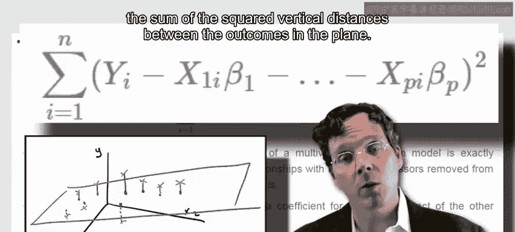

*   对于两个预测变量（一个截距，一个斜率），这相当于最小化数据点到回归线的垂直距离平方和。
*   对于三个预测变量（一个截距，两个回归变量），拟合的将是一个平面，准则是最小化数据点到该平面的垂直距离平方和。
*   当变量多于三个时，我们无法可视化，但思想是通用的：最小化`Y`到某个广义“超平面”的垂直距离。

我们所看到的核心思想是：**多变量回归通过取残差的方式来“调整”其他变量**。
例如，对于系数`β1`，我们的解释是：其余回归变量`X2`到`Xp`的线性影响已同时从`Y`和`X1`中被移除，然后我们研究这两个残差之间的关系。因此，在某种意义上，`Y`和`X1`都针对其余变量进行了调整。`β1`可以被视为在调整了与其他变量的线性关系后的“净效应”或“调整后效应”。

---

## 总结

本节课中我们一起学习了多变量回归系数估计的核心原理。我们从过原点回归出发，推导了两个预测变量情况下的估计过程，并得出了关键结论：多变量回归中每个变量的系数，都代表了在**线性剔除所有其他变量对该变量和结果变量的影响后**，该变量与结果之间的净关系。这个“调整”的思想是理解和解释多变量回归模型的基础。接下来，我们将通过计算机实验来验证这一原理，并在后续课程中通过具体例子学习如何解释多变量回归模型中的系数。