# 022：多元回归模型（续）📈

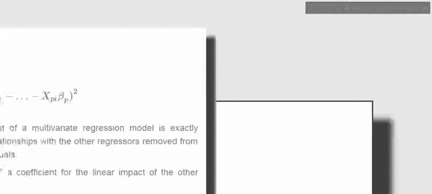

在本节课中，我们将继续探讨多元回归模型。我们将通过一个模拟演示来理解回归系数的估计过程，并详细解释多元回归系数的含义。此外，我们还将回顾线性模型的基本组成部分及其重要性。

## 模拟演示：回归系数的估计过程 🔍

上一节我们介绍了多元回归的基本概念，本节中我们来看看如何通过模拟来理解回归系数的估计。

我们进行一个模拟实验。生成100个观测值，并创建三个预测变量 `x1`、`x2` 和 `x3`，它们都服从标准正态分布。

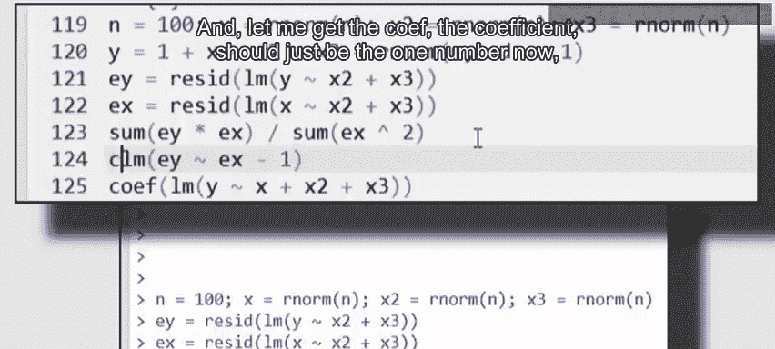

响应变量 `y` 的生成公式如下：
`y = 1 + x1 + x2 + x3 + ε`
其中，所有理论上的总体回归系数均为1，`ε` 是随机误差项。

接下来，我们获取 `y` 在剔除 `x2` 和 `x3` 影响后的残差。`lm` 函数默认包含截距项。`resid` 函数用于提取残差。

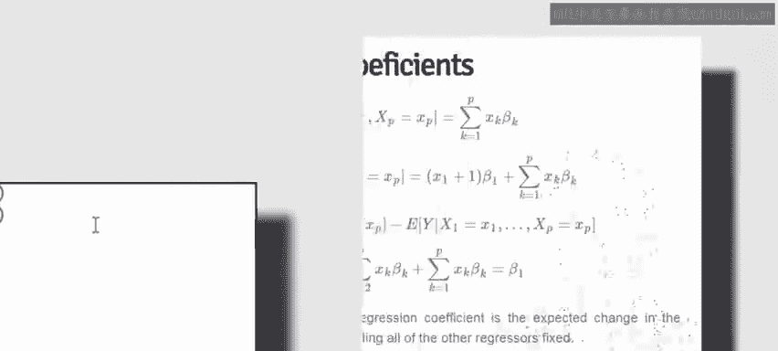

同样地，我们对 `x1` 进行相同操作，即剔除 `x2`、`x3` 和截距项的影响。

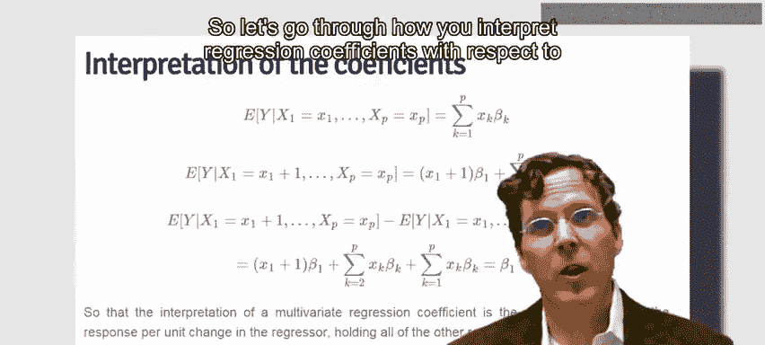

然后，我们使用这两组残差进行过原点回归估计，得到的系数是 0.11053。

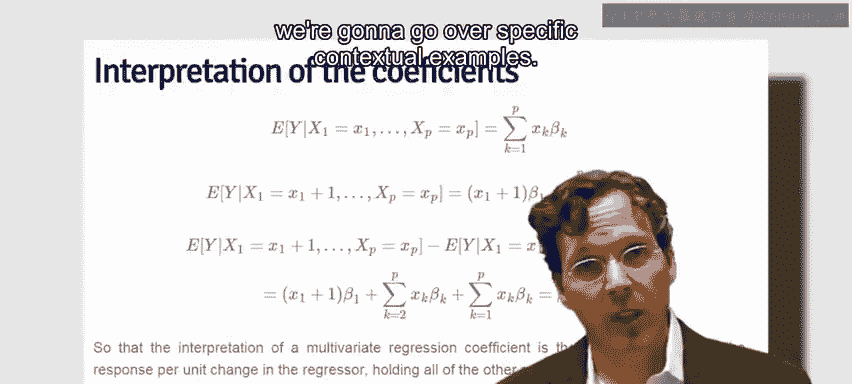

我们也可以用 `lm` 函数来验证这一点，将残差化的 `y` 对残差化的 `x1` 进行回归（需移除截距项），并提取系数。

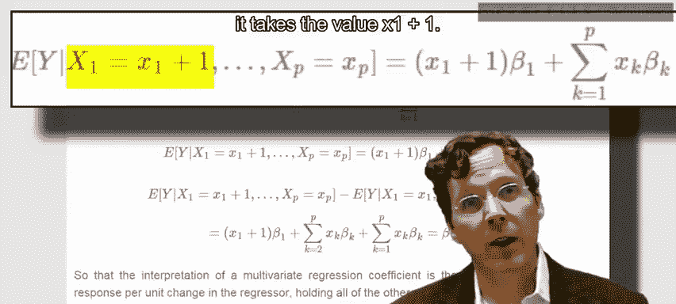

该系数应与上述过原点回归的估计值完全相同。

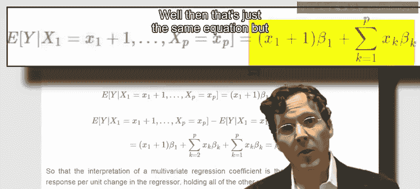

需要指出的是，这个系数与将 `y` 对 `x1`、`x2`、`x3` 和截距项进行多元回归后得到的 `x1` 的系数是相同的。

这证明了，线性模型在估计某个预测变量的系数时，本质上是剔除了其他变量对该预测变量和响应变量的影响后，再进行估计。

## 多元回归系数的解释 📝

现在，我们来讲解如何解释多元回归模型的系数。下一讲我们将结合具体实例进行深入分析。

给定一组协变量取值 `x1` 到 `xp`，我们的回归预测值是各个 `x` 与其系数乘积之和，即线性模型公式。

现在，考虑第一个回归系数 `β1` 对应的预测变量 `x1` 增加一个单位，即取值从 `x1` 变为 `x1 + 1`。

那么，新的预测值公式中，`x1` 项变为 `(x1 + 1)`。

如果我们计算 `x1` 增加一个单位后的期望响应值与原始期望响应值之差，结果正好等于 `β1`。

请注意，在整个讨论中，其他变量 `x2` 到 `xp` 都保持固定不变。`x1` 增加一个单位（无论其单位是什么）。

因此，**多元回归系数的解释是：在保持其他所有预测变量不变的情况下，该预测变量每增加一个单位，响应变量的期望变化量**。这是解释多元回归关系的核心，即“保持其他变量恒定”或“调整了其他变量的影响”。

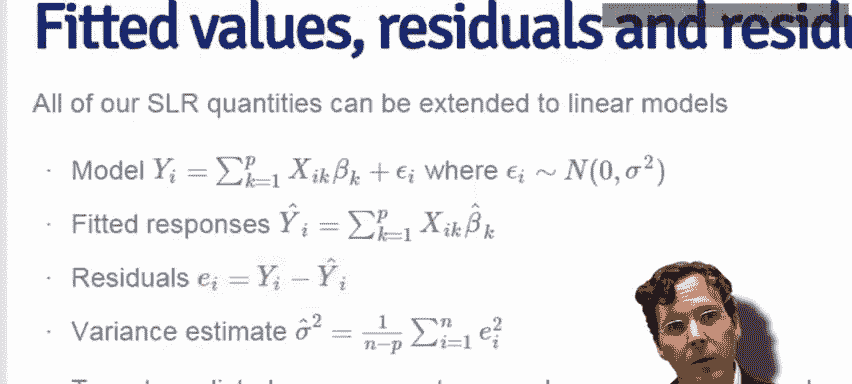

下一讲我们将通过多个具体例子来加深理解，但这就是其背后的数学原理。

## 线性模型的基本组成部分 📊

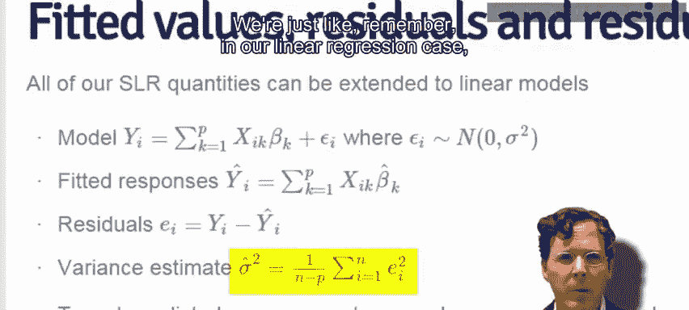

接下来，我们快速回顾线性模型的基本组成部分，它们与简单线性回归中的性质完全相同。

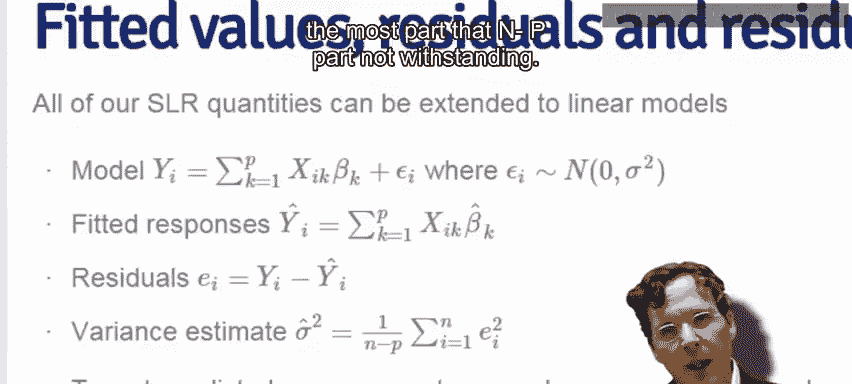

我们的线性模型是：
`Y = β0 + β1*x1 + ... + βp*xp + ε`
其中，我们假设误差项 `ε` 服从正态分布。

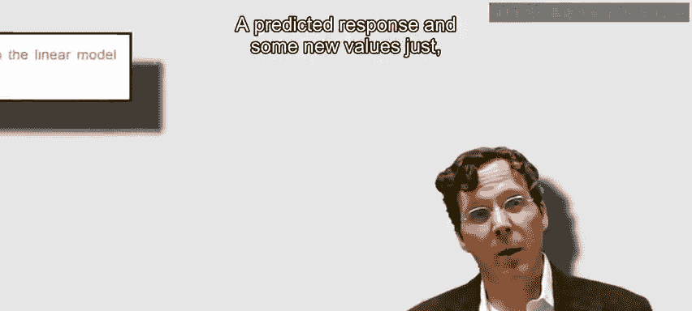

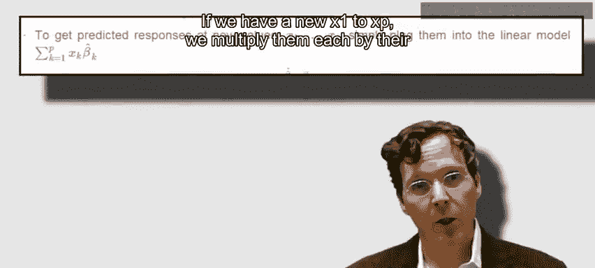

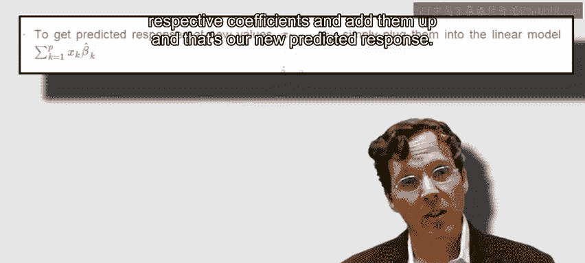

由此，我们得到一系列性质。这些性质与简单线性回归基本相同，只是现在我们引入了更多系数。

以下是线性模型的关键组成部分列表：

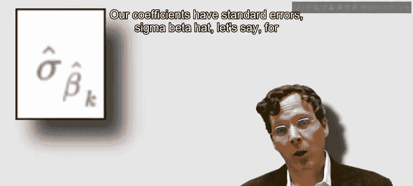

*   **拟合响应值**：在任何特定预测变量值下的拟合响应值 `ŷ`，只需将拟合系数乘以对应的预测变量值并求和即可。这适用于新数据或观测数据。
*   **残差**：观测值 `y` 与拟合值 `ŷ` 之差。我们的目标是最小化残差平方和。
*   **方差估计**：残差的平均平方和。在简单线性回归中，我们除以 `n-2`；在多元回归中，我们除以 `n-p`。这是一个技术细节，因为知道了 `n-p` 个残差，由于线性约束，就能知道剩下的 `p` 个。你可以大致将其理解为残差的平均平方。
*   **新观测值的预测**：对于一组新的预测变量值 `x1` 到 `xp`，将其代入线性模型，乘以各自系数后相加，就得到了预测的响应值。
*   **系数的标准误与检验**：每个系数估计 `β̂j` 都有其标准误 `σ(β̂j)`。我们可以使用 **t 检验** 来检验某个特定系数是否为零，因为 `(β̂j - βj) / σ(β̂j)` 服从 t 分布。简单线性回归中的所有推断方法都延续到多元回归。
*   **预测区间**：与简单线性回归一样，预测的响应值也有标准误，我们可以计算预测区间。

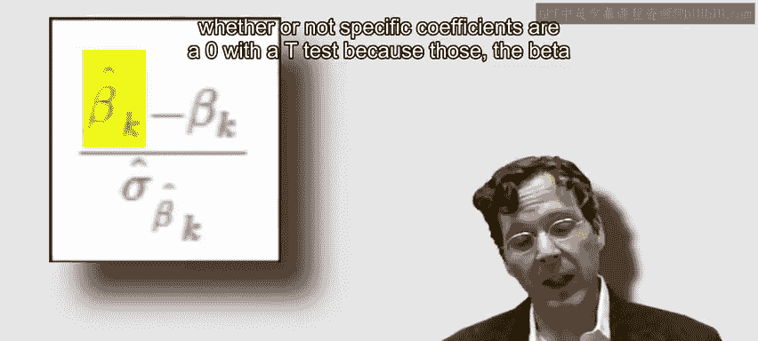

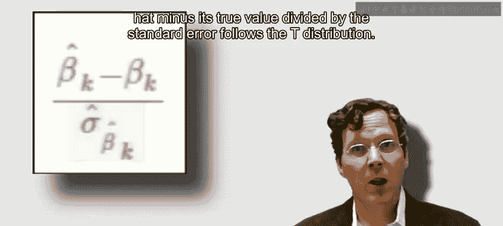

希望这些内容对你来说并不陌生。它们与简单线性回归几乎完全相同，只是现在我们有了更多的项。简单线性回归有截距和一个协变量两项，现在我们只是增加了更多的协变量。

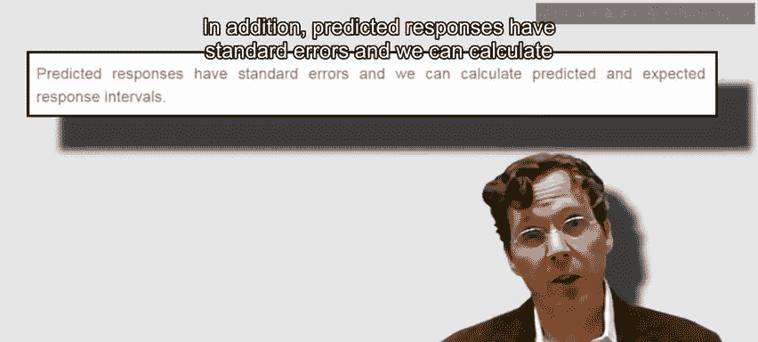

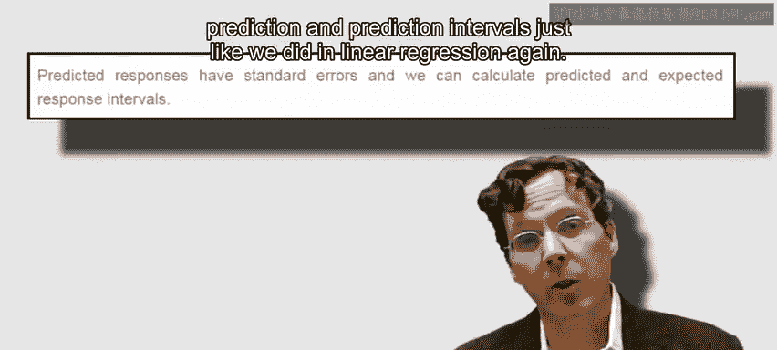

## 线性模型对数据科学的重要性 ⚙️

在进入具体例子之前，我们想讨论一下线性模型对数据科学家的重要性。

在进行任何机器学习或复杂算法之前，**线性模型应该是你的首选尝试**。

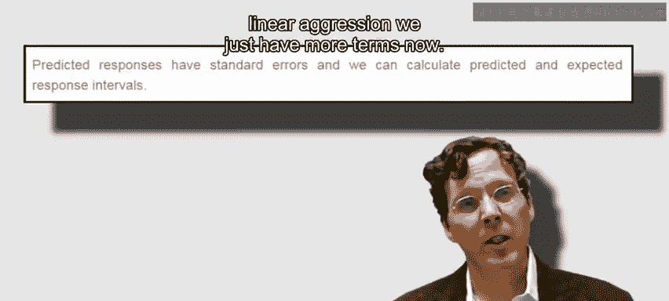

以下是线性模型的主要优势：

*   **简洁且易于理解**：它们以简洁且被深入理解的方式，描述了预测变量与响应变量之间的关系。
*   **强大的基础**：尽管一些现代机器学习算法可能在线性假设等方面有所超越，但线性模型始终应该是你分析的起点。
*   **功能广泛**：线性模型的能力可能超乎你的想象。例如，你可以将时间序列（如音频）分解为其谐波分量（离散傅里叶变换可视为线性模型的拟合）。你可以使用线性模型灵活地拟合相当复杂的函数和曲线。你可以将因子变量作为预测变量，此时方差分析（ANOVA）和协方差分析（ANCOVA）都是线性模型的特殊情况。你可以揭示响应变量与多个预测变量之间的复杂关系，并建立相当准确的预测模型。

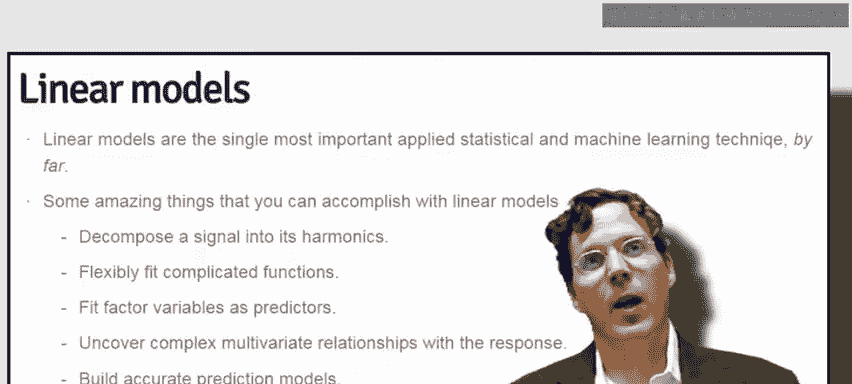

## 总结 ✨

本节课中，我们一起学习了多元回归模型的核心内容。

我们通过一个模拟实验，演示了回归系数估计的本质是剔除其他变量的影响。我们明确了多元回归系数的解释：在保持其他变量不变的情况下，某个预测变量的单位变化所引起的响应变量期望变化。我们还系统回顾了线性模型的基本组成部分及其性质，这些是进行统计推断和预测的基础。最后，我们强调了线性模型在数据科学中的基础性和重要性，它应是分析工作的首要工具。

在接下来的课程中，我们将通过具体的实例来应用和巩固这些概念。