# 023：多变量回归示例（第一部分）🎯

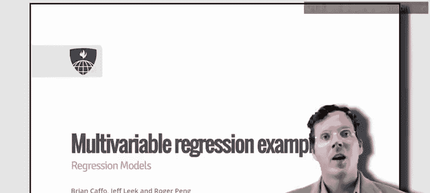

在本节课中，我们将学习多变量回归分析。我们将通过一个著名的数据集——瑞士生育率数据，来探讨如何构建和解释包含多个预测变量的回归模型。我们将重点关注模型系数的解释、变量选择的影响，以及如何通过模拟理解“辛普森悖论”等现象。

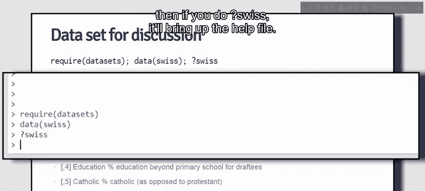

---

## 数据介绍与探索 📊


我们使用的数据集来自一个著名的统计学教科书，即瑞士生育率数据。该数据集位于R的`datasets`包中。

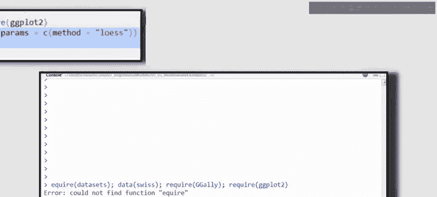

```r
require(datasets)
data(swiss)
?swiss
```

该数据集包含了1888年瑞士47个法语省份的标准化生育率指标和一些社会经济状况指标。变量包括：
*   `Fertility`：标准化生育率度量。
*   `Agriculture`：从事农业的男性百分比。
*   `Examination`：省份中在军事考试中获得特定分数的应征者百分比。
*   `Education`：接受过初等以上教育的人口百分比。
*   `Catholic`：天主教徒（相对于新教徒）的百分比。
*   `Infant.Mortality`：活产婴儿中未满一岁即夭折的百分比。

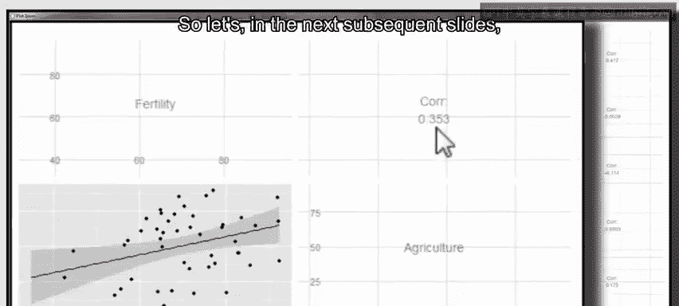

我们的目标是探究哪些因素可以解释各省的生育率差异。

在深入分析之前，我们先对数据进行基本的散点图探索。

```r
library(GGally)
ggpairs(swiss)
```

生成的矩阵图中，对角线显示了每个变量的分布，下三角区域显示了任意两个变量之间的散点图及其平滑曲线，上三角区域则显示了对应的相关系数。例如，`Fertility`和`Agriculture`的散点图显示其相关系数为0.35。

---

## 构建多变量回归模型 🔧

上一节我们观察了数据的基本关系，本节中我们来看看如何构建一个包含所有预测变量的回归模型。

我们首先拟合一个模型，将`Fertility`作为因变量，所有其他变量作为自变量。

```r
summary(lm(Fertility ~ ., data = swiss))
```

如果我们只关注系数表，可以运行：

```r
fit <- lm(Fertility ~ ., data = swiss)
summary(fit)$coefficients
```

以`Agriculture`的系数`-0.1721`为例，其解释为：在保持`Examination`、`Education`、`Catholic`和`Infant.Mortality`不变的情况下，我们预计从事农业的男性比例每增加1%，标准化生育率将**减少**0.1721。

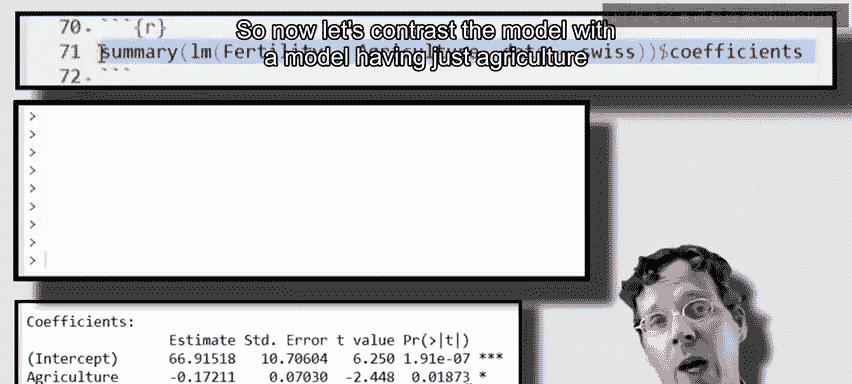

需要注意的是，`Agriculture`是以百分比（而非比例）度量的，这会影响系数的尺度。标准误`0.0703`衡量了该系数估计的精确度。t统计量`-2.448`是估计值除以标准误的结果，对应的p值`0.018`表明，在5%的显著性水平下，该系数是统计显著的。

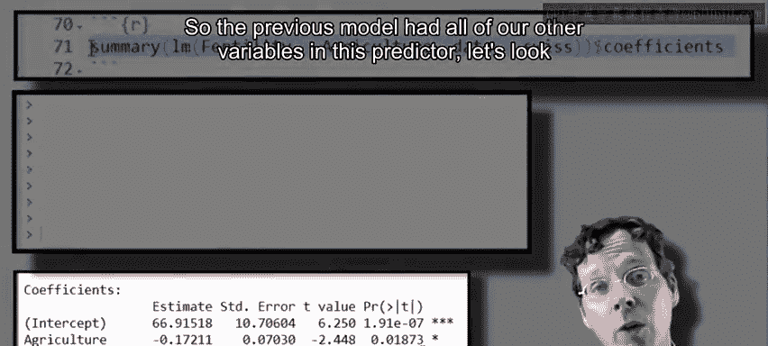

---

## 对比单变量与多变量模型 🔄

上一节我们拟合了包含所有变量的模型，本节中我们来看看如果只使用`Agriculture`一个预测变量，结果会如何变化。

```r
summary(lm(Fertility ~ Agriculture, data = swiss))$coefficients
```

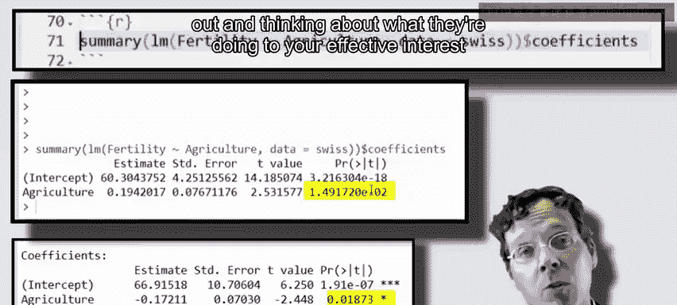

有趣的现象出现了：在单变量模型中，`Agriculture`的系数约为`0.1942`，是**正数**。而在包含所有变量的多变量模型中，其系数变成了`-0.1721`，是**负数**。调整了其他变量（如教育水平）后，`Agriculture`对`Fertility`的影响方向发生了逆转。

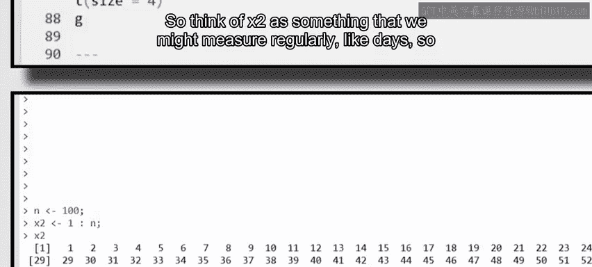

这种现象常被称为“辛普森悖论”（或更准确地说是“辛普森表象”）。它并不真正矛盾，而是强调了在观察性研究中，忽略重要变量（混杂因素）可能导致对核心变量关系的错误解读。两个模型中，`Agriculture`的系数都是统计显著的，但科学解释却截然不同。

---

## 通过模拟理解系数逆转 🎲

为了更直观地理解系数为何会逆转，我们通过一个模拟示例来演示。

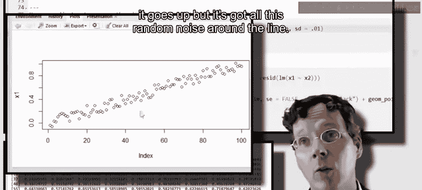

假设我们模拟100个数据点：
*   `x2`：代表时间，取值从1到100。
*   `x1`：代表财富，它随时间`x2`线性增长，并加上随机波动。
*   `y`：代表幸福感，其真实生成模型为：`y = -1 * x1 + 1 * x2 + 随机噪声`。即，幸福感与财富`x1`负相关，与时间`x2`正相关。

```r
n <- 100
x2 <- 1:n
x1 <- .01 * x2 + rnorm(n, sd=.5)
y <- -x1 + x2 + rnorm(n, sd=.1)
```

首先，我们错误地只使用`x1`来预测`y`：

```r
summary(lm(y ~ x1))$coefficients
```
结果会显示一个很大的**正**系数，这与真实的负关系完全相反。这是因为`x1`中包含了与`y`正相关的`x2`的信息。

然后，我们拟合正确的模型，同时包含`x1`和`x2`：

```r
summary(lm(y ~ x1 + x2))$coefficients
```
此时，我们得到了接近真实值`-1`和`+1`的系数估计。

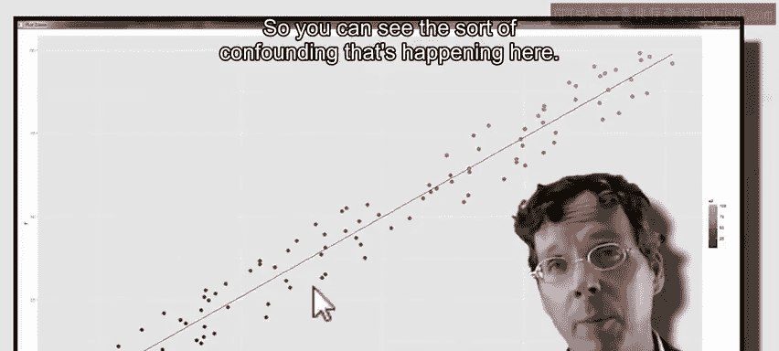

以下是理解这一过程的步骤：
1.  绘制`y`与`x1`的散点图，并按`x2`着色。可以看到明显的正相关趋势，但颜色梯度揭示了`x2`的混杂作用。
2.  计算残差：分别从`y`和`x1`中剔除`x2`的线性影响。
3.  绘制`y`的残差与`x1`的残差的散点图。此时，`x2`的影响已被移除，图中清晰地显示出`x1`与`y`之间真实的**负相关**关系。

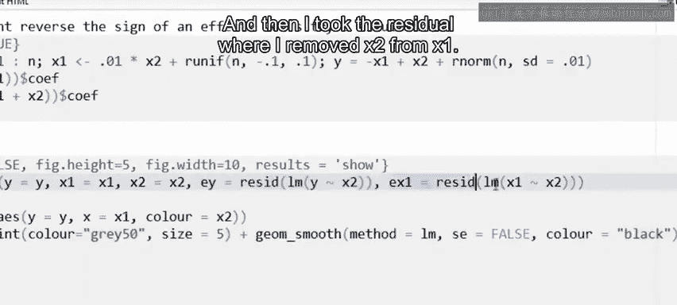

线性模型在多变量情况下的工作方式，正是通过从预测变量和响应变量中剔除其他变量的影响，来揭示“纯净”的关系。

---

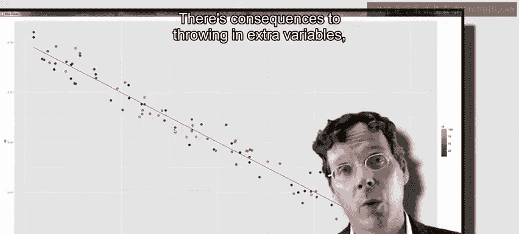

## 回到瑞士数据与模型选择 🧐

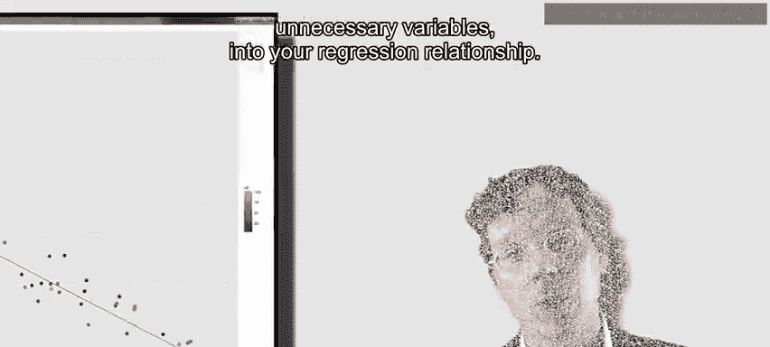

经过模拟，我们对多变量回归有了更深的理解。现在回到瑞士数据集。

`Agriculture`的效应在加入其他变量（特别是`Education`和`Examination`）后发生逆转。值得注意的是，`Education`与`Agriculture`呈负相关（-0.64），而`Education`对`Fertility`有更强的负效应。此外，`Education`和`Examination`高度相关（0.7），它们测量的是类似的概念。

因此，如果有人仅通过`Agriculture`对`Fertility`的单变量回归就声称两者存在正向因果关系，这个结论是非常可疑的。即使在关联性层面，这个正向关联也很容易被其他合理变量的引入所打破甚至逆转。

最后，我们看看在模型中引入一个完全多余的变量会发生什么。这里“多余”指的是该变量是已有变量的线性组合。

```r
swiss$z <- swiss$Agriculture + swiss$Education
summary(lm(Fertility ~ . + z, data = swiss))$coefficients
```
你会发现，新变量`z`的系数显示为`NA`。这是因为R无法估计一个完全由其他变量线性构成的变量的独立效应。如果你在拟合线性模型后看到`NA`系数，最可能的原因就是你引入了一个与其他变量存在完全或近似线性关系的变量。

---

## 总结 📝


本节课中我们一起学习了多变量回归分析的核心实践：
1.  **模型构建与解释**：我们学习了如何拟合多变量线性回归模型，并正确解释在控制其他变量条件下某个预测变量的系数。
2.  **辛普森悖论**：我们通过瑞士数据实例和模拟实验，深入理解了忽略重要混杂变量可能导致对核心变量关系的方向性误判。
3.  **变量选择的重要性**：科学分析是一个动态过程，需要基于领域知识谨慎地选择纳入模型的变量，以得到可靠且可解释的结论。
4.  **冗余变量**：我们了解到，在模型中引入与其他变量存在线性关系的冗余变量，会导致模型无法识别，系数估计为`NA`。

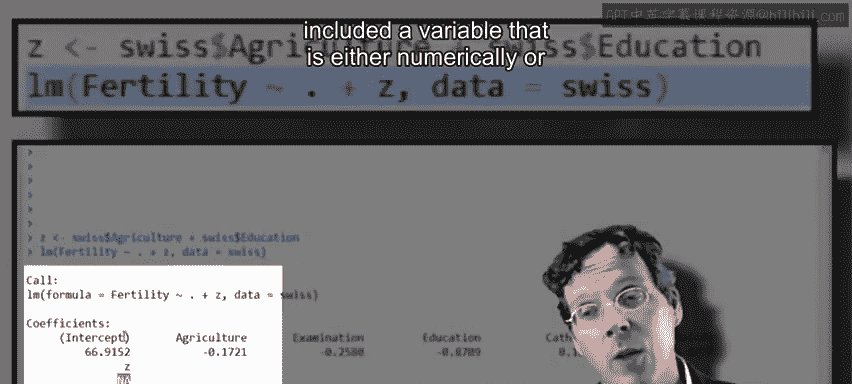

记住，回归分析不仅仅是运行代码，更需要对数据生成过程、变量间的潜在关系进行深入的思考和判断。