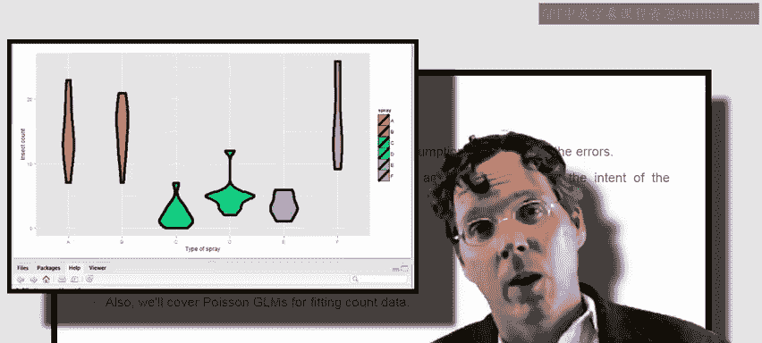
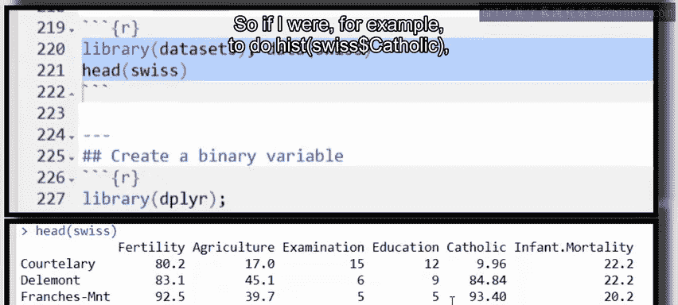
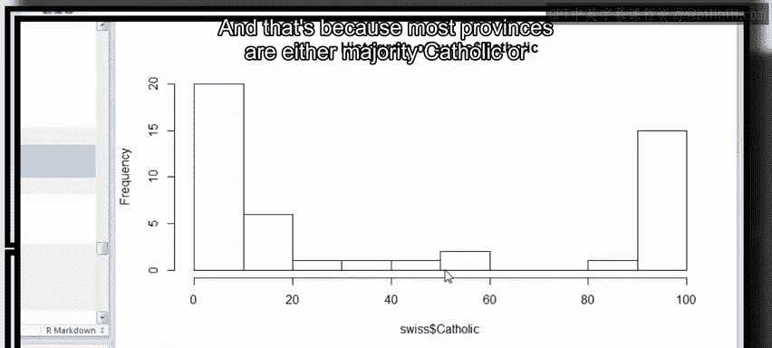
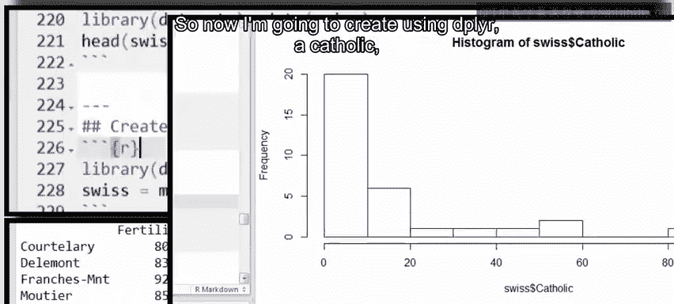
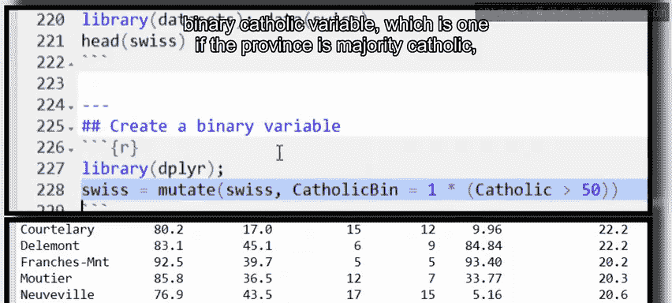
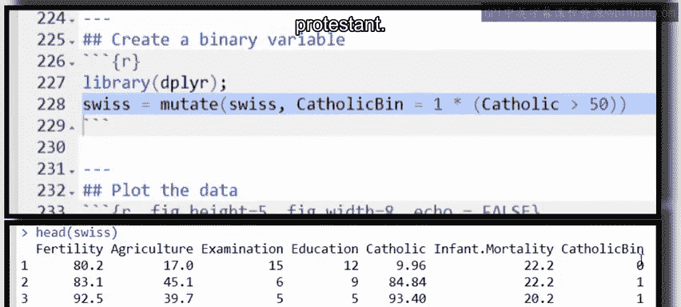
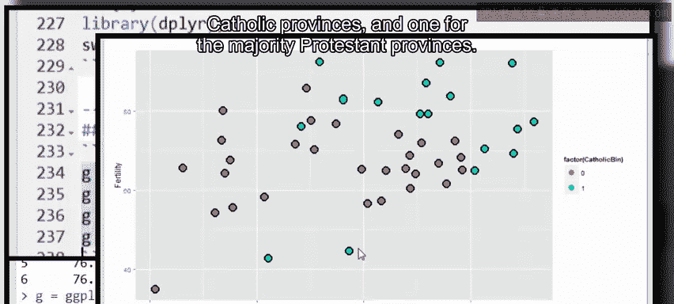
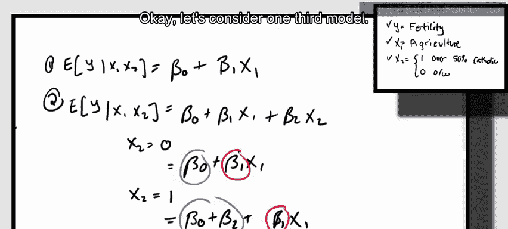
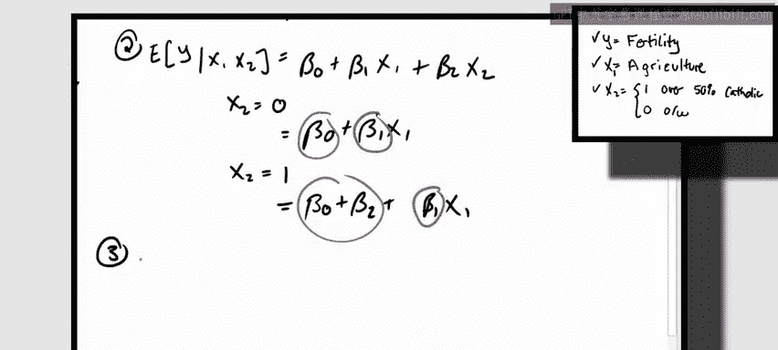
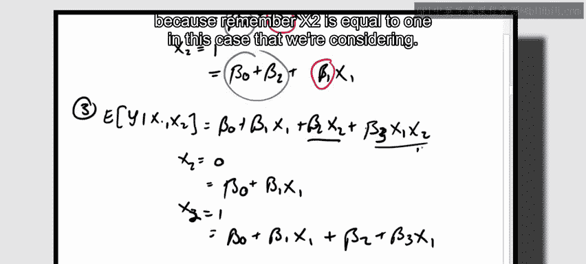

# 025：多变量回归示例第三部分 🧮



在本节课中，我们将学习多变量回归的一个重要示例，它构成了“协方差分析”（Ancova）主题的基础。我们将通过一个具体案例，演示如何拟合具有不同截距和斜率的多个回归线。

上一节我们介绍了多变量回归的基本概念，本节中我们来看看如何在实际数据中应用这些概念，特别是处理分类变量时的情况。

## 数据准备与探索


我们将使用之前见过的瑞士数据集。我们的目标是建立模型，将生育率（`Fertility`）作为结果变量，农业人口比例（`Agriculture`）作为预测变量。

首先，我们关注`Catholic`变量。该变量表示各省天主教徒的比例。通过绘制直方图可以发现，其分布呈现明显的双峰形态。


这是因为在数据所属的历史时期，大多数省份要么以天主教徒为主，要么以新教徒为主。






接下来，我们使用`dplyr`包创建一个二元的`Catholic`变量（`CatholicBin`）。如果一个省份的天主教徒比例超过50%，则该变量为1（多数为天主教），否则为0（多数为新教）。



```r
# 创建二元分类变量
Swiss <- Swiss %>%
  mutate(CatholicBin = ifelse(Catholic > 50, 1, 0))
```

执行`head(Swiss)`命令后，可以看到数据集中新增了`CatholicBin`变量。







现在绘制数据图。图中展示了`CatholicBin`因子变量（0代表新教省份，1代表天主教省份）与农业人口比例的关系。图中存在一些潜在的异常观测值，但为了专注于当前的教学目标——拟合分组回归线，我们暂时忽略这些问题。后续课程将专门讨论异常值和影响点。




我们的目标是分别为天主教省份和新教省份拟合两条独立的回归线。

## 模型构建与解释

以下是我们可以考虑的三种模型。设：
*   **Y** 为生育率（`Fertility`）
*   **X₁** 为农业人口比例（`Agriculture`）
*   **X₂** 为二元宗教变量（`CatholicBin`，1代表天主教，0代表新教）

### 模型1：忽略分组（单一直线）

第一个模型完全忽略省份的宗教差异，对所有数据拟合一条直线。


**公式**：
`E[Y | X₁, X₂] = β₀ + β₁X₁`

这个模型假设宗教分组对生育率与农业人口的关系没有影响。

### 模型2：包含分组变量，无交互项（平行直线）

第二个模型在预测变量中加入了宗教分组`X₂`，但没有交互项。


**公式**：
`E[Y | X₁, X₂] = β₀ + β₁X₁ + β₂X₂`

现在，让我们分析这个公式在不同`X₂`取值下的含义：
*   当 `X₂ = 0`（新教省份）：公式简化为 `β₀ + β₁X₁`
*   当 `X₂ = 1`（天主教省份）：公式变为 `(β₀ + β₂) + β₁X₁`


因此，拟合这个模型相当于拟合了两条**斜率相同**（都是`β₁`）但**截距不同**的直线。新教省份的截距是`β₀`，天主教省份的截距是`β₀ + β₂`。

### 模型3：包含分组变量和交互项（不同斜率和截距的直线）

第三个模型不仅包含分组变量，还加入了`X₁`和`X₂`的交互项（`X₁ * X₂`）。

**公式**：
`E[Y | X₁, X₂] = β₀ + β₁X₁ + β₂X₂ + β₃(X₁ * X₂)`





同样，我们分析不同`X₂`取值下的情况：
*   当 `X₂ = 0`（新教省份）：公式简化为 `β₀ + β₁X₁`
*   当 `X₂ = 1`（天主教省份）：公式变为 `(β₀ + β₂) + (β₁ + β₃)X₁`



现在，我们拟合了两条**斜率和截距都不同**的直线。
*   新教省份的直线是：截距 = `β₀`， 斜率 = `β₁`
*   天主教省份的直线是：截距 = `β₀ + β₂`， 斜率 = `β₁ + β₃`

**系数解释**：
*   `β₂` 代表了从新教省份切换到天主教省份时，**截距**的变化量。
*   `β₃` 代表了从新教省份切换到天主教省份时，**斜率**的变化量。

## 代码实现

理论可能有些抽象，让我们通过实际代码来加深理解。


```r
# 拟合模型1：忽略分组
fit1 <- lm(Fertility ~ Agriculture, data = Swiss)

# 拟合模型2：包含分组，无交互项（平行线）
fit2 <- lm(Fertility ~ Agriculture + CatholicBin, data = Swiss)

# 拟合模型3：包含分组和交互项（不同斜率的线）
fit3 <- lm(Fertility ~ Agriculture * CatholicBin, data = Swiss)
# 等价于 Fertility ~ Agriculture + CatholicBin + Agriculture:CatholicBin

# 查看模型3的摘要
summary(fit3)
```

通过运行`summary(fit3)`，我们可以查看`β₀`、`β₁`、`β₂`、`β₃`的具体估计值、标准误和显著性水平，从而判断宗教分组是否显著影响了生育率与农业人口关系的斜率和截距。


## 总结

本节课中我们一起学习了多变量回归中处理分组变量的核心方法。我们通过瑞士数据集示例，逐步构建了三个模型：
1.  忽略分组变量的简单线性模型。
2.  加入分组变量但无交互项的模型，该模型为不同组拟合了**平行线**（相同斜率，不同截距）。
3.  加入分组变量和交互项的模型，该模型为不同组拟合了**完全独立的线**（不同斜率和不同截距）。


理解交互项（`β₃(X₁ * X₂)`）的含义至关重要，它量化了预测变量`X₁`（如农业人口比例）对结果`Y`（如生育率）的影响如何随着分组变量`X₂`（如宗教）的不同而发生变化。这是进行协方差分析（ANCOVA）和探索组间差异的基础。