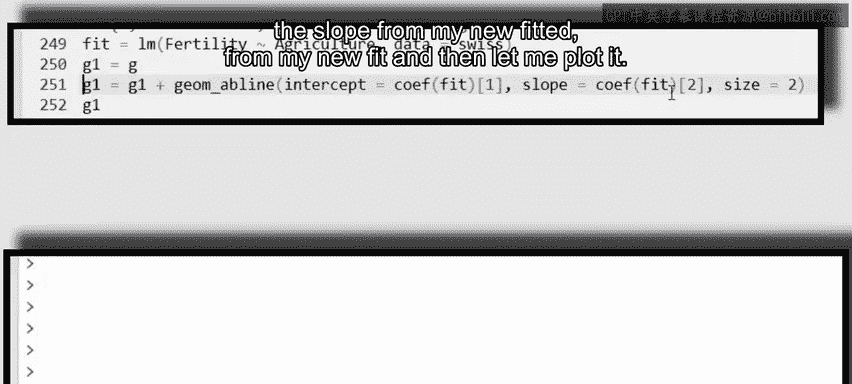
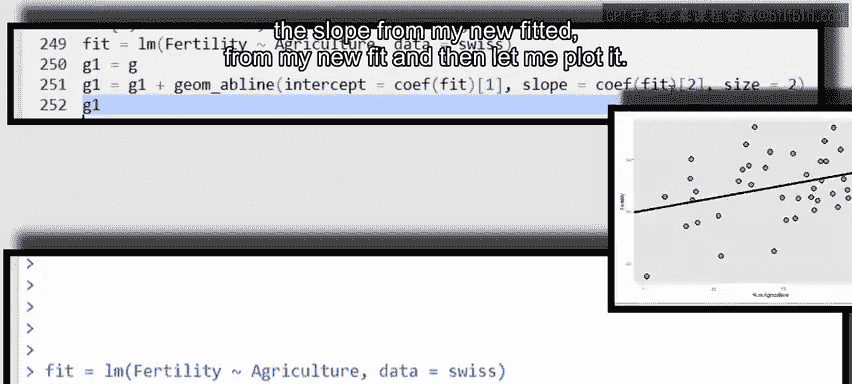
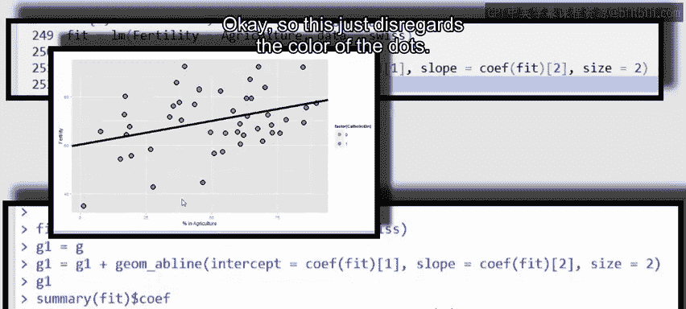
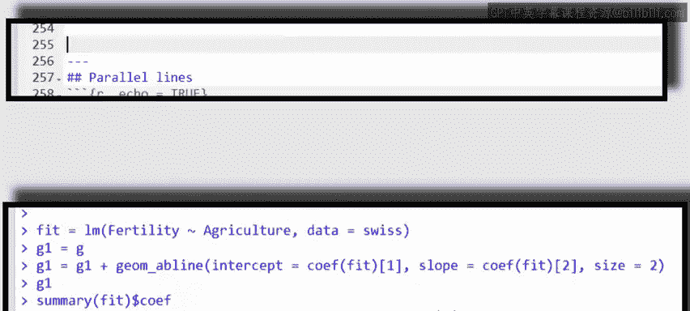
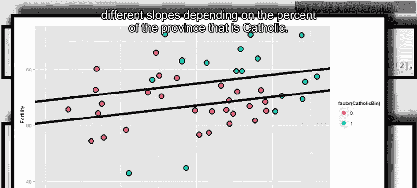
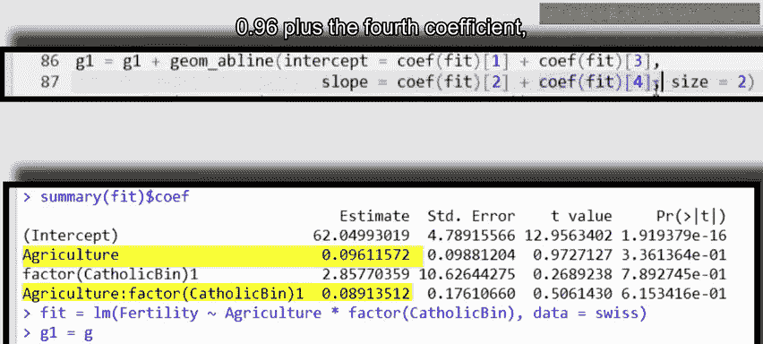
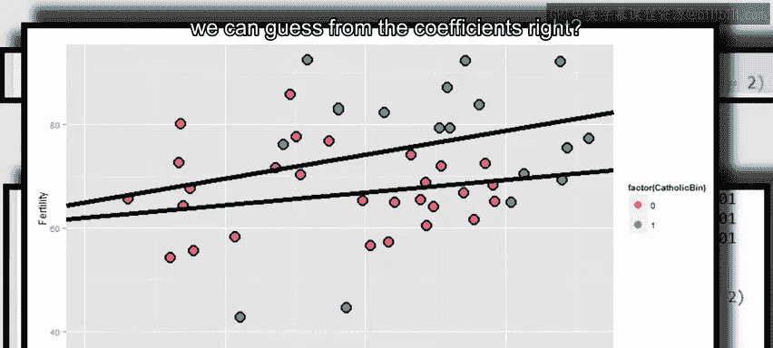
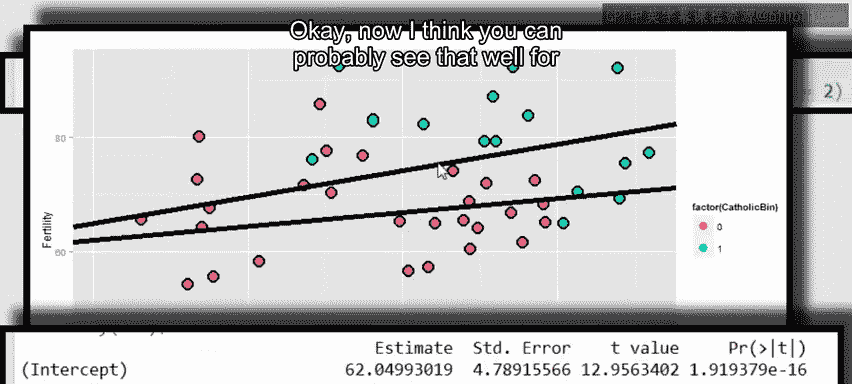
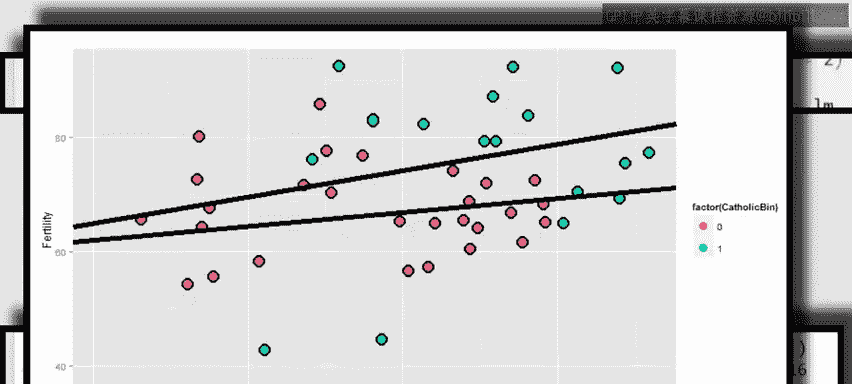

# 026：多变量回归示例（第四部分）📊

在本节课中，我们将通过一个实际案例，学习如何在R语言中拟合包含分类变量的多元线性回归模型。我们将逐步构建模型，从最简单的回归线开始，逐步引入分类变量及其与连续变量的交互作用，并可视化不同模型的结果。



---



## 模型拟合与可视化

上一节我们讨论了如何将分类变量引入回归模型。本节中，我们来看看如何在R中实际操作，并绘制出相应的拟合线。





首先，我们拟合一个完全不考虑宗教因素的简单模型。该模型仅使用农业人口比例来预测生育率。

以下是拟合该模型的R代码：

```r
# 拟合不考虑宗教的简单线性模型
fit <- lm(fertility ~ agriculture, data = swiss)
# 创建基础散点图并保存
g1 <- ggplot(swiss, aes(x = agriculture, y = fertility)) + geom_point()
# 获取截距和斜率
intercept <- coef(fit)[1]
slope <- coef(fit)[2]
# 将拟合线添加到图中
g1 <- g1 + geom_abline(intercept = intercept, slope = slope, color = "blue")
print(g1)
# 查看系数摘要
summary(fit)$coefficients
```

运行后，我们得到截距约为60，农业变量的斜率约为0.19。这条拟合线忽略了图中数据点的颜色差异。

---

## 拟合平行线模型

接下来，我们引入一个分类变量。我们创建一个二元变量`CatholicBin`，表示一个省份是否以天主教徒为主。然后，我们拟合一个模型，该模型为不同宗教的省份拟合具有不同截距但相同斜率（即平行线）的回归线。

以下是实现步骤：

```r
# 创建二元分类变量
swiss$CatholicBin <- as.factor(1 * (swiss$Catholic > 50))
# 拟合包含分类变量的模型（平行线）
fit_parallel <- lm(fertility ~ agriculture + CatholicBin, data = swiss)
# 查看系数
summary(fit_parallel)$coefficients
```

在R中，将变量编码为0和1时，R会自动将其视为因子（分类变量）。然而，良好的习惯是显式使用`as.factor()`或`factor()`函数。这是因为，如果一个变量取值0、1、2（例如代表三种发色），若不声明为因子，R会将其视为连续变量，错误地认为“2是1的两倍”。

系数表显示，我们得到了一个截距、一个农业变量的斜率，以及一个代表天主教省份的截距变化量（约为7.88）。现在，我们可以将两条平行线添加到图中：

```r
# 为新教徒省份绘制线（截距为coef[1]，斜率为coef[2]）
g1 <- g1 + geom_abline(intercept = coef(fit_parallel)[1],
                       slope = coef(fit_parallel)[2],
                       color = "darkred")
# 为天主教省份绘制线（截距为coef[1]+coef[3]，斜率仍为coef[2]）
g1 <- g1 + geom_abline(intercept = coef(fit_parallel)[1] + coef(fit_parallel)[3],
                       slope = coef(fit_parallel)[2],
                       color = "darkblue")
print(g1)
```



图中显示了两条斜率相同但截距不同的拟合线。

---

## 拟合带交互项的模型（非平行线）

最后，我们允许斜率也随宗教类别变化。在R公式中，使用星号`*`可以自动包含交互项以及所有主效应。

以下是具体操作：

```r
# 拟合包含交互项的模型（允许斜率和截距都变化）
fit_interaction <- lm(fertility ~ agriculture * CatholicBin, data = swiss)
# 查看系数
summary(fit_interaction)$coefficients
```

系数表现在包含四项：
1.  截距（新教徒省份）
2.  农业斜率（新教徒省份）
3.  天主教主效应（截距变化量）
4.  农业与天主教的交互项（斜率变化量）

因此，对于天主教省份，其回归线的：
*   **截距** = `coef[1]` + `coef[3]`
*   **斜率** = `coef[2]` + `coef[4]`

现在，我们将这两条非平行线添加到图中：



```r
# 为新教徒省份绘制线
g1 <- g1 + geom_abline(intercept = coef(fit_interaction)[1],
                       slope = coef(fit_interaction)[2],
                       color = "salmon", size = 1.2)
# 为天主教省份绘制线
g1 <- g1 + geom_abline(intercept = coef(fit_interaction)[1] + coef(fit_interaction)[3],
                       slope = coef(fit_interaction)[2] + coef(fit_interaction)[4],
                       color = "navy", size = 1.2)
print(g1)
```

从图中可以清晰地看到，现在两条线不再平行。根据系数（天主教相关项均为正数）可以判断，截距较高的蓝色线对应天主教省份，截距较低的鲑鱼色线对应新教省份。



---

## 总结与后续



本节课中，我们一起学习了多元线性回归中处理分类变量的完整流程：
1.  拟合了基础模型。
2.  引入了分类变量，拟合了**平行线模型**。
3.  引入了交互项，拟合了**非平行线模型**，并进行了可视化比较。



通过观察最终的拟合图，我们可能会对少数远离拟合线的数据点（例如图中的两个蓝色点）产生疑问：它们是否对模型产生了过度影响？这引出了回归诊断中的重要话题。在下一讲中，我们将探讨**残差分析**和**影响力诊断**，学习如何评估数据点对模型拟合的影响，并判断模型假设是否合理。