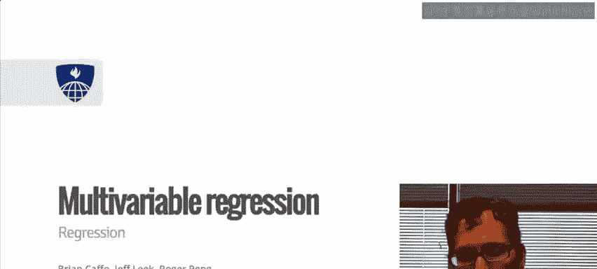
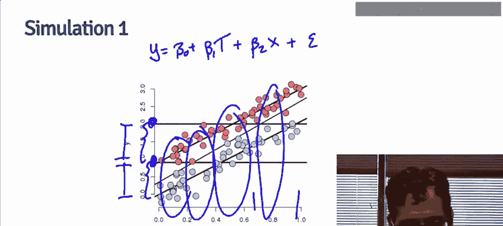
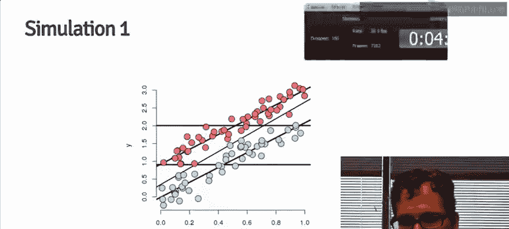
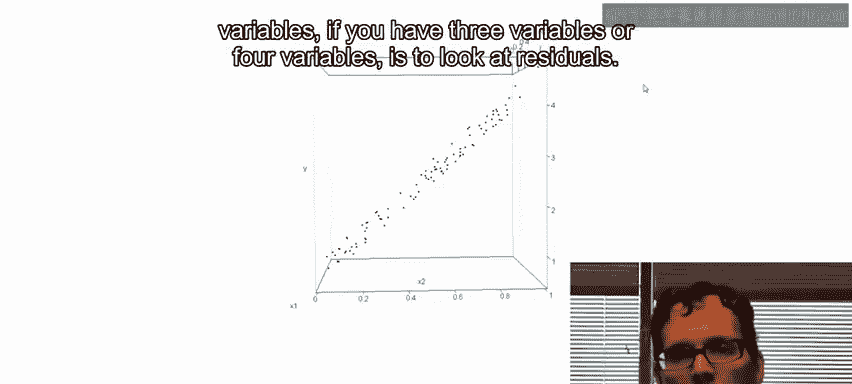

# 027：调整变量的影响 🧮

在本节课中，我们将学习多元回归分析。我们将通过一系列示例，探讨在模型中调整一个变量后，另一个变量与结果之间**观测到的关系**会发生何种变化。理解这一点对于正确解读回归模型的结果至关重要。

## 概述 📋

多元回归模型允许我们同时考虑多个预测变量对结果的影响。然而，当我们引入新的变量进行调整时，原有变量系数的估计值和显著性可能会发生显著变化，甚至出现方向性的逆转。本节将通过可视化的模拟数据，展示几种典型的变化模式。

## 示例一：调整前后效应基本一致

首先，我们来看一个简单直接的情况。在这个模拟数据中，我们有一个二元分组变量（例如处理组和对照组）和一个连续变量X。

以下是用于拟合的模型公式：
`Y = β₀ + β₁ * Group + β₂ * X + ε`

这个模型会拟合出两条**平行的直线**。其中，`β₁` 代表两组之间**截距的差异**，即处理效应；`β₂` 代表X与Y关系的**共同斜率**。

在上图中，水平线展示了忽略X时，分组变量（红色与蓝色）的**边际效应**。当我们拟合上述包含X的模型后，得到的调整后处理效应（即`β₁`的估计值）与边际效应大致相同。此外，对于X的任意取值，我们都有足够多的红点和蓝点来进行直接比较，这种数据分布类似于**随机化试验**的结果。

## 示例二：调整后效应消失（辛普森悖论）

上一节我们看到了调整变量后效应基本不变的情况。本节中我们来看看一个更戏剧性的场景：调整一个变量后，原本显著的效应完全消失。

在这个例子中，如果忽略X（看水平线），红色处理组和蓝色对照组之间存在明显的边际差异。然而，当我们拟合包含X的模型并观察截距的变化时，处理效应变得微乎其微。

这种情况常发生在**非随机化**的观察性研究中。例如，X可能是胆固醇水平，而“处理”是是否服用降压药。胆固醇水平很可能决定了患者是否会开始服用该药。此时，调整X实质上是在调整导致接受处理的**混杂因素**。这个例子也凸显了观察性数据分析的挑战。

关于这个数据集，还有一个关键点：
*   知识：在这个数据集中，X的值几乎可以完美预测个体属于哪个组（例如，X值小的是蓝组，X值大的是红组）。
*   缺乏直接证据：不存在一个X的取值能让我们同时看到红组和蓝组的数据点，因此我们无法在控制X的条件下直接比较两组。我们严重依赖模型的**假设**来进行比较。

## 示例三：调整后效应方向逆转

我们已经看到了效应消失的例子。现在，让我们探讨一种更令人惊讶的现象：调整变量后，效应的方向发生了逆转。

在这个场景中，忽略X时，红色组的平均结果高于蓝色组（边际效应显著）。但是，当我们拟合模型并调整X后，估计出的处理效应显示蓝色组的结果反而高于红色组。调整后的估计值与未调整的估计值**符号相反**。

这种现象在统计学中常被称为**辛普森悖论**。它指的是，一个变量与结果的关系在考虑（或忽略）另一个变量时发生了方向性的逆转。从图中的数据分布可以直观理解其原因，这其实并非真正的“悖论”。

## 示例四：从无效应变为有效应

前面的例子展示了显著效应因调整而减弱或反转。相反的情况也可能发生：调整变量可能揭示出隐藏的效应。

在此例中，如果忽略X，红组和蓝组之间几乎没有边际差异。然而，当我们把X纳入模型进行调整后，却发现了显著的处理效应。

这再次说明，调整变量对结果的影响没有简单的规则。效应的显著性可能从有到无、从无到有、保持显著、保持不显著，或者符号翻转，**所有排列组合都可能出现**。

## 示例五：存在交互作用的情况

到目前为止，我们假设了处理组和对照组具有相同的斜率。现在，我们来看一个斜率不同的情况，这涉及到**交互作用**。

在这个数据集中，红线和蓝线明显不平行。为了拟合这样的数据，我们需要使用包含交互项的模型：
`Y = β₀ + β₁ * Group + β₂ * X + β₃ * (Group * X) + ε`

这个模型允许两组拥有不同的截距和不同的斜率。

这里有一个非常重要的概念：当模型中存在交互项时，**主效应（`β₁`）本身不能单独被解释为处理效应**。从图中可以清楚地看到，处理效应的大小和方向**依赖于X的取值**。在X较小时，蓝组结果更高；在X较大时，红组结果更高。因此，不存在一个统一的“处理效应”。这个例子展示了，如果忽略了变量间的交互作用（效应修饰），而错误地拟合了平行线模型，可能会得到完全误导性的结论。

## 连续变量的情况：三维视角与残差图

我们之前的讨论集中在二元处理变量和连续变量X上。但同样的原理完全适用于多个连续预测变量的情况。

假设我们有两个连续变量X1和X2，以及结果Y。在二维散点图上（Y vs X1），我们可能看不到明显的关系。

但是，如果我们能在三维空间中观察（Y, X1, X2），或者更实际地，使用**残差图**，关系就会显现。

以下是分析方法：
1.  首先，分别用X2对Y和X1进行回归，得到残差。
    *   `Resid_Y = Y - (预测值 from Y ~ X2)`
    *   `Resid_X1 = X1 - (预测值 from X1 ~ X2)`
2.  然后，绘制 `Resid_Y` 对 `Resid_X1` 的散点图。

这张残差图展示了在**移除X2的线性影响后**，Y与X1之间剩余的关系。图中清晰显示了一个强烈的正相关，这是在原始二维图中被X2掩盖了的效应。

这个例子的核心要点是：调整变量导致系数发生各种变化（反转、增强、减弱、显著性改变）的现象，并不仅限于二元变量的情况，在**多个连续预测变量**的回归中同样普遍存在。

## 如何选择正确的模型？ 🤔

在目睹了调整变量可能带来的巨大变化后，一个自然的问题是：究竟哪个模型才是“正确”的？

答案是：**没有纯粹的统计答案**。确定正确的模型需要将统计分析与**专业领域知识**紧密结合。

以下是构建模型时的关键考虑因素：
*   **科学逻辑**：调整的变量在专业上是否有意义？例如，在血压模型中同时放入收缩压和舒张压，虽然它们高度相关，但让其中一个的效应消失并不具有科学洞察力。
*   **避免过度调整**：如果调整的变量本身就是处理决策的中介或结果，可能会不恰当地“调整掉”真实的处理效应。
*   **团队协作**：最好的做法是组建一个跨学科团队，包括领域专家、统计学家和数据分析师，共同讨论：
    *   不同调整策略下系数发生重大变化的原因。
    *   每种模型的利弊及其在科学上的合理性。
*   **自动化模型选择**：机器学习课程中会提到的自动化算法（如逐步回归、LASSO）更侧重于**预测精度**，而非保证系数的可解释性。对于旨在理解变量作用的解释性建模，亲手进行细致的、基于知识的模型构建是不可替代的。

## 总结 📝

本节课我们一起学习了多元回归中调整变量的核心影响。我们通过多个模拟示例看到，在回归模型中引入新的协变量后，我们关心的变量系数可能会：
1.  基本保持不变。
2.  减弱甚至消失。
3.  方向发生逆转（辛普森悖论）。
4.  从隐藏变为显著。
5.  在存在交互作用时，其含义发生根本变化。

这些变化在二元处理和连续预测变量，以及多个连续预测变量的情形中都会发生。最终，构建一个可信的、可解释的模型，依赖于统计工具与专业领域知识的深度融合与反复迭代。希望本课能帮助你未来在看到系数因调整而改变时，理解其背后可能的数据结构。