# 028：残差与诊断（第一部分）📊

在本节课中，我们将学习回归分析中的残差、诊断与验证。我们将从线性模型的基本概念出发，探讨如何利用残差评估模型拟合度，并介绍杠杆点和影响点的概念及其诊断方法。

---

## 线性模型回顾

上一节我们介绍了线性模型的基本形式。让我们先回顾一下线性模型的设定。

线性模型通常表示为：

\[
Y_i = \beta_0 + \beta_1 X_{i1} + \beta_2 X_{i2} + \ldots + \beta_p X_{ip} + \epsilon_i
\]

其中，\( Y_i \) 是因变量，\( X_{ij} \) 是自变量，\( \beta_j \) 是模型系数，\( \epsilon_i \) 是误差项。

在本讲座中，我们通常假设误差项 \( \epsilon_i \) 服从正态分布。请注意，部分结论依赖此假设，部分则不依赖。

---

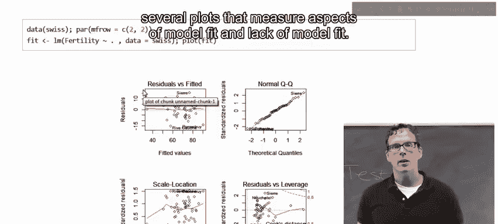

## 残差的定义与估计

本节中，我们来看看残差是如何定义的，以及如何估计残差方差。

残差 \( e_i \) 定义为观测值 \( Y_i \) 与模型预测值 \( \hat{Y}_i \) 的差值：

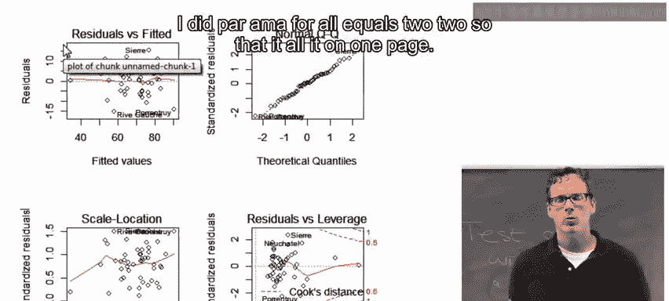

\[
e_i = Y_i - \hat{Y}_i
\]

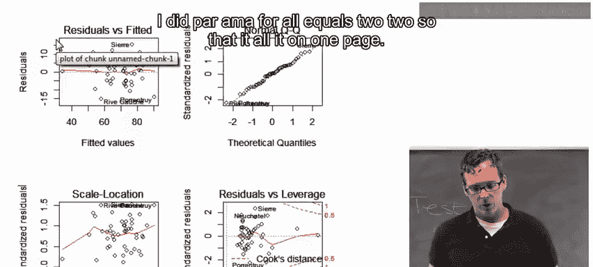

残差方差 \( \hat{\sigma}^2 \) 的估计量是残差平方和的平均值。为了获得无偏估计，我们使用 \( n - p \) 作为分母，而不是 \( n \)：

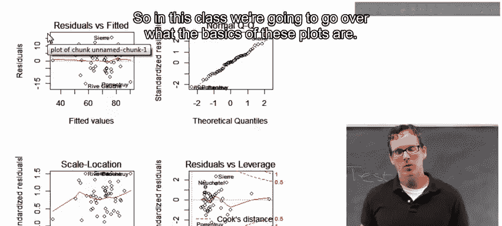

\[
\hat{\sigma}^2 = \frac{\sum_{i=1}^n e_i^2}{n - p}
\]

其中，\( n \) 是样本量，\( p \) 是模型参数的数量（包括截距项）。

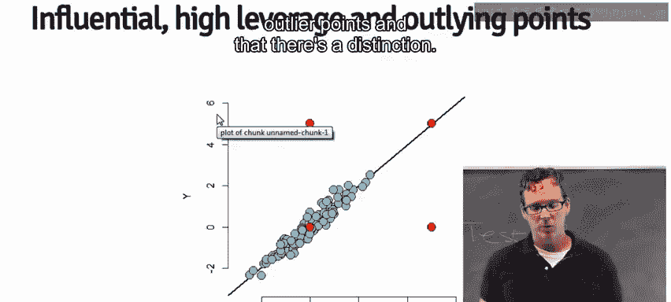

---

## 在R中生成诊断图

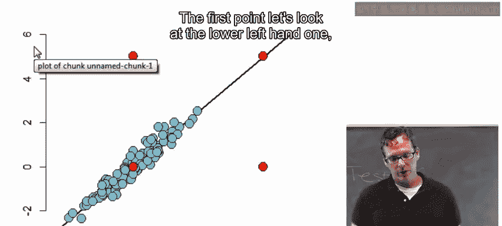

在R语言中，可以非常方便地获取残差图以及一系列衡量模型拟合优度与缺陷的图形。

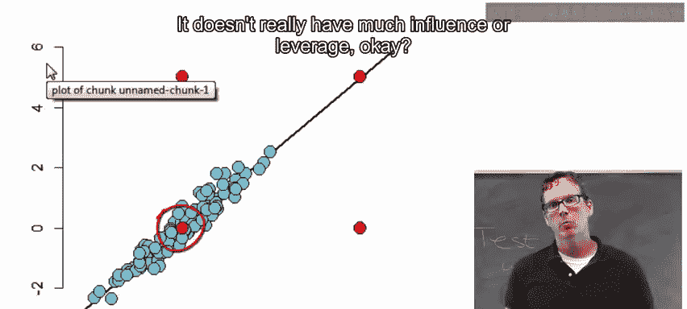

以下是具体操作步骤：

1.  加载数据集 `swiss`。
2.  拟合一个包含所有自变量的线性模型。一个简便的方法是在公式的波浪符号 `~` 后使用点号 `.`，这表示纳入数据框中除因变量外的所有变量。
3.  使用 `par(mfrow = c(2, 2))` 命令将图形排列成2行2列，以便在一页中显示所有图形。
4.  对拟合的模型对象直接使用 `plot()` 命令，R会自动生成一系列残差诊断图。

---

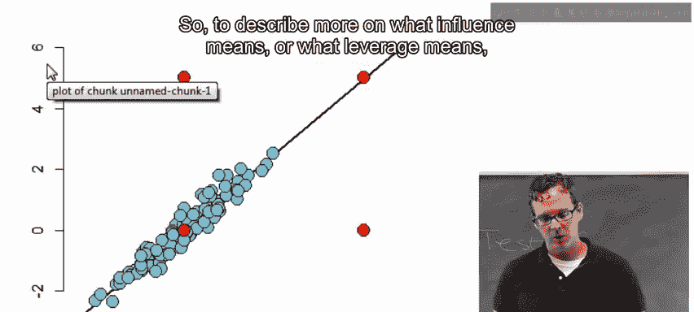

## 杠杆点与影响点

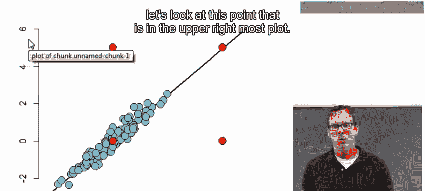

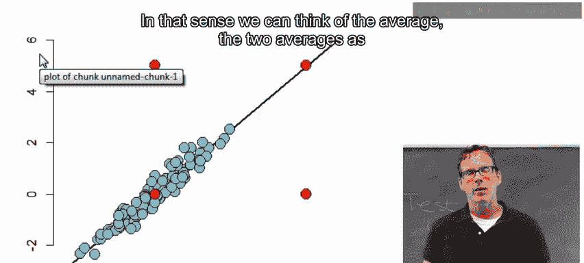

为了理解这些诊断图，我们需要区分两个重要概念：**杠杆点**和**影响点**（或异常点）。

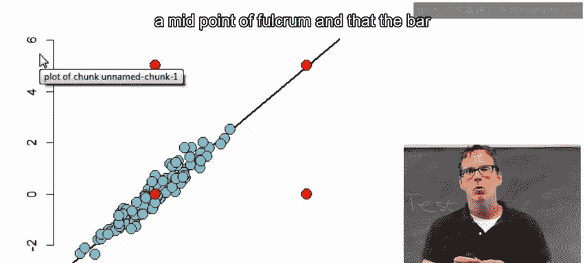

考虑一个散点图，其中大部分数据在预测变量和响应变量之间呈现出清晰的线性关系。图中有四个用橙色标记的点，我们将逐一讨论。

第一个点位于左下角，处于数据云的中心。它既没有很高的杠杆值，也没有很大的影响力。

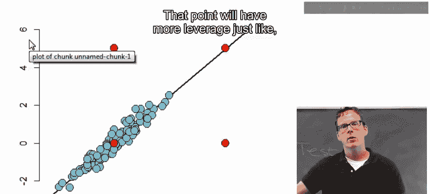

---

### 什么是杠杆值？

杠杆值衡量的是一个数据点因其预测变量值远离数据中心而潜在影响回归线位置的能力。

想象回归线必须穿过预测变量和响应变量的均值点，这个均值点就像一个支点。数据点距离这个支点越远，就像在杠杆上离支点越远的位置施加力，其“撬动”回归线的潜力就越大，即杠杆值越高。

因此，杠杆值的概念仅取决于数据点的预测变量值距离其中心有多远。

---

### 什么是影响力？

影响力则衡量一个数据点实际对回归线估计产生的影响大小。一个点可以有高杠杆值，但如果它本身紧密遵循由其他数据点确立的回归关系，那么它可能选择不“行使”这种杠杆力，从而对最终模型的影响很小。

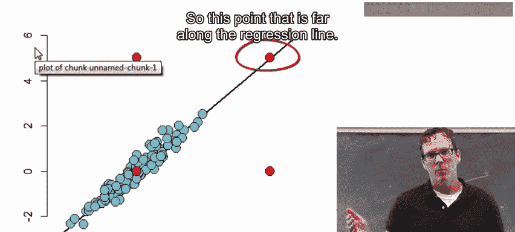

例如，图中右上角的点，虽然预测变量值很大（高杠杆值），但它恰好落在由其他数据点暗示的回归线上。如果移除这个点，回归线的变化很小。因此，这个点具有高杠杆值但低影响力。

---

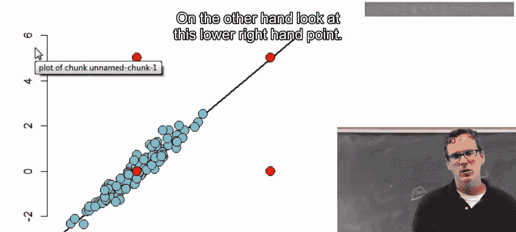

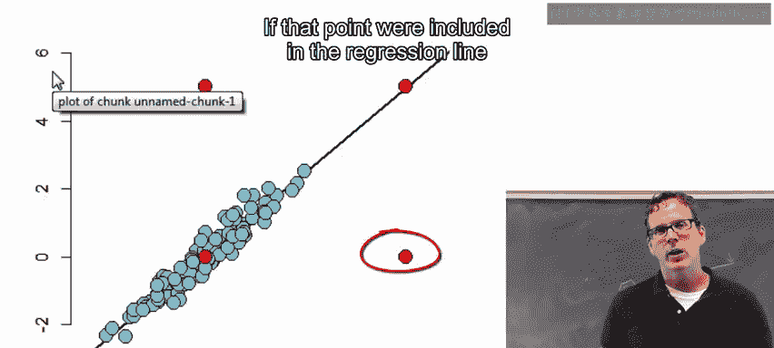

### 高杠杆值且高影响力的点

现在，看看右下角的点。这个点不仅预测变量值远离中心（高杠杆值），而且其响应变量值也严重偏离由其他数据点暗示的趋势。如果将其纳入回归分析，它会对回归线的斜率和位置产生巨大影响。因此，这个点同时具有高杠杆值和高影响力。

---

### 低杠杆值但可能是异常值的点

最后，观察左上角的点。它的预测变量值处于数据中心（低杠杆值），但其响应变量值却严重偏离整体趋势。虽然它是一个异常值，但由于杠杆值低，它对回归线整体形状（斜率）的影响，远小于那个高杠杆值且高影响力的右下角点。它主要影响的是截距估计。

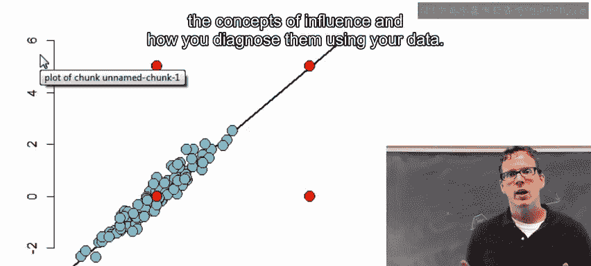

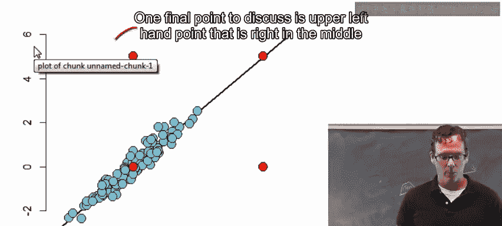

在本讲座中，我们将详细探讨杠杆值和影响力的概念，并学习如何使用数据来诊断它们。

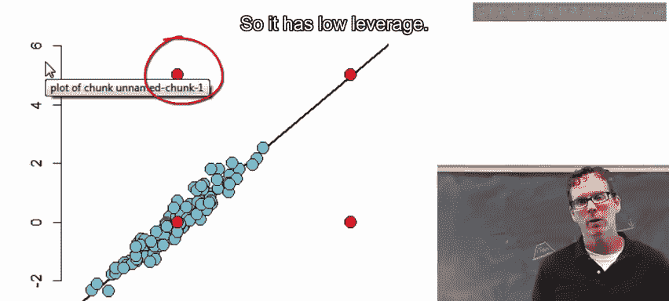

---

## 总结

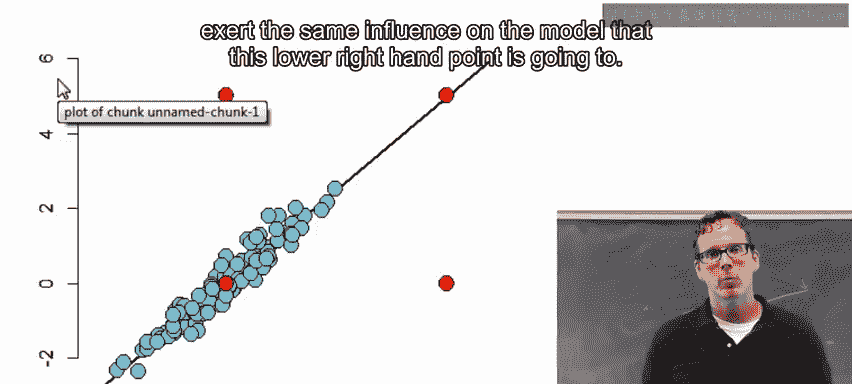

本节课我们一起学习了回归诊断的基础知识。我们回顾了线性模型和残差的定义，演示了如何在R中快速生成诊断图形。更重要的是，我们区分了**杠杆点**（由预测变量的极端值引起）和**影响点**（实际对模型参数估计产生较大影响的点）这两个关键概念。理解这两者的区别对于正确解释诊断图、识别潜在问题数据点至关重要。在接下来的课程中，我们将深入探讨具体的诊断统计量和图形。