# 030：残差与诊断（第三部分）🔍

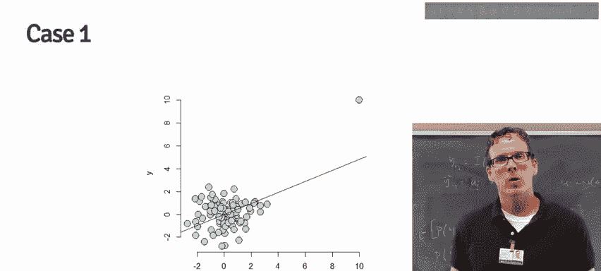

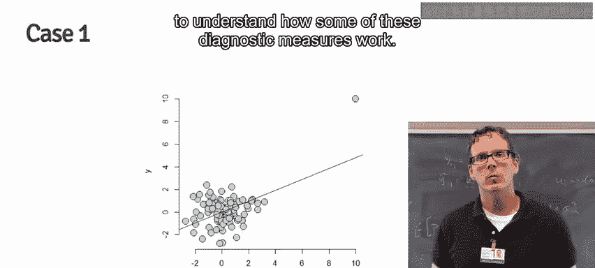

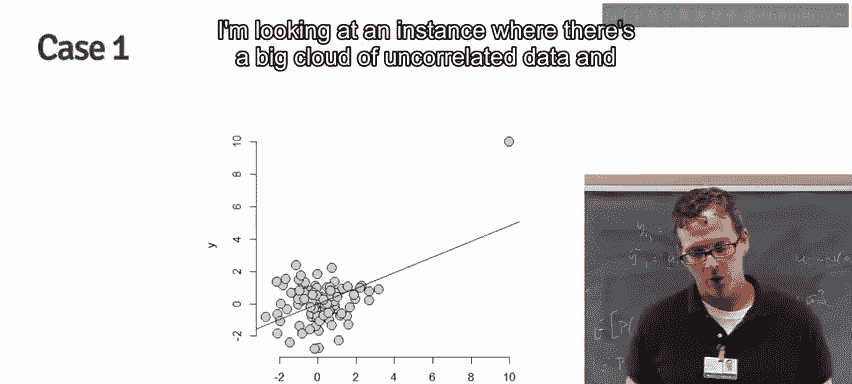

在本节课中，我们将通过模拟实验来理解几种回归诊断指标的工作原理，并学习如何解读R语言默认生成的诊断图。我们将重点关注**杠杆值**、**DFBETA**和**残差图**，这些工具能帮助我们识别数据中的异常点、高影响力点以及模型可能存在的问题。

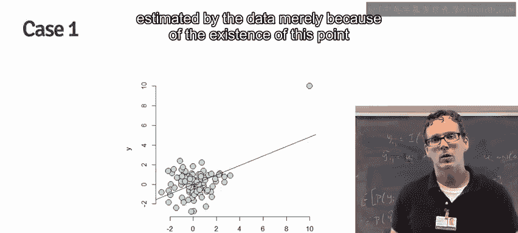

---

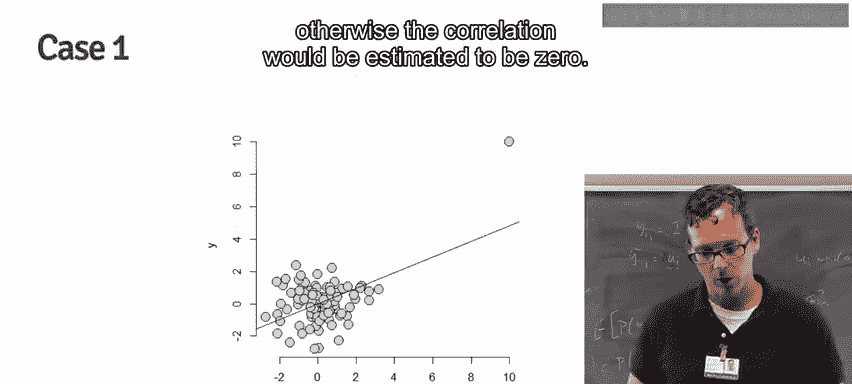

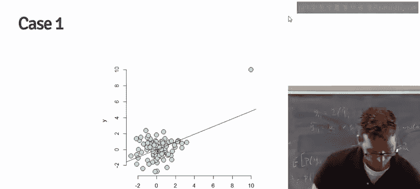


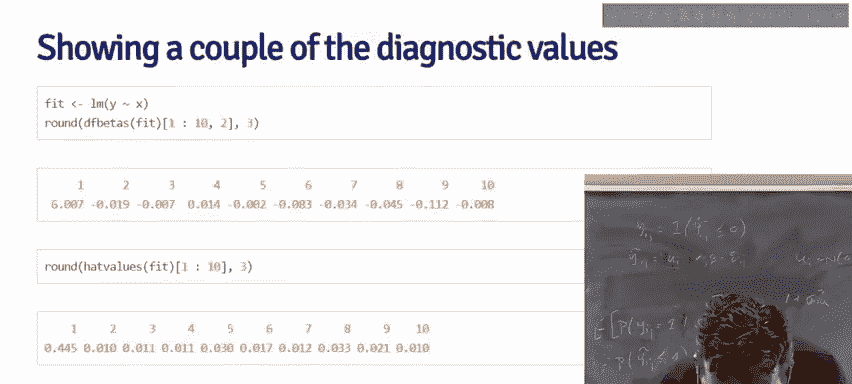

## 通过模拟实验理解诊断指标


上一节我们介绍了杠杆值和DFBETA等概念，本节中我们来看看如何通过模拟数据来直观感受这些指标的作用。


### 实验一：不相关数据中的离群点

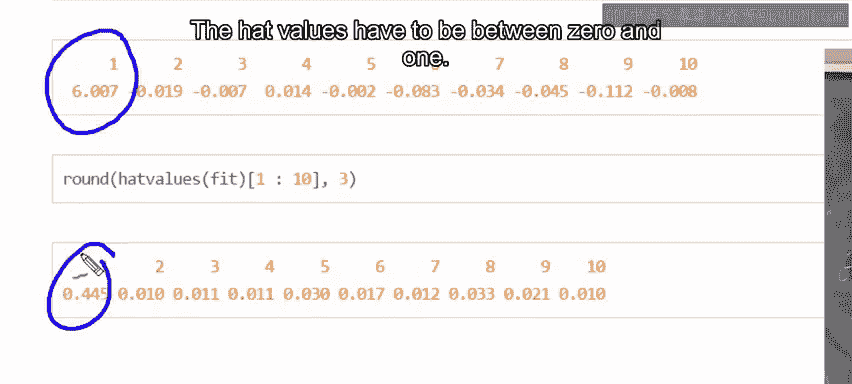


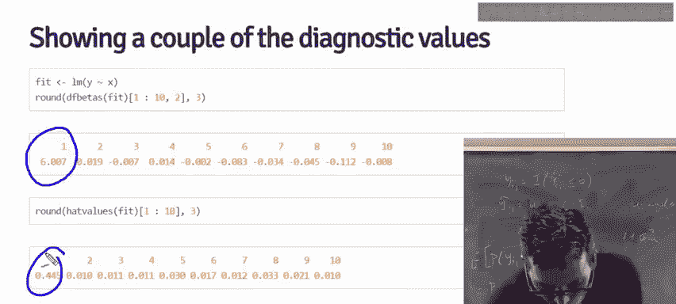

首先，我们观察一个由大量不相关的数据点构成的云团，并在其中加入一个明显的离群点 `(10, 10)`。

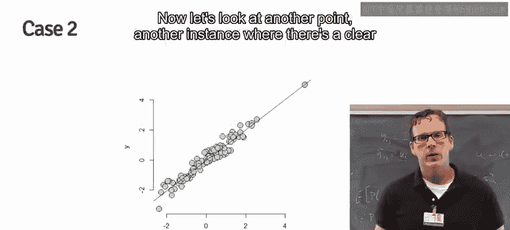

以下是生成和绘制该数据的R代码：
```r
# 生成独立的正态随机数对
x <- rnorm(100)
y <- rnorm(100)
# 添加离群点 (10, 10)
x <- c(x, 10)
y <- c(y, 10)
# 绘制散点图
plot(x, y)
```

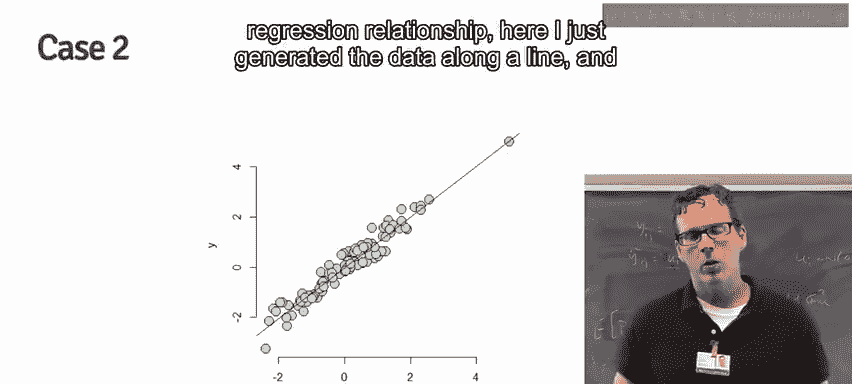

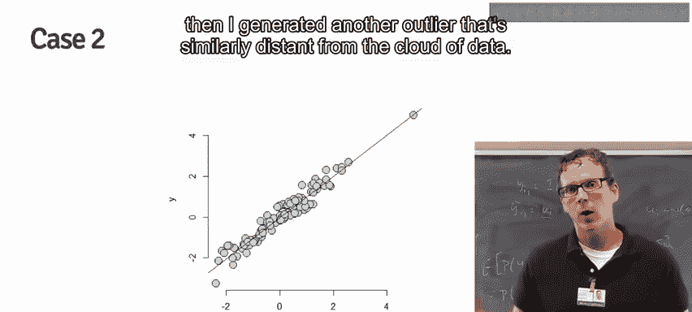

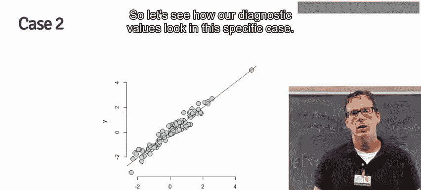

在这个例子中，仅仅因为这个离群点的存在，数据会显示出很强的相关性估计，否则相关性应估计为零。

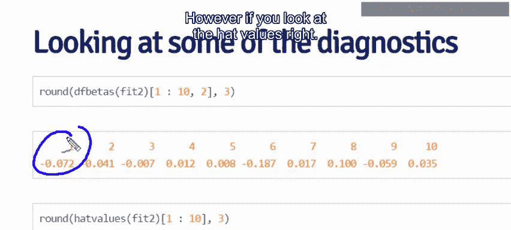

现在，让我们查看几个诊断指标的值。

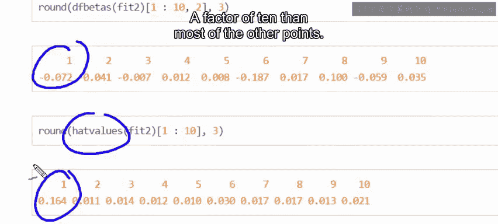

以下是相关诊断指标的计算结果：
*   **DFBETA值**：离群点 `(10, 10)` 的DFBETA值比其他所有点高出几个数量级。
*   **杠杆值**：该点的杠杆值也远大于其他点。杠杆值介于0和1之间，这个点的值明显异常。

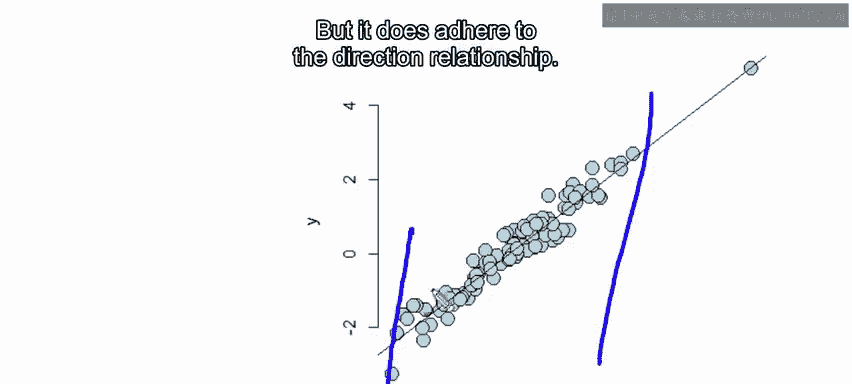

这些指标都能清晰地识别出这个离群点。

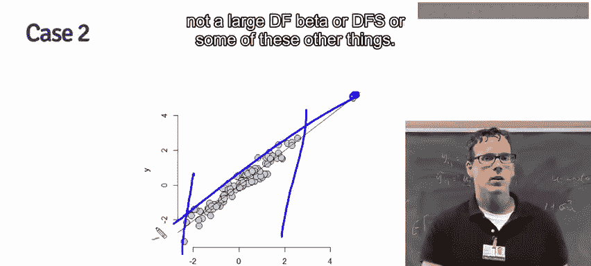

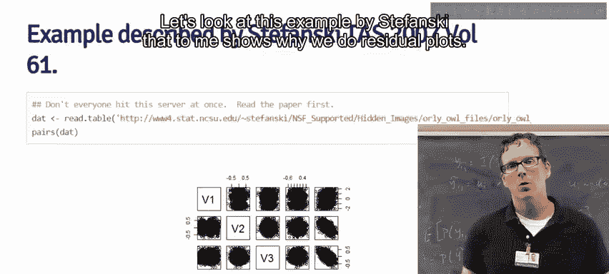

### 实验二：回归线上的离群点

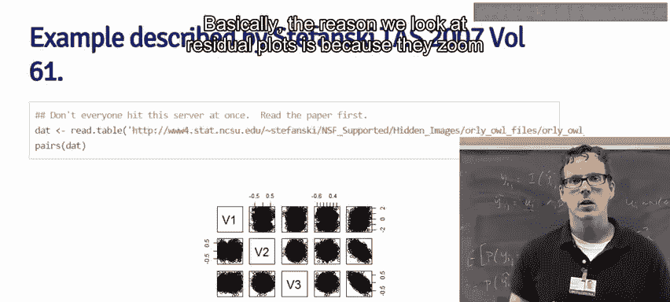

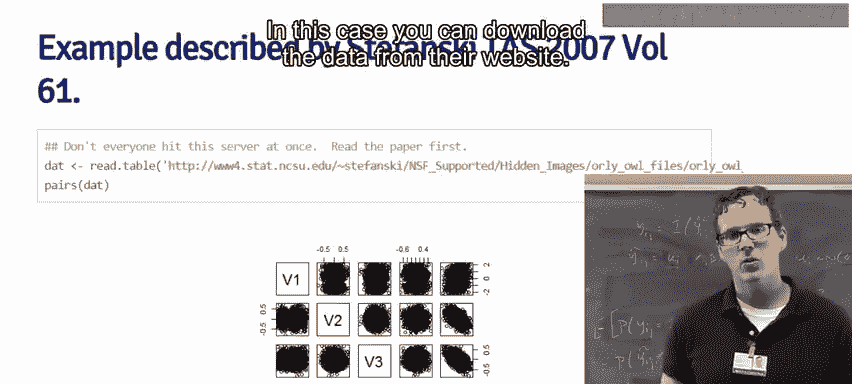

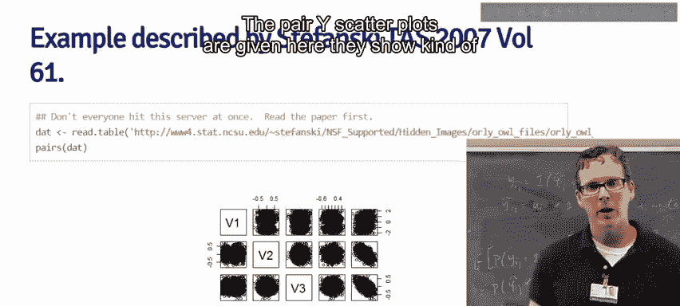

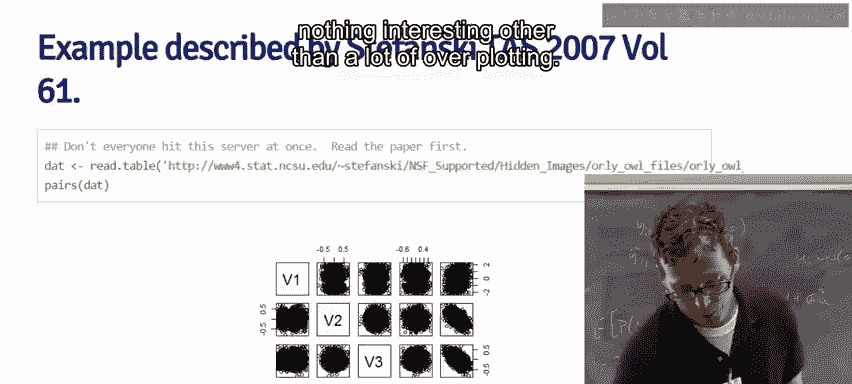

接下来，我们看另一个例子。这里的数据基本沿一条直线分布，但同样加入了一个远离数据云团的点。不过，这个点恰好落在了回归线上。

以下是相关诊断指标的计算结果：
*   **DFBETA值**：这个离群点的DFBETA值仍然较大，表明它对拟合有一定影响，但不像第一个例子中那样具有压倒性的差异。
*   **杠杆值**：该点的杠杆值比大多数其他点大十倍左右。原因在于，这个点的X值超出了其他数据的范围，因此具有高杠杆值。但由于它符合回归关系，所以对系数估计（DFBETA）的影响相对较小。

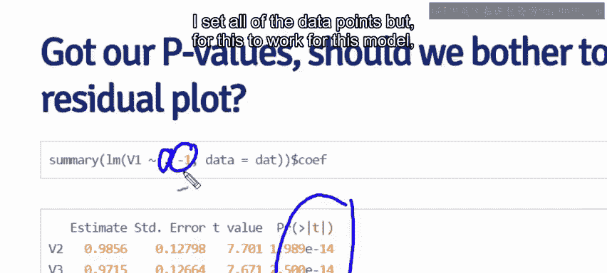

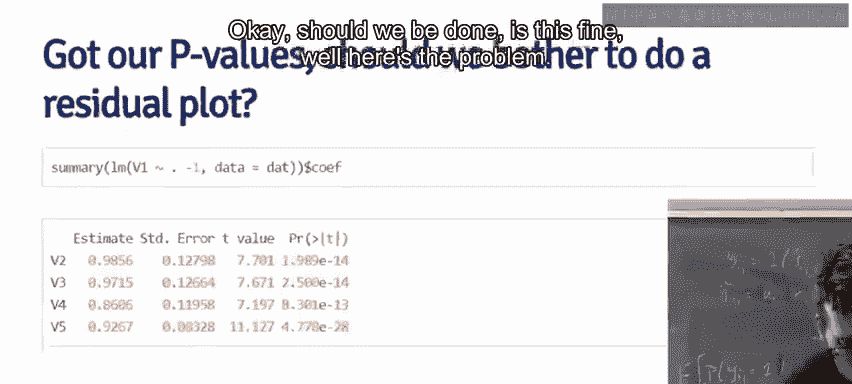

这个例子说明，高杠杆点不一定对模型参数有巨大影响。

---

## 残差图的重要性：Anscombe数据集示例


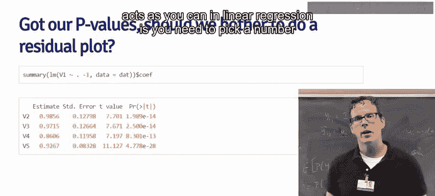


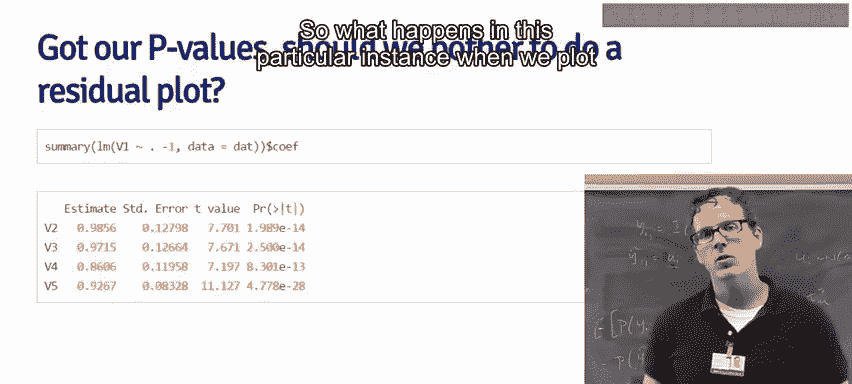

为了理解我们为何要绘制残差图，让我们看看Anscombe构造的著名数据集。这个例子完美展示了残差图如何放大模型潜在的问题。


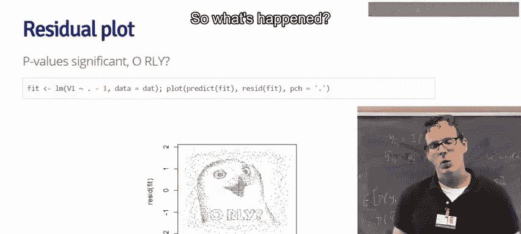


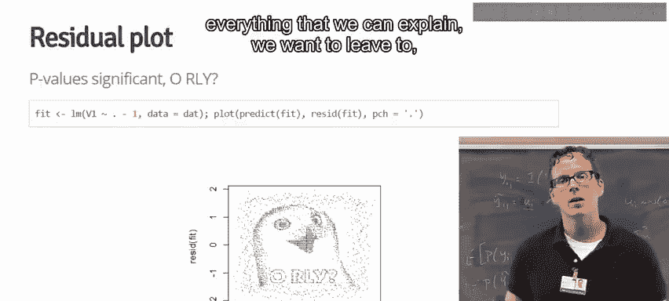

我们可以从其网站下载该数据。其两两散点图除了显示大量重叠外，没有展示出任何有趣的信息。


以下是拟合线性模型和查看P值的R代码：
```r
# 假设数据已加载为 `anscombe`
fit <- lm(y1 ~ x1 + x2 + x3 + x4, data = anscombe)
summary(fit)
```
查看模型摘要会发现，每个系数的P值都高度显著。如果不进一步检查，我们可能会认为模型拟合得很好。

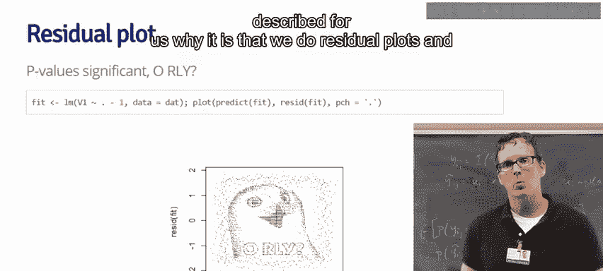


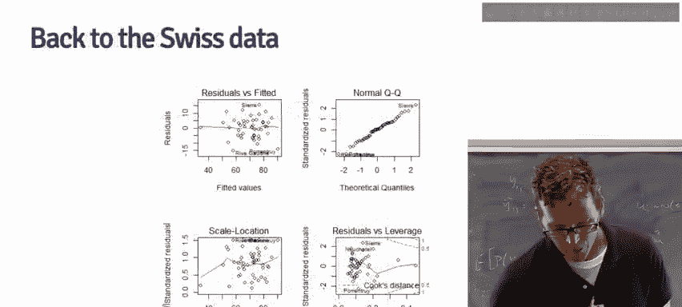

然而，问题在于残差图。在多元回归中，我们无法像简单线性回归那样将残差对单个X作图，通常选择绘制**残差与拟合值**的图。

以下是绘制残差与拟合值图的R代码：
```r
plot(fitted(fit), residuals(fit), xlab = "Fitted Values (Y_hat)", ylab = "Residuals")
```
在这个特定实例中，残差图揭示出一个非常巧妙的图案。如果不看残差图，我们完全无法发现这个清晰的系统模式，它表明了模型的严重缺陷。回归分析的目标是建模系统性的部分，而将无法解释的部分视为噪声。但像图中这样明显的系统性图案，本应被模型捕捉。

Anscombe构造这个数据集的目的，正是为了说明残差图的作用：它们能放大并揭示模型拟合不佳的方面。

---

## 解读R语言的默认诊断图

现在让我们回到瑞士数据集，解读R语言默认生成的一系列诊断图。课程开始时我们展示过这些图，现在来看看如何解释它们。

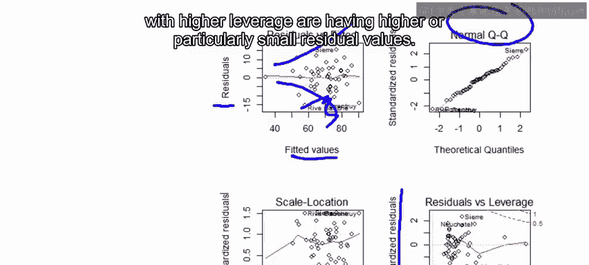

R的 `plot()` 函数对线性模型对象会生成四张诊断图。

以下是四张默认诊断图的解读：

1.  **残差与拟合值图**：此图与我们刚才用Anscombe数据绘制的图类似。目标是寻找任何系统性模式。例如，如果残差随拟合值增大而扩散或收缩，可能暗示**异方差性**。在此数据集中，此图看起来没有太大问题。
2.  **正态Q-Q图**：此图专门用于评估误差项的正态性假设。点越接近对角线，表明残差越接近正态分布。
3.  **标准化残差位置-尺度图**：此图绘制标准化残差（使其在不同实验间更具可比性，类似于t统计量）的平方根与拟合值的关系。它同样用于检查异方差性或其他模式，只是换了一种尺度。
4.  **残差与杠杆图**：此图将（标准化）残差与杠杆值对应起来。目标是检查高杠杆点是否伴有异常大或小的残差。例如，一个点可能杠杆值很高但残差很小（因为它强拉了回归线穿过自己），也可能杠杆值和残差都很高。

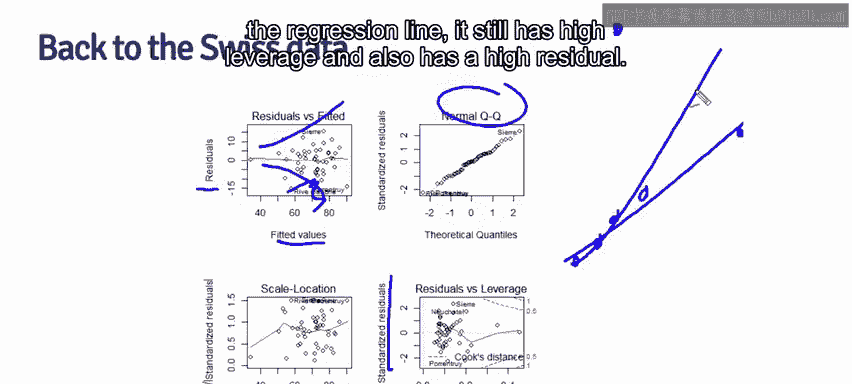

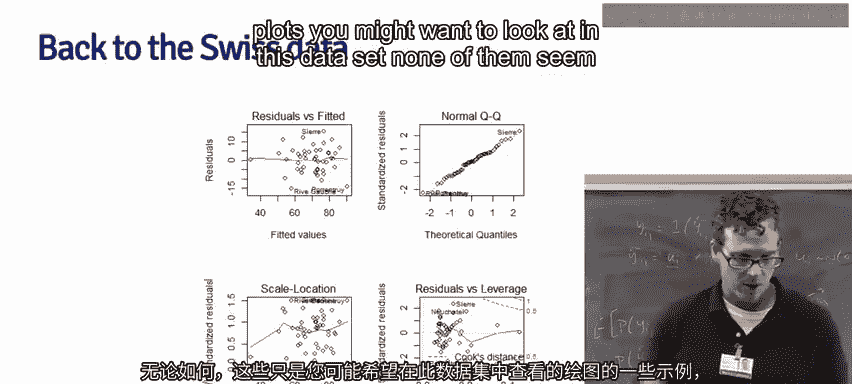


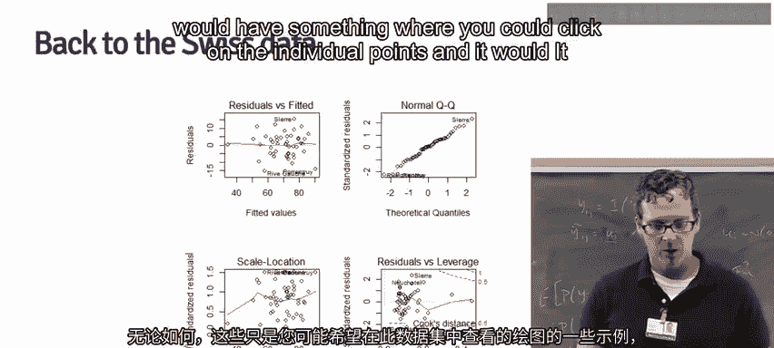

在本次分析的瑞士数据集中，这些诊断图看起来都没有严重问题。理想情况下，诊断图应具备交互功能，例如将鼠标悬停在点上可以显示该点的详细信息（如观测编号），这有助于进一步调查。我们将在后续的“数据产品”课程中讨论如何创建此类交互图。


---

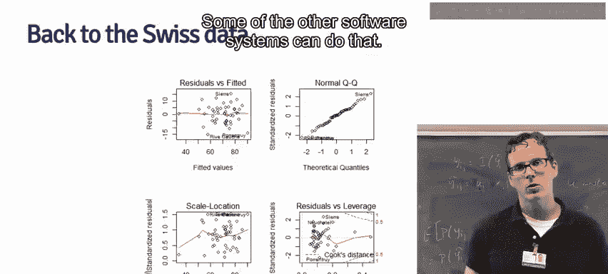


## 总结

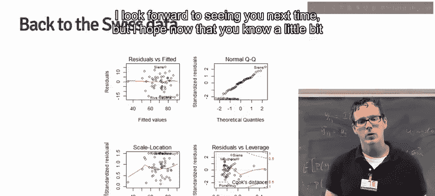

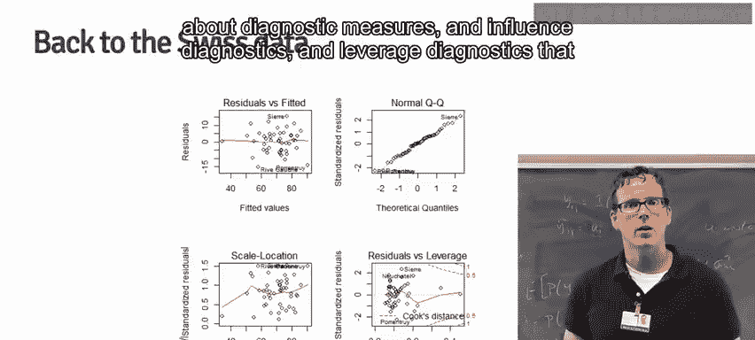


本节课中，我们一起学习了如何利用模拟实验理解**杠杆值**和**DFBETA**等诊断指标。我们通过Anscombe数据集的经典例子，深刻认识到**绘制并检查残差图**对于发现模型系统性缺陷至关重要。最后，我们系统解读了R语言默认提供的四张回归诊断图，包括残差与拟合值图、Q-Q图、尺度-位置图以及残差与杠杆图。掌握这些诊断工具，并将其纳入未来的回归分析流程中，将极大地帮助您评估模型假设、识别异常点，并最终建立更稳健的回归模型。