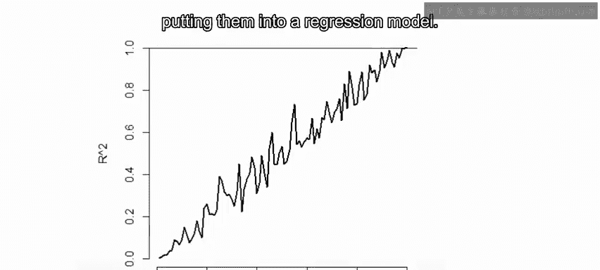

# 031：模型选择（第一部分）🔍


在本节课中，我们将要学习在回归背景下，当模型包含多个变量时如何进行模型拟合。我们将重点讨论模型选择的基本原则，并理解在构建解释性模型时，简约性和可解释性的重要性。


---


上一节我们介绍了回归模型的基础，本节中我们来看看当模型包含多个变量时需要注意的事项。


首先，需要区分多元回归与数据科学专业中预测课程所涉及的内容。在预测任务中，我们通常不太关心模型的可解释性，因此更能容忍复杂的模型、大量的交互项，以及使用自动化搜索算法和规则来针对特定损失函数寻找最佳预测模型。


相比之下，在许多回归分析的应用场景中，我们希望模型简单且易于解释。这意味着我们将高度重视**简约性**原则，即寻找能够解释我们所观察现象的最简单模型。这个原则类似于奥卡姆剃刀定律：在其他条件相同的情况下，最简单的解决方案很可能是正确的。在这里，我们倾向于选择简单的模型而非复杂的模型。


这种偏好会产生广泛的影响。例如，如果一个回归模型中的某个变量只能解释极少量的额外变异，但严重损害了模型的可解释性，我们通常会选择省略这个变量，即使它确实能解释一小部分正面的变异性。


---


为了帮助我们思考模型构建，可以引用Scott Zeger的一个观点：将模型视为观察数据的**透镜**。从这个角度看，模型本身没有对错之分。任何能让你从数据中学到有价值且真实信息的模型，就是“正确”的模型。透镜的比喻很贴切：有时你需要显微镜来观察超精细的细节，有时则需要望远镜来获取宏观层面的信息。合适的模型就像合适的透镜，能突出显示那些能揭示真实情况的特征。


---


在特定情况下，例如当我们关注某种处理效应时，模型可能存在无数种出错的方式，导致我们得出错误结论。在本讲座中，我们将探讨包含不必要回归变量或遗漏重要回归变量时会发生什么。


Donald Rumsfeld曾提出一个关于认知的分类，虽然备受争议，但对理解回归模型构建很有启发：
*   **已知的已知**：我们知道并且已经记录下来的回归变量，应该直接纳入模型。
*   **已知的未知**：我们知道应该纳入回归模型，但不幸的是我们没有收集到的变量。
*   **未知的未知**：我们应该纳入回归模型，但我们既没有收集到，也不知道它们是否重要的变量。


这个分类有助于我们在构建回归模型时进行系统的思考。


---

以下是关于如何处理这些不同类型变量的一些通用规则：


**遗漏重要变量（已知的未知或未知的未知）**
这通常会导致**偏差**。如果你感兴趣的某个回归变量（如处理效应）与一个被遗漏的变量相关，那么你对感兴趣变量的估计就可能不准确。防止这种情况的一种方法是尝试**随机化**。如果被遗漏的变量与你感兴趣的变量不相关，那么是否包含它通常影响不大。这就是为什么A/B测试和临床试验如此有效。然而，如果存在太多混杂因素，即使随机化也可能无济于事。


**包含不必要变量**
包含不重要的变量通常不会引入偏差。例如，如果你生成一堆与任何事物无关的标准正态随机数并放入回归模型，它们不会导致偏差。然而，这确实会**增大标准误**。向回归模型中引入不必要的变量会膨胀标准误，我们可以实际测量其影响程度。


此外，像**R平方**这样的模型统计量，并不一定是评判包含不同回归变量的模型优劣的好方法。原因是，随着你放入更多回归变量，R平方**保证会上升**，无论这些变量是否有用。同样，在回归中纳入更多回归变量时，残差平方和或均方误差也保证会下降。


以下是一个示例，我模拟了一组数据，并逐步将生成的随机正态向量作为回归变量加入模型，结果显示R平方持续上升，尽管加入的只是随机噪声。


```r
# 模拟示例代码示意
set.seed(123)
n <- 100
y <- rnorm(n)
# 逐步加入随机预测变量并计算R平方
rsq <- numeric(20)
for (i in 1:20) {
  x <- matrix(rnorm(n * i), ncol = i)
  fit <- lm(y ~ x)
  rsq[i] <- summary(fit)$r.squared
}
plot(1:20, rsq, type = "b", xlab = "Number of Random Predictors", ylab = "R-squared")
```


---




本节课中我们一起学习了多元回归模型选择的第一部分核心思想。我们明确了在解释性建模中追求简约性和可解释性的目标，并将模型比作观察数据的透镜。我们探讨了Donald Rumsfeld的认知分类在回归变量选择中的应用，并分析了遗漏重要变量会导致偏差，而包含不必要变量则会增大标准误的后果。最后，我们指出R平方等指标在模型比较中的局限性，因为它们会随着变量增加而必然提升。在接下来的课程中，我们将继续探讨更具体的模型选择方法和准则。