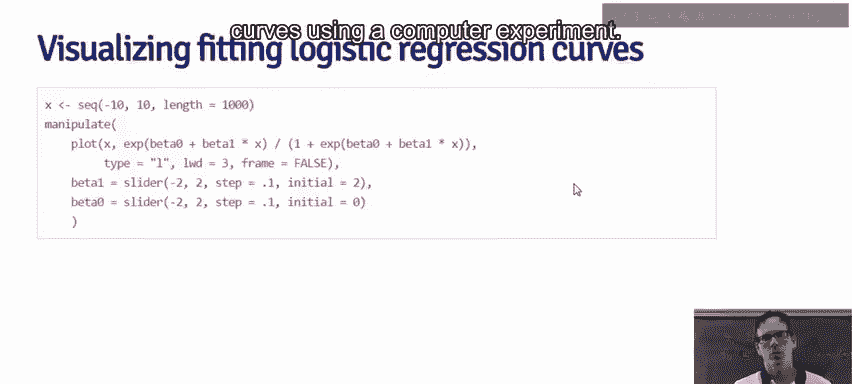

# 035：逻辑回归第1部分 📊

在本节课中，我们将要学习针对二分类数据的广义线性模型，即逻辑回归。我们将重点讨论当结果变量是0或1的随机变量时，如何建立模型。课程会以一个具体的例子——预测巴尔的摩乌鸦队（一支美式橄榄球队）的胜负——来贯穿始终，帮助你理解核心概念。

## 概述：什么是二分类数据？

在许多分析场景中，结果变量只能取两个值。例如，在生物统计学中，研究结束时病人可能“存活”或“死亡”；在体育分析中，比赛结果是“胜利”或“失败”。这类数据可以被视为一系列“抛硬币”实验，但每次实验的“成功”概率可能不同，并依赖于一系列协变量。

如果一系列0和1的结果是独立的，且成功概率恒定，那么总成功次数就服从**二项分布**。当协变量为常数时，二项分布数据可以通过**二元逻辑回归**来处理。本节课我们将通过讲解二元数据的情况，来覆盖二元和二项两种情况。

## 案例引入：乌鸦队胜负数据

作为教学案例，我们使用由课程讲师Jeff Leek整理的数据集。该数据集记录了乌鸦队的比赛信息，我们将探究乌鸦队的得分在多大程度上能预测其比赛胜负。

以下是数据中包含的关键变量：
*   `ravenWinNumber`: 乌鸦队获胜记为1，否则为0。
*   `ravenScore`: 乌鸦队得分。
*   `opponentScore`: 对手得分。

在本例中，我们暂时只关注乌鸦队得分 (`ravenScore`) 这一个预测变量。你可以想象，如果你是球队管理层，会希望用包括得分、对手得分、主客场等多种协变量来预测胜负。通过这个简单的例子理解逻辑回归原理后，你可以很容易地将知识扩展到多变量的情况。

## 为什么不用线性回归？

上一节我们介绍了案例数据，本节中我们来看看为什么标准的线性回归模型可能不适用于此类数据。

如果我们试图用线性回归直接建模乌鸦队获胜（记为1）的概率，即建立如下模型：
`获胜概率 = β0 + β1 * 得分 + 误差`
这个模型存在明显问题。线性回归通常假设误差服从正态分布，但我们的结果变量只有0和1两个值，该假设显然不成立。此外，线性模型预测出的“概率”值可能小于0或大于1，这不符合概率的定义。

虽然偶尔用线性模型快速查看趋势并非不可，但更严谨、更合适的方法是使用**逻辑回归**模型。

## 核心概念：几率、对数几率与Logit函数

既然不能直接对概率建模，逻辑回归选择对**几率**进行建模。几率定义为事件发生的概率与不发生的概率之比。

**公式**：
`几率 = p / (1 - p)`
其中 `p` 代表事件发生的概率。

几率可以转换回概率：
**公式**：
`p = 几率 / (1 + 几率)`

我们更常用的是几率的自然对数，称为**对数几率**或**Logit**。
**公式**：
`Logit(p) = log( p / (1 - p) )`

逻辑回归的巧妙之处在于：它假设对数几率与预测变量之间存在线性关系，而不是直接假设概率与预测变量线性相关。

## 逻辑回归模型

现在，让我们正式建立逻辑回归模型。我们不再像线性回归那样直接建模期望值，而是通过一个连接函数来建模。

对于二分类结果，其期望值就是概率 `p`。逻辑回归模型设定为：
**公式**：
`p = exp(β0 + β1*x) / [1 + exp(β0 + β1*x)]`
或者等价地，写成对数几率的形式：
**公式**：
`log( p / (1 - p) ) = β0 + β1*x`

这个模型可以理解为：我们将数据视为一系列成功概率不同的“抛硬币”实验，每个实验的成功概率 `p` 通过Logit函数与预测变量 `x` 线性相关。从对数几率反向计算概率的函数（即 `exp(a)/[1+exp(a)]`）通常被称为**Logistic函数**或**Sigmoid函数**。

## 模型解释

逻辑回归系数的解释非常直观。所有提到的对数均指自然对数（ln）。

*   **截距 β0**：当预测变量 `x` 为0时，结果的对数几率。在乌鸦队的例子中，`β0` 是乌鸦队得0分时获胜的对数几率。`exp(β0)/[1+exp(β0)]` 则是模型预测的得0分时的获胜概率。当然，现实中得0分不可能获胜，这说明了模型在数据范围外的推断需要谨慎。
*   **斜率 β1**：它表示预测变量 `x` 每增加一个单位，结果的对数几率的变化量。
    **公式推导**：
    `Logit(p | x+1) - Logit(p | x) = [β0 + β1*(x+1)] - [β0 + β1*x] = β1`
*   **指数化斜率 exp(β1)**：这是**优势比**。它表示预测变量 `x` 每增加一个单位，结果的几率变为原来的多少倍。这是更常用的解释方式。

如果模型中有多个预测变量（如同时考虑得分和主客场），`exp(β1)` 的解释则是在**保持其他变量不变**的情况下，得分每增加一分，获胜的**优势比**。这与多元线性回归中“控制其他变量后”的解释思路一脉相承。

## 几率的起源与趣味解读

对数几率之所以有用，是因为对数能将加法关系转化为乘法（比率）关系，而比率是人们易于理解的概念。几率的概念源于“公平博弈”的思想。

想象一个赌局：抛一枚成功概率为 `p` 的硬币。如果正面朝上，你赢 `X` 元；如果反面朝上，你输 `Y` 元。为了让游戏公平（期望收益为0），需要满足：
`Y / X = p / (1 - p)`
这正是几率。如果设 `X = 1`，那么 `Y` 就是你为赢得1美元而愿意支付的钱数。这就是赛马等博彩中“赔率”的由来。例如，“10比1”的赔率意味着如果你下注1美元，赢了就能拿回10美元。

一个有趣的现象是，赛马场通过动态调整赔率来平衡投注资金，确保无论哪匹马赢，庄家几乎不亏钱（他们通过收取手续费盈利）。长期来看，公众投注形成的聚合赔率，竟然能相当准确地反映赛马的真实胜率，这体现了“群体智慧”和市场效率。

## 总结与下节预告

本节课中我们一起学习了逻辑回归的基础知识。我们了解到，对于二分类数据，直接使用线性回归存在模型假设不满足、预测值可能超出合理范围等问题。逻辑回归通过建模**对数几率**与预测变量的线性关系，巧妙地解决了这些问题。模型的系数，特别是经过指数化后的**优势比**，具有清晰直观的解释。

下一讲，我们将通过计算机实验，直观地展示如何拟合和可视化逻辑回归曲线。敬请期待。