# 036：逻辑回归第2部分 📈

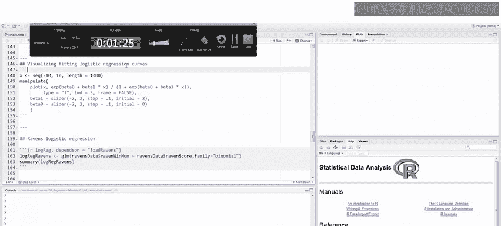

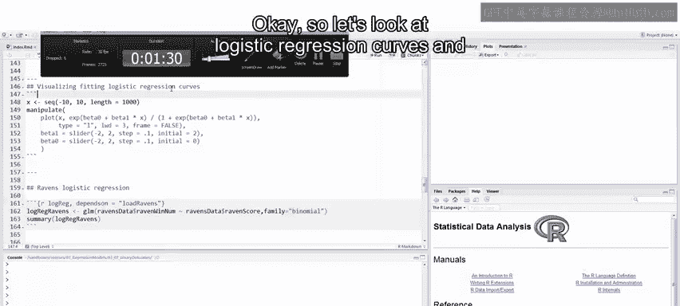

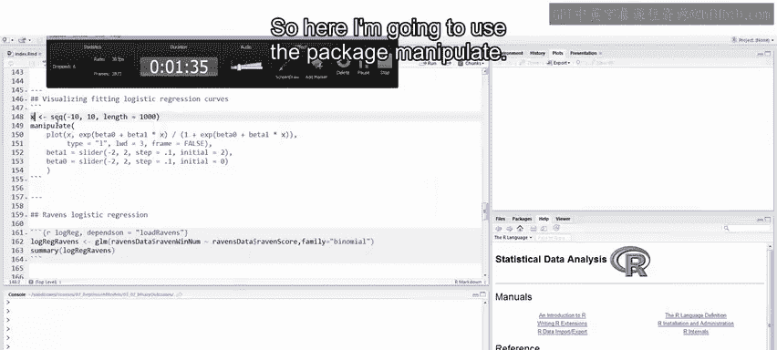

在本节课中，我们将学习逻辑回归曲线，并探讨R语言是如何拟合数据的。我们将通过可视化工具来理解逻辑回归模型的参数如何影响曲线形状，以及模型如何通过最大似然估计来寻找最佳拟合。

---

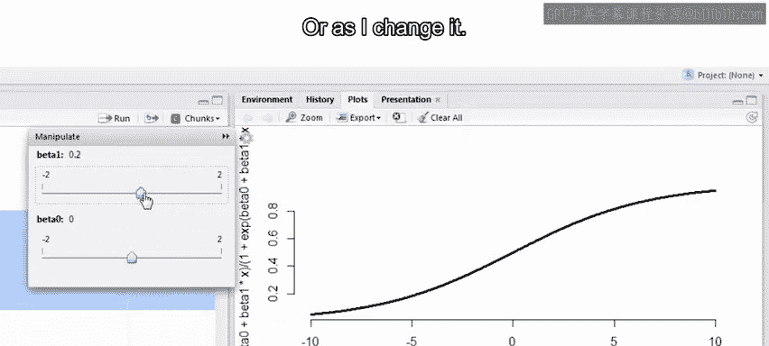

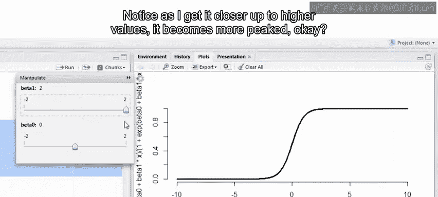

## 逻辑回归曲线与参数调整 🔧

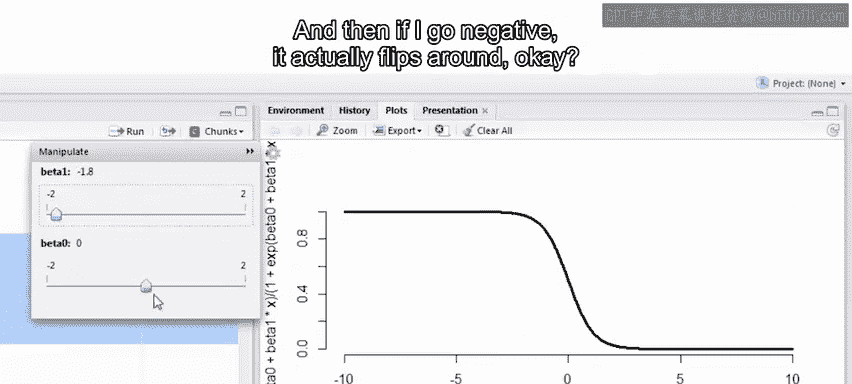

上一节我们介绍了逻辑回归的基本概念，本节中我们来看看逻辑回归曲线的具体形态以及其参数的意义。

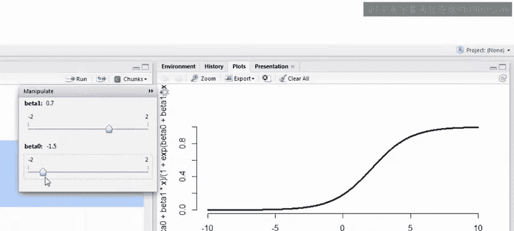

逻辑回归模型的核心函数是一个S形曲线，其公式如下：

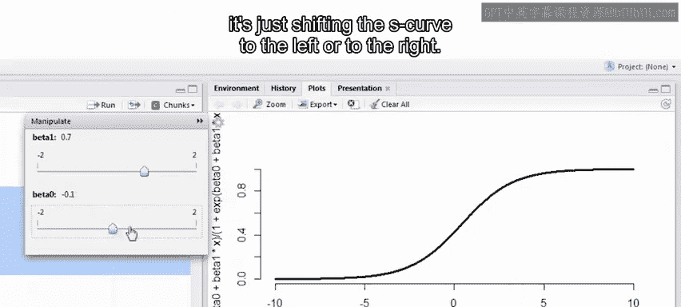

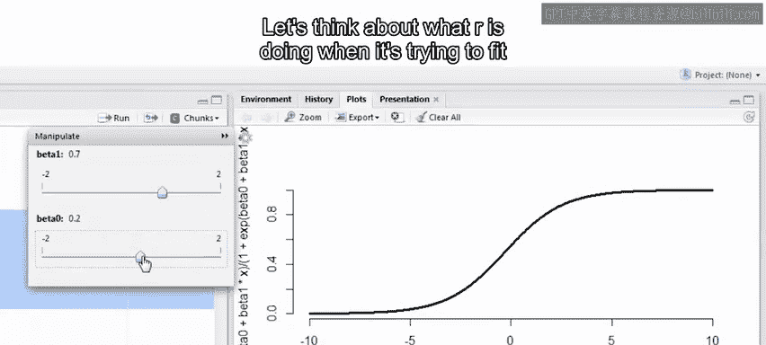

**公式：** `P(Y=1|X) = e^(β₀ + β₁X) / (1 + e^(β₀ + β₁X))`

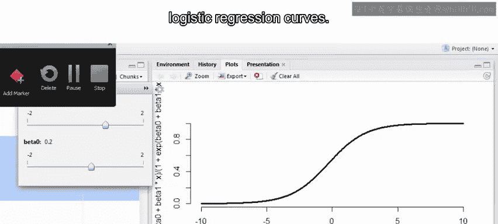

其中，`P(Y=1|X)` 表示在给定预测变量 `X` 时，结果为1（或“成功”）的概率。`β₀` 和 `β₁` 是模型的参数。

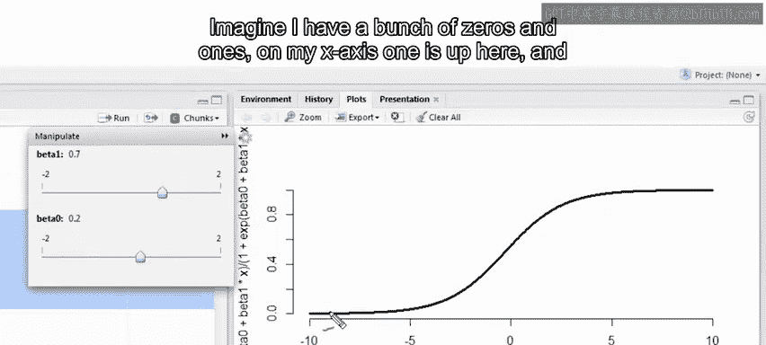

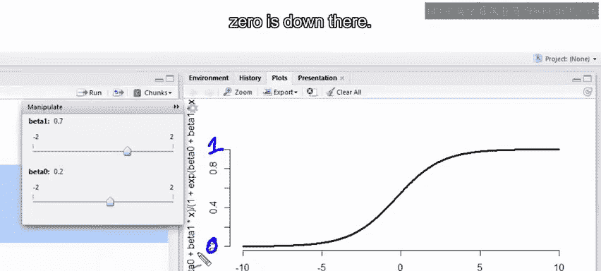

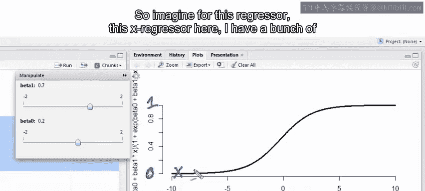

我们可以使用R语言的 `manipulate` 包来动态观察这些参数如何改变曲线的形状。

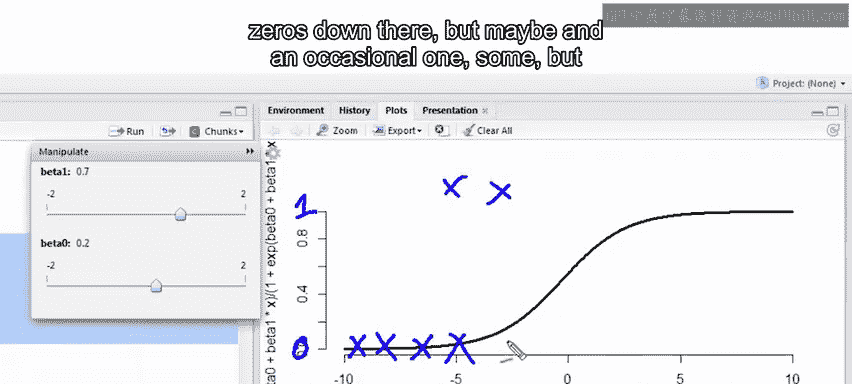

*   **β₁（斜率参数）的作用**：当 `β₁` 的绝对值增大时，S形曲线会变得更陡峭。如果 `β₁` 为正值，曲线从左下向右上增长；如果 `β₁` 为负值，曲线则从左上向右下下降（即形状翻转）。
*   **β₀（截距参数）的作用**：改变 `β₀` 的值会使整个S形曲线沿着X轴左右平移，但不改变其基本形状。

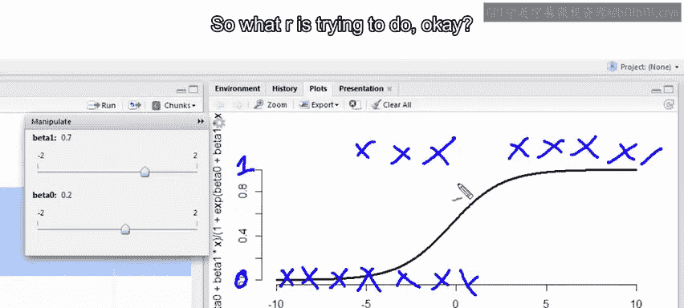

---

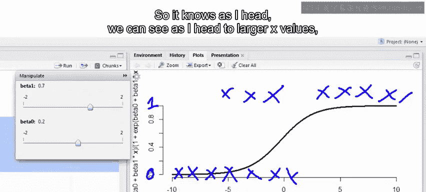

## R语言如何拟合逻辑回归曲线 🤖

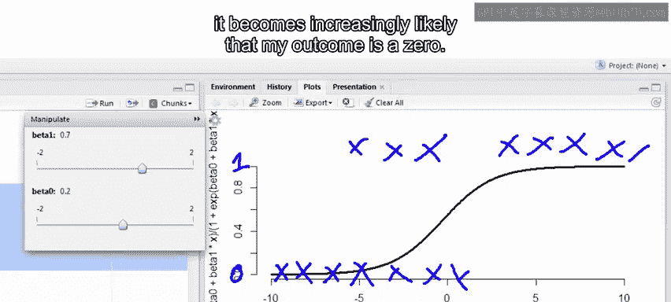

理解了曲线形态后，我们来看看R语言在幕后是如何工作的。

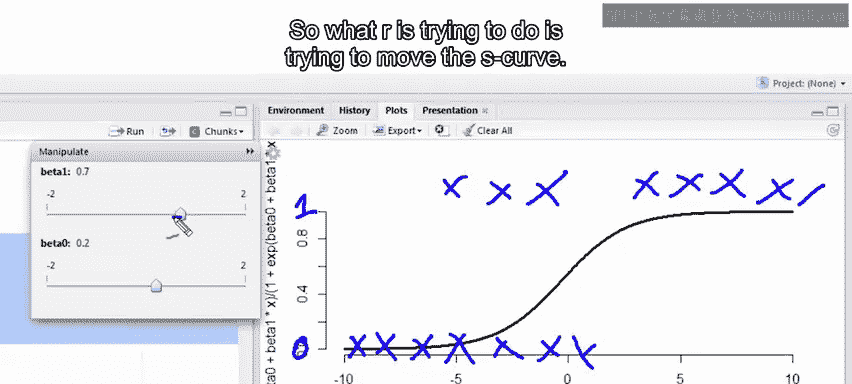

想象我们有一组数据，其中结果变量 `Y` 是二元的（0或1）。在X值较小的区域，观测到的结果大多是0；在X值较大的区域，观测到的结果大多是1。当然，中间区域会存在一些混合。

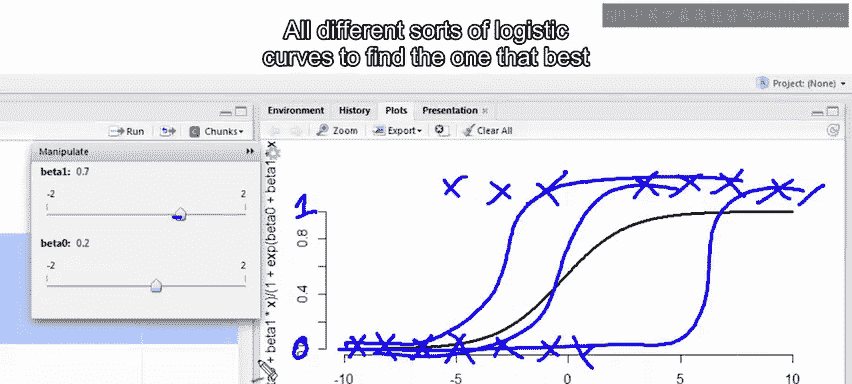

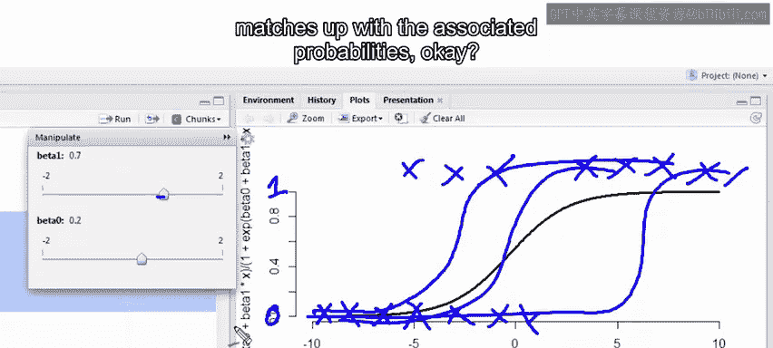

R语言拟合逻辑回归的目标是：在所有可能的S形曲线（即所有 `β₀` 和 `β₁` 的组合）中，找到一条最能匹配数据背后概率规律的曲线。

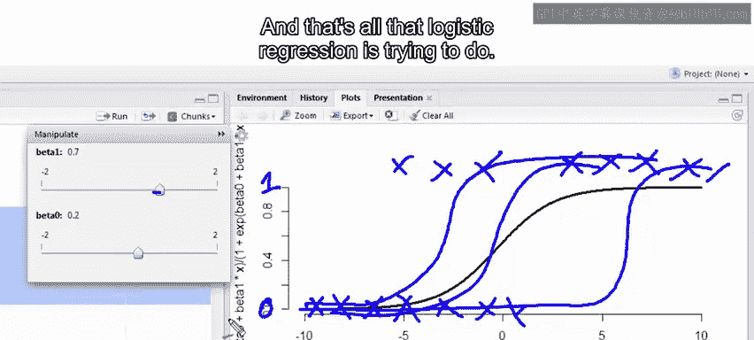

以下是R语言实现这一目标的过程：
1.  **尝试不同曲线**：系统通过调整 `β₀` 和 `β₁` 这两个“滑块”，生成无数条不同的逻辑回归曲线。
2.  **评估拟合优度**：对于每一条尝试的曲线，计算其能“解释”当前观测数据的可能性。
3.  **选择最佳曲线**：采用**最大似然估计**的原则，最终选择那个能使观测数据出现“可能性”最大的参数组合，其对应的曲线就是最佳拟合曲线。

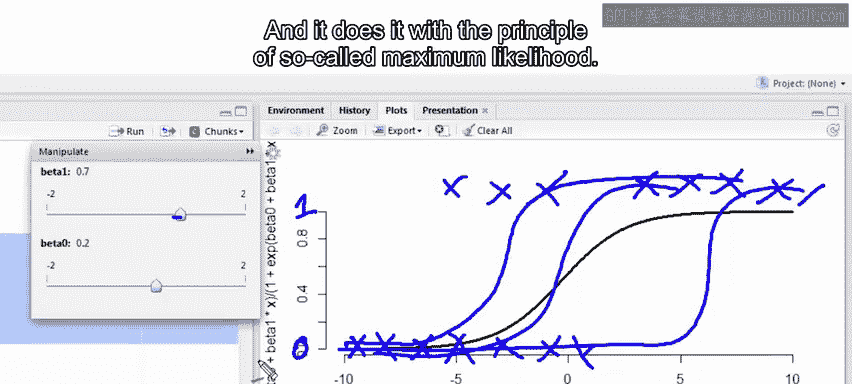

这个过程就像让这些数据点固定不动，然后我们调整曲线的形状和位置，直到找到最贴合数据点分布趋势的那条S形路径。

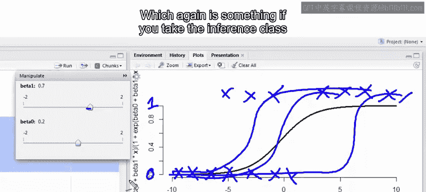

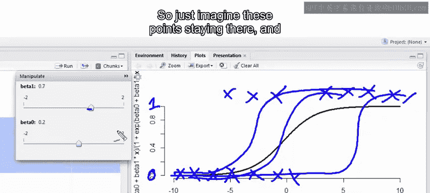

---

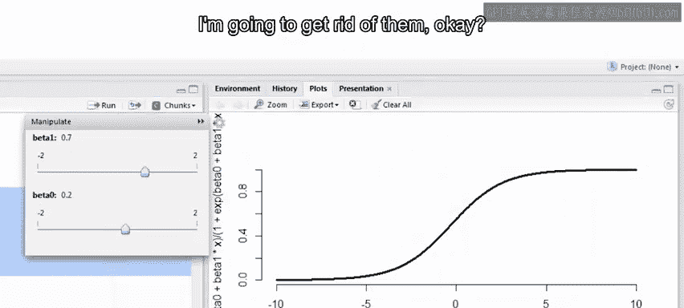

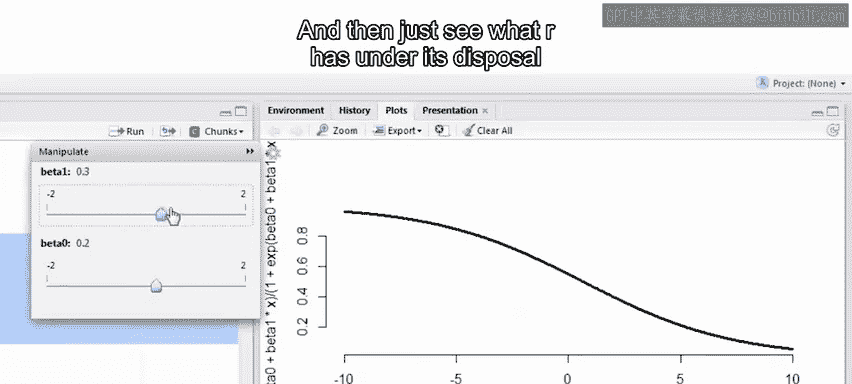

## 总结 📝

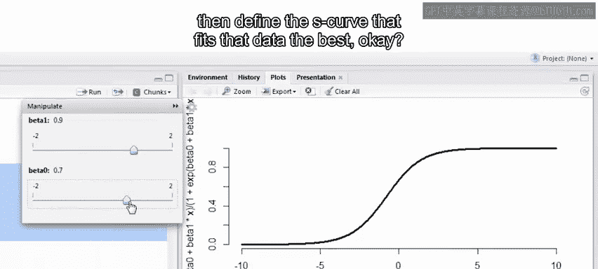

本节课中我们一起学习了逻辑回归的核心机制。

我们首先通过可视化演示，理解了模型参数 `β₀` 和 `β₁` 如何控制逻辑回归S形曲线的位置与陡峭程度。接着，我们探讨了R语言拟合逻辑回归模型的本质：它通过**最大似然估计**方法，系统地搜索所有可能的参数组合，以找到那条能最优描述二元结果与预测变量之间概率关系的曲线。

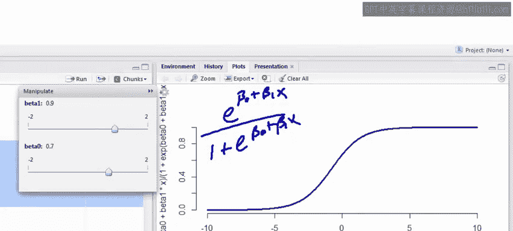

最终得到的拟合函数，即上述概率公式，就是将线性预测值 `(β₀ + β₁X)` 转换回我们更容易理解的概率尺度。