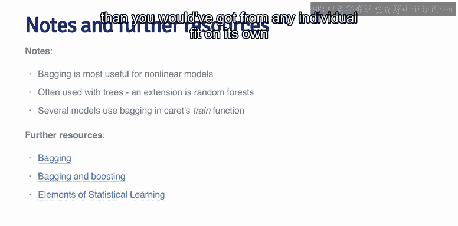

# 020：19_装袋法 (Bagging)


在本节课中，我们将要学习一种名为“装袋法”的集成学习技术。装袋法是“自助聚合”的简称，其核心思想是通过组合多个模型的预测结果，来获得一个更稳定、更准确的最终模型。


## 概述 📋


装袋法的基本思想是：当你拟合复杂的模型时，有时将这些模型的预测结果进行平均，可以得到一个更平滑的模型拟合。这有助于在模型的潜在偏差和方差之间取得更好的平衡。

上一节我们介绍了模型复杂性与过拟合的概念，本节中我们来看看如何利用装袋法来提升模型性能。


## 装袋法原理 🔄


装袋法有一个非常简单的核心理念：**对原始数据集进行有放回的重复抽样（自助采样），基于每个抽样数据集分别建立模型，最后将所有模型的预测结果进行聚合（如平均或投票）**。


这个过程类似于数据科学专项课程中推断课程里学到的自助法。


以下是装袋法的基本步骤：
1.  从原始数据集中进行有放回的随机抽样，生成多个自助样本。
2.  在每个自助样本上独立地训练同一个基学习器（例如决策树）。
3.  对于回归问题，将所有基学习器的预测结果取平均值作为最终预测；对于分类问题，则采用投票法。


**公式表示（回归问题）**：
假设我们有 \( B \) 个自助样本，基于每个样本训练的模型为 \( \hat{f}^b(x) \)，则装袋法的最终预测为：
\[
\hat{f}_{\text{bag}}(x) = \frac{1}{B} \sum_{b=1}^{B} \hat{f}^b(x)
\]


这样做的结果是，最终模型的偏差与单独拟合任何一个模型时的偏差相似，但由于我们平均了许多不同的预测器，因此**方差显著降低**。这对于非线性模型（如平滑曲线、决策树）特别有用。


## 装袋法实例演示 💻


我们将通过一个具体的例子来演示装袋法如何工作。本例使用R语言和`Ozone`数据集，目标是使用臭氧浓度预测温度。


首先，我们加载并准备数据。


```r
# 加载数据
library(ElemStatLearn)
data(ozone)
# 为了演示，按臭氧浓度排序
ozone <- ozone[order(ozone$ozone), ]
```


数据集中包含四个变量：`ozone`（臭氧浓度）、`radiation`（辐射）、`temperature`（温度）和`wind`（风速）。我们的预测任务是：以`ozone`为自变量，预测`temperature`。

接下来，我们演示装袋法的核心过程：创建多个自助样本，在每个样本上拟合平滑曲线（loess），然后聚合预测。


```r
# 初始化一个矩阵来存储来自不同自助样本的预测
ll <- matrix(NA, nrow=10, ncol=155)
# 进行10次自助采样和模型拟合
for(i in 1:10){
    # 1. 有放回地随机抽样
    ss <- sample(1:dim(ozone)[1], replace=TRUE)
    ozone0 <- ozone[ss, ]
    ozone0 <- ozone0[order(ozone0$ozone), ]
    
    # 2. 在自助样本上拟合loess平滑曲线
    loess0 <- loess(temperature ~ ozone, data=ozone0, span=0.2)
    
    # 3. 对固定的臭氧值序列进行预测，并存储结果
    ll[i, ] <- predict(loess0, newdata=data.frame(ozone=1:155))
}
```


在上面的代码中，我们循环了10次。每次循环中，我们：
1.  从原始数据中有放回地抽取一个自助样本`ozone0`。
2.  在该样本上使用`loess`函数拟合一条平滑曲线，`span`参数控制平滑度。
3.  对臭氧值1到155这个固定的序列进行预测，并将结果存储在矩阵`ll`的第`i`行。


现在，矩阵`ll`的每一行都代表基于一个自助样本的模型对整个臭氧区间的预测。装袋法的最后一步是聚合这些预测。


```r
# 计算所有预测的平均值，得到装袋法后的最终预测
bagged_pred <- apply(ll, 2, mean)
```


## 结果可视化 📊


我们可以通过绘图来直观比较装袋法的效果。


```r
# 绘制原始数据点
plot(ozone$ozone, ozone$temperature, pch=19, cex=0.5, xlab="臭氧浓度", ylab="温度")
# 绘制10个单独的自助样本拟合曲线（灰色）
for(i in 1:10){
    lines(1:155, ll[i,], col="grey", lwd=2)
}
# 绘制原始数据拟合的单一loess曲线（红色虚线）
lines(1:155, predict(loess(temperature ~ ozone, data=ozone, span=0.2), newdata=data.frame(ozone=1:155)), col="red", lwd=2, lty=2)
# 绘制装袋法后的平均曲线（红色实线）
lines(1:155, bagged_pred, col="red", lwd=2)
```


在生成的图中：
*   每个黑点代表一个观测值。
*   每条灰线代表基于一个自助样本的`loess`拟合。它们非常曲折，捕捉了数据中的大量波动，但也可能有些过拟合。
*   红色虚线是在**整个原始数据集**上拟合的单一`loess`曲线。
*   **红色实线是装袋法的结果**，即所有灰色曲线的平均值。你可以看到它比任何一条灰线都更平滑，更接近数据的中心趋势，在不过度拟合噪声的情况下更好地捕捉了整体趋势。

这证明了装袋法可以降低模型方差，获得更稳健的拟合。


## 使用`caret`包实现装袋法 🛠️


在实际应用中，我们可以使用R的`caret`包来方便地实现装袋法。`caret`包提供了一些内置的装袋模型。


以下是`caret`中可用的部分装袋模型方法：
*   `bagEarth`：装袋多元自适应回归样条。
*   `treebag`：装袋决策树。
*   `bagFDA`：装袋柔性判别分析。


你可以直接在`train`函数中设置`method`参数为上述方法之一。


此外，`caret`包也允许你为任何自定义的算法创建装袋函数，这需要更高级的用法。基本思路是定义三个函数：`fit`（训练模型）、`pred`（进行预测）和`aggregate`（聚合预测）。


以下是一个为条件回归树创建自定义装袋函数的框架示例：


```r
library(caret)
# 准备预测变量和结果变量
predictors <- data.frame(ozone=ozone$ozone)
temperature <- ozone$temperature
# 使用bag函数进行装袋
treebag <- bag(predictors, temperature, B = 10,
                bagControl = bagControl(fit = ctreeBag$fit,
                                        predict = ctreeBag$pred,
                                        aggregate = ctreeBag$aggregate))
```
在这个例子中：
*   `fit` 函数指定了如何在每个自助样本上训练模型（这里使用`ctree`条件推断树）。
*   `predict` 函数指定了如何用训练好的模型进行预测。
*   `aggregate` 函数指定了如何聚合多个模型的预测结果（例如取中位数）。


## 总结与拓展 🚀


本节课中我们一起学习了装袋法。


**核心要点总结**：
1.  **目的**：装袋法通过构建多个模型并聚合其预测，来减少模型的方差，提高稳定性和泛化能力，尤其适用于高方差、低偏差的模型（如决策树）。
2.  **过程**：自助采样 -> 独立训练 -> 聚合预测（平均/投票）。
3.  **效果**：保持偏差大致不变，显著降低方差。
4.  **应用**：在`caret`包中可直接调用多种装袋模型，也支持自定义装袋函数。


装袋法是非线性模型中非常有用的工具，尤其常与决策树结合使用。它的一个著名扩展是**随机森林**，我们将在后续课程中讨论。随机森林在装袋的基础上，进一步在训练每棵树时对特征进行随机抽样，从而获得更好的效果和更强的抗过拟合能力。




许多集成学习方法都源于装袋法的思想。要深入了解其理论细节，可以参考《统计学习基础》等资料。记住，装袋法的基本思想就是：**重采样数据，重新拟合模型，然后跨样本平均模型拟合结果，从而获得比任何单个拟合更平滑、更稳健的模型**。