# 027：无监督预测

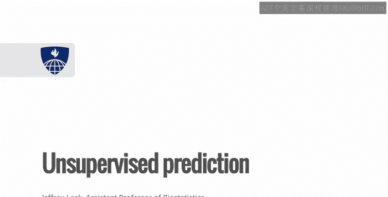

在本节课中，我们将要学习**无监督预测**的概念。这是一种在数据没有预先标注类别标签时，先通过聚类发现数据内在结构，再基于此结构构建预测模型的方法。

---

## 概述

在本课程之前讨论的例子中，我们通常知道数据的标签是什么。换句话说，我们进行的是**有监督分类**，旨在预测已知的类别结果。

然而，有时我们并不知道用于预测的标签。因此，我们必须先发现这些标签。一种方法是：从观测数据中创建聚类，为这些聚类命名，然后基于这些聚类构建一个预测器。当面对新数据时，我们预测其所属的聚类，并应用之前为聚类设定的名称。

这种方法为预测问题增加了几个难度层级。首先，创建聚类的过程并非完美无噪声。其次，为聚类找到合适的名称，即很好地解释聚类，是一个极具挑战性的问题。如果你学习过数据科学专项课程中的探索性数据分析，就会理解其中的原因。

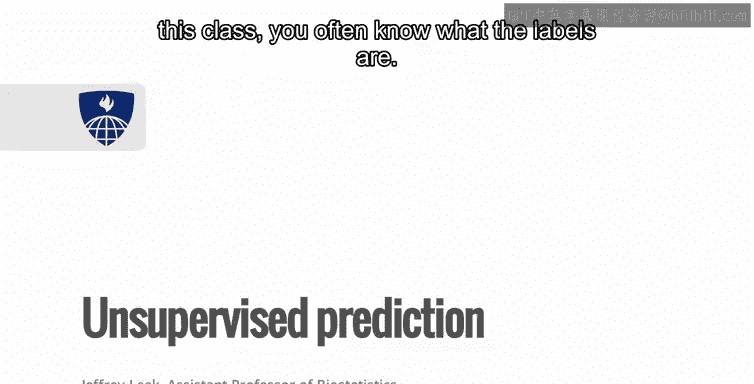

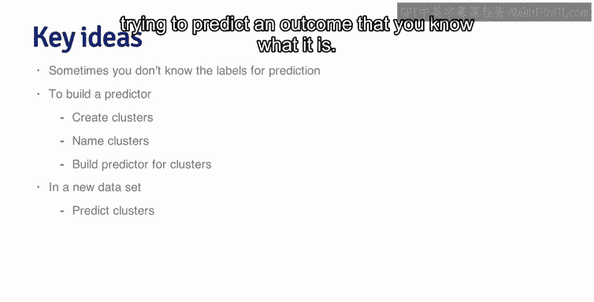

---

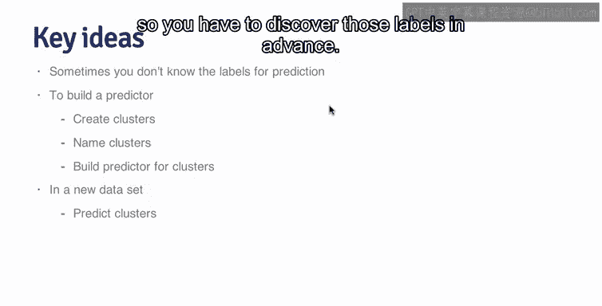

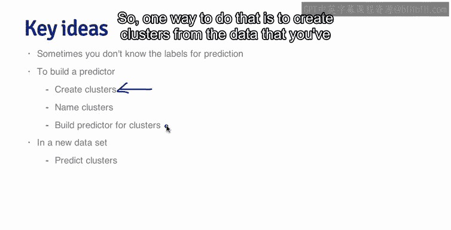

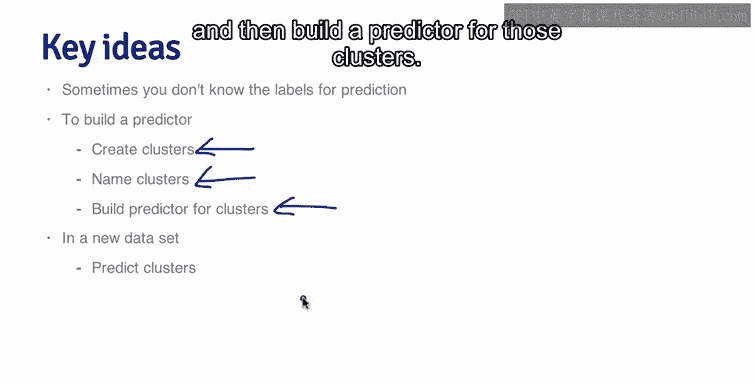

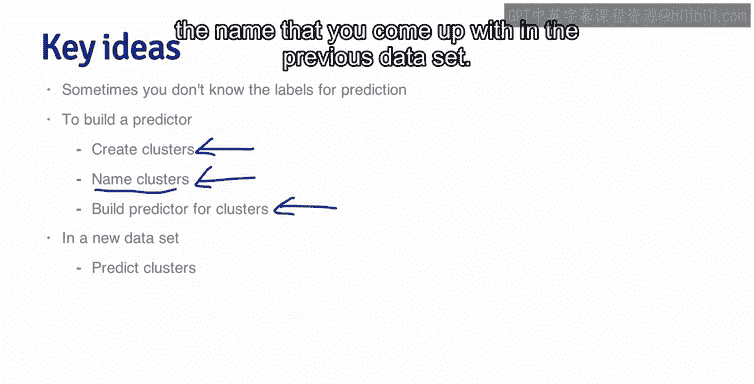

## 无监督预测的基本步骤

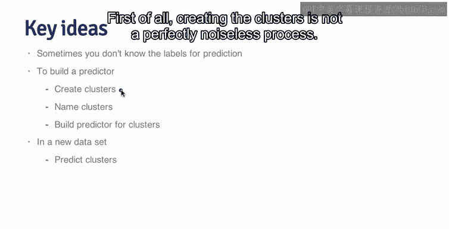

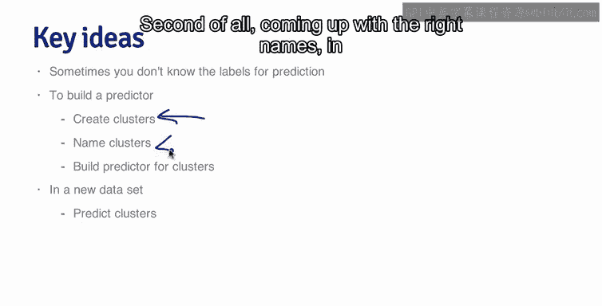

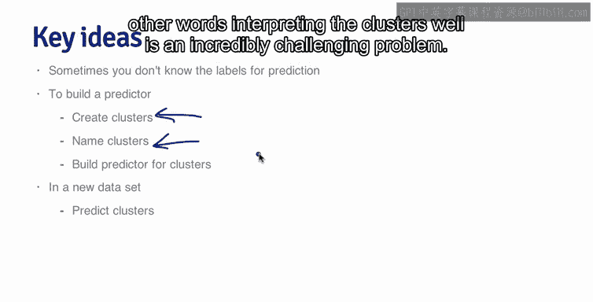

上一节我们介绍了无监督预测的核心思想，本节中我们来看看其具体实施步骤。

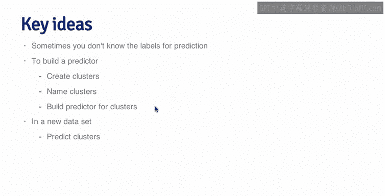

以下是实施无监督预测的关键步骤：

1.  **聚类分析**：使用聚类算法（如K均值）在忽略真实标签的情况下，从数据中发现内在的群组结构。
2.  **聚类解释与命名**：分析每个聚类的特征，并为其赋予有意义的名称或标签。这一步通常需要领域知识，且容易产生过度解读。
3.  **构建预测模型**：将上一步得到的聚类标签作为新的“目标变量”，使用我们学过的有监督学习算法（如分类树）构建预测模型。
4.  **在新数据上进行预测**：将训练好的模型应用于新的、无标签的数据，预测其所属的聚类，并应用相应的名称。

---

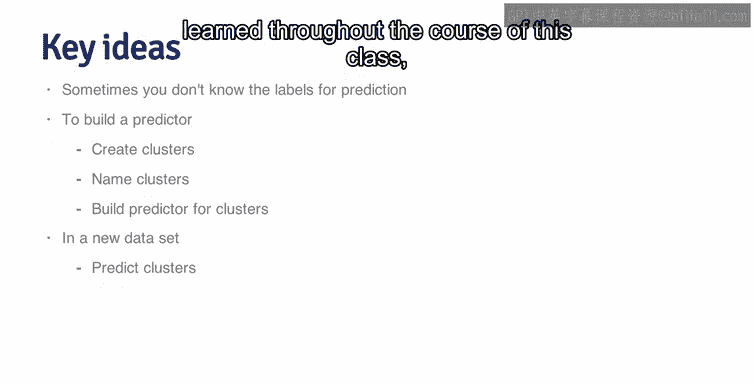

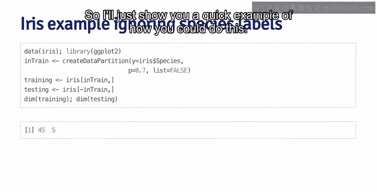

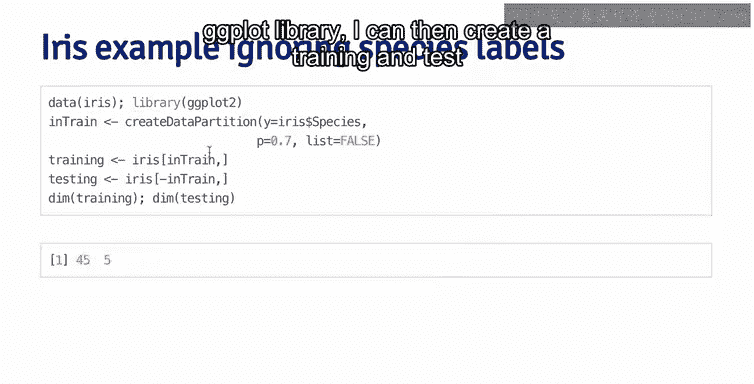

## 实战示例：鸢尾花数据集

让我们通过一个具体的代码示例来演示这个过程。我们将使用鸢尾花（Iris）数据集，但会故意忽略其已知的物种标签。

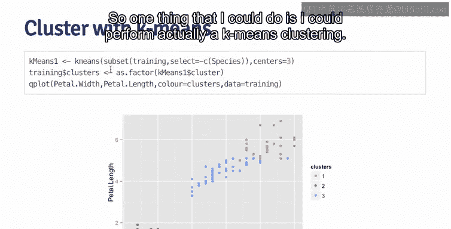

首先，我们加载必要的库并准备数据，忽略物种信息。

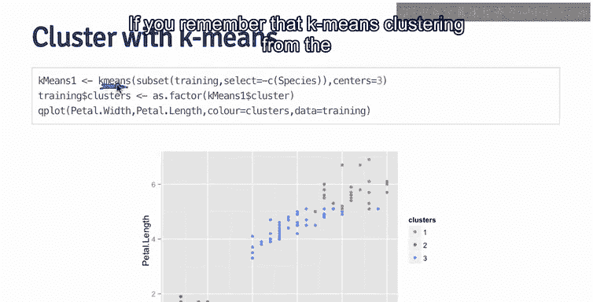

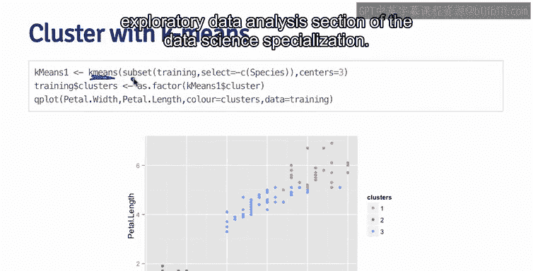

```r
library(caret)
data(iris)
# 创建训练集和测试集，但忽略物种标签
set.seed(123)
inTrain <- createDataPartition(y=iris$Species, p=0.7, list=FALSE)
training <- iris[inTrain, ]
testing <- iris[-inTrain, ]
# 移除物种列，仅使用特征进行聚类
trainingPredictors <- training[, -5]
```

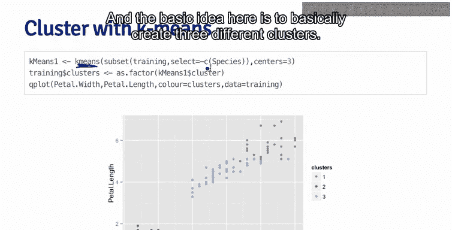

### 第一步：执行K均值聚类

我们使用K均值算法将数据分为3个簇。

```r
# 执行K均值聚类，设定簇数K=3
kmeansResult <- kmeans(trainingPredictors, centers=3)
# 将聚类结果作为新标签添加到训练集中
training$Cluster <- as.factor(kmeansResult$cluster)
```

### 第二步：可视化与解释聚类

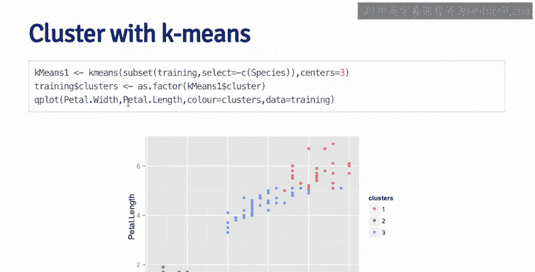

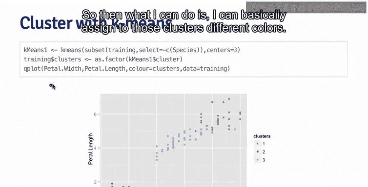

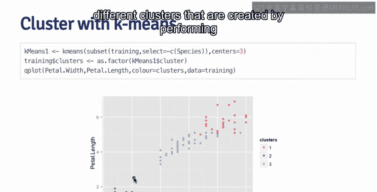

我们可以将聚类结果可视化，并尝试理解每个簇的含义。在理想情况下，这些簇可能接近真实的物种分类，但通常解释起来很困难。

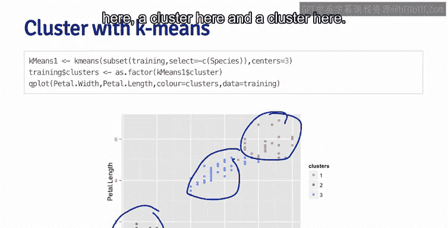

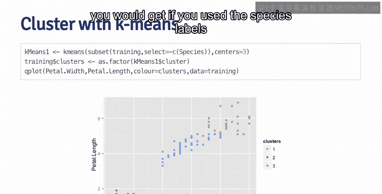

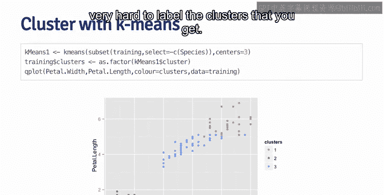

```r
# 使用前两个特征进行可视化，颜色代表聚类结果
plot(training$Petal.Length, training$Petal.Width, col=training$Cluster,
     xlab="Petal Length", ylab="Petal Width", main="K-means Clustering Results")
```

为了评估聚类效果（仅在本例中可行，因为我们知道真实标签），我们可以比较聚类结果与真实物种的对应关系。

```r
# 创建聚类与真实物种的交叉表
table(Predicted_Cluster = training$Cluster, Actual_Species = training$Species)
```

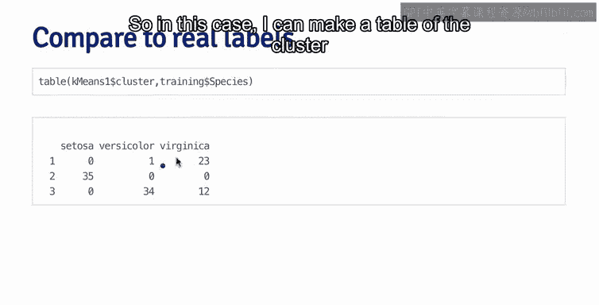

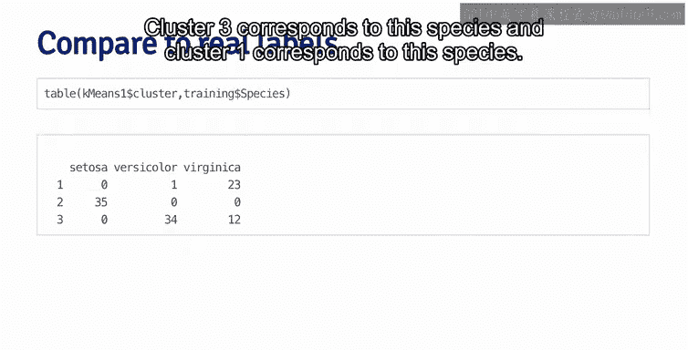

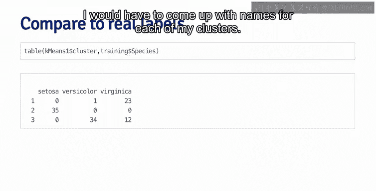

输出可能显示：Cluster 2 主要对应 setosa 物种，Cluster 3 对应 versicolor，Cluster 1 对应 virginica。但在真正的无监督场景中，我们不知道这些物种名称，必须自己为簇命名。

### 第三步：构建预测模型

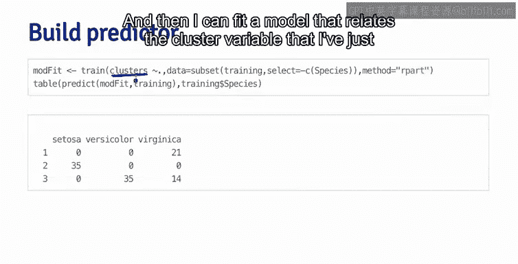

现在，我们将`Cluster`变量作为目标，使用有监督学习算法构建一个预测模型。

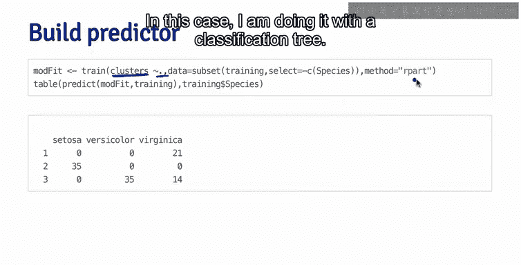

```r
# 使用分类树模型，基于所有预测变量来预测我们创建的Cluster标签
modFit <- train(Cluster ~ ., data=training[, -5], method="rpart")
# 在训练集上进行预测
trainPred <- predict(modFit, training)
# 查看训练集上的预测准确性
confusionMatrix(trainPred, training$Cluster)
```

模型在训练集上可能表现尚可，但簇1和簇3有时会被混淆。这是因为我们的预测模型构建过程和聚类构建过程都引入了误差和变异，使得无监督预测成为一个相当具有挑战性的问题。

### 第四步：在测试集上应用模型

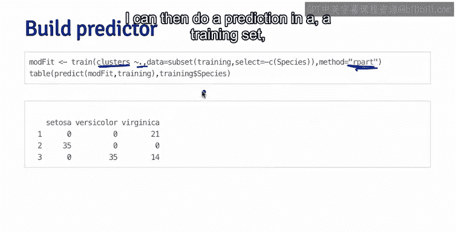

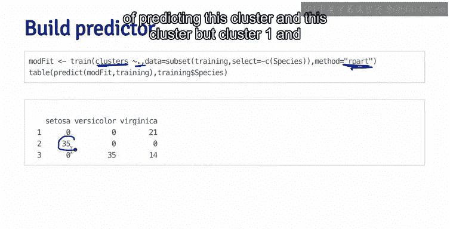

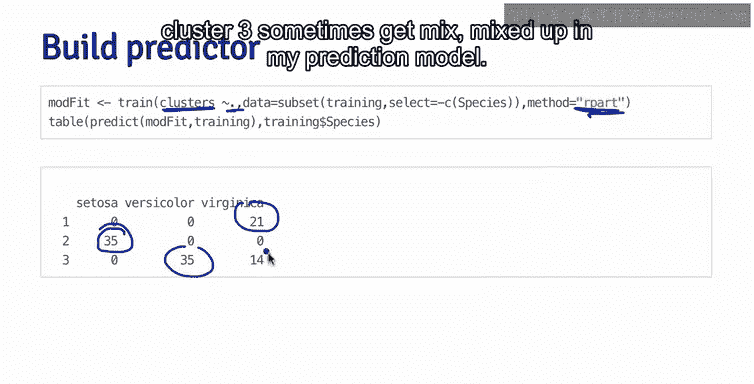

最后，我们将模型应用于测试集。在一般情况下，我们不知道测试集的真实标签。

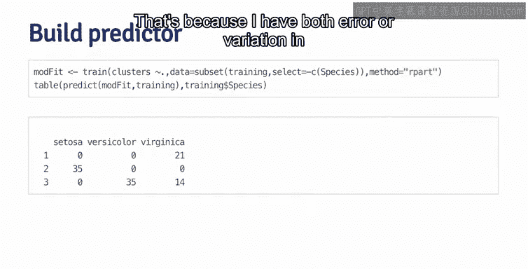

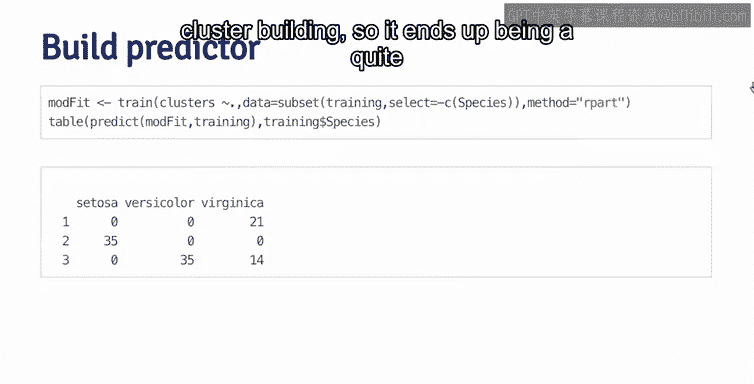

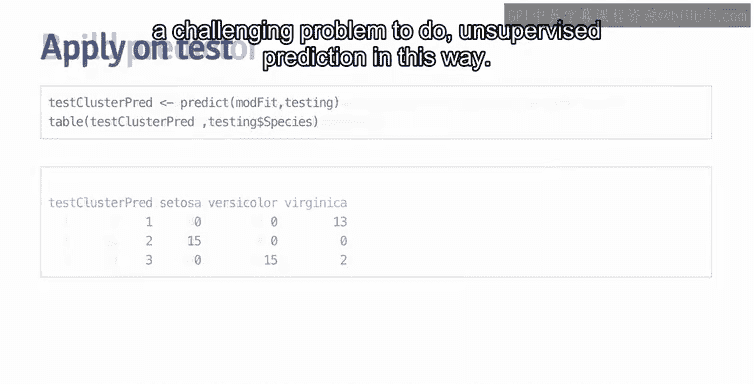

```r
# 在测试集上进行预测
testPred <- predict(modFit, testing)
# 为了评估，我们查看预测的聚类与测试集真实物种的对比（这在实际无监督场景中不可用）
table(Predicted_Cluster = testPred, Actual_Species = testing$Species)
```

尽管存在挑战，但这个简单的流程在区分不同物种到不同的聚类标签方面，可能做得相当不错。

---

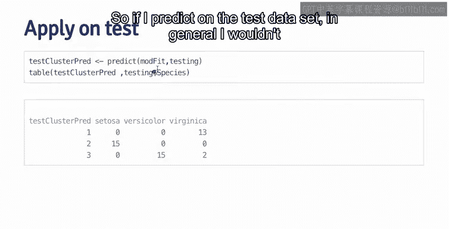

## 挑战与注意事项

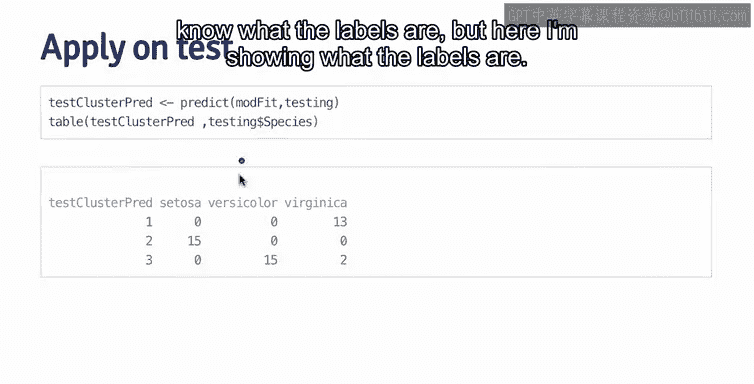

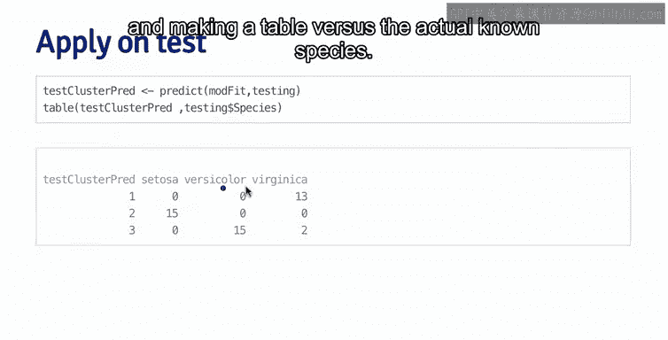

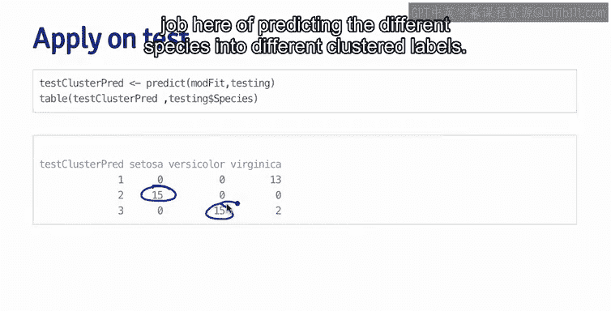

上一节我们走通了无监督预测的流程，本节中我们来总结其挑战和需要注意的关键点。

总的来说，无监督预测是一个相当困难的问题。在标记聚类、执行无监督分析和理解其工作原理时必须格外小心。

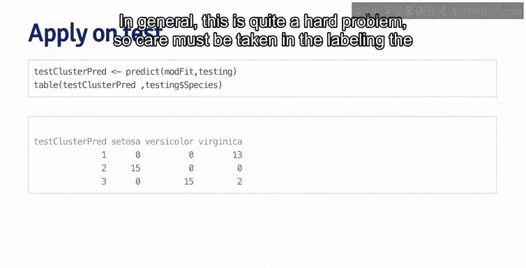

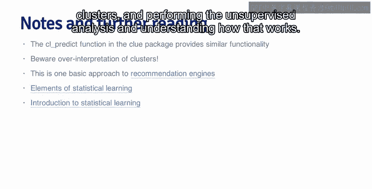

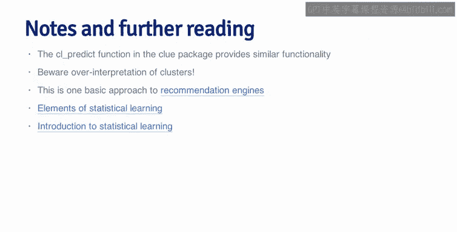

*   **聚类的稳定性**：聚类本质上是一种探索性技术。聚类结果可能因数据采样方式或算法初始化的不同而改变。
*   **解释的陷阱**：必须非常警惕对这类聚类的过度解读。为聚类赋予有意义的名称需要深厚的领域知识，且容易出错。
*   **误差累积**：无监督预测的误差来自两个方面：聚类构建的误差和预测模型构建的误差，两者会叠加。

`clue`包中的`cl_predict`函数提供了与我刚才描述的功能类似的功能。但通常，如果你在进行无监督预测，构建自己的方法更有意义，因为你确实需要仔细思考如何定义聚类。

这种方法实际上是构建像**推荐引擎**这类应用的基础方法之一：识别具有相似喜好的用户群组，并将这些喜好分配给新用户。

你可以通过阅读《统计学习基础》和《统计学习导论》来了解更多关于无监督预测的知识。

---

## 总结

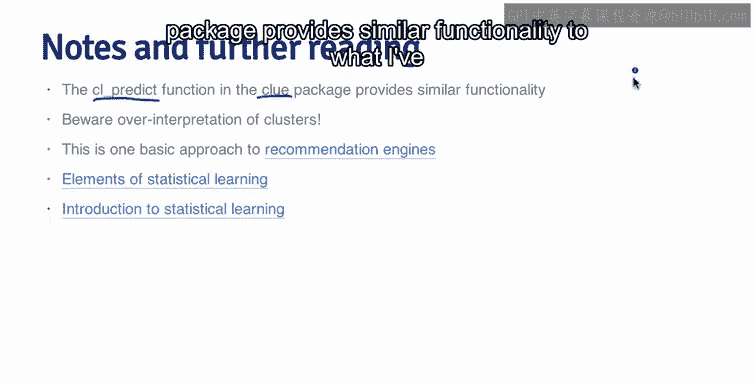

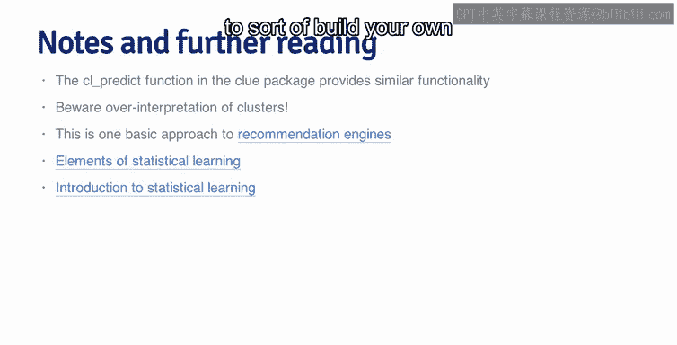

本节课中，我们一起学习了**无监督预测**。

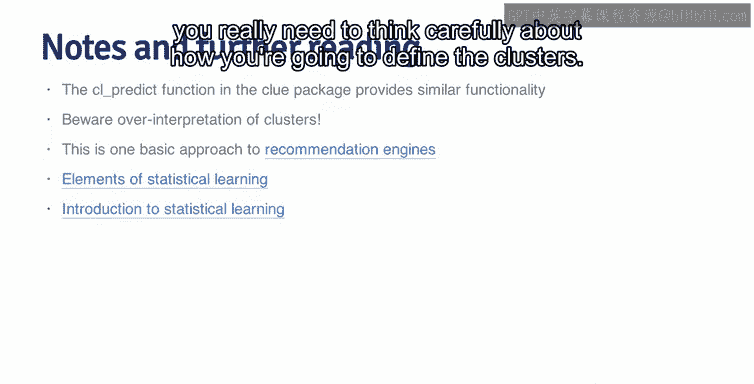

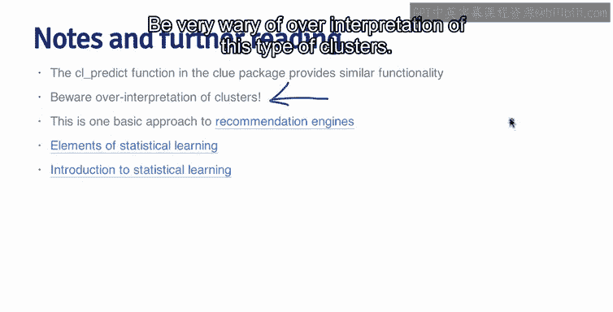

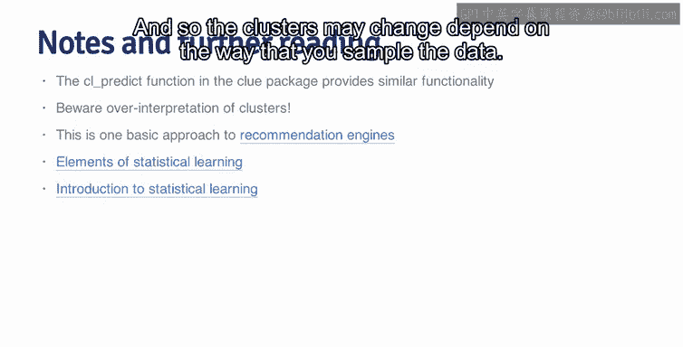

我们了解到，当数据没有标签时，可以先通过聚类分析发现数据的自然分组，然后将这些分组作为伪标签，使用有监督学习算法构建预测模型。我们通过鸢尾花数据集的示例演示了完整的流程：K均值聚类、结果解释、构建分类树模型以及在测试集上进行预测。

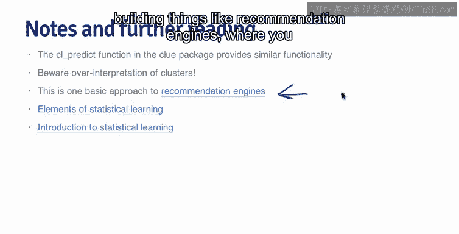

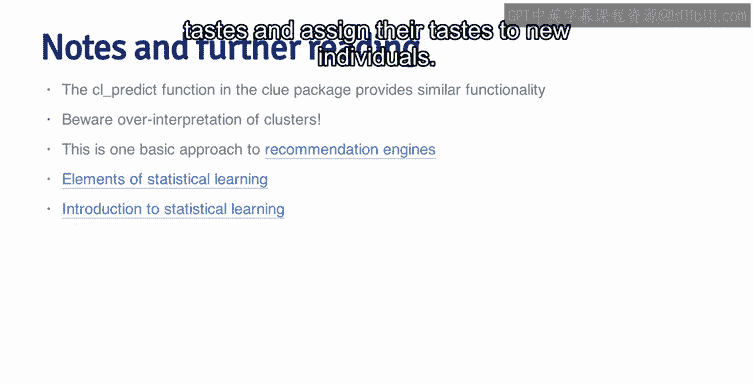

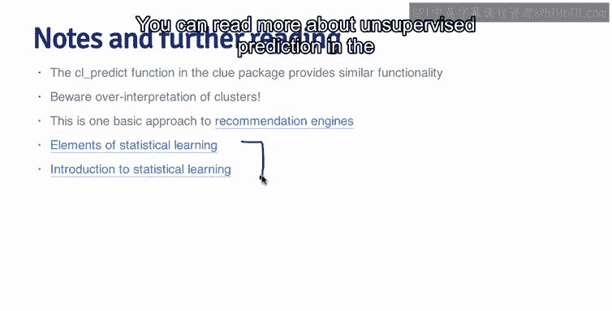

同时，我们也重点讨论了这种方法的**核心挑战**，包括聚类的噪声、解释的难度以及误差的累积。无监督预测是一个强大的工具，尤其在探索性分析和推荐系统等领域，但应用时需要保持谨慎并充分理解其局限性。