# 课程8：实际机器学习 🧠 - P10：caret软件包入门指南

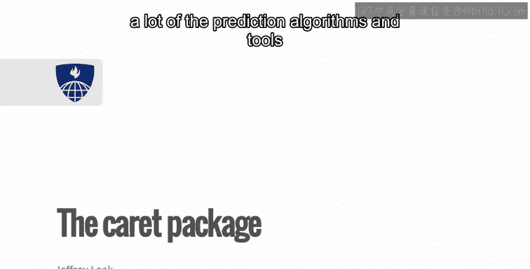

在本节课中，我们将学习R语言中一个非常实用的前端软件包——**caret**。该软件包封装了众多预测算法和工具，为机器学习流程提供了一个统一、便捷的框架。

---

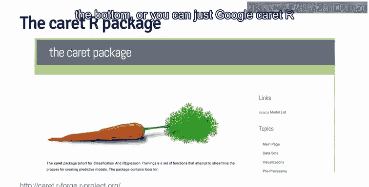

## 概述 📋

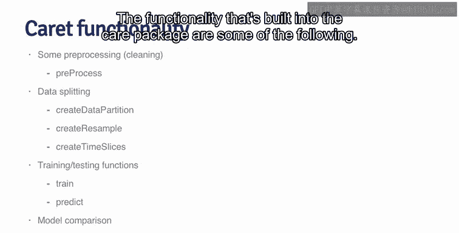

caret软件包的核心目标是简化R中各种机器学习算法的应用过程。它提供了一个统一的接口，使得数据预处理、模型训练、验证和评估等步骤更加标准化和易于操作。

您可以通过访问其官方网站或直接搜索“caret R package”来找到并获取这个软件包。

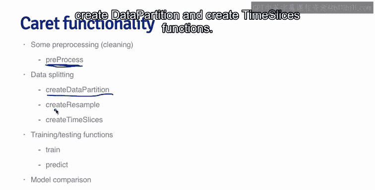

---


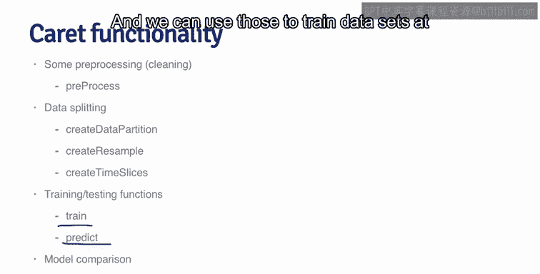

## caret软件包的主要功能 ⚙️

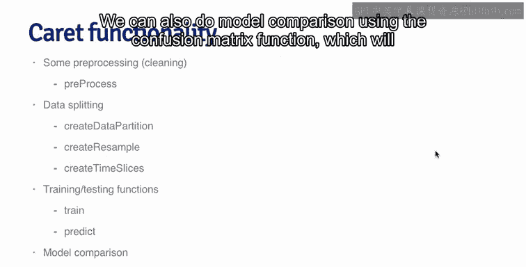

caret软件包内置了多种功能，旨在支持完整的机器学习工作流。

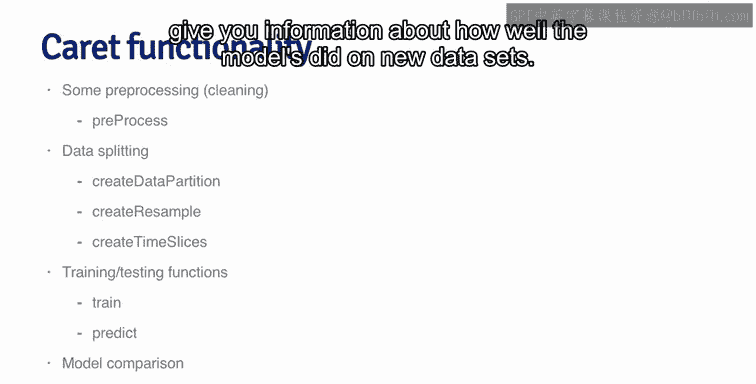

以下是其主要功能列表：

*   **数据预处理**：可以使用caret中的预处理工具来清理数据并设置特征，以便它们能用于预测建模。
*   **数据分割与交叉验证**：通过`createDataPartition`和`createTimeSlices`等函数，可以在训练集内进行数据分割和交叉验证。
*   **模型训练与预测**：使用`train`和`predict`函数可以创建训练集和测试集，训练预测模型，并将其应用于新数据集。
*   **模型比较**：使用`confusionMatrix`函数可以获得模型在新数据集上表现的信息，便于模型比较。

---

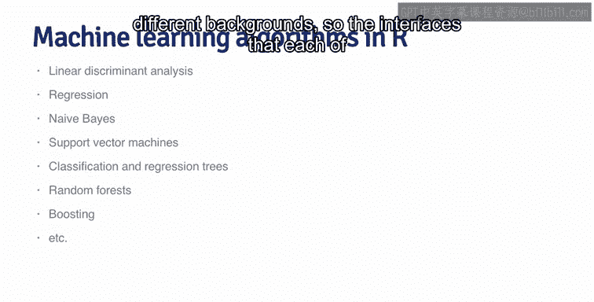

## 为什么需要caret？ 🤔

上一节我们介绍了caret的功能，本节中我们来看看它要解决的核心问题。

R语言内置了大量机器学习算法，从经典的统计学习方法（如线性判别分析、回归）到计算机科学中广泛使用的算法（如支持向量机、分类与回归树、随机森林和提升方法）。这些算法由不同背景的开发者构建，因此每个预测算法的接口都略有不同。

考虑以下不同的预测算法类别，从线性判别分析到提升方法。对于每一种算法，在R中创建的对象（例如名为`obj`）都可能属于不同的类（如`lda`、`glm`）。当我们尝试使用`predict`函数进行预测时，每次都需要传递略有不同的参数才能获得结果预测。

例如，对于GLM包，我们需要指定`type = “response”`来获取该模型拟合的响应预测；而对于rpart包，则需要使用`type = “prob”`来预测响应。每种情况都有些许差异。

caret软件包提供了一个统一的框架，允许您仅使用一个函数进行预测，而无需指定所有可能需要的选项，从而获得一致的预测输出。

---

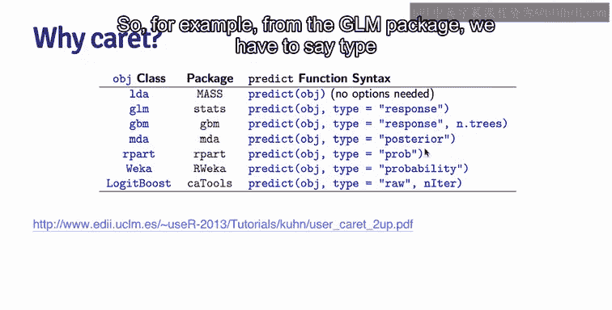

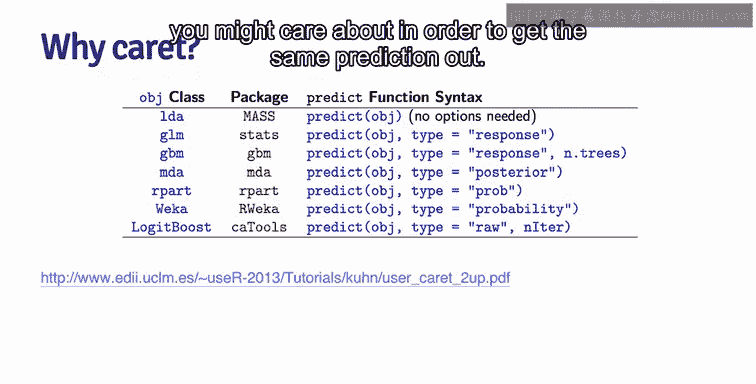

## 一个快速示例 🚀

前面我们了解了caret的必要性，现在通过一个具体示例来演示其基本用法。后续课程会深入细节。

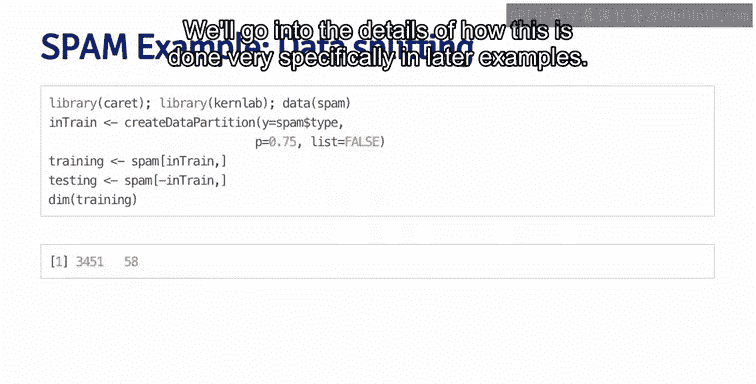

首先，我们加载caret软件包以及`kernlab`包以获取垃圾邮件数据集。

```r
library(caret)
library(kernlab)
data(spam)
```

### 1. 分割数据

首先，将数据集划分为训练集和测试集。我们将使用`createDataPartition`函数，并计划用大约75%的数据训练模型，25%的数据进行测试。

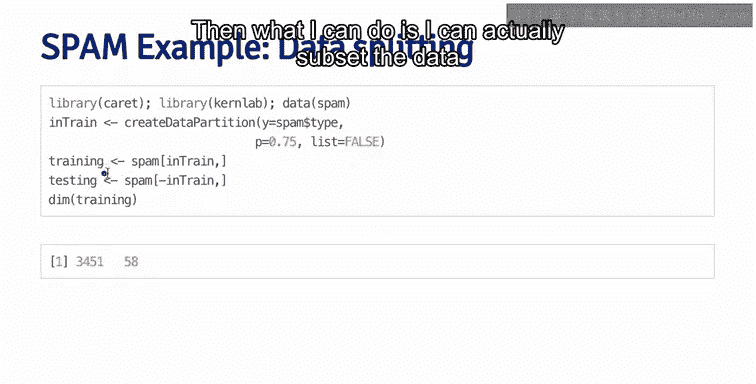

```r
inTrain <- createDataPartition(y=spam$type, p=0.75, list=FALSE)
```

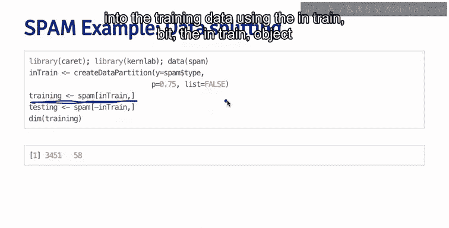

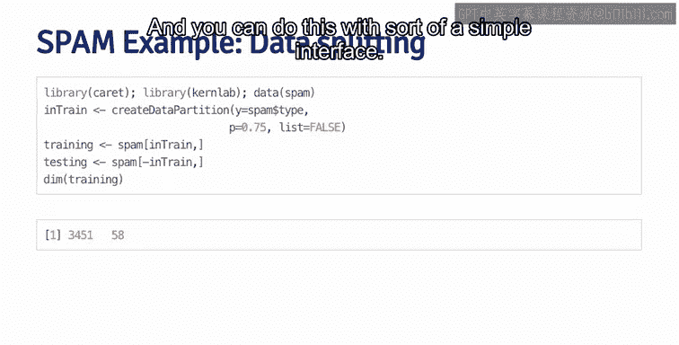

然后，利用`inTrain`对象将数据子集化为训练数据和测试数据。

```r
training <- spam[inTrain, ]
testing <- spam[-inTrain, ]
```

这样，我们就得到了专门用于训练和测试的数据子集，整个过程通过简单的接口完成。

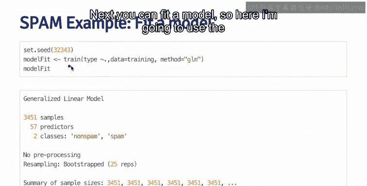

### 2. 训练模型

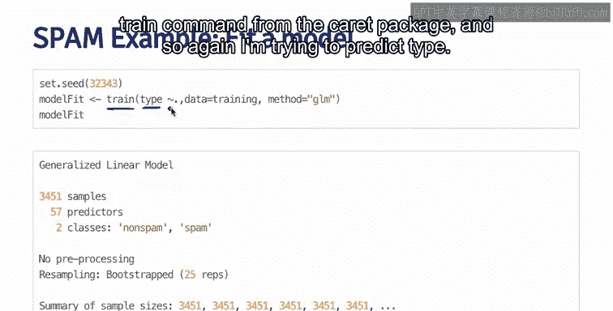

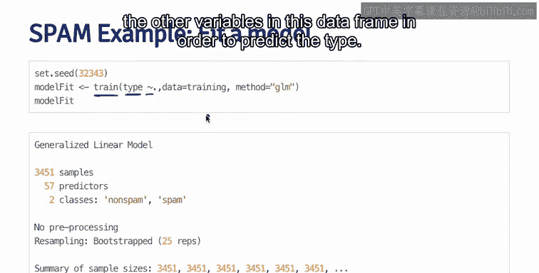

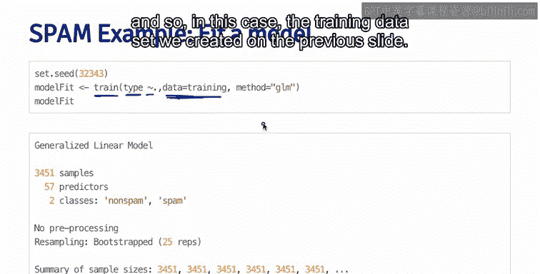

接下来，使用caret包中的`train`命令来拟合一个模型。这里我们尝试预测`type`变量，使用公式`type ~ .`表示使用数据框中的所有其他变量来预测`type`。我们指定在之前创建的`training`数据集上构建模型，并选择要使用的方法，例如`glm`。

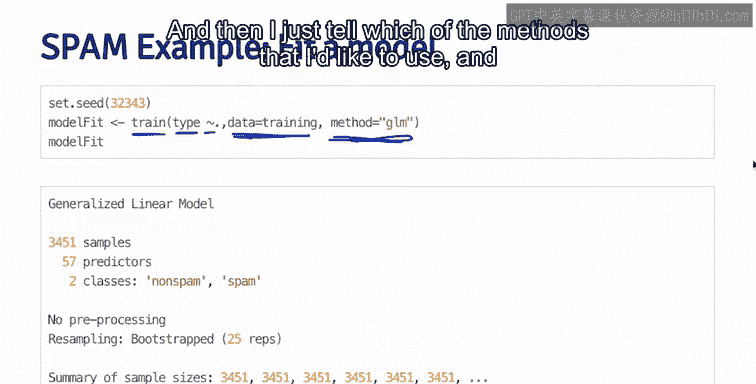

```r
modelFit <- train(type ~ ., data=training, method=“glm”)
```

`train`函数会创建一个模型拟合对象。在本例中，它使用训练集中的3451个样本和57个预测变量，基于GLM模型来预测所属类别。该函数会通过多种方式测试模型效果并选择最佳模型，例如使用重采样和25次重复的拔靴法，并校正拔靴抽样可能带来的偏差。

### 3. 检查模型与预测

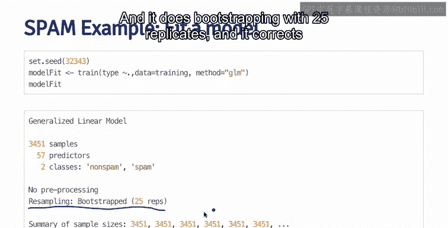


拟合模型后，我们可以查看模型细节。方法是查看模型拟合对象的`finalModel`组件。

```r
modelFit$finalModel
```

这将显示该GLM模型的实际拟合值。

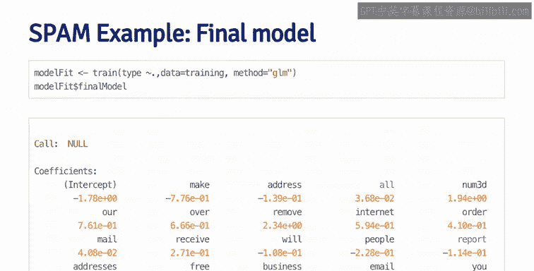

然后，可以使用`predict`命令对新样本进行预测。得益于统一框架，我们只需键入`predict`，传入从caret的`train`函数获得的模型拟合对象以及想要预测的数据（本例中是测试数据`testing`）。

```r
predictions <- predict(modelFit, newdata=testing)
```

执行后将得到一组对应于响应变量的预测值，可用于评估模型拟合效果。

### 4. 模型评估

一种评估方法是计算混淆矩阵，使用`confusionMatrix`函数（注意首字母大写M）。

```r
confusionMatrix(predictions, testing$type)
```

需要传入从模型拟合得到的预测值以及测试样本的实际结果（本例中是`type`，即邮件是否为垃圾邮件）。该函数将报告混淆矩阵，显示预测为非垃圾邮件且实际也是非垃圾邮件的案例、预测为垃圾邮件且实际也是垃圾邮件的案例等。

同时，它还会提供一系列汇总统计信息，例如：
*   **准确率**及其95%置信区间。
*   其他类别的对应情况信息，如**灵敏度**和**特异度**。

`confusionMatrix`函数封装了评估模型拟合时可能需要的多种准确性度量指标。

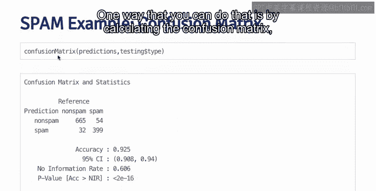

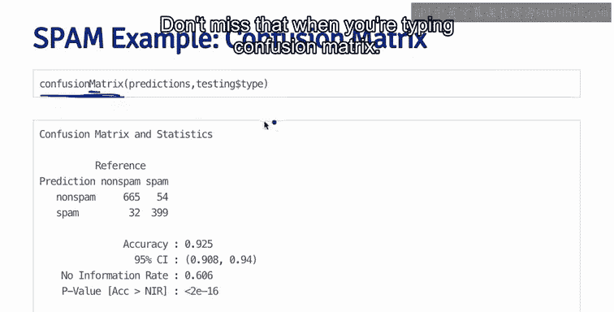

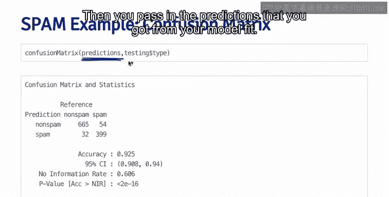

---

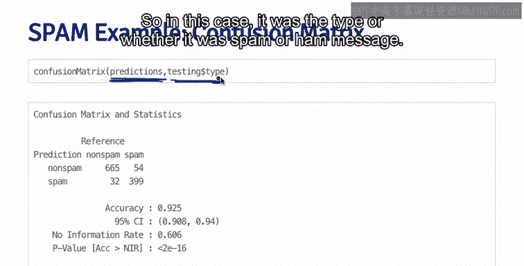

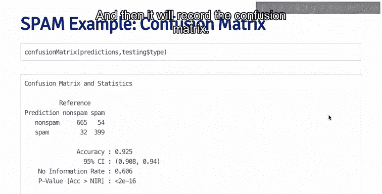

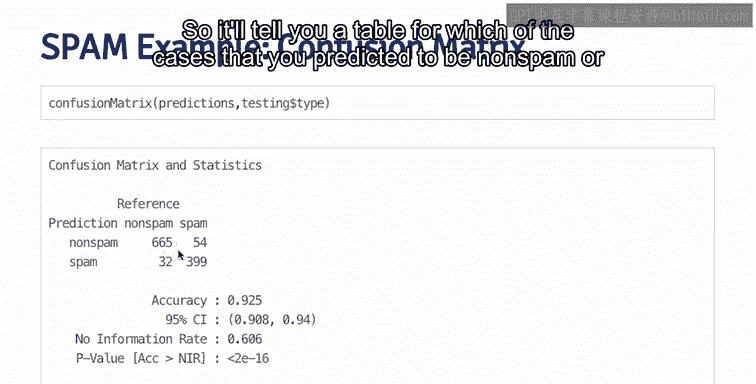

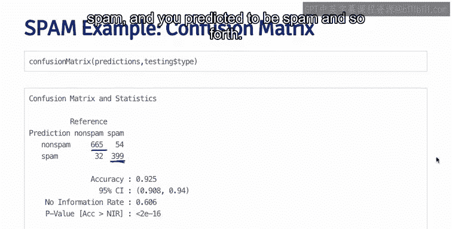

## 延伸学习 📚

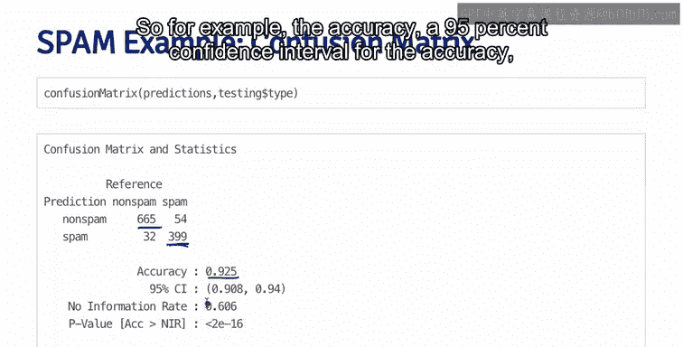

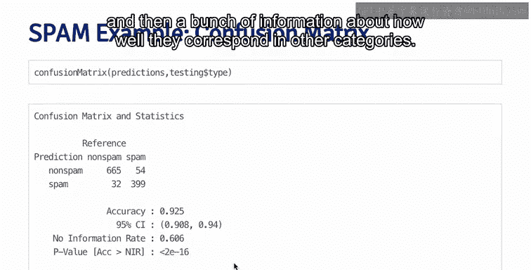

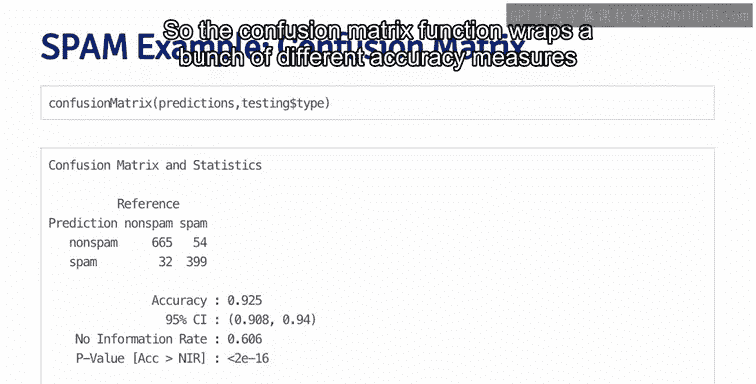

本节课我们一起学习了caret软件包的基本应用。本课程将涵盖大量关于如何实际应用caret包的内容。

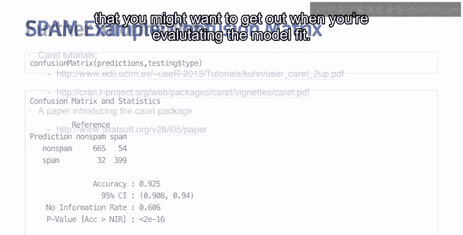

此外，以下资源也非常有用：
*   caret官方教程非常详尽，可以覆盖本课程未涉及的内容。
*   《Journal of Statistical Software》上有一篇介绍caret包的优秀论文，如需进一步信息可供参考。

---

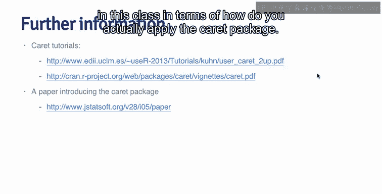

## 总结 ✨

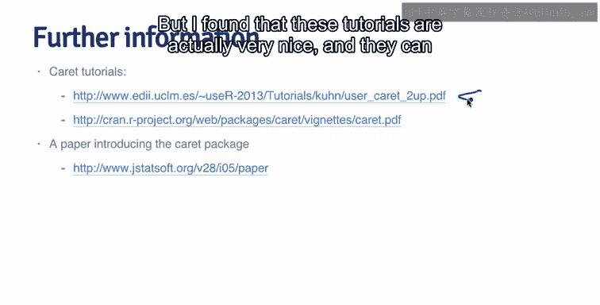

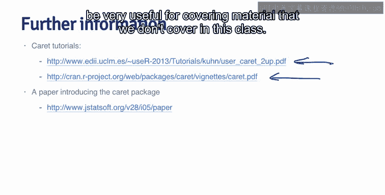

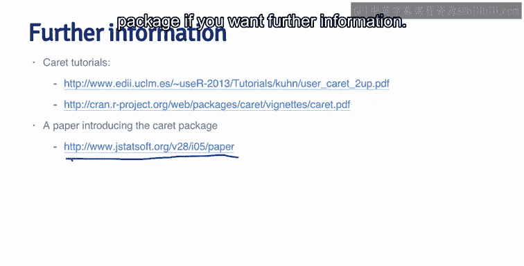

本节课中，我们一起学习了R语言中强大的**caret软件包**。我们了解到它通过提供统一接口，简化了多种机器学习算法的应用流程。从数据预处理、分割，到模型训练、预测，再到使用混淆矩阵进行评估，caret使整个机器学习项目更加高效和标准化。掌握caret是运用R进行实际机器学习建模的重要一步。