# 课程一：预测的动机 🎯

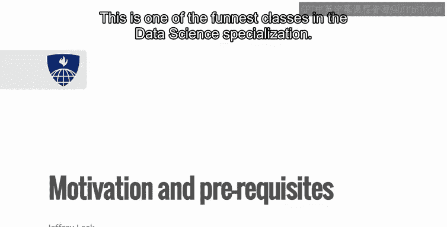

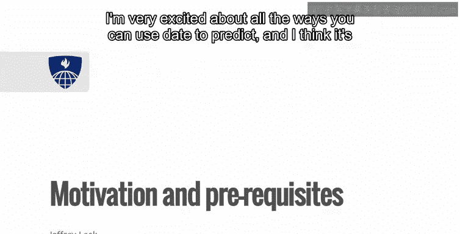

在本节课中，我们将要学习《实际机器学习》这门课程的整体介绍与动机。我们将探讨预测在数据科学中的重要性、课程的核心内容、所需预备知识，以及预测在现实世界中的广泛应用。

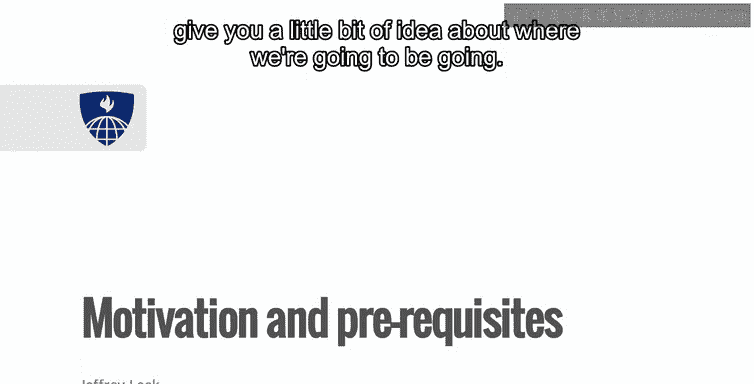

---

欢迎来到《实际机器学习》课程。这是数据科学专项课程中最有趣的课程之一。数据在预测方面的多种应用方式令人兴奋。预测可能是数据科学领域中最广为人知的方向之一。

本讲将涵盖本课程的动机与先决条件，并让你对课程的整体方向有一个初步了解。

---

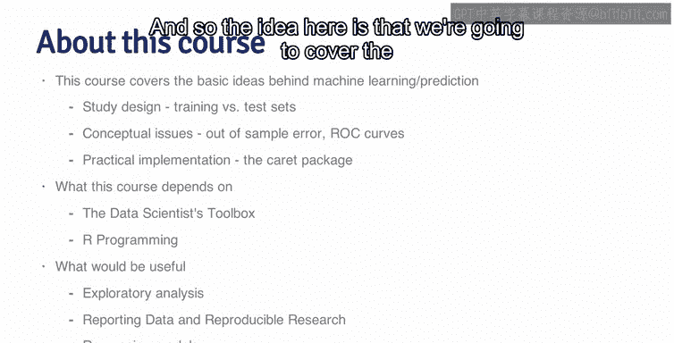

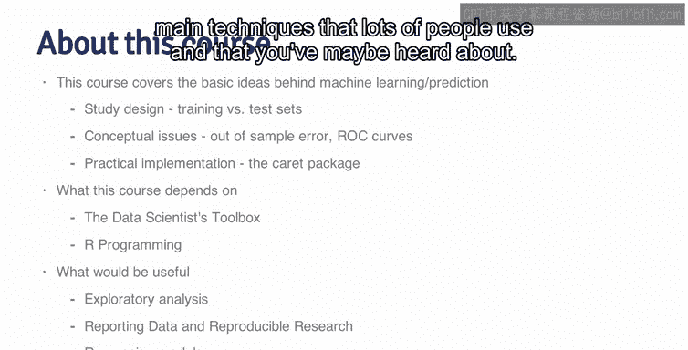

## 课程内容概览 📚

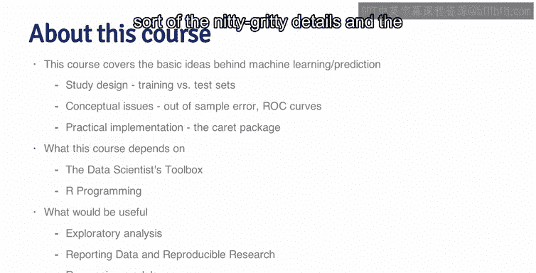

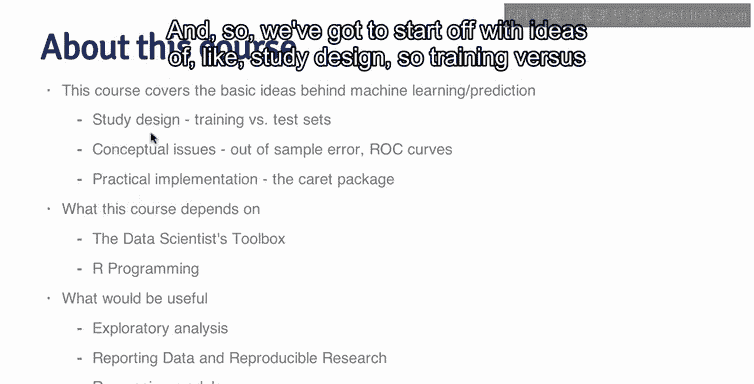

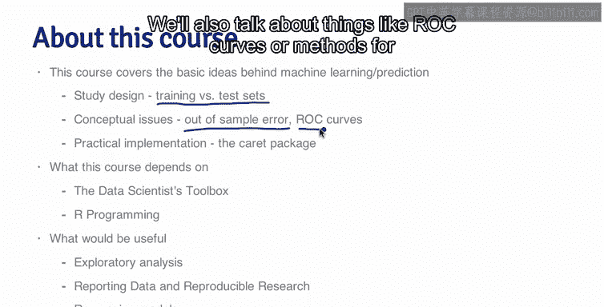

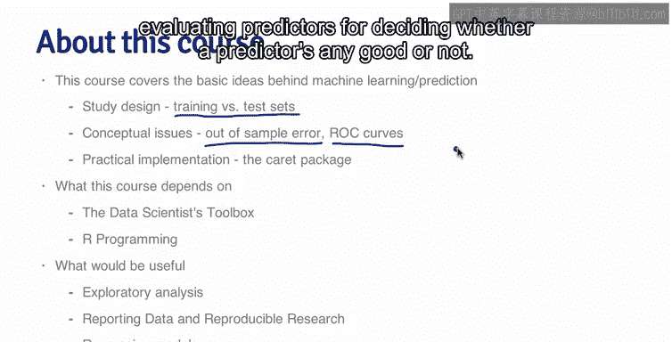

本课程将涵盖机器学习和预测的基本概念。我们的目标是**非常实用**且**注重动手实践**，以深入理解机器学习。

我们将介绍许多人使用的主流技术，例如**线性回归**和**随机森林**。同时，我们也会深入探讨在实际案例中进行机器学习时涉及的**具体细节**和**实际问题**。

我们将从研究设计的概念开始，例如**训练集**与**测试集**的划分，以及如何在真实数据中构建预测器。接着，我们会讨论一些概念性问题，如**样本外误差**和**过拟合**。你可能听说过，某些模型可能对数据中的噪声过于敏感，导致在新样本上预测效果不佳。我们将探讨如何预防这类问题。

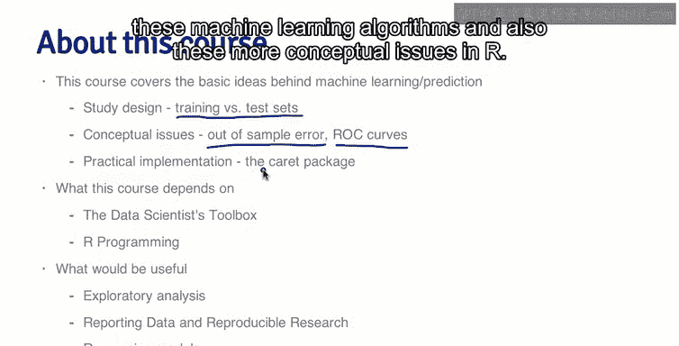

我们还将讨论诸如**ROC曲线**等方法，用于评估预测器的性能，判断其是否有效。

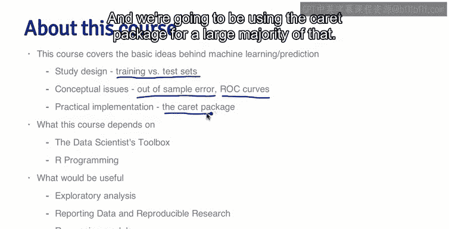

---

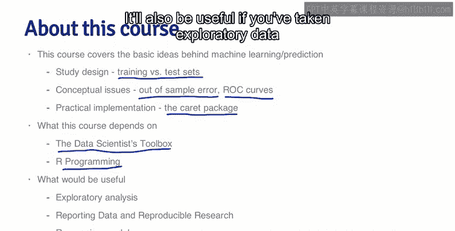

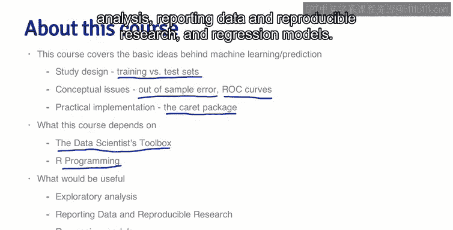

## 实践工具与预备知识 ⚙️

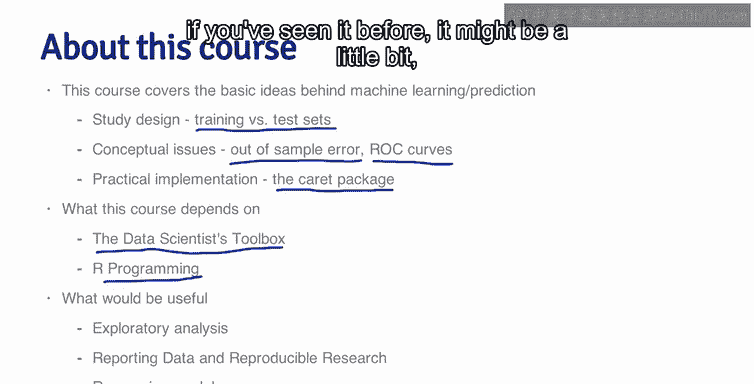

我们将重点在R语言中实践这些机器学习算法，并探讨上述概念性问题。我们将大量使用 **`caret`** 软件包。

`caret` 包是一个优秀的统一框架，整合了R中许多由不同开发者构建的机器学习包。这些包有不同的参数和设计选择，而`caret`包为它们提供了一个统一的接口。

本课程相当依赖于你在《数据科学家工具箱》和《R编程》课程中学到的工具。如果你尚未学习这些课程，强烈建议你在学习本课程前先完成它们。

如果你学习过《探索性数据分析》、《可重复性研究》和《回归模型》课程也会很有帮助。这些课程并非强制要求，但本课程的许多内容与之相关。提前了解这些知识会让你在学习本课程时更轻松。

---

## 谁在进行预测？🌍

这是一个重要的问题，也是本课程的重要动机。基本上，如今大多数组织都在以某种形式使用机器学习，从简单到非常复杂的形式都有。

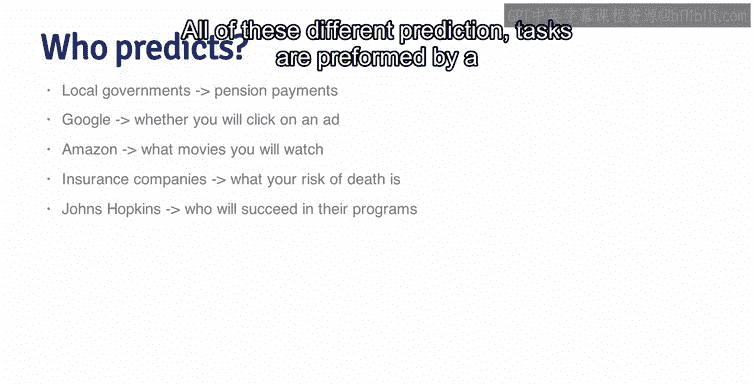

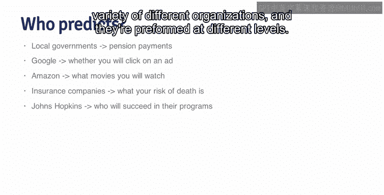

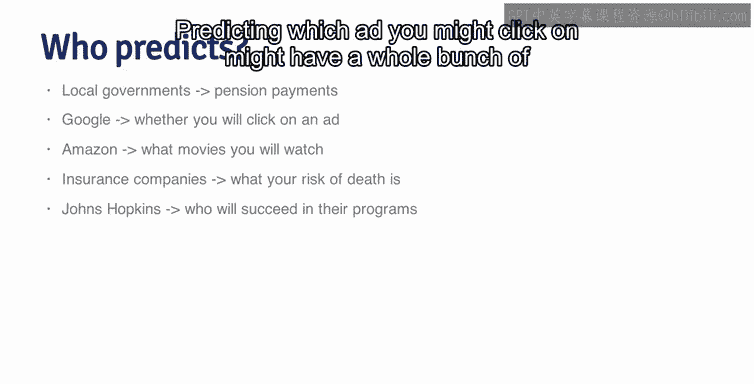

以下是几个例子：

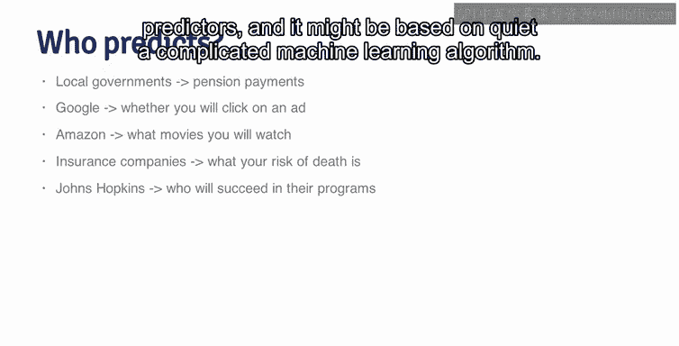

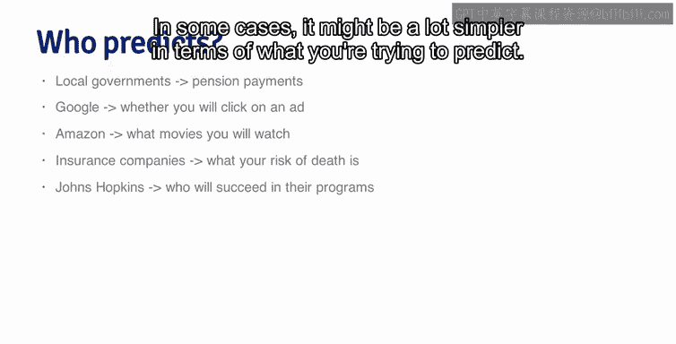

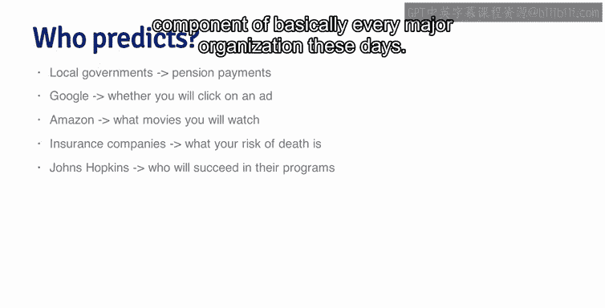

*   **地方政府**：可能尝试预测未来的养老金支付，以了解其财政收入机制是否足以覆盖这些支出。
*   **谷歌**：可能希望预测你是否会点击某个广告，以便只向你展示最有可能获得点击的广告，从而增加收入。
*   **亚马逊和网飞**：向你展示了一部电影后，希望你购买下一部。为此，它们需要预测你可能感兴趣的内容，以保持你的观看兴趣，进而增加收入。
*   **保险公司**：雇佣大量的精算师和统计学家，试图预测你在各种情况下的风险（包括死亡），以确定设定保险费率的合适价格。
*   **约翰霍普金斯大学**：可能希望预测哪些申请者最有可能在项目中取得成功。

所有这些不同的预测任务由各种组织执行，其复杂程度也不同。有些非常复杂，例如预测你可能点击哪个广告，可能涉及大量预测变量和复杂的算法；有些则相对简单。无论如何，预测已成为当今几乎所有主要组织的重要组成部分。

---

## 为何要进行预测？💡

进行预测的原因有很多。

首先，是**荣誉与认可**。例如，Chris Fenssky是赢得“网飞奖”的团队成员之一。该奖项提供100万美元，奖励给能最佳预测用户可能感兴趣的新电影的团队。赢得此类竞赛会带来极大的荣誉。

其次，是**经济利益**。不仅在于组织可以通过优化预测（如预测广告点击）来赚取大量金钱，竞赛本身也提供丰厚奖金。例如，“Heritage健康奖”提供了300万美元，用于奖励能最佳预测谁将在一年内住院的团队。虽然无人赢得全额大奖，但参与者在阶段性奖励中获得了可观的收入。一些人甚至基于在竞赛中的表现创立了分析公司。

如今，数据科学，尤其是预测，已经成为一种**竞技运动**。Kaggle等组织主办各种预测竞赛，参与者尝试预测特定实验的结果或各种事物。这些竞赛通常有固定的时间限制和奖金，并设有排行榜，充满竞争乐趣。

---

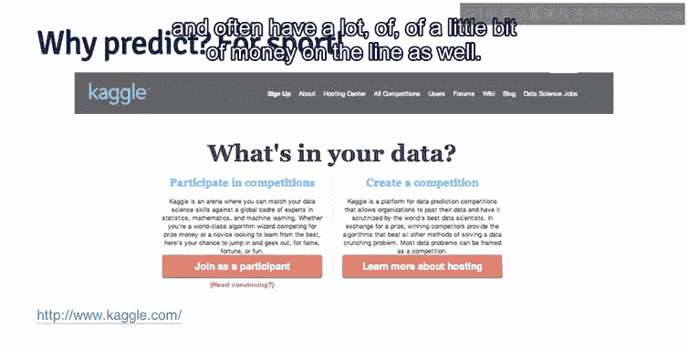

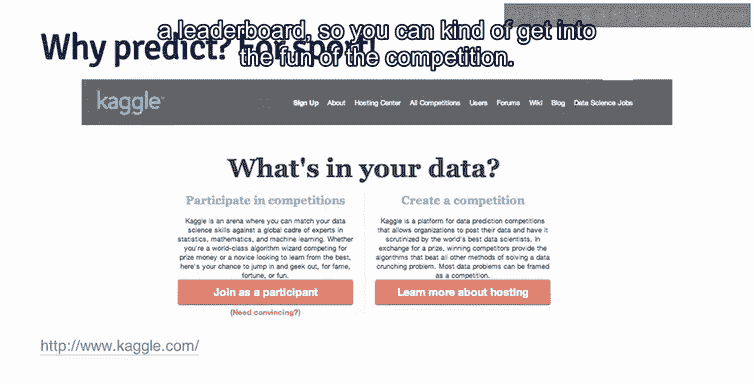

## 预测在医学与学习资源中的应用 🏥📖

预测也应用于**改善医疗决策**。例如，Oncotype DX是一种预后基因表达特征，可用于预测患有乳腺癌的女性在特定条件下的生存期。这对医生为乳腺癌患者制定治疗方案非常有帮助。

这里推荐一本非常有用的书：《统计学习基础》。这本书的内容对本课程而言可能有些深入，但其介绍的许多工具仍然极其有用。你可以在作者网站上免费获取PDF版本，但如果你喜欢这本书，也鼓励你购买以支持作者的辛勤工作。

---

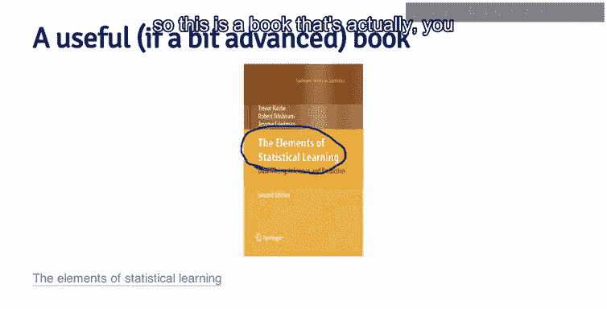

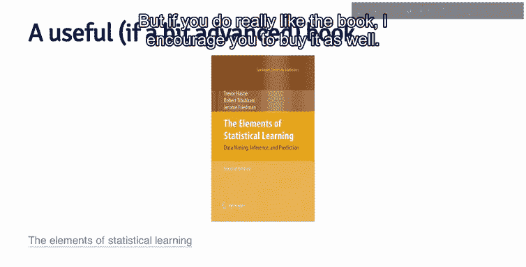

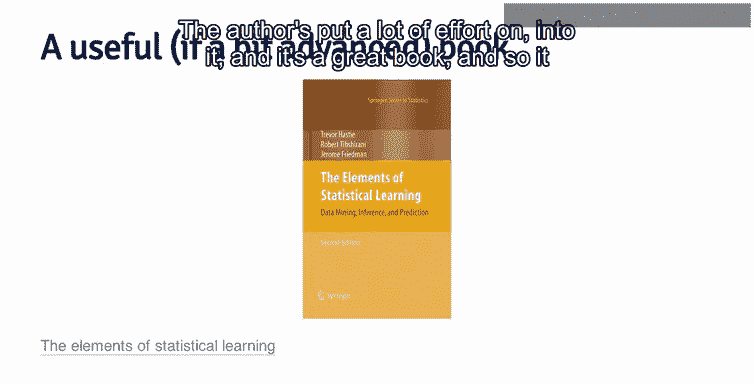

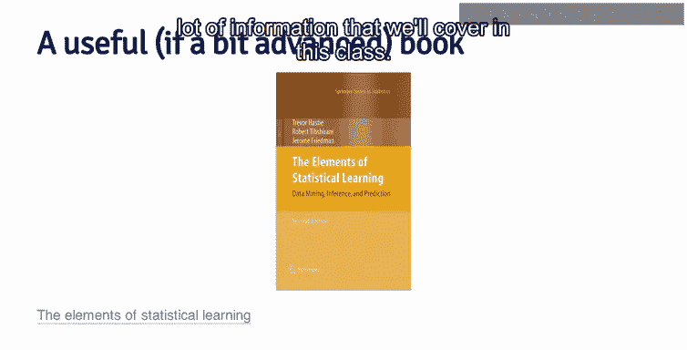

## 核心工具与进阶学习 🛠️

本课程将主要使用 **`caret`** 软件包。它整合了R中大量已构建的预测器，并允许你在一个统一的框架中设置训练集和测试集，从而避免构建预测模型时出现的许多问题。

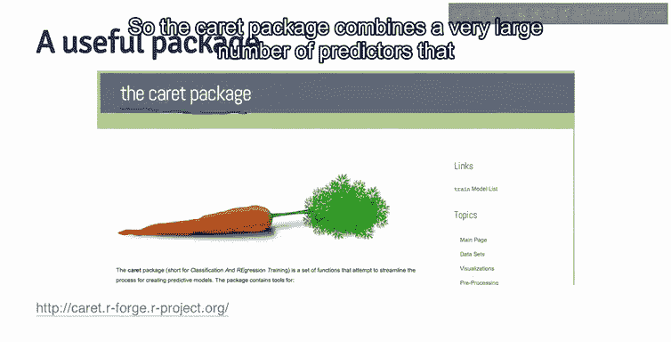

如果你想学习更进阶的内容，可以关注Coursera上的《机器学习》课程。所谓进阶内容，包括这些算法背后的更多数学细节，或处于前沿的高级机器学习算法。本课程将为你学习这些内容打下坚实基础。

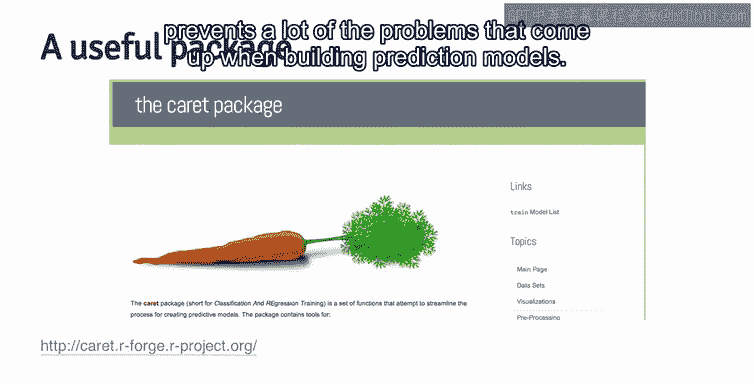

本课程将**涵盖基础知识**，并致力于让你实现从“0到60”的跨越。换句话说，它将使你达到可以在日常工作中使用机器学习工具的水平，但不会涵盖所有机器学习算法的顶级细节。

---

## 丰富的学习资源 🔗

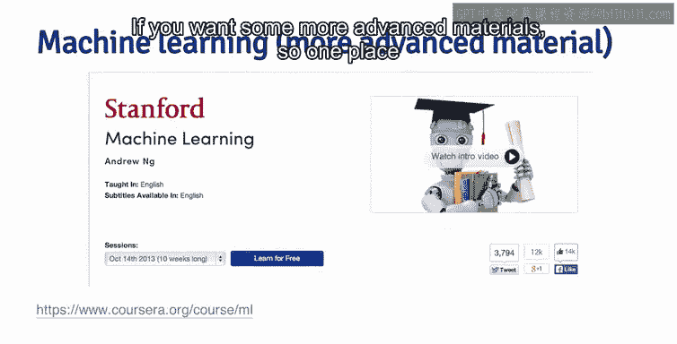

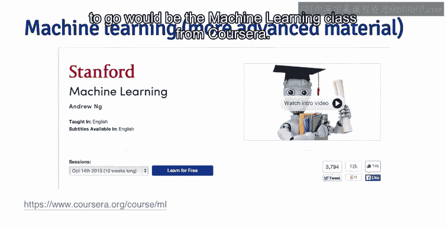

目前关于机器学习的信息非常丰富，这是一个非常热门的话题。网上有大量资源，例如来自Science、MIT、CMU和Kaggle的链接，提供了多种进行机器学习的方法。如果本课程激发了你的兴趣，并让你对这些其他资源感到兴奋，那将是非常好的事情。

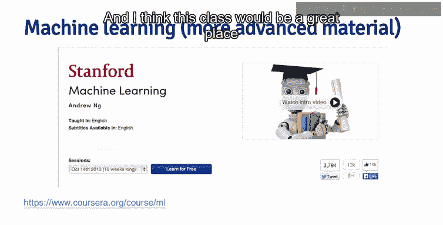

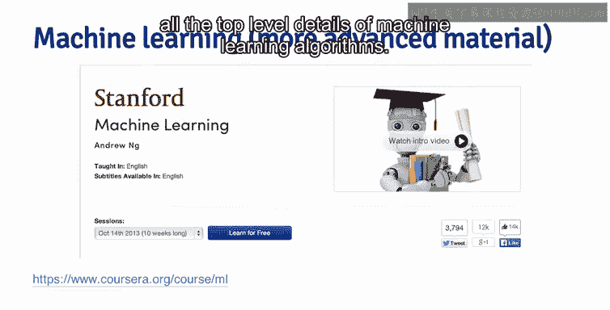

---

## 总结 ✨

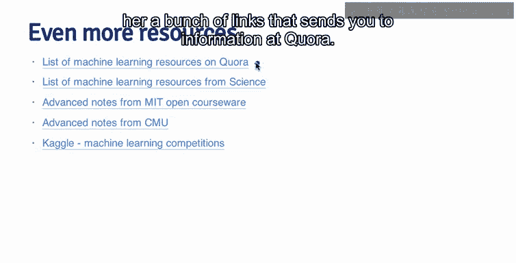

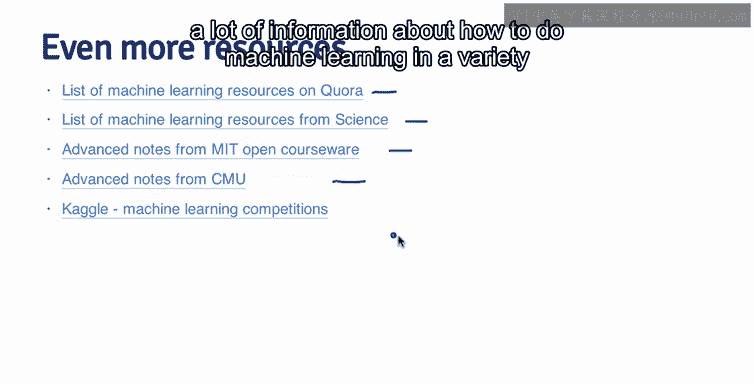

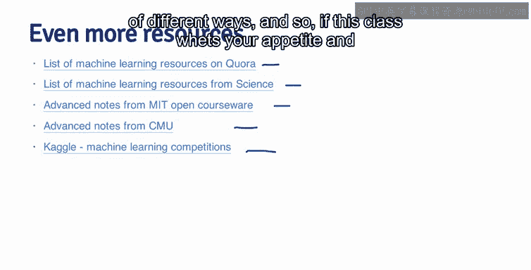

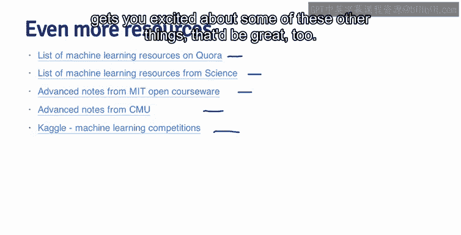

本节课我们一起学习了《实际机器学习》课程的动机与概览。我们了解了预测在数据科学中的核心地位、本课程将涵盖的**线性回归**、**随机森林**等主要技术，以及**过拟合**、**ROC曲线**等关键概念。我们明确了课程将大量使用R语言和 **`caret`** 包进行实践，并探讨了预测在商业、医疗等领域的广泛应用。最后，我们指出了进一步学习的方向和可用资源。接下来，我们将开始深入具体的机器学习方法。