# 课程8：实际机器学习 🧠 - P25：组合预测因素

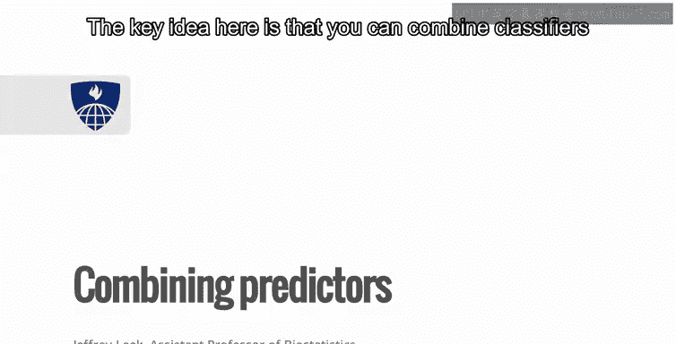

在本节课中，我们将要学习如何组合不同的预测模型，这种方法有时被称为集成方法。我们将探讨其核心思想、优势、具体实现步骤以及需要注意的事项。

## 概述 📋

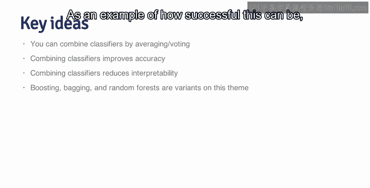

组合预测模型的核心思想是，通过对多个分类器的预测结果进行平均或投票，来获得一个更优的最终预测。这些分类器可以是完全不同的类型，例如，可以将提升（Boosting）分类器、随机森林和线性回归模型组合在一起。通常，组合模型能提高预测准确性，但可能会降低模型的可解释性。

上一节我们介绍了单一模型的应用，本节中我们来看看如何将它们组合起来发挥更大作用。


## 核心思想与优势 🎯

组合预测模型的基本原理类似于“多数投票”。假设我们有五个完全独立的分类器，每个分类器的准确率为70%。通过多数投票机制（即五个分类器中至少有三个预测正确），组合后的准确率可以提升至83.7%。如果有101个独立分类器，组合后的准确率甚至可以达到99.9%。

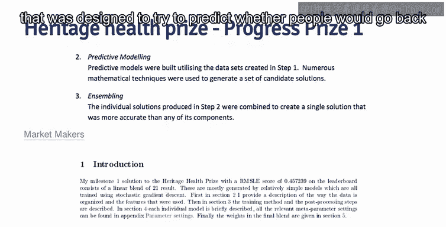

这种方法在实践中非常成功。例如，Netflix百万美元大奖赛的获胜团队，就是通过组合107个不同的机器学习算法来获得最佳成绩的。同样，Heritage Health Prize（一项300万美元的竞赛）的获胜方案也采用了集成多个不同回归模型和机器学习方法的技术。

## 组合模型的方法 🔧

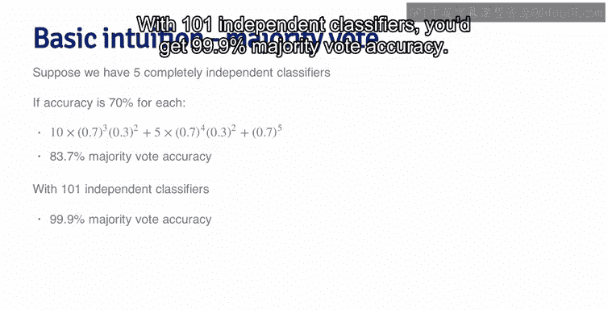

以下是两种主要的组合分类器的方法：

*   **使用同类分类器组合**：例如，通过装袋法（Bagging）、提升法（Boosting）或随机森林（Random Forest）来组合多个相同类型的分类器。
*   **使用不同分类器组合**：通过模型堆叠（Model Stacking）或模型集成（Model Ensembling）来组合不同类型的分类器。本节课我们将重点讨论模型堆叠。

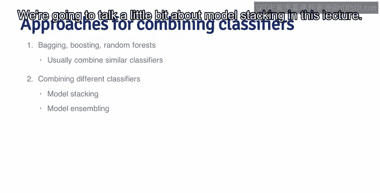

## 实战示例：组合GLM与随机森林 💻

让我们通过一个工资数据（`wage`）的示例来具体说明。首先，我们准备数据，排除`log wage`变量（因为它会是预测`wage`的强相关变量，不利于演示），并将数据分为三个部分：
*   **训练集**：用于构建初始模型。
*   **测试集**：用于“混合”或堆叠不同的模型预测。
*   **验证集**：用于最终评估组合模型的性能。

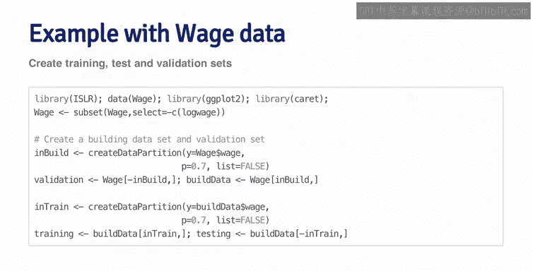

**数据准备代码**：
```r
# 假设df是包含wage和其他变量的数据框
# 移除log wage列
df <- subset(df, select = -c(logwage))

# 划分数据集（示例比例）
set.seed(123)
trainIndex <- createDataPartition(df$wage, p = .6, list = FALSE)
train <- df[ trainIndex,]
temp <- df[-trainIndex,]

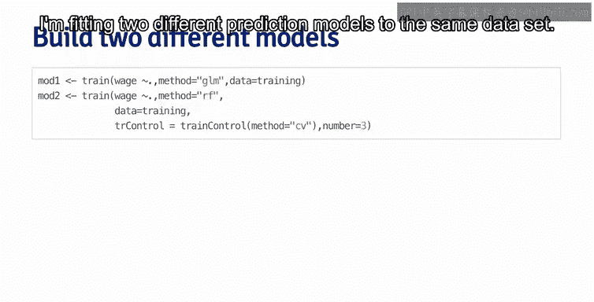

testIndex <- createDataPartition(temp$wage, p = .5, list = FALSE)
test <- temp[ testIndex,]
validation <- temp[-testIndex,]
```

接下来，我们在训练集上构建两个不同的模型：
1.  一个广义线性模型（GLM）。
2.  一个随机森林模型。

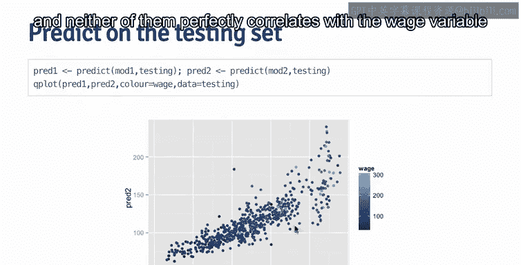

**构建模型代码**：
```r
# 模型1: 广义线性模型 (GLM)
model1 <- train(wage ~ ., data = train, method = "glm")

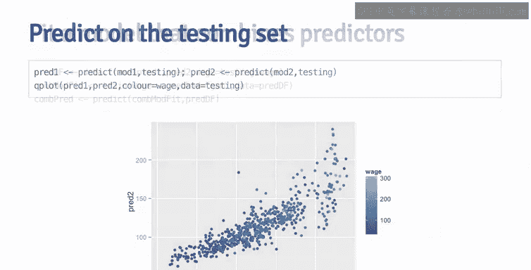

# 模型2: 随机森林
model2 <- train(wage ~ ., data = train, method = "rf")
```

然后，我们使用测试集来“混合”这两个模型。具体步骤是：
1.  用两个模型分别对测试集进行预测，得到两组预测值（`pred1`, `pred2`）。
2.  创建一个新的数据框，包含这两组预测值作为特征，以及真实的`wage`值作为目标变量。
3.  在这个新数据上拟合一个“组合模型”（例如另一个线性模型），学习如何最优地结合`pred1`和`pred2`来预测`wage`。

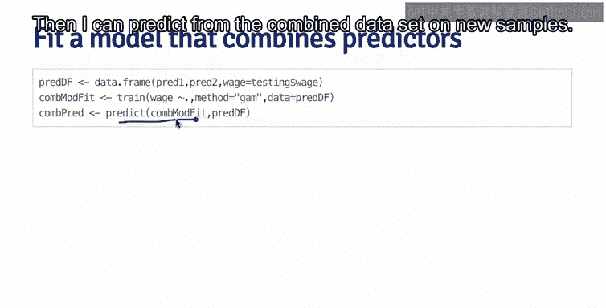

**模型堆叠代码**：
```r
# 在测试集上进行预测
pred1 <- predict(model1, newdata = test)
pred2 <- predict(model2, newdata = test)

# 创建用于堆叠的新数据框
stackData <- data.frame(pred1, pred2, wage = test$wage)

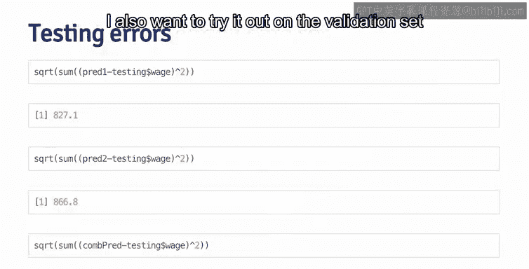

# 拟合组合模型（例如线性回归）
combinedModel <- lm(wage ~ pred1 + pred2, data = stackData)
```

最后，我们在未参与任何模型训练的验证集上评估性能。分别计算单一模型和组合模型的预测误差（如均方根误差RMSE）。

**验证评估**：
```r
# 在验证集上进行预测
val_pred1 <- predict(model1, newdata = validation)
val_pred2 <- predict(model2, newdata = validation)

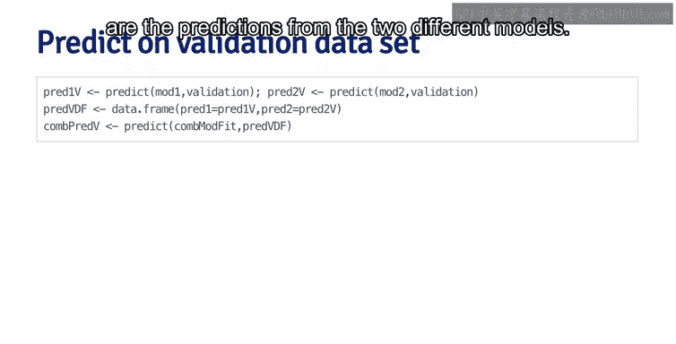

# 使用组合模型对验证集的预测结果进行“再预测”
val_stackData <- data.frame(pred1 = val_pred1, pred2 = val_pred2)
final_pred <- predict(combinedModel, newdata = val_stackData)

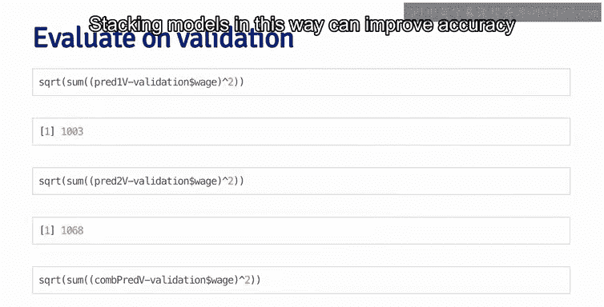

# 计算误差
error1 <- RMSE(val_pred1, validation$wage)
error2 <- RMSE(val_pred2, validation$wage)
error_combined <- RMSE(final_pred, validation$wage)

# 通常结果会显示：error_combined < error1 且 error_combined < error2
```
在这个例子中，组合模型的预测误差通常低于任何一个单一模型的误差，这证明了模型堆叠的有效性。

## 注意事项与总结 ⚠️

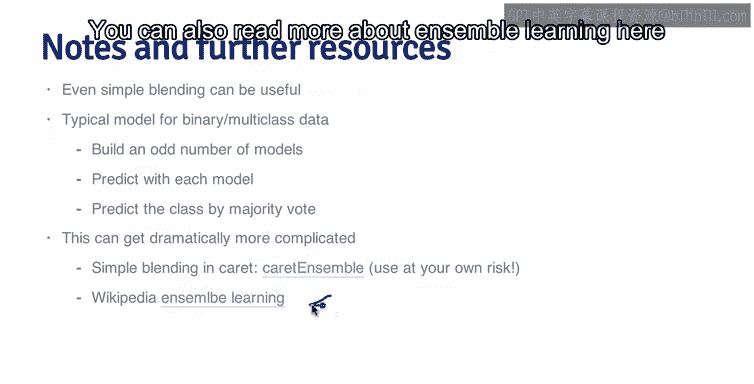

虽然组合模型能提升精度，但需要考虑以下几点：

*   **可解释性降低**：组合模型（尤其是复杂集成）比单一模型更难以解释。
*   **计算复杂度增加**：训练和部署多个模型需要更多的计算资源和时间。著名的Netflix百万美元大奖解决方案就因计算过于密集而从未被实际部署。
*   **过拟合风险**：如果组合过程不当（例如，使用测试集信息进行模型选择或参数调整），可能会在未知数据上表现不佳。因此，使用独立的验证集进行评估至关重要。

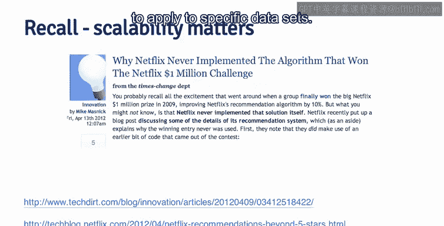

本节课中我们一起学习了组合预测模型（集成学习）的核心概念与方法。我们了解到，通过像多数投票或模型堆叠这样的策略，可以有效地整合不同模型的优势，从而获得更稳健、更准确的预测结果。同时，我们也认识到在追求高精度的过程中，需要权衡可解释性与计算成本。