# 课程8：实际机器学习 🧠 - P9：应该使用什么数据

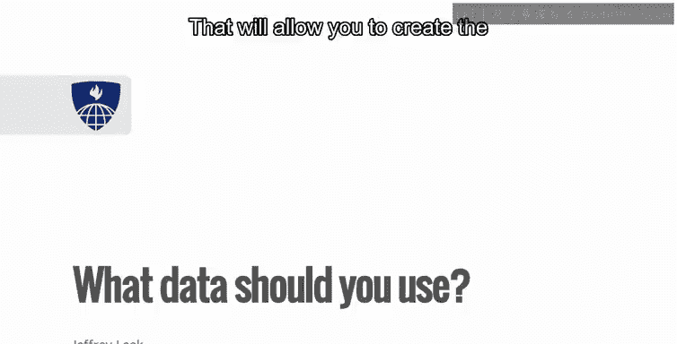

在本节课中，我们将要学习如何为机器学习算法选择最合适的数据集。定义好研究问题后，最关键的一步就是找到能够帮助你做出最佳预测的数据。

## 概述：数据选择的核心原则

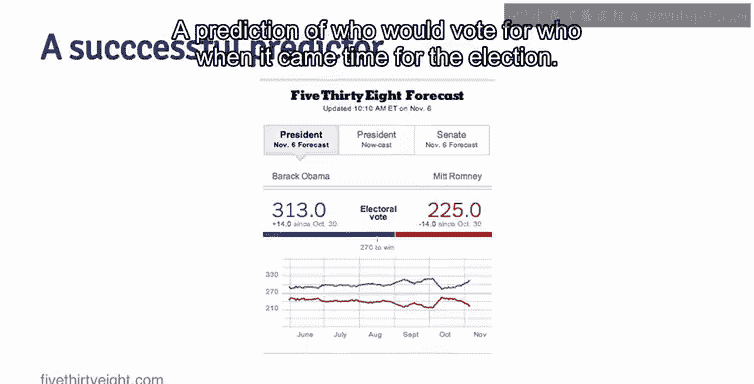

上一节我们讨论了如何定义研究问题，本节中我们来看看如何为这个问题寻找数据。核心原则是：**尽可能使用与预测目标最直接相关的数据**。这通常被称为“用同类数据预测同类结果”。

## 用同类数据预测同类结果 📊

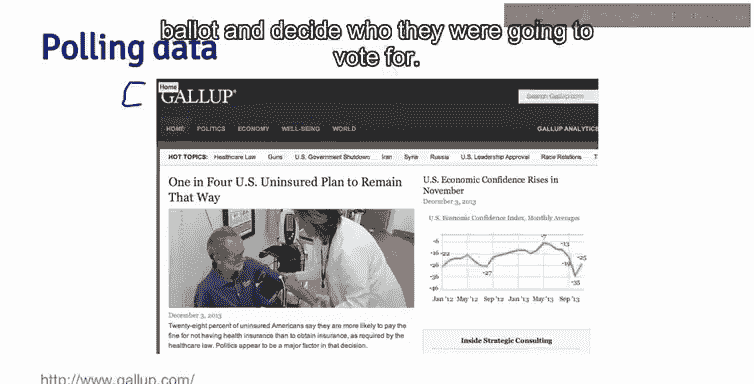

一个非常成功的预测案例是美国的“538”博客。它旨在建立一个选举预测模型，以预测美国总统大选及其他选举的结果。

统计学家内特·西尔弗（Nate Silver）使用了来自各种民意调查的数据，并将它们汇总平均，以试图获得谁将赢得选举的最佳预测。他成功地预测了2008年和2012年的选举。

以下是他的成功关键点：
*   **数据来源**：他使用了盖洛普等机构的民意调查数据，这些数据直接询问人们“你可能会在即将到来的选举中投票给谁”。
*   **数据处理**：他识别了数据的质量差异，意识到某些民调可能存在偏向性。因此，他根据民调的准确性和无偏性对数据进行了加权处理。

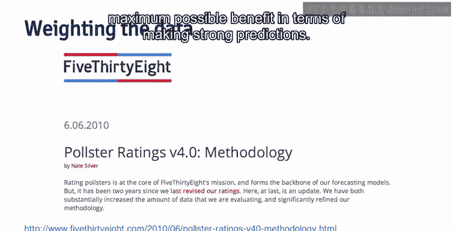

这个例子表明，找到正确的数据集，并结合对实际情况的科学理解，可以最大程度地提升预测的准确性。

## 更多成功案例 ⚾️🎬

这个“用同类数据预测同类结果”的原则在许多领域都得到了验证。

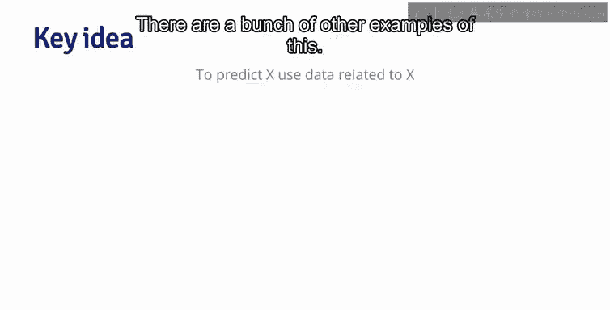

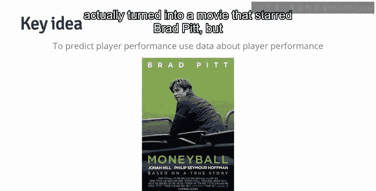

**1. 点球成金（Moneyball）**
这个案例后来被拍成了由布拉德·皮特主演的电影。其核心是预测棒球运动员的表现，特别是他们能为球队赢得多少比赛。预测方法是使用该球员过去的表现数据，以及其他类似球员的历史数据。

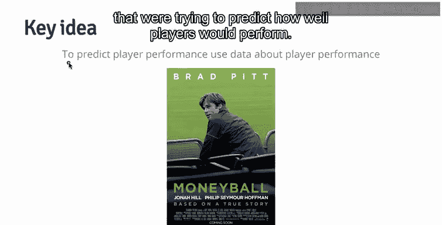

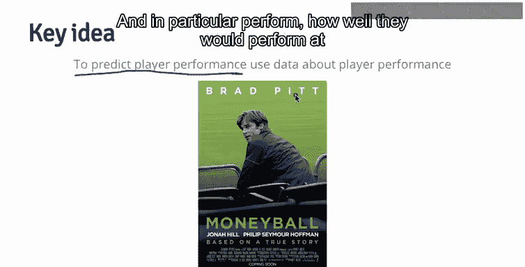

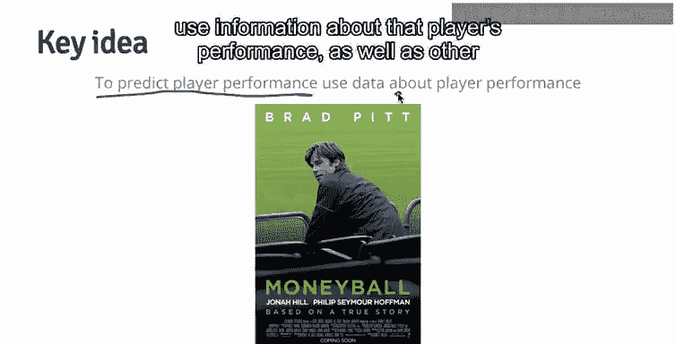

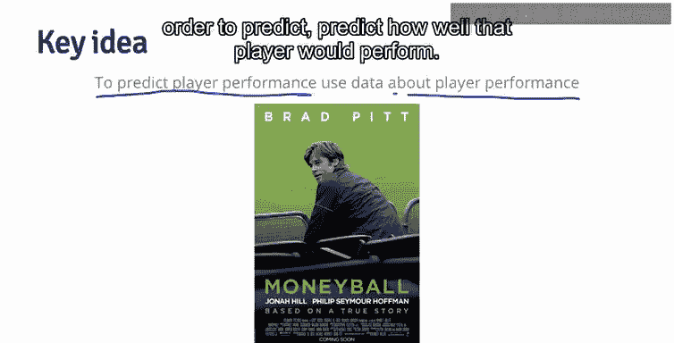

**2. Netflix 大奖赛**
目标是预测用户的电影偏好。他们基于用户过去的电影评分数据来预测其未来的喜好。

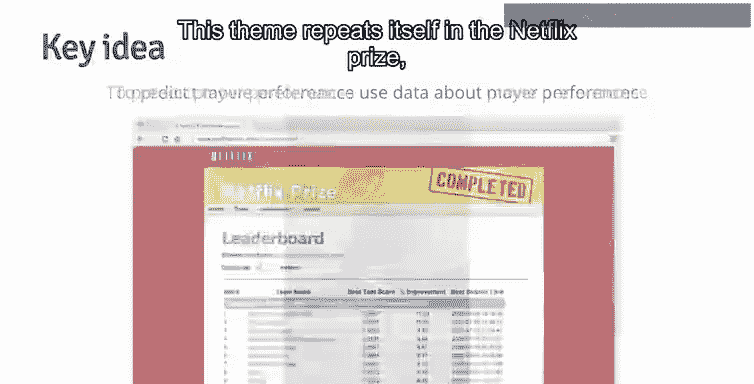

**3. Heritage Health 健康奖**
目标是预测哪些人可能会住院。他们使用了这些人过去的住院记录数据。

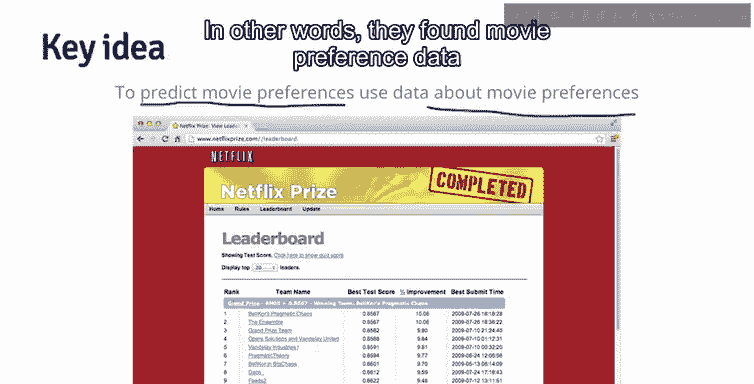

这些案例的共同点是：**使用的数据与未来要预测的过程完全相同**。你使用的数据与你关心的过程越接近，你的预测效果通常就越好。

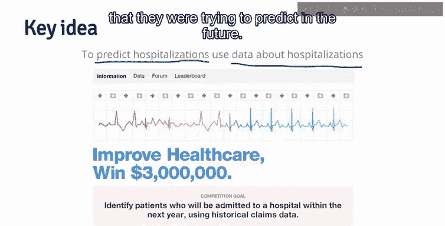

## 关联性较弱的数据与潜在风险 ⚠️

然而，这并非一条绝对的硬性规则。有时，人们会使用关联性较弱的数据进行预测。

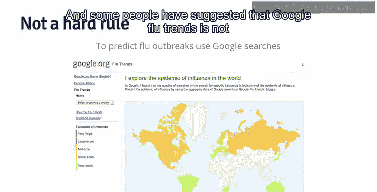

一个著名的例子是使用**谷歌搜索趋势来预测流感爆发**。但最近有人指出这种方法存在重大缺陷：如果人们的搜索行为发生变化，或者这些搜索与流感之间的关联性质发生改变，预测结果就会严重偏离。一些人认为谷歌流感趋势并非估计流感流行程度的可靠方法。

关联性越弱，预测可能就越困难。例如，Oncotype DX 是一种基于基因表达的预测算法（基因表达是体内分子活性的测量），用于预测乳腺癌患者在不同疗法下的生存情况。这里的关联性就相对松散一些。

**数据的性质至关重要**。例如，如果你使用美国疾控中心（CDC）的数据来测量流感样症状的高发人群，算法（如谷歌流感趋势）可能会高估流感病例数，如果某些无关因素导致人们搜索了类似的搜索词。

## 最常见的机器学习错误 🚫

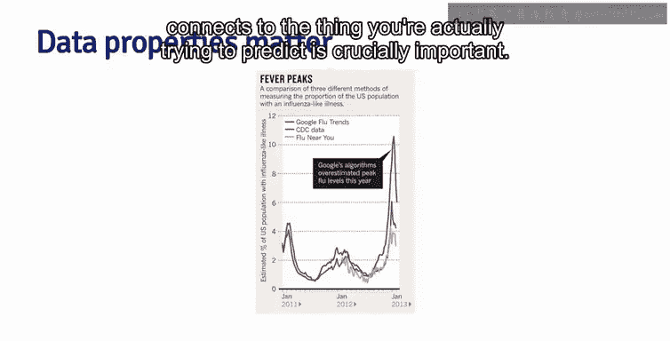

事实上，**不理解数据与预测目标之间的真实联系，是机器学习中最常见的错误**。机器学习常被看作一个黑箱过程：从一端输入数据，从另一端输出预测结果。

这是一个有点荒谬的预测例子，它来自《新英格兰医学杂志》上的一篇论文。他们在X轴上绘制了人均巧克力年消费量（公斤），在Y轴上绘制了每千万人口中的诺贝尔奖获得者数量。

图中显示了一个趋势：巧克力消费量越高，每百万人中获得诺贝尔奖的数量也倾向于越多。论文报告了R平方和P值，表明这是一个高度显著的关系。

但你可以想到，有许多其他变量可能将这两件事联系起来。例如，如果你来自欧洲，你可能吃更多巧克力（图中数据点大多是欧洲国家），而诺贝尔奖是由欧洲机构颁发的。因此，你可能会想象更多的欧洲人也获得了诺贝尔奖。这与巧克力本身预测你是否能获得诺贝尔奖的能力无关。

这个例子表明，如果你只是天真地建立一个预测算法，你可能会声称自己能够很好地预测。但如果相关特征发生变化（例如，诺贝尔委员会开始将更多奖项颁发给亚洲国家而非欧洲国家），你会发现这个预测算法将不再有效。

## 总结

本节课中，我们一起学习了为机器学习选择数据的关键原则。

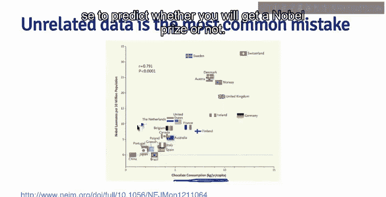

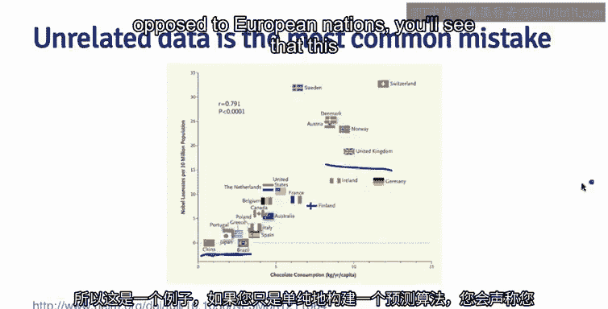

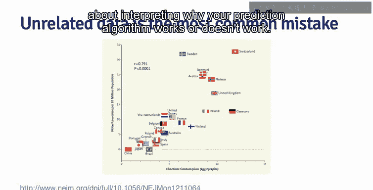

核心要点是：**尽可能使用同类数据来预测同类结果**。当你使用关联性不强的数据时，必须非常小心地解释你的预测算法为何有效或无效。理解数据与预测目标之间的真实联系，是构建可靠模型的基础，远比将算法视为黑箱更为重要。