# 005：Shiny应用中的输入与输出 📊

在本节课中，我们将学习如何使Shiny应用变得有用，即让它能够接收用户的输入值，进行R语言计算，然后将计算结果输出给用户。本节的核心是理解Shiny应用中输入与输出的基本连接方式。

---

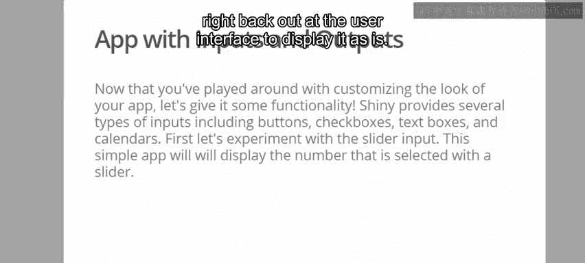

## 接收用户输入：创建滑块控件 🎚️

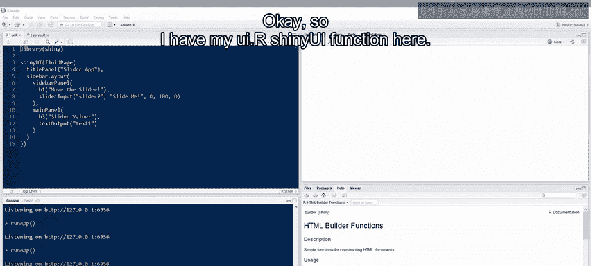

一个Shiny应用要发挥作用，首先需要能够接收用户的输入值。本节我们将创建一个简单的滑块控件，它位于用户界面中。用户通过滑块选择的值将被传递到服务器函数，然后服务器函数会原封不动地将该值返回，并在用户界面上重新显示出来。这是一个基础的构建练习，我们暂时不对输入值做任何处理，只是将其显示出来。

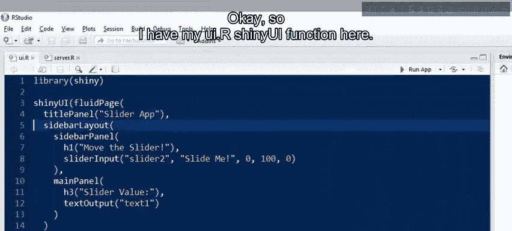

以下是创建滑块并显示其值的步骤：

1.  **在用户界面（UI）中创建滑块**：在`ui.R`文件的`sidebarLayout`函数内的`sidebarPanel`中，使用`sliderInput`函数创建一个滑块。我们需要为这个滑块指定一个ID（例如`slider2`），并设置其标签、取值范围和初始值。
    ```r
    sliderInput("slider2", "移动滑块：", min = 0, max = 100, value = 0)
    ```

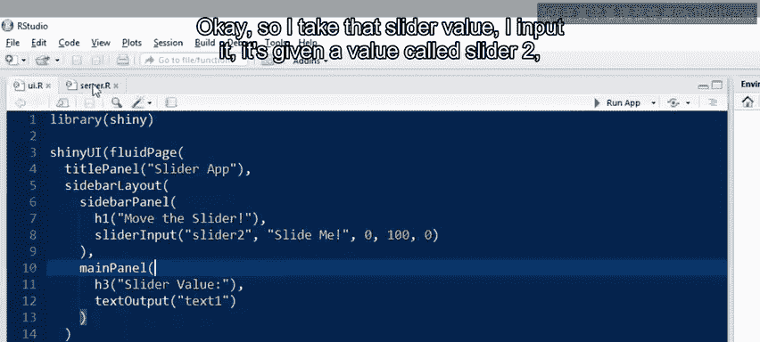

2.  **在服务器（Server）中获取输入值**：在`server.R`文件中，我们定义一个函数，它接收`input`和`output`作为参数。通过`input$slider2`可以访问用户在UI中通过滑块`slider2`输入的值。

3.  **在服务器中渲染输出**：我们使用`renderText`函数将获取到的输入值（`input$slider2`）转换为文本，并赋值给一个输出对象（例如`output$text1`）。
    ```r
    output$text1 <- renderText({ input$slider2 })
    ```

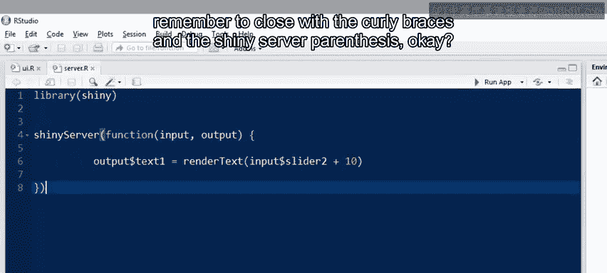

4.  **在用户界面中显示输出**：最后，回到`ui.R`文件，在`mainPanel`中使用`textOutput`函数，并指定要显示的输出对象ID（`"text1"`），这样服务器返回的文本就能在界面上显示出来。
    ```r
    textOutput("text1")
    ```

运行此应用后，用户移动滑块，滑块当前的值会实时显示在主面板中。这个过程是：滑块接收用户输入，该输入值被标记为`slider2`；服务器函数通过`input$slider2`获取该值，然后通过`output$text1`将其输出；UI再通过`textOutput("text1")`将其显示出来。

---

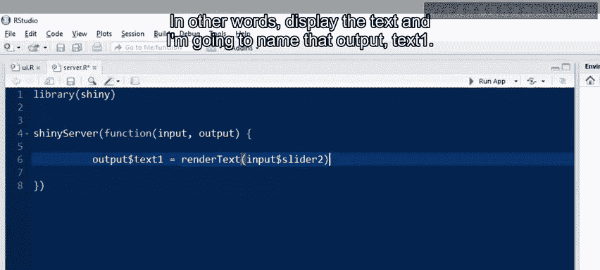

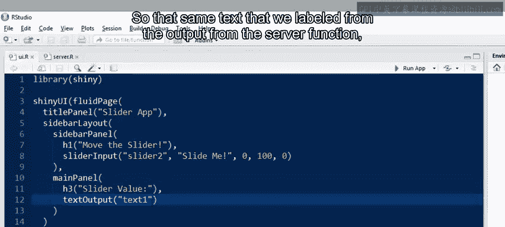

## 理解Shiny的响应式编程 🔄

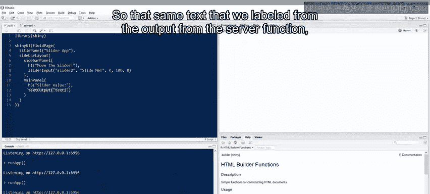

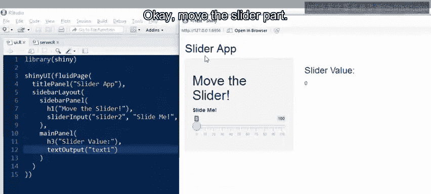

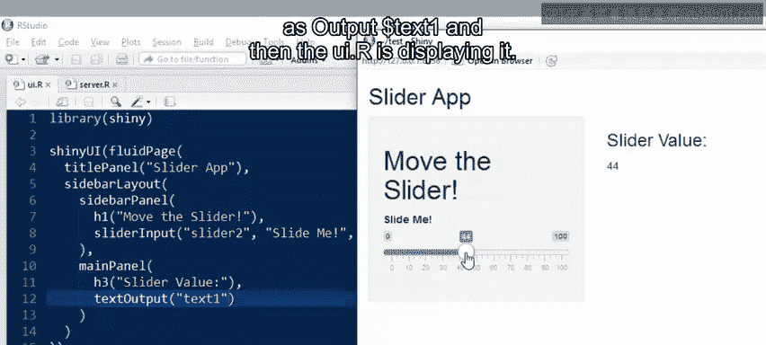

上一节我们介绍了输入与输出的基本连接。本节中我们来看看Shiny应用的一个重要特性：响应式编程。这与传统的线性R编程思维有所不同。

在Shiny中，**组件的布局顺序并不决定代码的执行顺序**。例如，滑块不一定非要放在侧边栏，输出也不一定非要放在主面板。你可以将滑块放在主面板，而将输出放在侧边栏。这是因为Shiny的服务器函数是“响应式”的，它会持续监听所有输入的变化。一旦任何输入（如滑块的值）发生变化，所有依赖于该输入的输出都会自动重新计算和更新，形成一个动态的、来回交互的循环，而不是从上到下执行一次就结束。

此外，**输入与输出之间的标签必须严格匹配**。如果UI中滑块的ID是`slider2`，那么服务器中就必须使用`input$slider2`来引用它；同样，如果服务器中输出的ID是`text1`，那么UI中就必须使用`textOutput("text1")`来显示它。如果标签不匹配，相应的功能将无法正常工作。

---

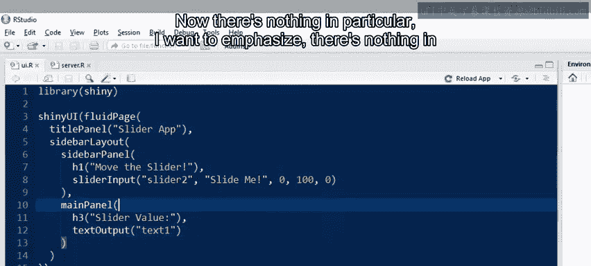

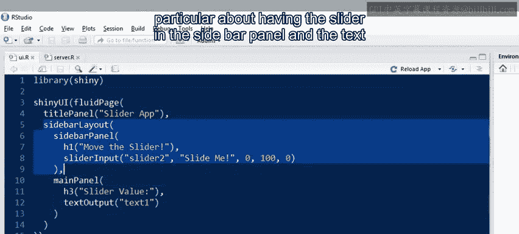

## 对输入值进行简单计算 ➕

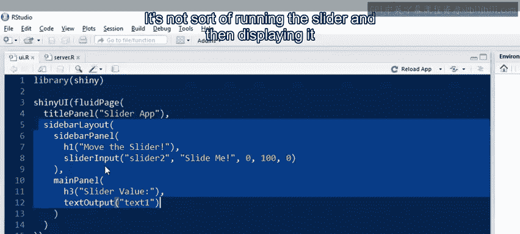

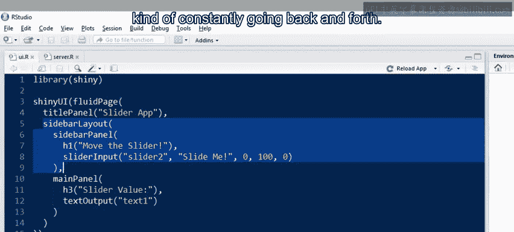

现在我们已经掌握了如何传递输入和输出。接下来，让我们尝试在服务器端对用户的输入值进行一些简单的R计算，而不仅仅是原样返回。

我们可以在服务器函数的`renderText`中对输入值进行操作。例如，将滑块的值加上10后再输出：

```r
output$text1 <- renderText({
    input$slider2 + 10
})
```

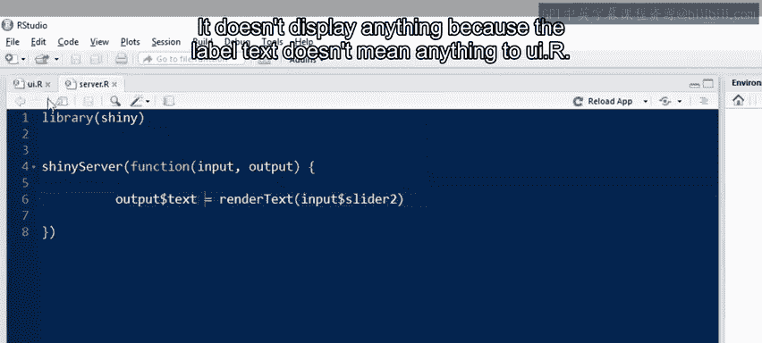

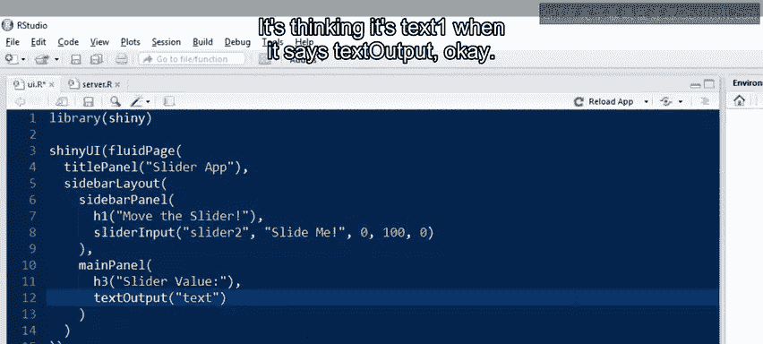

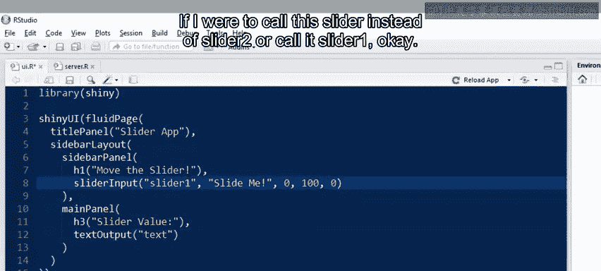

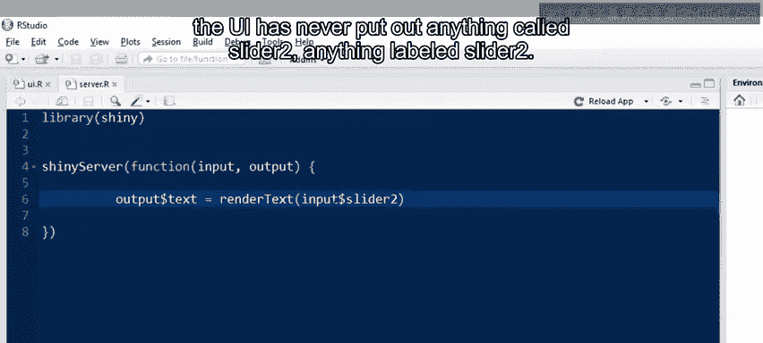

这样，当用户选择滑块值为29时，应用显示的结果将是39。虽然这只是一个非常简单的加法操作，但它演示了Shiny应用的核心流程：**从用户界面接收输入，在服务器端用R代码处理该输入，然后将处理后的结果发送回用户界面进行显示**。所有这些步骤都是响应式地自动完成的。

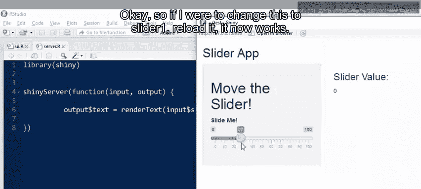

你可以尝试创建其他类型的输入控件（如下拉框、复选框、按钮等），获取其输入值，并进行各种计算后再显示出来，以此熟悉整个流程。

---

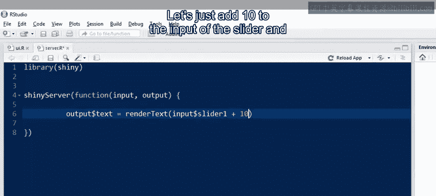

## 总结 📝

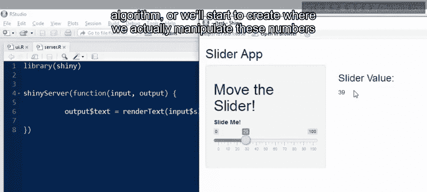

本节课中，我们一起学习了Shiny应用处理输入与输出的基本方法。我们首先创建了一个滑块控件来接收用户输入，并理解了如何将输入值从UI传递到Server，再通过Server处理后输出回UI显示。我们探讨了Shiny响应式编程的特点，即代码执行不依赖于布局顺序，而是由输入的变化驱动。最后，我们实践了对输入值进行简单的R计算（如加法），完成了从输入、处理到输出的完整闭环。这是构建交互式数据产品的基础。